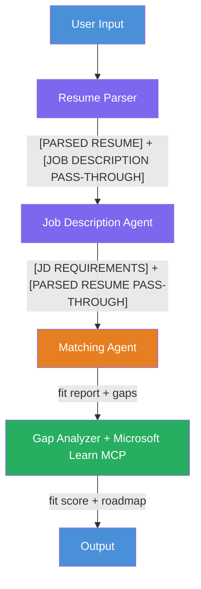

# Εργαστήριο 02 - Ροή Εργασίας Πολυ-Πράκτορα: Αξιολογητής Εφαρμογής Βιογραφικού σε Θέση Εργασίας

## Επισκόπηση

Σε αυτό το πρακτικό εργαστήριο, θα δημιουργήσετε μια **εφαρμογή πολυ-πράκτορα που βασίζεται στη ροή εργασίας** χρησιμοποιώντας το Foundry Toolkit στο VS Code και θα την αναπτύξετε στην υπηρεσία Microsoft Foundry Agent.

**Τι θα δημιουργήσετε:** έναν Αξιολογητή Εφαρμογής Βιογραφικού σε Θέση Εργασίας που αναλύει βιογραφικό και περιγραφή θέσης εργασίας, βαθμολογεί τη συμβατότητα και παράγει έναν εξατομικευμένο οδικό χάρτη μάθησης χρησιμοποιώντας πόρους Microsoft Learn.

---

## Αρχιτεκτονική

**Πώς λειτουργεί:**
1. Ο χρήστης επικολλά ένα βιογραφικό και μια περιγραφή θέσης εργασίας.
2. Ο **ResumeParser** αναλύει το βιογραφικό και αντιγράφει την περιγραφή θέσης αυτούσια σε μια ενότητα `[JOB DESCRIPTION PASS-THROUGH]`.
3. Ο **JD Agent** εξάγει δομημένες απαιτήσεις από το πέρασμα, στη συνέχεια προωθεί το `[PARSED RESUME]` ως `[PARSED RESUME PASS-THROUGH]`.
4. Ο **MatchingAgent** συγκρίνει `[PARSED RESUME PASS-THROUGH]` με `[JD REQUIREMENTS]` και παράγει μια βαθμολογία συμβατότητας.
5. Ο **GapAnalyzer** μετατρέπει τα κενά σε μια πρακτική οδό και αντλεί πραγματικούς συνδέσμους Microsoft Learn μέσω MCP.

---

## Προαπαιτούμενα

Ολοκληρώστε πρώτα το Εργαστήριο 01:

- [Εργαστήριο 01 - Μονός Πράκτορας](../lab01-single-agent/README.md)

---

## Μέρος 1: Διαβάστε τις ενότητες με τη σειρά

Δείτε την πλήρη διαδρομή μάθησης στο:

- [Έγγραφα Εργαστηρίου 2 - Προαπαιτούμενα](docs/00-prerequisites.md)
- [Έγγραφα Εργαστηρίου 2 - Πλήρης Διαδρομή Μάθησης](docs/README.md)
- [Οδηγός εκτέλεσης PersonalCareerCopilot](PersonalCareerCopilot/README.md)

---

## Μέρος 2: Δημιουργήστε και δοκιμάστε τη ροή εργασίας

1. Χρησιμοποιήστε τον οδηγό Foundry Toolkit για να δημιουργήσετε το έργο με βάση τη ροή εργασίας.
2. Αντιγράψτε τα μπλοκ των προτροπών και το γράφημα ροής εργασίας από `PersonalCareerCopilot/main.py` στον χώρο εργασίας σας.
3. Τρέξτε το τοπικά με τον Επιθεωρητή Πράκτορα και επαληθεύστε και τους τέσσερις πράκτορες συν το εργαλείο MCP.
4. Αναπτύξτε τον φιλοξενούμενο πράκτορα στη Foundry όταν οι τοπικές δοκιμές περάσουν.

---

## Σχέδια Ορχήστρωσης

Το Εργαστήριο 02 χρησιμοποιεί μια **διαδοχική ροή εργασίας**: το αποτέλεσμα κάθε πράκτορα τροφοδοτεί τον επόμενο και η ροή επιστρέφει την τελική απάντηση του πράκτορα. Δύο σχέδια το καθιστούν δυνατό:

- **Διαδοχική αλυσίδα** - το `WorkflowBuilder` συνδέει το ResumeParser → JD Agent → MatchingAgent → GapAnalyzer με μία κλήση `add_edge()` ανά βήμα
- **Μεταφορά περιεχομένου** - επειδή κάθε πράκτορας βλέπει μόνο την έξοδο του άμεσου προκατόχου του, ο ResumeParser και ο JD Agent αντιγράφουν τα δεδομένα που χρειάζονται οι κατερχόμενοι πράκτορες σε επισημασμένες ενότητες περάσματος

Τα έγγραφα εξηγούν επίσης γιατί το εργαστήριο δεν χρησιμοποιεί fan-out/fan-in και πώς να επεκτείνετε το γράφημα με έναν ακόμα πράκτορα.

Δείτε [docs/04-orchestration-patterns.md](docs/04-orchestration-patterns.md).

---

**Προηγούμενο:** [Εργαστήριο 01 - Μονός Πράκτορας](../lab01-single-agent/README.md) · **Πίσω σε:** [Αρχική Σελίδα Εργαστηρίου](../../README.md)

---

<!-- CO-OP TRANSLATOR DISCLAIMER START -->
**Αποποίηση ευθυνών**:
Αυτό το έγγραφο έχει μεταφραστεί χρησιμοποιώντας την υπηρεσία μετάφρασης με τεχνητή νοημοσύνη [Co-op Translator](https://github.com/Azure/co-op-translator). Ενώ επιδιώκουμε την ακρίβεια, παρακαλούμε να έχετε υπόψη ότι οι αυτοματοποιημένες μεταφράσεις ενδέχεται να περιέχουν λάθη ή ανακρίβειες. Το πρωτότυπο έγγραφο στη μητρική του γλώσσα πρέπει να θεωρείται η αυθεντική πηγή. Για κρίσιμες πληροφορίες, συνιστάται επαγγελματική ανθρώπινη μετάφραση. Δεν φέρουμε ευθύνη για τυχόν παρεξηγήσεις ή λανθασμένες ερμηνείες που προκύπτουν από τη χρήση αυτής της μετάφρασης.
<!-- CO-OP TRANSLATOR DISCLAIMER END -->