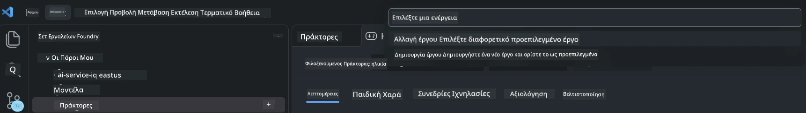

# Ενότητα 0 - Εισαγωγή

⏱️ ~10 λεπτά

> [!WARNING]
> **Προεπισκόπηση & Περιορισμοί:** [Hosted Agents](https://learn.microsoft.com/azure/foundry/agents/concepts/hosted-agents) βρίσκονται αυτήν την περίοδο σε **δημόσια προεπισκόπηση** - δεν συνιστώνται για εργασίες παραγωγής. Ορισμένες λειτουργίες που παρουσιάζονται σε αυτό το εργαστήριο ενδέχεται να αλλάξουν καθώς η υπηρεσία προχωρά προς GA.

## Τι θα δημιουργήσετε

Σε αυτό το εργαστήριο, επεκτείνετε τις δεξιότητες του μεμονωμένου πράκτορα από το Lab 01 για να δημιουργήσετε ένα **πολυπράκτορα ροής εργασίας** - τον Αξιολογητή Εφαρμογής Βιογραφικού → Θέσης Εργασίας.

Επικολλάτε ένα **βιογραφικό** και μια **περιγραφή εργασίας**. Τέσσερις εξειδικευμένοι πράκτορες επεξεργάζονται την είσοδο διαδοχικά, και μετά επιστρέφουν:
- Ένα σκορ καταλληλότητας (0–100 με ανάλυση σκοραρίσματος)
- Μια λίστα με κενά σε δεξιότητες και πιστοποιήσεις
- Έναν εξατομικευμένο οδικό χάρτη μάθησης με πραγματικούς συνδέσμους Microsoft Learn για κάθε κενό

**Η ροή εργασίας χρησιμοποιεί:**
- **Microsoft Agent Framework** - `WorkflowBuilder` για διαδοχικό συντονισμό pipeline
- **Foundry Toolkit για VS Code** - πλαίσιο εργασίας, τοπικός έλεγχος, ανάπτυξη
- **Ένα μοντέλο AI** (π.χ., `gpt-4.1-mini`) - που χρησιμοποιείται από όλους τους τέσσερις πράκτορες
- **Διακομιστής Microsoft Learn MCP** - παρέχει πραγματικούς συνδέσμους εκπαιδευτικών πόρων για κάθε κενό δεξιότητας

---

## Επιλέξτε τη διαδρομή σας

> ⚠️ **Συνεχίστε με την ίδια διαδρομή που χρησιμοποιήσατε στο Lab 01.**

<details open>
<summary><strong>🅰️ Διαδρομή Α - Azure cloud (απαιτεί συνδρομή Azure)</strong></summary>

| | Λεπτομέρειες |
|---|---|
| **Για ποιον είναι;** | Ολοκληρώσατε το Lab 01 χρησιμοποιώντας συνδρομή Azure |
| **Μοντέλο** | Azure OpenAI μέσω Foundry (π.χ., `gpt-4.1-mini`) |
| **Καλυπτόμενα modules** | Όλα τα modules (00–09) |
| **Ανάπτυξη στο cloud;** | ✅ Ναι - πλήρης ανάπτυξη end-to-end |

</details>

<details open>
<summary><strong>🅱️ Διαδρομή Β - Foundry Local (δεν απαιτείται συνδρομή Azure)</strong></summary>

| | Λεπτομέρειες |
|---|---|
| **Για ποιον είναι;** | Ολοκληρώσατε το Lab 01 χρησιμοποιώντας Foundry Local |
| **Μοντέλο** | Foundry Local (δωρεάν, τρέχει τοπικά στη συσκευή σας) |
| **Καλυπτόμενα modules** | Modules 00–05 (παραλείποντας 06–07 - ανάπτυξη & επαλήθευση cloud) |
| **Ανάπτυξη στο cloud;** | ❌ Όχι - μόνο τοπικός έλεγχος μέσω Agent Inspector |

</details>

---

## Έλεγχος Lab 01

Το Lab 02 χτίζεται απευθείας πάνω στο Lab 01. Ολοκληρώστε πρώτα το Lab 01 πριν ξεκινήσετε εδώ.

Δεν έχετε ολοκληρώσει το Lab 01; Ξεκινήστε εδώ: [Lab 01 - Εισαγωγή](../../lab01-single-agent/docs/00-prerequisites.md)

<details open>
<summary><strong>🅰️ Διαδρομή Α - Azure cloud</strong></summary>

```powershell
az account show --query "{name:name, id:id}" --output table
```

Αν αποτύχει, εκτελέστε `az login`. Μετά επιβεβαιώστε στο VS Code:

1. `Ctrl+Shift+P` → πληκτρολογήστε **Foundry Toolkit** → επιβεβαιώστε ότι εμφανίζονται οι εντολές.
2. Κάντε κλικ στο εικονίδιο **Foundry Toolkit** → το έργο και το αναπτυγμένο μοντέλο εμφανίζουν **Επιτυχία**.



> **RBAC:** Έχετε εκχωρήσει το ρόλο **Foundry User** στο Εργαστήριο 01. Εάν χρειάζεται να το επαναεκχωρήσετε, δείτε [Εργαστήριο 01, Ενότητα 1](../../lab01-single-agent/docs/01-setup.md#deploy-a-model--assign-rbac). Ο ρόλος προηγουμένως ονομαζόταν **Azure AI User** - με τις ίδιες άδειες.

</details>

<details open>
<summary><strong>🅱️ Διαδρομή B - Foundry Local</strong></summary>

```powershell
Invoke-WebRequest -Uri "http://localhost:5273/v1/health" -UseBasicParsing | Select-Object StatusCode
```

Αναμενόμενο: `StatusCode: 200`. Αν όχι, επανεκκινήστε το Foundry Local από την πλαϊνή μπάρα του Foundry Toolkit.

> Όλες οι εκτελέσεις συμπερασμάτων γίνονται στον υπολογιστή σας. Η μόνη εξερχόμενη κλήση είναι το εργαλείο MCP προς `https://learn.microsoft.com/api/mcp`.

</details>

---

## Τι νέο υπάρχει στο Εργαστήριο 02

| | Εργαστήριο 01 | Εργαστήριο 02 |
|--|--------|--------|
| Πράκτορες | 1 | 4 (συνδεδεμένοι με το WorkflowBuilder) |
| Πρότυπο σκελετού | Βασικό - Agent Framework | Workflows - Agent Framework |
| Νέο πακέτο | - | `mcp` |
| Ορχήστρωση | Μονομερής συνομιλητικός πράκτορας | Διαδοχική ροή εργασίας (WorkflowBuilder) |
| Νέο εργαλείο | - | `search_microsoft_learn_for_plan` (MCP) |

---

**Επόμενο:** [01 - Κατανόηση της Αρχιτεκτονικής →](01-understand-multi-agent.md)

---

<!-- CO-OP TRANSLATOR DISCLAIMER START -->
**Αποποίηση ευθυνών**:
Αυτό το έγγραφο έχει μεταφραστεί χρησιμοποιώντας την υπηρεσία μετάφρασης με τεχνητή νοημοσύνη [Co-op Translator](https://github.com/Azure/co-op-translator). Ενώ επιδιώκουμε την ακρίβεια, παρακαλούμε να έχετε υπόψη ότι οι αυτοματοποιημένες μεταφράσεις ενδέχεται να περιέχουν λάθη ή ανακρίβειες. Το πρωτότυπο έγγραφο στη μητρική του γλώσσα πρέπει να θεωρείται η αυθεντική πηγή. Για κρίσιμες πληροφορίες, συνιστάται επαγγελματική ανθρώπινη μετάφραση. Δεν φέρουμε ευθύνη για τυχόν παρεξηγήσεις ή λανθασμένες ερμηνείες που προκύπτουν από τη χρήση αυτής της μετάφρασης.
<!-- CO-OP TRANSLATOR DISCLAIMER END -->