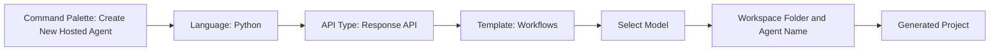

# Ενότητα 2 - Σκελετός του έργου πολλαπλών πρακτόρων

⏱️ ~5 λεπτά

Σε αυτή την ενότητα, χρησιμοποιείτε [Foundry Toolkit for VS Code](https://aka.ms/foundrytk) για να **δημιουργήσετε τον σκελετό ενός έργου πολλαπλών πρακτόρων**. Ο οδηγός δημιουργεί `agent.yaml`, `main.py`, `Dockerfile`, `requirements.txt`, `.env`, και τη ρύθμιση αποσφαλμάτωσης του VS Code - ώστε να μπορείτε να εστιάσετε στη σύνδεση της ροής εργασίας με 4 πράκτορες στην Ενότητα 3.

> **Κύρια ιδέα:** Ο σκελετός είναι ένα λειτουργικό υπόδειγμα με έναν πράκτορα. Αντικαθιστάτε τη λογική του προτύπου με το `WorkflowBuilder` γράφημα στην Ενότητα 3. Δεν χρειάζεται να γράψετε τον βασικό κώδικα από το μηδέν.

> **Υλοποίηση αναφοράς:** [`PersonalCareerCopilot/`](../../../../../workshop/lab02-multi-agent/PersonalCareerCopilot) είναι ένα πλήρες λειτουργικό παράδειγμα. Χρησιμοποιήστε το για να συγκρίνετε την εργασία σας καθώς προχωράτε.

### Ροή του οδηγού δημιουργίας σκελετού



---

## Βήμα 1: Άνοιγμα του οδηγού Create Hosted Agent

1. Πατήστε `Ctrl+Shift+P` για να ανοίξετε την **Παλέτα Εντολών**.
2. Πληκτρολογήστε: **Foundry Toolkit: Create a New Hosted Agent** και επιλέξτε το.
3. Ο οδηγός ανοίγει στην καρτέλα **Agent Details**.

> **Εναλλακτικά:** Κάντε κλικ στο εικονίδιο **Foundry Toolkit** στη Γραμμή Δραστηριοτήτων (Activity Bar) → κάντε κλικ στο εικονίδιο **+** δίπλα στο **Hosted Agents** → **Create New Hosted Agent**.

---

## Βήμα 2: Επιλέξτε ρυθμίσεις


1. Στο αριστερό τμήμα πλοήγησης/επιλογών επιλέξτε τα εξής:

| Μενού | Επιλογή | Σημειώσεις |
|--------|-----------|-------|
| **Γλώσσα** | Python | Υποστηρίζεται επίσης το C# (.NET) |
| **Πλαίσιο** | Agent Framework | Παρέχει `Agent`, `AgentExecutor`, `WorkflowBuilder` |
| **Τύπος API** | Response API | `POST /responses` - διαχείριση ιστορικού από την πλατφόρμα, υποστήριξη streaming |
| **Πρότυπο** | **Workflows** | Επεξεργάζεται αιτήματα μέσω πολλαπλών πρακτόρων κατά σειρά |

2. Αφού τα επιλέξετε, κάντε κλικ στο **Next**


3. Στο επόμενο παράθυρο, επιλέξτε τα εξής:

| Μενού | Επιλογή | Σημειώσεις |
|--------|-----------|-------|
| **Φάκελος εργασίας** | Περιηγηθείτε στο φάκελο προορισμού | π.χ., `workshop/lab02-multi-agent/` σε αυτό το αποθετήριο |
| **Όνομα πράκτορα** | `PersonalCareerCopilot` | Αυτό γίνεται το όνομα του φακέλου του έργου |
| **Ανάπτυξη μοντέλου** | Επιλέξτε το αναπτυγμένο μοντέλο σας | π.χ., `gpt-4.1-mini` από το Εργαστήριο 01 |

4. Κάντε κλικ στο **Create** για να δημιουργηθεί ο σκελετός του έργου. Το VS Code δημιουργεί τα αρχεία και ανοίγει το φάκελο.

> **Συμβουλή:** [`gpt-4.1-mini`](https://learn.microsoft.com/azure/foundry/foundry-models/concepts/models-sold-directly-by-azure#gpt-41-series) ισορροπεί καλά την ταχύτητα και την ποιότητα για την ανάπτυξη πολλαπλών πρακτόρων.

---

## Βήμα 3: Ελέγξτε το δημιουργημένο έργο

Μετά την ολοκλήρωση της δημιουργίας σκελετού, επιβεβαιώστε ότι βλέπετε αυτά τα αρχεία στο Explorer (`Ctrl+Shift+E`):

```
📂 <your-agent-name>/
├── .azdignore          ← Files excluded from Azure Developer CLI deployments
├── .dockerignore       ← Files excluded from Docker builds
├── .env                ← Environment variables (placeholders - fill in Module 3)
├── .vscode/
│   ├── launch.json     ← Debug config (F5 → run + Agent Inspector)
│   └── tasks.json      ← VS Code task definitions
├── agent.yaml          ← Agent definition (kind: hosted, protocol: responses)
├── Dockerfile          ← Container config for deployment
├── main.py             ← Stub agent entry point (replace with WorkflowBuilder in Module 3)
└── requirements.txt    ← Python dependencies
```

> **Σημαντικό:** Ανοίξτε αυτόν τον σκελετωμένο φάκελο απευθείας στο VS Code ώστε `.vscode/launch.json` και `tasks.json` να εφαρμόζονται σωστά για την αποσφαλμάτωση με F5.

### Επεξήγηση βασικών αρχείων

| Αρχείο | Σκοπός |
|------|---------|
| `agent.yaml` | Δηλώνει `kind: hosted`, αντιστοιχίζει μεταβλητές περιβάλλοντος, ορίζει το πρωτόκολλο `/responses` |
| `main.py` | Υπόδειγμα: ένας `FoundryChatClient` → `Agent` → `ResponsesHostServer`. Αντικαθιστάτε αυτό με 4 πράκτορες + `WorkflowBuilder` στην Ενότητα 3 |
| `Dockerfile` | `python:3.12-slim`, εγκαθιστά `requirements.txt`, εκθέτει τη θύρα 8088, εκτελεί `python main.py` |
| `requirements.txt` | `agent-framework-foundry`, `agent-framework-foundry-hosting`, `mcp<2,>=1.24.0`, `debugpy` |

> **Αναφορά:** Δείτε [`PersonalCareerCopilot/agent.yaml`](../../../../../workshop/lab02-multi-agent/PersonalCareerCopilot/agent.yaml) και [`PersonalCareerCopilot/requirements.txt`](../../../../../workshop/lab02-multi-agent/PersonalCareerCopilot/requirements.txt) για το πλήρες δημιουργημένο περιεχόμενο.

---

### ✅ Σημείο ελέγχου

- [ ] Ο οδηγός σκελετού ολοκληρώθηκε - ο νέος φάκελος έργου φαίνεται στο Explorer
- [ ] Όλα τα αναμενόμενα αρχεία παρόντα: `agent.yaml`, `main.py`, `Dockerfile`, `requirements.txt`, `.env`
- [ ] `agent.yaml` εμφανίζει `kind: hosted` και `protocol: responses`
- [ ] `main.py` εισάγει `Agent`, `FoundryChatClient`, `ResponsesHostServer`
- [ ] Ο σκελετωμένος φάκελος είναι ανοιχτός ως ρίζα του workspace του VS Code
- [ ] Κατανοείτε ότι `main.py` είναι υπόδειγμα - `WorkflowBuilder` προστίθεται στην Ενότητα 3

---

**Προηγούμενο:** [01 - Κατανόηση της Αρχιτεκτονικής Πολλών Πρακτόρων](01-understand-multi-agent.md) · **Επόμενο:** [03 - Διαμόρφωση Πρακτόρων & Περιβάλλοντος →](03-configure-agents.md)

---

<!-- CO-OP TRANSLATOR DISCLAIMER START -->
**Αποποίηση ευθυνών**:
Αυτό το έγγραφο έχει μεταφραστεί χρησιμοποιώντας την υπηρεσία μετάφρασης με τεχνητή νοημοσύνη [Co-op Translator](https://github.com/Azure/co-op-translator). Ενώ επιδιώκουμε την ακρίβεια, παρακαλούμε να έχετε υπόψη ότι οι αυτοματοποιημένες μεταφράσεις ενδέχεται να περιέχουν λάθη ή ανακρίβειες. Το πρωτότυπο έγγραφο στη μητρική του γλώσσα πρέπει να θεωρείται η αυθεντική πηγή. Για κρίσιμες πληροφορίες, συνιστάται επαγγελματική ανθρώπινη μετάφραση. Δεν φέρουμε ευθύνη για τυχόν παρεξηγήσεις ή λανθασμένες ερμηνείες που προκύπτουν από τη χρήση αυτής της μετάφρασης.
<!-- CO-OP TRANSLATOR DISCLAIMER END -->