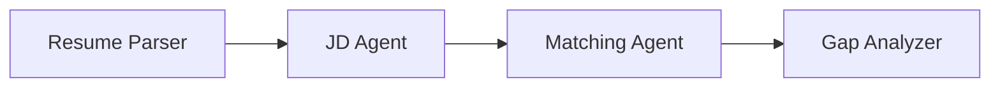
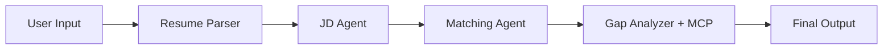

# Ενότητα 4 - Πρότυπα Ορχήστρωσης

⏱️ ~10 λεπτά

Σε αυτήν την ενότητα, εξερευνάτε τα πρότυπα ορχήστρωσης που χρησιμοποιούνται στον Resume Job Fit Evaluator και μαθαίνετε πώς να διαβάζετε, να τροποποιείτε και να επεκτείνετε το γράφημα ροής εργασίας. Η κατανόηση αυτών των προτύπων είναι απαραίτητη για τον εντοπισμό σφαλμάτων σε ζητήματα ροής δεδομένων και τη δημιουργία των δικών σας [ροών εργασίας με πολλαπλούς πράκτορες](https://learn.microsoft.com/agent-framework/workflows/).

---

## Πρότυπο 1: Ακολουθιακή αλυσίδα

Το θεμελιώδες πρότυπο στη ροή εργασίας είναι η **ακολουθιακή αλυσίδα** - η έξοδος κάθε πράκτορα τροφοδοτεί άμεσα τον επόμενο.



Στον κώδικα, κάθε κλήση `add_edge()` δημιουργεί ένα βήμα στην αλυσίδα:

```python
.add_edge(resume_executor, jd_executor)       # ResumeParser output → JD Agent
.add_edge(jd_executor, matching_executor)     # JD Agent output → MatchingAgent
.add_edge(matching_executor, gap_executor)    # MatchingAgent output → GapAnalyzer
```

> **Γιατί ακολουθιακό, όχι fan-out/fan-in;** Το `WorkflowBuilder` χρησιμοποιεί **λογική OR** για τις εισερχόμενες ακμές: ένας εκτελεστής που βρίσκεται πιο κάτω ενεργοποιείται μόλις **οποιοσδήποτε** προηγούμενος ολοκληρώσει. Αν το `matching_executor` είχε δύο εισερχόμενες ακμές (από `resume_executor` και `jd_executor`), θα ενεργοποιούταν δύο φορές - μία όταν τελειώνει ο ResumeParser και άλλη μία όταν τελειώνει ο JD Agent - προκαλώντας έτσι το GapAnalyzer να τρέχει επίσης δύο φορές και η έξοδος να εμφανίζεται δύο φορές. Ο ακολουθιακός σωλήνας αποφεύγει εντελώς αυτό.

## Πρότυπο 2: Μεταβίβαση Περιεχομένου

Επειδή το `context_mode="last_agent"` σημαίνει ότι κάθε εκτελεστής βλέπει μόνο την **έξοδο του άμεσου προηγούμενού του**, οι πράκτορες σε μια ακολουθιακή αλυσίδα πρέπει να μεταβιβάζουν ρητά οποιαδήποτε δεδομένα χρειάζονται οι πράκτορες κατώτερου επιπέδου.

Σε αυτή τη ροή εργασίας:
- Ο **ResumeParser** αντιγράφει τον JD κατά λέξη στο `[JOB DESCRIPTION PASS-THROUGH]` (έτσι ώστε ο JD Agent να μπορεί να τον βρει).
- Ο **JD Agent** αντιγράφει τον `[PARSED RESUME]` κατά λέξη στο `[PARSED RESUME PASS-THROUGH]` (για να μπορεί ο MatchingAgent να συγκρίνει και τα δύο προφίλ).

```
ResumeParser output
└─ [PARSED RESUME]               ← extracted by JD Agent
└─ [JOB DESCRIPTION PASS-THROUGH] ← extracted by JD Agent

JD Agent output
└─ [JD REQUIREMENTS]             ← extracted by MatchingAgent
└─ [PARSED RESUME PASS-THROUGH]  ← extracted by MatchingAgent
```

Κάθε τμήμα μεταβίβασης πρέπει να αντιγράφεται **κατά λέξη** - η περίληψη ή παραφράζωσή του καταστρέφει τον κατώτερο πράκτορα που εξαρτάται από αυτό.

---

## Το πλήρες γράφημα

Ο συνδυασμός των προτύπων ακολουθιακής αλυσίδας και μεταβίβασης περιεχομένου παράγει την πλήρη ροή εργασίας:



Ο Agent Inspector δείχνει αυτήν την ίδια δομή γραφήματος όταν ο πράκτορας τρέχει τοπικά. Ανατρέξτε στην [Ενότητα 5 - Δοκιμή τοπικά](05-test-locally.md) για στιγμιότυπα οθόνης.

---

## Ανάγνωση κώδικα WorkflowBuilder

Το γράφημα ροής εργασίας κατασκευάζεται στη συνάρτηση `main()` στο [`PersonalCareerCopilot/main.py`](../../../../../workshop/lab02-multi-agent/PersonalCareerCopilot/main.py). Οι τρεις κλήσεις `add_edge()` χτίζουν τον ακολουθιακό σωλήνα:

| # | Ακμή | Επίδραση |
|---|------|--------|
| 1 | `resume_executor → jd_executor` | Ο JD Agent λαμβάνει `[PARSED RESUME]` + `[JOB DESCRIPTION PASS-THROUGH]` |
| 2 | `jd_executor → matching_executor` | Ο MatchingAgent λαμβάνει `[JD REQUIREMENTS]` + `[PARSED RESUME PASS-THROUGH]` |
| 3 | `matching_executor → gap_executor` | Ο GapAnalyzer λαμβάνει αναφορά καταλληλότητας + λίστα κενών |

---

## Τροποποίηση του γραφήματος

### Προσθήκη νέου πράκτορα

Για να προσθέσετε πέμπτο πράκτορα (π.χ., έναν **InterviewPrepAgent** μετά το GapAnalyzer):

1. Ορίστε μια σταθερά `INTERVIEW_PREP_INSTRUCTIONS`.
2. Δημιουργήστε αντικείμενα `Agent` + `AgentExecutor` (ίδιο πρότυπο με τους υπάρχοντες τέσσερις).
3. Προσθέστε `.add_edge(gap_executor, interview_exec)` στο `WorkflowBuilder`.
4. Ενημερώστε το `output_executors=[interview_exec]`.

> **Σημαντικό:** Ο `start_executor` είναι ο μόνος πράκτορας που λαμβάνει ακατέργαστη είσοδο χρήστη. Όλοι οι άλλοι πράκτορες λαμβάνουν έξοδο από την ακμή ανάντη τους.

---

## Συνηθισμένα λάθη στο γράφημα

| Λάθος | Σύμπτωμα | Διόρθωση |
|---------|---------|-----|
| Έλλειψη ακμής προς `output_executors` | Ο πράκτορας τρέχει αλλά η έξοδος είναι κενή | Βεβαιωθείτε ότι υπάρχει διαδρομή από τον `start_executor` προς κάθε πράκτορα στο `output_executors` |
| Κυκλική εξάρτηση | Άπειρος βρόχος ή χρονικό όριο | Ελέγξτε να μην τροφοδοτεί κανένας πράκτορας πάλι πράκτορα ανάντη |
| Πράκτορας στο `output_executors` χωρίς εισερχόμενη ακμή | Κενή έξοδος | Προσθέστε τουλάχιστον μία `add_edge(source, that_agent)` |
| Πολλαπλές `output_executors` χωρίς fan-in | Η έξοδος περιέχει μόνο απάντηση ενός πράκτορα | Χρησιμοποιήστε έναν μοναδικό πράκτορα εξόδου που συγκεντρώνει ή αποδεχτείτε πολλές εξόδους |
| Έλλειψη `start_executor` | `ValueError` κατά το χρόνο κατασκευής | Πάντοτε ορίστε `start_executor` στο `WorkflowBuilder()` |

---

## Εντοπισμός σφαλμάτων στο γράφημα

### Χρήση του Agent Inspector

1. Ξεκινήστε τον πράκτορα τοπικά με F5.
2. Ανοίξτε τον Agent Inspector (`Ctrl+Shift+P` → **Foundry Toolkit: Open Agent Inspector**).
3. Στείλτε ένα δοκιμαστικό μήνυμα.
4. Στο πάνελ απάντησης του Inspector, αναζητήστε την **έξοδο σε streaming** - δείχνει τη συμβολή κάθε πράκτορα διαδοχικά.


### Χρήση καταγραφής

Προσθέστε καταγραφή στο `main.py` για να εντοπίσετε τη ροή δεδομένων:

```python
import logging
logger = logging.getLogger("resume-job-fit")

# In main(), after building the workflow:
logger.info("Workflow graph built with edges: RP→JD, JD→MA, MA→GA")
```

Τα αρχεία καταγραφής του server δείχνουν τη σειρά εκτέλεσης των πρακτόρων και τις κλήσεις εργαλείων MCP:

```
INFO:agent_framework:Executing agent: ResumeParser
INFO:agent_framework:Executing agent: JobDescriptionAgent
INFO:agent_framework:Executing agent: MatchingAgent
INFO:agent_framework:Executing agent: GapAnalyzer
INFO:agent_framework:Tool call: search_microsoft_learn_for_plan(skill="Kubernetes")
POST https://learn.microsoft.com/api/mcp → 200
INFO:agent_framework:Tool call: search_microsoft_learn_for_plan(skill="Terraform")
POST https://learn.microsoft.com/api/mcp → 200
```

---

### Σημείο ελέγχου

- [ ] Μπορείτε να αναγνωρίσετε τα δύο πρότυπα ορχήστρωσης στη ροή εργασίας: ακολουθιακή αλυσίδα και μεταβίβαση περιεχομένου
- [ ] Κατανοείτε γιατί το `context_mode="last_agent"` απαιτεί ρητή μεταβίβαση δεδομένων μεταξύ πρακτόρων
- [ ] Μπορείτε να διαβάσετε τον κώδικα `WorkflowBuilder` και να αντιστοιχίσετε κάθε κλήση `add_edge()` στο οπτικό γράφημα
- [ ] Γνωρίζετε πώς να προσθέσετε νέο πράκτορα στο τέλος του σωλήνα
- [ ] Μπορείτε να αναγνωρίσετε συνηθισμένα λάθη γραφήματος και τα συμπτώματά τους

---

**Προηγούμενο:** [03 - Διαμόρφωση Πρακτόρων & Περιβάλλοντος](03-configure-agents.md) · **Επόμενο:** [05 - Δοκιμή τοπικά →](05-test-locally.md)

---

<!-- CO-OP TRANSLATOR DISCLAIMER START -->
**Αποποίηση ευθυνών**:
Αυτό το έγγραφο έχει μεταφραστεί χρησιμοποιώντας την υπηρεσία μετάφρασης με τεχνητή νοημοσύνη [Co-op Translator](https://github.com/Azure/co-op-translator). Ενώ επιδιώκουμε την ακρίβεια, παρακαλούμε να έχετε υπόψη ότι οι αυτοματοποιημένες μεταφράσεις ενδέχεται να περιέχουν λάθη ή ανακρίβειες. Το πρωτότυπο έγγραφο στη μητρική του γλώσσα πρέπει να θεωρείται η αυθεντική πηγή. Για κρίσιμες πληροφορίες, συνιστάται επαγγελματική ανθρώπινη μετάφραση. Δεν φέρουμε ευθύνη για τυχόν παρεξηγήσεις ή λανθασμένες ερμηνείες που προκύπτουν από τη χρήση αυτής της μετάφρασης.
<!-- CO-OP TRANSLATOR DISCLAIMER END -->