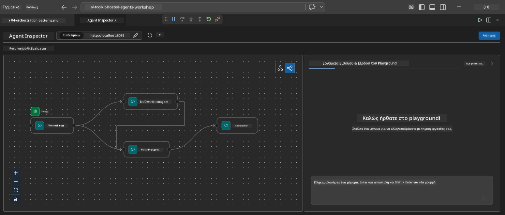
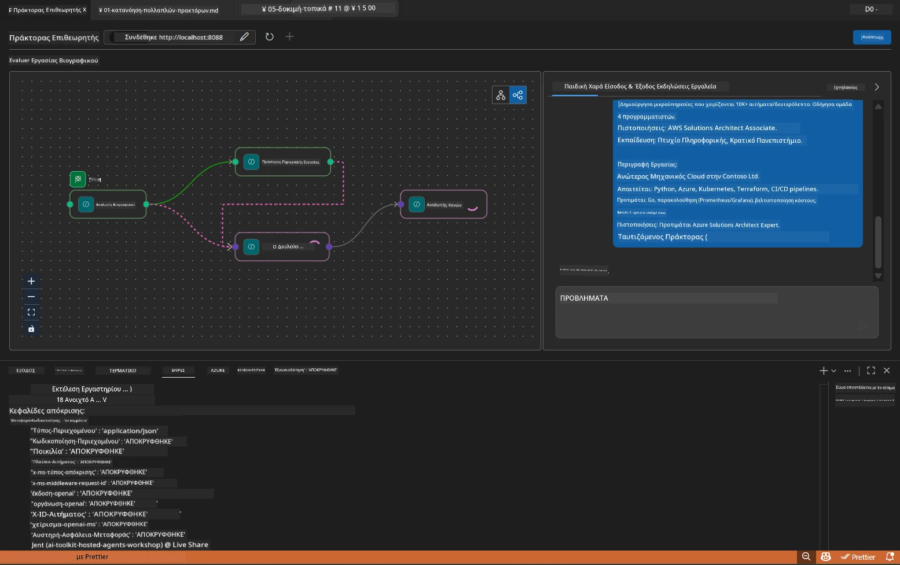
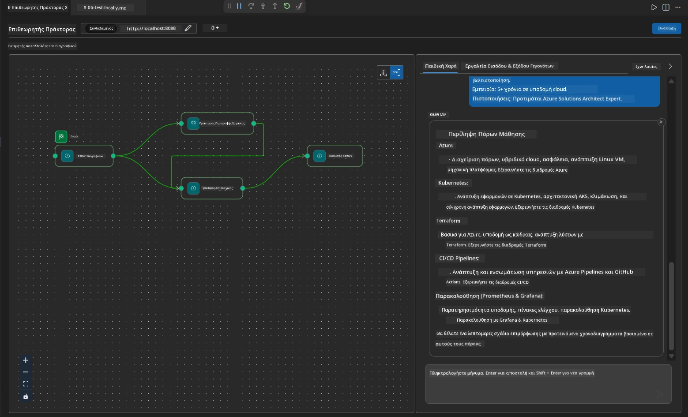

# Ενότητα 5 - Δοκιμή τοπικά

⏱️ ~15 λεπτά

Σε αυτήν την ενότητα, εκτελείτε τη ροή εργασίας πολλαπλών πρακτόρων τοπικά, τη δοκιμάζετε με το Agent Inspector και επαληθεύετε ότι και οι τέσσερις πράκτορες και το εργαλείο MCP λειτουργούν σωστά πριν την ανάπτυξη.

---

## Βήμα 1: Εκκίνηση του server πράκτορα

### Επιλογή Α: Χρήση της εργασίας VS Code (συνιστάται)

1. Ανοίξτε το `workshop/lab02-multi-agent/PersonalCareerCopilot/` ως τον φάκελο σας στο VS Code.
2. Πατήστε `Ctrl+Shift+P` → πληκτρολογήστε **Tasks: Run Task** → επιλέξτε **Run Agent HTTP Server**.
3. Η εργασία εκκινεί τον διακομιστή με το debugpy συνδεδεμένο στη θύρα `5679` και τον πράκτορα στη θύρα `8088`.
4. Περιμένετε να εμφανιστεί στην έξοδο το μήνυμα εκκίνησης, ακολουθούμενο από το μήνυμα "έτοιμο" του διακομιστή (εμφανίζονται και άλλες γραμμές καταγραφής ανάμεσα):

```
INFO:resume-job-fit:Starting Resume -> Job Fit Evaluator HTTP server...
...
INFO:hypercorn.error:Running on http://0.0.0.0:8088 (CTRL + C to quit)
```

### Επιλογή Β: Χρήση F5 (λειτουργία αποσφαλμάτωσης)

1. Πατήστε `F5` → επιλέξτε **Debug Local Agent HTTP Server**.
2. Ο διακομιστής ξεκινά με πλήρη υποστήριξη breakpoint - χρήσιμο για επιθεώρηση αποκρίσεων MCP ή εξόδων πράκτορα.

---

## Βήμα 2: Άνοιγμα Agent Inspector

1. Πατήστε `Ctrl+Shift+P` → πληκτρολογήστε **Foundry Toolkit: Open Agent Inspector**.
2. Το Agent Inspector ανοίγει ως πίνακας στο VS Code συνδεδεμένος με το `http://localhost:8088`.
3. Θα πρέπει να δείτε τη διεπαφή πράκτορα έτοιμη να λάβει μηνύματα.



> **Εάν το Agent Inspector δεν ανοίξει:** Βεβαιωθείτε ότι ο διακομιστής έχει ξεκινήσει πλήρως (βλέπετε το `Running on http://0.0.0.0:8088` στο log). Αν η θύρα 5679 είναι απασχολημένη, δείτε [Ενότητα 8 - Αντιμετώπιση προβλημάτων](08-troubleshooting.md).

---

## Βήμα 2β: (Προαιρετικό) Άνοιγμα του Workflow Visualizer

Το Foundry Toolkit περιλαμβάνει έναν **Workflow Visualizer** σε πραγματικό χρόνο που δείχνει πώς οι πράκτορες αλληλεπιδρούν καθώς εκτελείται το γράφημα. Αυτό είναι ιδιαίτερα χρήσιμο για την αποσφαλμάτωση πολλαπλών πρακτόρων.

1. Πατήστε `Ctrl+Shift+P` → πληκτρολογήστε **Foundry Toolkit: Open Visualizer for Hosted Agents**.
2. Ανοίγει μια νέα καρτέλα στο VS Code που δείχνει το γράφημα ζωντανής εκτέλεσης.
3. Καθώς στέλνετε μηνύματα στο Agent Inspector, ο visualizer ενημερώνεται αυτόματα - οι πράσινοι κόμβοι υποδηλώνουν ολοκληρωμένους πράκτορες και οι κινούμενες ακμές δείχνουν τη ροή δεδομένων μεταξύ τους.

> **Πρόβλημα με τη θύρα:** Εάν η θύρα του visualizer χρησιμοποιείται ήδη, αλλάξτε την στις Ρυθμίσεις VS Code → **Extensions** → **Microsoft Foundry Configuration** → **Hosted Agents: Visualizer Port**.

---

## Βήμα 3: Εκτέλεση δοκιμών καπνού

Εκτελέστε αυτές τις δύο δοκιμές με τη σειρά. Η κάθε μία ελέγχει τμηματικά περισσότερο τη ροή εργασίας.

### Δοκιμή 1: Βασικό βιογραφικό + περιγραφή εργασίας

Επικολλήστε τα εξής στο Agent Inspector:

```
Resume:
Jane Doe
Senior Software Engineer with 5 years of experience in Python, Django, and AWS.
Built microservices handling 10K+ requests/second. Led a team of 4 developers.
Certifications: AWS Solutions Architect Associate.
Education: B.S. Computer Science, State University.

Job Description:
Senior Cloud Engineer at Contoso Ltd.
Required: Python, Azure, Kubernetes, Terraform, CI/CD pipelines.
Preferred: Go, monitoring (Prometheus/Grafana), cost optimization.
Experience: 5+ years in cloud infrastructure.
Certifications: Azure Solutions Architect Expert preferred.
```

**Αναμενόμενη δομή εξόδου:**

Η απόκριση πρέπει να περιέχει έξοδο από τους τέσσερις πράκτορες στη σειρά:

1. **Έξοδος Resume Parser** - Δύο επισημασμένα τμήματα: `[PARSED RESUME]` (προφίλ υποψηφίου με ομαδοποιημένες δεξιότητες) και `[JOB DESCRIPTION PASS-THROUGH]` (κείμενο JD κατά λέξη που τροφοδοτεί τον JD Agent)
2. **Έξοδος JD Agent** - Δομημένες απαιτήσεις με διαχωρισμό υποχρεωτικών και προτιμώμενων δεξιοτήτων
3. **Έξοδος Matching Agent** - Βαθμολογία καταλληλότητας (0-100) με ανάλυση, αντιστοιχισμένες δεξιότητες, ελλείπουσες δεξιότητες, κενά
4. **Έξοδος Gap Analyzer** - Ατομικές κάρτες κενών για κάθε ελλείπουσα δεξιότητα, καθεμία με URL του Microsoft Learn





### Τι να ελέγξετε στη Δοκιμή 1

| Έλεγχος | Αναμενόμενο | Πέρασε; |
|-------|----------|-------|
| Η απόκριση περιέχει βαθμολογία καταλληλότητας | Αριθμός μεταξύ 0-100 με ανάλυση | |
| Οι αντιστοιχισμένες δεξιότητες αναγράφονται | Python, CI/CD (μερικώς), κ.ά. | |
| Οι ελλείπουσες δεξιότητες αναγράφονται | Azure, Kubernetes, Terraform, κ.ά. | |
| Υπάρχουν κάρτες κενών για κάθε ελλείπουσα δεξιότητα | Μία κάρτα ανά δεξιότητα | |
| Παρόντα URL του Microsoft Learn | Πραγματικοί σύνδεσμοι `learn.microsoft.com` | |
| Δεν υπάρχουν μηνύματα σφάλματος στην απόκριση | Καθαρή, δομημένη έξοδος | |

### Δοκιμή 2: Ακραία περίπτωση - υποψήφιος με υψηλή καταλληλότητα

Επικολλήστε ένα βιογραφικό που ταιριάζει στενά με την περιγραφή εργασίας για να επαληθεύσετε ότι ο GapAnalyzer χειρίζεται σενάρια υψηλής καταλληλότητας:

```
Resume:
Alex Chen
Senior Cloud Engineer with 7 years of experience.
Skills: Python, Azure (AKS, Functions, DevOps), Kubernetes, Terraform, CI/CD (GitHub Actions, Azure Pipelines), Go, Prometheus, Grafana, cost optimization.
Certifications: Azure Solutions Architect Expert, Azure DevOps Engineer Expert.
Led infrastructure migration to Azure for 3 enterprise clients.
Education: M.S. Computer Science, Tech University.

Job Description:
Senior Cloud Engineer at Contoso Ltd.
Required: Python, Azure, Kubernetes, Terraform, CI/CD pipelines.
Preferred: Go, monitoring (Prometheus/Grafana), cost optimization.
Experience: 5+ years in cloud infrastructure.
Certifications: Azure Solutions Architect Expert preferred.
```

**Αναμενόμενη συμπεριφορά:**
- Η βαθμολογία καταλληλότητας πρέπει να είναι **80+** (οι περισσότερες δεξιότητες ταιριάζουν)
- Οι κάρτες κενών πρέπει να εστιάζουν στην επιμελημένη προετοιμασία/συνέντευξη παρά στην βασική εκμάθηση
- Οι οδηγίες του GapAnalyzer λένε: "Αν fit >= 80, εστίαση σε επιμελημένη προετοιμασία/συνέντευξη"

---

## Βήμα 4: Δοκιμή με δικά σας δεδομένα (προαιρετικό)

Δοκιμάστε να επικολλήσετε το δικό σας βιογραφικό και μια πραγματική περιγραφή εργασίας. Αυτό βοηθά να επαληθευτεί:

- Οι πράκτορες χειρίζονται διαφορετικές μορφές βιογραφικών (χρονολογικές, λειτουργικές, υβριδικές)
- Ο JD Agent χειρίζεται διαφορετικά στυλ περιγραφών εργασίας (κουκκίδες, παραγράφους, δομημένα)
- Το εργαλείο MCP επιστρέφει σχετικά πόρους για πραγματικές δεξιότητες
- Οι κάρτες κενών εξατομικεύονται στο συγκεκριμένο προφίλ σας

> **Ιδιωτικότητα - Διαδρομή Α (Foundry cloud):** Το κείμενο βιογραφικού και της περιγραφής εργασίας αποστέλλεται στην ανάπτυξη Azure OpenAI για συμπεράσματα. Δεν καταγράφεται ή αποθηκεύεται από την υποδομή εργαστηρίου. Χρησιμοποιήστε ψευδώνυμα (π.χ., "Jane Doe") αν προτιμάτε.
>
> **Ιδιωτικότητα - Διαδρομή Β (Foundry Local):** Και οι τέσσερις μηχανισμοί πρακτόρων εκτελούνται εξ ολοκλήρου στη συσκευή σας. Το βιογραφικό και το κείμενο περιγραφής εργασίας **δεν φεύγουν ποτέ από τη μηχανή σας**. Η μόνη εξερχόμενη κλήση είναι το εργαλείο MCP που ανακτά πόρους από το `https://learn.microsoft.com/api/mcp`· το ερώτημα αυτό περιέχει μόνο το όνομα της δεξιότητας, όχι τα προσωπικά σας δεδομένα.

---

### Σημείο ελέγχου

- [ ] Ο διακομιστής ξεκίνησε επιτυχώς στη θύρα `8088` (στα logs εμφανίζεται το `Running on http://0.0.0.0:8088`)
- [ ] Το Agent Inspector άνοιξε και συνδέθηκε με τον πράκτορα
- [ ] Δοκιμή 1: Πλήρης απόκριση με βαθμολογία καταλληλότητας, αντιστοιχισμένες/ελλείπουσες δεξιότητες, κάρτες κενών και URL Microsoft Learn
- [ ] Δοκιμή 2: Υψηλής καταλληλότητας υποψήφιος λαμβάνει βαθμολογία 80+ με προτάσεις εστιασμένες στην επιμέλεια
- [ ] Όλες οι κάρτες κενών παρούσες (μία ανά ελλείπουσα δεξιότητα, χωρίς περικοπές)
- [ ] Δεν υπάρχουν σφάλματα ή ίχνη στο τερματικό του διακομιστή

---

**Προηγούμενο:** [04 - Πρότυπα Ορχήστρωσης](04-orchestration-patterns.md) · **Επόμενο:** [06 - Ανάπτυξη στο Foundry →](06-deploy-to-foundry.md)

---

<!-- CO-OP TRANSLATOR DISCLAIMER START -->
**Αποποίηση ευθυνών**:
Αυτό το έγγραφο έχει μεταφραστεί χρησιμοποιώντας την υπηρεσία μετάφρασης με τεχνητή νοημοσύνη [Co-op Translator](https://github.com/Azure/co-op-translator). Ενώ επιδιώκουμε την ακρίβεια, παρακαλούμε να έχετε υπόψη ότι οι αυτοματοποιημένες μεταφράσεις ενδέχεται να περιέχουν λάθη ή ανακρίβειες. Το πρωτότυπο έγγραφο στη μητρική του γλώσσα πρέπει να θεωρείται η αυθεντική πηγή. Για κρίσιμες πληροφορίες, συνιστάται επαγγελματική ανθρώπινη μετάφραση. Δεν φέρουμε ευθύνη για τυχόν παρεξηγήσεις ή λανθασμένες ερμηνείες που προκύπτουν από τη χρήση αυτής της μετάφρασης.
<!-- CO-OP TRANSLATOR DISCLAIMER END -->