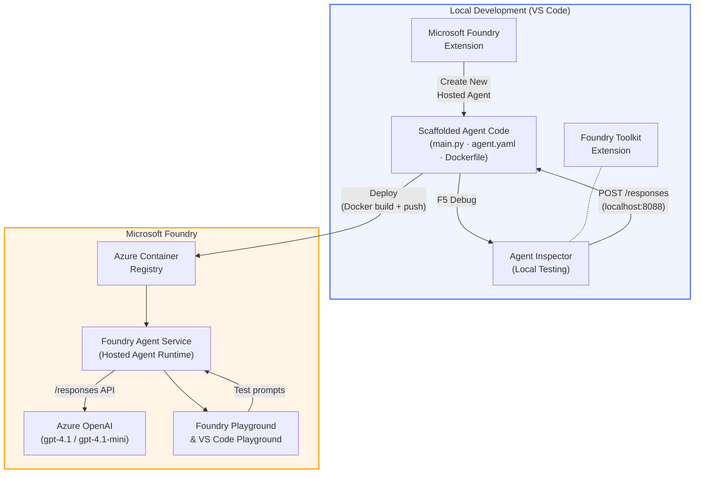

# Foundry Toolkit + Taller de Agentes Alojados de Foundry

[](https://www.python.org/)
[](https://github.com/microsoft/agents)
[](https://learn.microsoft.com/azure/foundry/agents/concepts/hosted-agents)
[](https://ai.azure.com/)
[](https://learn.microsoft.com/azure/ai-services/openai/)
[](https://learn.microsoft.com/cli/azure/install-azure-cli)
[](https://learn.microsoft.com/azure/developer/azure-developer-cli/install-azd)
[](https://www.docker.com/)
[](https://marketplace.visualstudio.com/items?itemName=ms-windows-ai-studio.windows-ai-studio)
[](../../LICENSE)

Build, test, and deploy AI agents to **Microsoft Foundry Agent Service** as **Hosted Agents** - entirely from VS Code using the **Microsoft Foundry extension** and **Foundry Toolkit**.

> **Hosted Agents are currently in preview.** Supported regions are limited - see [region availability](https://learn.microsoft.com/azure/foundry/agents/concepts/hosted-agents#region-availability).

> The `agent/` folder inside each lab is **automatically scaffolded** by the Foundry extension - you then customize the code, test locally, and deploy.

### 🌐 Soporte multilingüe

#### Soportado mediante GitHub Action (Automatizado y siempre actualizado)

<!-- CO-OP TRANSLATOR LANGUAGES TABLE START -->
[Arabic](../ar/README.md) | [Bengali](../bn/README.md) | [Bulgarian](../bg/README.md) | [Burmese (Myanmar)](../my/README.md) | [Chinese (Simplified)](../zh-CN/README.md) | [Chinese (Traditional, Hong Kong)](../zh-HK/README.md) | [Chinese (Traditional, Macau)](../zh-MO/README.md) | [Chinese (Traditional, Taiwan)](../zh-TW/README.md) | [Croatian](../hr/README.md) | [Czech](../cs/README.md) | [Danish](../da/README.md) | [Dutch](../nl/README.md) | [Estonian](../et/README.md) | [Finnish](../fi/README.md) | [French](../fr/README.md) | [German](../de/README.md) | [Greek](../el/README.md) | [Hebrew](../he/README.md) | [Hindi](../hi/README.md) | [Hungarian](../hu/README.md) | [Indonesian](../id/README.md) | [Italian](../it/README.md) | [Japanese](../ja/README.md) | [Kannada](../kn/README.md) | [Khmer](../km/README.md) | [Korean](../ko/README.md) | [Lithuanian](../lt/README.md) | [Malay](../ms/README.md) | [Malayalam](../ml/README.md) | [Marathi](../mr/README.md) | [Nepali](../ne/README.md) | [Nigerian Pidgin](../pcm/README.md) | [Norwegian](../no/README.md) | [Persian (Farsi)](../fa/README.md) | [Polish](../pl/README.md) | [Portuguese (Brazil)](../pt-BR/README.md) | [Portuguese (Portugal)](../pt-PT/README.md) | [Punjabi (Gurmukhi)](../pa/README.md) | [Romanian](../ro/README.md) | [Russian](../ru/README.md) | [Serbian (Cyrillic)](../sr/README.md) | [Slovak](../sk/README.md) | [Slovenian](../sl/README.md) | [Spanish](./README.md) | [Swahili](../sw/README.md) | [Swedish](../sv/README.md) | [Tagalog (Filipino)](../tl/README.md) | [Tamil](../ta/README.md) | [Telugu](../te/README.md) | [Thai](../th/README.md) | [Turkish](../tr/README.md) | [Ukrainian](../uk/README.md) | [Urdu](../ur/README.md) | [Vietnamese](../vi/README.md)

> **Prefer to Clone Locally?**
>
> This repository includes 50+ language translations which significantly increases the download size. To clone without translations, use sparse checkout:
>
> **Bash / macOS / Linux:**
> ```bash
> git clone --filter=blob:none --sparse https://github.com/microsoft-foundry/Foundry_Toolkit_for_VSCode_Lab.git
> cd Foundry_Toolkit_for_VSCode_Lab
> git sparse-checkout set --no-cone '/*' '!translations' '!translated_images'
> ```
>
> **CMD (Windows):**
> ```cmd
> git clone --filter=blob:none --sparse https://github.com/microsoft-foundry/Foundry_Toolkit_for_VSCode_Lab.git
> cd Foundry_Toolkit_for_VSCode_Lab
> git sparse-checkout set --no-cone "/*" "!translations" "!translated_images"
> ```
>
> This gives you everything you need to complete the course with a much faster download.
<!-- CO-OP TRANSLATOR LANGUAGES TABLE END -->

---

## Arquitectura



**Flujo:** La extensión Foundry crea la estructura del agente → personalizas el código y las instrucciones → pruebas localmente con Agent Inspector → despliegas a Foundry (imagen Docker enviada a ACR) → verificas en Playground.

---

## Qué vas a construir

| Lab | Description | Status |
|-----|-------------|--------|
| **Laboratorio 01 - Agente único** | Construye el **"Explícalo como si fuera un ejecutivo"**, púebalo localmente y despliega a Foundry | ✅ Disponible |
| **Laboratorio 02 - Flujo de trabajo multi-agente** | Crea el **"Currículum → Evaluador de idoneidad para el puesto"** - 4 agentes colaboran para puntuar la adecuación del currículum y generar una hoja de ruta de aprendizaje | ✅ Disponible |

---

## Conoce al agente ejecutivo

En este taller construirás el agente **"Explícalo como si fuera un ejecutivo"** - un agente de IA que toma jerga técnica complicada y la traduce en resúmenes tranquilos y aptos para la sala de juntas. Porque, seamos honestos, a nadie en la alta dirección le interesa escuchar sobre "agotamiento del grupo de hilos causado por llamadas sincrónicas introducidas en v3.2."

Construí este agente después de demasiados incidentes en los que mi informe post-mortem perfectamente redactado obtuvo la respuesta: *"Entonces... ¿el sitio web está caído o no?"*

### Cómo funciona

Le proporcionas una actualización técnica. Responde con un resumen ejecutivo: tres puntos clave, sin jerga, sin trazas de pila, sin angustia existencial. Solo **qué pasó**, **impacto en el negocio**, y **siguiente paso**.

### Verlo en acción

**Tú dices:**
> "La latencia de la API aumentó debido al agotamiento del grupo de hilos causado por llamadas sincrónicas introducidas en v3.2."

**El agente responde:**

> **Resumen Ejecutivo:**
> - **Qué pasó:** Después de la última versión, el sistema se ralentizó.
> - **Impacto en el negocio:** Algunos usuarios experimentaron demoras al usar el servicio.
> - **Siguiente paso:** El cambio se ha revertido y se está preparando una solución antes del redepliegue.

### ¿Por qué este agente?

Es un agente extremadamente sencillo y de propósito único: perfecto para aprender el flujo de trabajo de agentes alojados de punta a punta sin enredarse en cadenas de herramientas complejas. ¿Y, honestamente? Todo equipo de ingeniería podría usar uno de estos.

---

## Estructura del taller

```
📂 Foundry_Toolkit_for_VSCode_Lab/
├── 📄 README.md                      ← You are here
└── 📂 workshop/
    ├── 📂 lab01-single-agent/        ← Full lab: docs + agent code
    │   ├── README.md                 ← Hands-on lab instructions
    │   ├── 📂 docs/                  ← Step-by-step tutorial modules
    │   │   ├── 00-prerequisites.md
    │   │   ├── 01-setup.md
    │   │   ├── 02-create-hosted-agent.md
    │   │   ├── 03-configure-and-code.md
    │   │   ├── 04-test-locally.md
    │   │   ├── 05-deploy-to-foundry.md
    │   │   ├── 06-verify-in-playground.md
    │   │   ├── 07-summary.md
    │   │   └── 08-troubleshooting.md
    │   └── 📂 agent/                 ← Reference solution (auto-scaffolded by Foundry extension)
    │       ├── agent.yaml
    │       ├── Dockerfile
    │       ├── main.py
    │       └── requirements.txt
    └── 📂 lab02-multi-agent/         ← Resume → Job Fit Evaluator
        ├── README.md                 ← Hands-on lab instructions (end-to-end)
        ├── 📂 docs/                  ← Step-by-step tutorial modules
        │   ├── 00-prerequisites.md
        │   ├── 01-understand-multi-agent.md
        │   ├── 02-scaffold-multi-agent.md
        │   ├── 03-configure-agents.md
        │   ├── 04-orchestration-patterns.md
        │   ├── 05-test-locally.md
        │   ├── 06-deploy-to-foundry.md
        │   ├── 07-verify-in-playground.md
        │   └── 08-troubleshooting.md
        └── 📂 PersonalCareerCopilot/ ← Reference solution (multi-agent workflow)
            ├── agent.yaml
            ├── Dockerfile
            ├── main.py
            └── requirements.txt
```

> **Nota:** La `agent/` folder inside each lab is what the **Microsoft Foundry extension** generates when you run `Microsoft Foundry: Create a New Hosted Agent` from the Command Palette. The files are then customized with your agent's instructions, tools, and configuration. Lab 01 walks you through recreating this from scratch.

---

## Comenzando

### 1. Clona el repositorio

```bash
git clone https://github.com/microsoft-foundry/Foundry_Toolkit_for_VSCode_Lab.git
cd Foundry_Toolkit_for_VSCode_Lab
```

### 2. Configura un entorno virtual de Python

```bash
python -m venv venv
```

Actívalo:

- **Windows (PowerShell):**
  ```powershell
  .\venv\Scripts\Activate.ps1
  ```
- **macOS / Linux:**
  ```bash
  source venv/bin/activate
  ```

### 3. Instala dependencias

```bash
pip install -r workshop/lab01-single-agent/agent/requirements.txt
```

### 4. Configura las variables de entorno

Copia el archivo de ejemplo `.env` dentro de la carpeta del agente y completa tus valores:

```bash
cp workshop/lab01-single-agent/agent/.env.example workshop/lab01-single-agent/agent/.env
```

Edita `workshop/lab01-single-agent/agent/.env`:

```env
AZURE_AI_PROJECT_ENDPOINT=https://<your-account>.services.ai.azure.com/api/projects/<your-project>
AZURE_AI_MODEL_DEPLOYMENT_NAME=<your-model-deployment-name>
```

### 5. Sigue los laboratorios del taller

Cada laboratorio es autónomo y tiene sus propios módulos. Comienza con **Lab 01** para aprender los fundamentos, luego pasa a **Lab 02** para flujos de trabajo multi-agente.

#### Laboratorio 01 - Agente único ([instrucciones completas](workshop/lab01-single-agent/README.md))

| # | Módulo | Enlace |
|---|--------|------|
| 1 | Leer los requisitos previos | [00-prerequisites.md](workshop/lab01-single-agent/docs/00-prerequisites.md) |
| 2 | Instala Foundry Toolkit y la extensión Foundry | [01-setup.md](workshop/lab01-single-agent/docs/01-setup.md) |
| 3 | Crea un proyecto de Foundry | [01-setup.md](workshop/lab01-single-agent/docs/01-setup.md) |
| 4 | Crea un agente alojado | [02-create-hosted-agent.md](workshop/lab01-single-agent/docs/02-create-hosted-agent.md) |
| 5 | Configura las instrucciones y el entorno | [03-configure-and-code.md](workshop/lab01-single-agent/docs/03-configure-and-code.md) |
| 6 | Prueba localmente | [04-test-locally.md](workshop/lab01-single-agent/docs/04-test-locally.md) |
| 7 | Despliega a Foundry | [05-deploy-to-foundry.md](workshop/lab01-single-agent/docs/05-deploy-to-foundry.md) |
| 8 | Verifica en el playground | [06-verify-in-playground.md](workshop/lab01-single-agent/docs/06-verify-in-playground.md) |
| 9 | Solución de problemas | [08-troubleshooting.md](workshop/lab01-single-agent/docs/08-troubleshooting.md) |

#### Laboratorio 02 - Flujo de trabajo multi-agente ([instrucciones completas](workshop/lab02-multi-agent/README.md))

| # | Módulo | Enlace |
|---|--------|------|
| 1 | Requisitos previos (Laboratorio 02) | [00-prerequisites.md](workshop/lab02-multi-agent/docs/00-prerequisites.md) |
| 2 | Comprende la arquitectura multi-agente | [01-understand-multi-agent.md](workshop/lab02-multi-agent/docs/01-understand-multi-agent.md) |
| 3 | Crea la estructura del proyecto multi-agente | [02-scaffold-multi-agent.md](workshop/lab02-multi-agent/docs/02-scaffold-multi-agent.md) |
| 4 | Configura los agentes y el entorno | [03-configure-agents.md](workshop/lab02-multi-agent/docs/03-configure-agents.md) |
| 5 | Patrones de orquestación | [04-orchestration-patterns.md](workshop/lab02-multi-agent/docs/04-orchestration-patterns.md) |
| 6 | Prueba localmente (multi-agente) | [05-test-locally.md](workshop/lab02-multi-agent/docs/05-test-locally.md) |
| 7 | Despliega a Foundry | [06-deploy-to-foundry.md](workshop/lab02-multi-agent/docs/06-deploy-to-foundry.md) |
| 8 | Verifica en el playground | [07-verify-in-playground.md](workshop/lab02-multi-agent/docs/07-verify-in-playground.md) |
| 9 | Solución de problemas (multi-agente) | [08-troubleshooting.md](workshop/lab02-multi-agent/docs/08-troubleshooting.md) |

---

## Mantenedor

<table>
<tr>
    <td align="center"><a href="https://github.com/ShivamGoyal03">
        <br />
        <sub><b>Shivam Goyal</b></sub>
    </a><br />
    </td>
</tr>
</table>

---

## Permisos requeridos (referencia rápida)

| Escenario | Roles requeridos |
|----------|---------------|
| Create new Foundry project | **Azure AI Owner** on Foundry resource |
| Deploy to existing project (new resources) | **Azure AI Owner** + **Contributor** on subscription |
| Deploy to fully configured project | **Reader** on account + **Azure AI User** on project |

> **Importante:** Azure `Owner` and `Contributor` roles only include *management* permissions, not *development* (data action) permissions. You need **Azure AI User** or **Azure AI Owner** to build and deploy agents.

---

## Referencias

- [Primeros pasos: Despliega tu primer agente alojado (VS Code)](https://learn.microsoft.com/azure/foundry/agents/quickstarts/quickstart-hosted-agent)
- [¿Qué son los agentes alojados?](https://learn.microsoft.com/azure/foundry/agents/concepts/hosted-agents)
- [Crea flujos de trabajo de agentes alojados en VS Code](https://learn.microsoft.com/azure/foundry/agents/how-to/vs-code-agents-workflow-pro-code)
- [Despliega un agente alojado](https://learn.microsoft.com/azure/foundry/agents/how-to/deploy-hosted-agent)
- [RBAC para Microsoft Foundry](https://learn.microsoft.com/azure/foundry/concepts/rbac-foundry)
- [Ejemplo de agente de revisión de arquitectura](https://github.com/Azure-Samples/agent-architecture-review-sample) - Agente alojado del mundo real con herramientas MCP, diagramas Excalidraw y despliegue dual

---


## Licencia

[MIT](../../LICENSE)

---

<!-- CO-OP TRANSLATOR DISCLAIMER START -->
**Descargo de responsabilidad**:
Este documento ha sido traducido utilizando el servicio de traducción automática [Co-op Translator](https://github.com/Azure/co-op-translator). Aunque nos esforzamos por la precisión, tenga en cuenta que las traducciones automatizadas pueden contener errores o inexactitudes. El documento original en su idioma nativo debe considerarse la fuente autorizada. Para información crítica, se recomienda una traducción profesional humana. No somos responsables de cualquier malentendido o interpretación errónea que surja del uso de esta traducción.
<!-- CO-OP TRANSLATOR DISCLAIMER END -->
