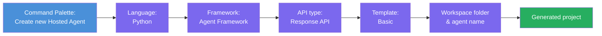
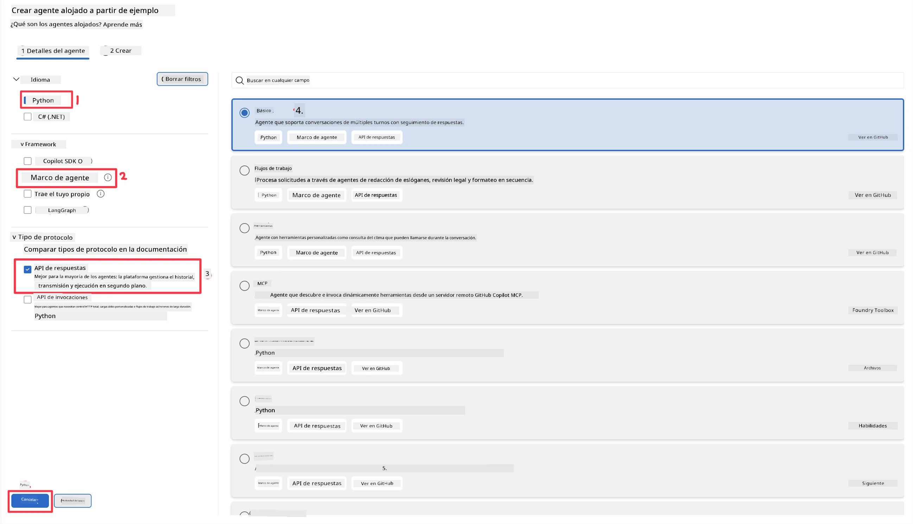
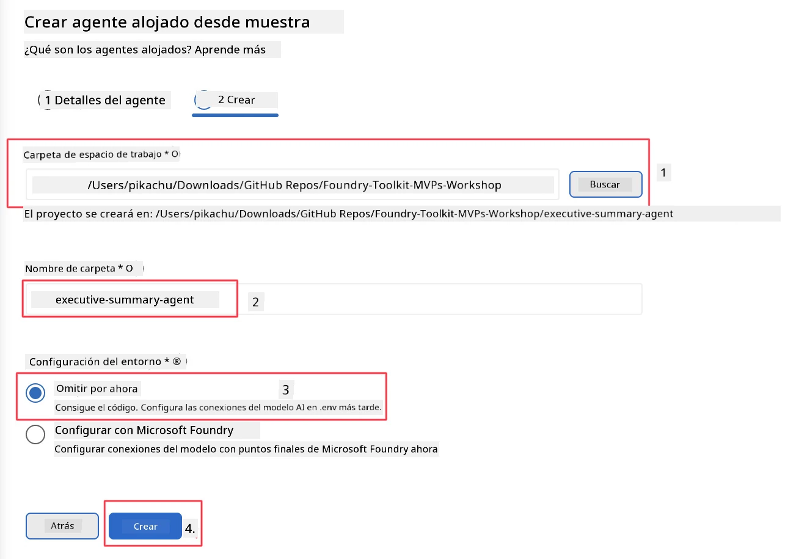

# Módulo 2 - Crear un Nuevo Agente Hospedado

⏱️ ~5 min

En este módulo, usas Foundry Toolkit para **estructurar un proyecto de agente hospedado**. La estructura genera la estructura completa del proyecto - `agent.yaml`, `main.py`, `Dockerfile`, `requirements.txt`, y configuración de depuración para VS Code - para que puedas concentrarte en personalizar el comportamiento del agente.

> **Concepto clave:** La carpeta `agent/` en este laboratorio es un ejemplo de lo que genera Foundry Toolkit. No escribes estos archivos desde cero.

### Flujo del asistente de creación



---

## Paso 1: Abrir el asistente para Crear Agente Hospedado

1. Presiona `Ctrl+Shift+P` para abrir la **Paleta de Comandos**.
2. Escribe: **Foundry Toolkit: Create new Hosted Agent** y selecciónalo.

> **Alternativa: Crear vía Foundry Portal**
> Si prefieres el navegador, puedes crear tu proyecto en [https://ai.azure.com](https://ai.azure.com). Una vez que el proyecto está provisionado, regresa a VS Code y usa la barra lateral de **Foundry Toolkit** para conectarte a él.

> **Alternativa:** En la barra lateral de Foundry Toolkit, coloca el cursor sobre **Agents** bajo tu proyecto, haz clic en el icono **+**, luego selecciona **Create in Code With Template**.

## Paso 2: Elegir configuraciones



1. En la sección de navegación/opciones a la izquierda selecciona lo siguiente:

| Menú | Selección | Notas |
|--------|-----------|-------|
| **Lenguaje** | Python | También se soporta C# |
| **Framework** | Agent Framework | Punto de partida sencillo usando Agent Framework SDK |
| **Tipo de API** | Response API | `POST /responses` - conversacional, con historial gestionado por la plataforma |
| **Plantilla** | Básica | Punto de partida sencillo usando Agent Framework SDK |

2. Una vez seleccionados, haz clic en **Siguiente**



3. En la ventana siguiente, selecciona lo siguiente:

| Menú | Selección | Notas |
|--------|-----------|-------|
| **Carpeta de trabajo** | Elige una carpeta destino | e.g., `/workspace/Foundry_Toolkit_for_VSCode_Lab/` o una subcarpeta en este repo |
| **Nombre del agente** | Ingresa un nombre | e.g., `executive-summary-agent` |
| **Configuración del entorno** | omitir configuración por ahora |  |

Haz clic en **crear** para crear nuestro agente. Se creará una nueva carpeta con el nombre del agente hospedado.

## Paso 3: Examina el proyecto generado

Después de que termine la estructuración, verifica que ves estos archivos en el Explorador (`Ctrl+Shift+E`):

```
📂 executive-summary-agent/
├── .env                ← Environment variables (placeholders)
├── .vscode/
│   ├── launch.json     ← Debug config (F5 → run + Agent Inspector)
│   └── tasks.json      ← VS Code task definitions
├── agent.yaml          ← Agent definition (kind: hosted)
├── Dockerfile          ← Container config for deployment
├── main.py             ← Agent entry point (your main code)
└── requirements.txt    ← Python dependencies
```

### Archivos clave explicados

| Archivo | Propósito |
|------|---------|
| `agent.yaml` | Declara el agente como `kind: hosted`, mapea variables del entorno, define el protocolo `/responses` |
| `main.py` | Crea un `FoundryChatClient` → lo envuelve en un `Agent` con instrucciones → sirve vía `ResponsesHostServer` en el puerto 8088 |
| `Dockerfile` | Usa `python:3.12-slim`, instala dependencias, expone el puerto 8088, corre `main.py` |
| `requirements.txt` | `agent-framework-foundry`, `agent-framework-foundry-hosting`, `mcp`, `debugpy` |

> **Importante:** Abre la carpeta del agente estructurado directamente en VS Code (la carpeta `agent/` en sí) para que `.vscode/launch.json` y `tasks.json` funcionen correctamente para la depuración con F5.

---

### ✅ Punto de control

- [ ] Proyecto estructurado creado con todos los archivos esperados
- [ ] `agent.yaml` muestra `kind: hosted` y `protocol: responses`
- [ ] `main.py` importa `Agent`, `FoundryChatClient`, `ResponsesHostServer`
- [ ] La carpeta del agente está abierta en VS Code como la raíz del espacio de trabajo

---

**Anterior:** [01 - Configuración](01-setup.md) · **Siguiente:** [03 - Configurar y Codificar →](03-configure-and-code.md)

---

<!-- CO-OP TRANSLATOR DISCLAIMER START -->
**Descargo de responsabilidad**:
Este documento ha sido traducido utilizando el servicio de traducción automática [Co-op Translator](https://github.com/Azure/co-op-translator). Aunque nos esforzamos por la precisión, tenga en cuenta que las traducciones automatizadas pueden contener errores o inexactitudes. El documento original en su idioma nativo debe considerarse la fuente autorizada. Para información crítica, se recomienda una traducción profesional humana. No somos responsables de cualquier malentendido o interpretación errónea que surja del uso de esta traducción.
<!-- CO-OP TRANSLATOR DISCLAIMER END -->