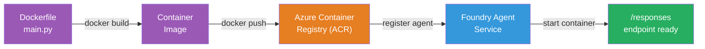
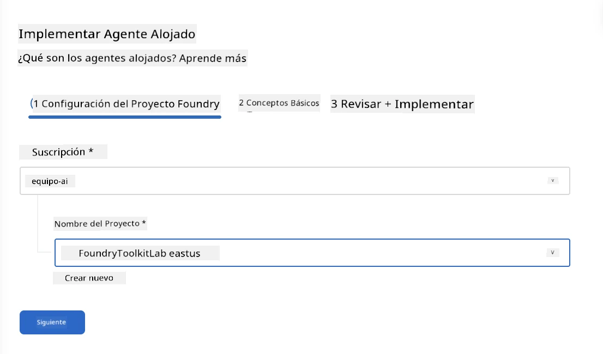
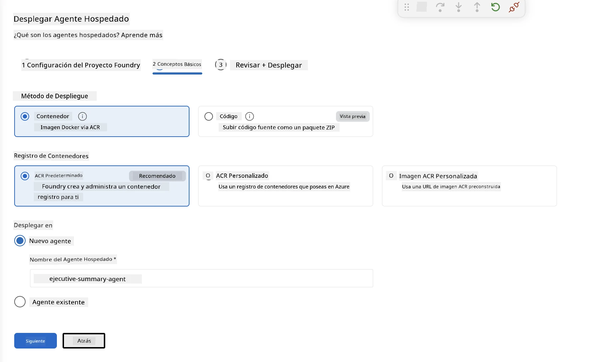
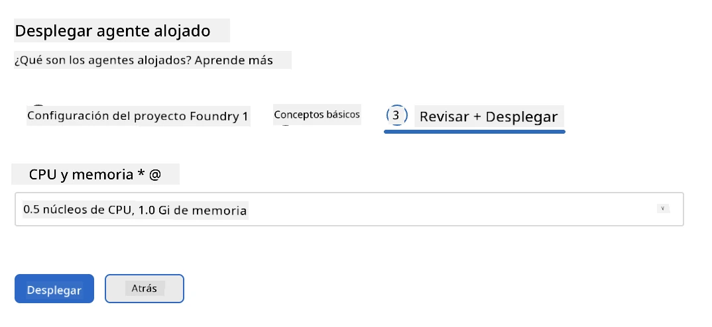
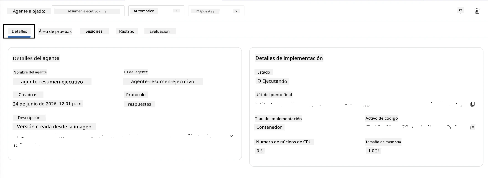

# Módulo 5 - Desplegar en el Servicio Foundry Agent

⏱️ ~10 min

> ⚠️ **Usuarios del Camino B:** Este módulo requiere una suscripción a Foundry. Si está usando Foundry Local, salte a [Módulo 07 - Resumen](07-summary.md). ¡Ha completado con éxito el flujo de trabajo de desarrollo local!

En este módulo, despliega su agente probado localmente a Microsoft Foundry como un **Agente Hospedado**. El despliegue construye una imagen de contenedor, la sube a Azure Container Registry y arranca el agente en la infraestructura gestionada de Foundry.

### Canalización de despliegue

---

## Verificación de requisitos previos

Antes de desplegar, verifique:

- [ ] El agente pasa los 3 escenarios locales de [Módulo 04](04-test-locally.md)
- [ ] Tiene el rol **Usuario de Azure AI** a nivel de proyecto ([Módulo 01, Asignar RBAC](01-setup.md#deploy-a-model--assign-rbac))
- [ ] Está conectado a Azure en VS Code (el icono de Cuentas muestra su nombre)

---

## Paso 1: Iniciar el despliegue

### Opción A: Desplegar desde Agent Inspector (recomendado)

Si Agent Inspector está abierto (desde pruebas):
1. Haga clic en el botón **Desplegar** en la esquina superior derecha (icono de nube ↑).

### Opción B: Desplegar desde el Command Palette

1. Presione `Ctrl+Shift+P` → **Foundry Toolkit: Deploy Hosted Agent**.

---

## Paso 2: Configurar el despliegue

El asistente le solicitará:

| Pregunta | Selección |
|--------|-----------|
| **Suscripción** | Su suscripción de Azure |
| **Proyecto objetivo** | Su proyecto Foundry (p.ej., `workshop-agents`) |

Haga clic en **siguiente** para configurar su agente.

| Pregunta | Selección |
|--------|-----------|
| **Método de despliegue** | Contenedor |
| **Registro de contenedores** | **ACR por defecto** (Microsoft Foundry crea y administra uno para usted) |
| **Desplegar en** | Nuevo Agente (nombre, `executive-summary-agent`) |

Haga clic en **siguiente** para revisar y desplegar su agente.

| Pregunta | Selección |
|--------|-----------|
| **CPU y memoria** | **0.5 núcleos CPU, 1.0 Gi memoria** (el predeterminado - suficiente para el taller) |

---

## Paso 3: Desplegar y monitorear

1. Haga clic en **Desplegar**.
2. Observe el panel **Salida** (seleccione **Microsoft Foundry** del desplegable).
3. El despliegue sigue estas etapas:
   - **Construcción Docker** - construye el contenedor desde su Dockerfile
   - **Push Docker** - sube la imagen a ACR (1–3 min en el primer despliegue)
   - **Registro del agente** - crea el agente hospedado en Foundry
   - **Inicio del contenedor** - inicia con identidad gestionada por el sistema

4. Cuando finalice, aparece una notificación:
   > **executive-summary-agent se desplegó correctamente.** `View logs` `Run agent`

5. Haga clic en **Ejecutar agente** para abrir el Agent Playground.

### Valores de estado de despliegue

| Estado | Significado |
|--------|------------|
| **Ejecutando** | Contenedor listo, agente respondiendo |
| **Pendiente** | Contenedor iniciándose - espere 30–60 segundos |
| **Fallido** | Revise los registros (vea solución de problemas abajo) |

---

## Errores comunes en el despliegue

| Error | Causa raíz | Solución |
|-------|-----------|---------|
| `agents/write` permiso denegado | Falta el rol **Azure AI User** a nivel de proyecto | [Módulo 01, Asignar RBAC](01-setup.md#deploy-a-model--assign-rbac) |
| Docker no está en ejecución | Docker Desktop no iniciado | Inicie Docker Desktop → verifique `docker info` |
| Autorización ACR | La identidad administrada no puede obtener la imagen | Consulte [Módulo 08 - Solución de problemas](08-troubleshooting.md) |

---

### ✅ Punto de control

- [ ] Despliegue completado sin errores
- [ ] El agente aparece en la pestaña **Hosted Agent** cuando haces clic en **Agents** bajo tu proyecto en la barra lateral de Foundry Toolkit
- [ ] El estado del contenedor muestra **Running**
- [ ] Pestaña de Playground del Agente abierta mostrando detalles del agente y URL del endpoint

---

**Anterior:** [04 - Probar localmente](04-test-locally.md) · **Siguiente:** [06 - Verificar en Playground →](06-verify-in-playground.md)

---

<!-- CO-OP TRANSLATOR DISCLAIMER START -->
**Descargo de responsabilidad**:
Este documento ha sido traducido utilizando el servicio de traducción automática [Co-op Translator](https://github.com/Azure/co-op-translator). Aunque nos esforzamos por la precisión, tenga en cuenta que las traducciones automatizadas pueden contener errores o inexactitudes. El documento original en su idioma nativo debe considerarse la fuente autorizada. Para información crítica, se recomienda una traducción profesional humana. No somos responsables de cualquier malentendido o interpretación errónea que surja del uso de esta traducción.
<!-- CO-OP TRANSLATOR DISCLAIMER END -->