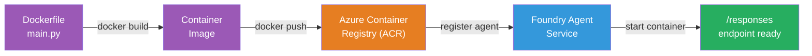

# Módulo 5 - Desplegar en el Servicio de Agentes de Foundry

⏱️ ~10 min

> ⚠️ **Usuarios del Path B:** Este módulo requiere una suscripción a Foundry. Si estás usando Foundry Local, salta a [Módulo 07 - Resumen](07-summary.md). ¡Has completado con éxito el flujo de trabajo de desarrollo local!

En este módulo, despliegas tu agente probado localmente en Microsoft Foundry como un **Hosted Agent**. El despliegue construye una imagen de contenedor, la envía a Azure Container Registry y arranca el agente en la infraestructura gestionada de Foundry.

### Pipeline de despliegue

---

## Comprobación de requisitos previos

Antes de desplegar, verifica:

- [ ] El agente pasa los 3 escenarios locales de [Módulo 04](04-test-locally.md)
- [ ] Tienes el rol **Azure AI User** a nivel de proyecto ([Módulo 01, Asignar RBAC](01-setup.md#desplegar-un-modelo-y-asignar-rbac))
- [ ] Has iniciado sesión en Azure en VS Code (el icono de Cuentas muestra tu nombre)

---

## Paso 1: Iniciar el despliegue

### Opción A: Desplegar desde Agent Inspector (recomendado)

Si el Agent Inspector está abierto (por las pruebas):
1. Haz clic en el botón **Deploy** en la esquina superior derecha (ícono de nube ↑).

### Opción B: Desplegar desde Command Palette

1. Presiona `Ctrl+Shift+P` → **Foundry Toolkit: Deploy Hosted Agent**.

---

## Paso 2: Configurar el despliegue

El asistente te pedirá:

| Prompt | Selection |
|--------|-----------|
| **Subscription** | Your Azure Subscription |
| **Target project** | Your Foundry project (e.g., `workshop-agents`) |

Haz clic en **next** para configurar tu agente.

| Prompt | Selection |
|--------|-----------|
| **Deployment Method** | Container |
| **Container registry** | **Default ACR** (Microsoft Foundry creates and manages one for you) |
| **Deploy to** | New Agent (name, `executive-summary-agent`) |

Haz clic en **next** para revisar y desplegar tu agente.

| Prompt | Selection |
|--------|-----------|
| **CPU and memory** | **0.25 CPU cores, 0.5 Gi memory** (suficiente para el taller) |

---

## Paso 3: Desplegar y supervisar

1. Haz clic en **Deploy**.
2. Observa el panel **Output** (selecciona **Microsoft Foundry** en el desplegable).
3. El despliegue pasa por estas etapas:
   - **Docker build** - crea el contenedor a partir de tu Dockerfile
   - **Docker push** - empuja la imagen a ACR (1–3 min en el primer despliegue)
   - **Agent registration** - crea el agente alojado en Foundry
   - **Container start** - inicia con identidad administrada por el sistema

4. Cuando termine, aparece una notificación:
   > **my-agent is deployed successfully.** `View logs` `Run agent`

5. Haz clic en **Run agent** para abrir el Agent Playground.

### Valores de estado de despliegue

| Status | Meaning |
|--------|---------|
| **Running** | Contenedor listo, agente respondiendo |
| **Pending** | Contenedor iniciándose - espera 30–60 segundos |
| **Failed** | Revisa los registros (ver solución de problemas abajo) |

---

## Errores comunes de despliegue

| Error | Root cause | Fix |
|-------|-----------|-----|
| `agents/write` permission denied | Falta el rol **Azure AI User** a nivel de proyecto | [Módulo 01, Asignar RBAC](01-setup.md#desplegar-un-modelo-y-asignar-rbac) |
| Docker not running | Docker Desktop no iniciado | Inicia Docker Desktop → verifica `docker info` |
| ACR authorization | La identidad administrada no puede extraer la imagen | Ver [Módulo 08 - Solución de problemas](08-troubleshooting.md) |

---

### ✅ Punto de control

- [ ] Despliegue completado sin errores
- [ ] El agente aparece bajo **Hosted Agents (Preview)** en la barra lateral de Foundry
- [ ] El estado del contenedor muestra **Running**
- [ ] Se abrió la pestaña Agent Playground mostrando detalles del agente y la URL del endpoint

---

**Anterior:** [04 - Probar localmente](04-test-locally.md) · **Siguiente:** [06 - Verificar en Playground →](06-verify-in-playground.md)

---

<!-- CO-OP TRANSLATOR DISCLAIMER START -->
**Descargo de responsabilidad**:
Este documento ha sido traducido utilizando el servicio de traducción automática [Co-op Translator](https://github.com/Azure/co-op-translator). Aunque nos esforzamos por la precisión, tenga en cuenta que las traducciones automatizadas pueden contener errores o inexactitudes. El documento original en su idioma nativo debe considerarse la fuente autorizada. Para información crítica, se recomienda una traducción profesional humana. No somos responsables de cualquier malentendido o interpretación errónea que surja del uso de esta traducción.
<!-- CO-OP TRANSLATOR DISCLAIMER END -->
