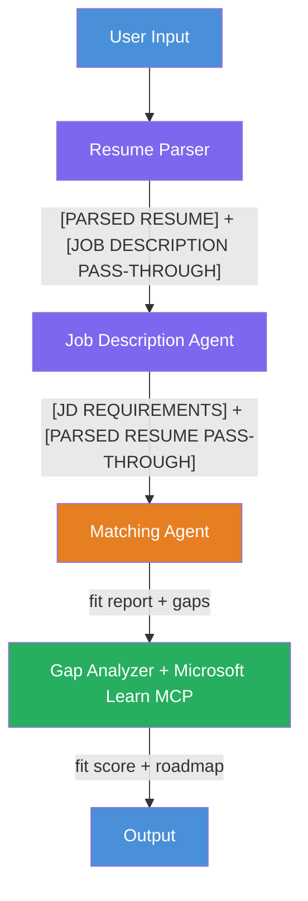

# Laboratorio 02 - Flujo de Trabajo Multi-Agente: Evaluador de Ajuste Currículum → Trabajo

## Resumen

En este laboratorio práctico, construirás una **aplicación multi-agente centrada en flujos de trabajo** usando Foundry Toolkit en VS Code y la desplegarás en Microsoft Foundry Agent Service.

**Lo que construirás:** un Evaluador de Ajuste Currículum → Trabajo que analiza un currículum y una descripción de trabajo, califica la coincidencia, y produce una hoja de ruta personalizada de aprendizaje usando recursos de Microsoft Learn.

---

## Arquitectura

**Cómo funciona:**
1. El usuario pega un currículum y una descripción de trabajo.
2. **ResumeParser** analiza el currículum y copia la descripción de trabajo textualmente en una sección `[JOB DESCRIPTION PASS-THROUGH]`.
3. **JD Agent** extrae requisitos estructurados del paso directo, luego retransmite el `[PARSED RESUME]` hacia delante como `[PARSED RESUME PASS-THROUGH]`.
4. **MatchingAgent** compara el `[PARSED RESUME PASS-THROUGH]` contra el `[JD REQUIREMENTS]` y produce una puntuación de ajuste.
5. **GapAnalyzer** convierte las brechas en una hoja de ruta práctica y obtiene enlaces reales de Microsoft Learn vía MCP.

---

## Prerrequisitos

Completa primero el Laboratorio 01:

- [Laboratorio 01 - Agente Único](../lab01-single-agent/README.md)

---

## Parte 1: Lee los módulos en orden

Consulta el camino completo de aprendizaje en:

- [Documentos del Laboratorio 2 - Prerrequisitos](docs/00-prerequisites.md)
- [Documentos del Laboratorio 2 - Camino Completo de Aprendizaje](docs/README.md)
- [Guía de uso de PersonalCareerCopilot](PersonalCareerCopilot/README.md)

---

## Parte 2: Construye y prueba el flujo de trabajo

1. Usa el asistente Foundry Toolkit para crear la estructura del proyecto basado en flujos de trabajo.
2. Copia los bloques de indicación y el gráfico del flujo de trabajo desde `PersonalCareerCopilot/main.py` a tu espacio de trabajo.
3. Ejecuta localmente con el Agent Inspector y verifica los cuatro agentes además de la herramienta MCP.
4. Despliega el agente alojado en Foundry cuando las pruebas locales tengan éxito.

---

## Patrones de orquestación

El Laboratorio 02 usa una **cadena secuencial**: la salida de cada agente alimenta al siguiente, y el flujo de trabajo retorna la respuesta del agente final. Dos patrones hacen que esto funcione:

- **Cadena secuencial** - `WorkflowBuilder` conecta ResumeParser → JD Agent → MatchingAgent → GapAnalyzer con una llamada `add_edge()` por paso
- **Retransmisión de contenido** - porque cada agente ve solo la salida directa de su predecesor, ResumeParser y JD Agent copian los datos que los agentes siguientes necesitan en secciones etiquetadas de paso directo

Los documentos también explican por qué el laboratorio no usa fan-out/fan-in, y cómo extender el gráfico con otro agente.

Consulta [docs/04-orchestration-patterns.md](docs/04-orchestration-patterns.md).

---

**Anterior:** [Laboratorio 01 - Agente Único](../lab01-single-agent/README.md) · **Volver a:** [Inicio del Taller](../../README.md)

---

<!-- CO-OP TRANSLATOR DISCLAIMER START -->
**Descargo de responsabilidad**:
Este documento ha sido traducido utilizando el servicio de traducción automática [Co-op Translator](https://github.com/Azure/co-op-translator). Aunque nos esforzamos por la precisión, tenga en cuenta que las traducciones automatizadas pueden contener errores o inexactitudes. El documento original en su idioma nativo debe considerarse la fuente autorizada. Para información crítica, se recomienda una traducción profesional humana. No somos responsables de cualquier malentendido o interpretación errónea que surja del uso de esta traducción.
<!-- CO-OP TRANSLATOR DISCLAIMER END -->