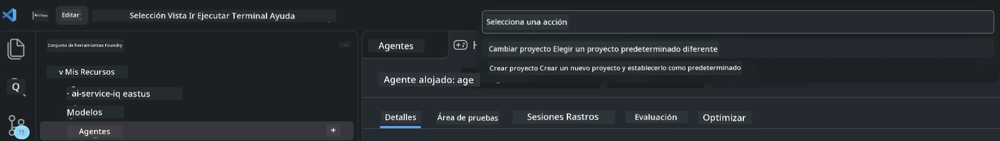

# Módulo 0 - Introducción

⏱️ ~10 min

> [!WARNING]
> **Vista previa y limitaciones:** [Agentes alojados](https://learn.microsoft.com/azure/foundry/agents/concepts/hosted-agents) están actualmente en **vista previa pública** - no se recomienda para cargas de trabajo en producción. Algunas características mostradas en este taller pueden cambiar a medida que el servicio avance hacia GA.

## Lo que construirás

En este laboratorio, extiendes las habilidades de un solo agente del Laboratorio 01 para construir un **flujo de trabajo multiagente** - el Evaluador de Currículum → Adecuación al Trabajo.

Pegas un **currículum** y una **descripción de trabajo**. Cuatro agentes especializados procesan la entrada secuencialmente, luego devuelven:
- Una puntuación de adecuación (0–100 con un desglose de puntuación)
- Una lista de brechas de habilidades y certificaciones
- Una hoja de ruta de aprendizaje personalizada con enlaces reales de Microsoft Learn para cada brecha

**El flujo de trabajo usa:**
- **Microsoft Agent Framework** - `WorkflowBuilder` para orquestación de canalización secuencial
- **Foundry Toolkit para VS Code** - esqueleto, prueba local, despliegue
- **Un modelo de IA** (por ejemplo, `gpt-4.1-mini`) - usado por los cuatro agentes
- **Servidor Microsoft Learn MCP** - proporciona enlaces reales de recursos de aprendizaje para cada brecha de habilidad

---

## Elige tu camino

> ⚠️ **Continúa con el mismo camino que usaste en el Laboratorio 01.**

<details open>
<summary><strong>🅰️ Camino A - nube de Azure (requiere suscripción a Azure)</strong></summary>

| | Detalles |
|---|---|
| **¿Para quién es?** | Completaste el Laboratorio 01 usando una suscripción de Azure |
| **Modelo** | Azure OpenAI a través de Foundry (por ejemplo, `gpt-4.1-mini`) |
| **Módulos cubiertos** | Todos los módulos (00–09) |
| **¿Desplegar en la nube?** | ✅ Sí - despliegue completo de principio a fin |

</details>

<details open>
<summary><strong>🅱️ Camino B - Foundry Local (no se necesita suscripción a Azure)</strong></summary>

| | Detalles |
|---|---|
| **¿Para quién es?** | Completaste el Laboratorio 01 usando Foundry Local |
| **Modelo** | Foundry Local (gratuito, corre en tu máquina) |
| **Módulos cubiertos** | Módulos 00–05 (salta 06–07 - despliegue y verificación en la nube) |
| **¿Desplegar en la nube?** | ❌ No - solo pruebas locales a través de Agent Inspector |

</details>

---

## Revisión del Laboratorio 01

El Laboratorio 02 se basa directamente en el Laboratorio 01. Completa el Laboratorio 01 primero antes de comenzar aquí.

¿No has hecho el Laboratorio 01 aún? Comienza aquí: [Laboratorio 01 - Introducción](../../lab01-single-agent/docs/00-prerequisites.md)

<details open>
<summary><strong>🅰️ Camino A - nube de Azure</strong></summary>

```powershell
az account show --query "{name:name, id:id}" --output table
```

Si esto falla, ejecuta `az login`. Luego verifica en VS Code:

1. `Ctrl+Shift+P` → escribe **Foundry Toolkit** → confirma que aparezcan los comandos.
2. Haz clic en el ícono **Foundry Toolkit** → tu proyecto y modelo desplegado muestran **Succeeded**.



> **RBAC:** Asignaste **Foundry User** en el Laboratorio 01. Si necesitas reasignarlo, consulta [Laboratorio 01, Módulo 1](../../lab01-single-agent/docs/01-setup.md#deploy-a-model--assign-rbac). El rol se llamaba anteriormente **Azure AI User** - mismos permisos.

</details>

<details open>
<summary><strong>🅱️ Camino B - Foundry Local</strong></summary>

```powershell
Invoke-WebRequest -Uri "http://localhost:5273/v1/health" -UseBasicParsing | Select-Object StatusCode
```

Esperado: `StatusCode: 200`. Si no, reinicia Foundry Local desde la barra lateral de Foundry Toolkit.

> Toda la inferencia se ejecuta en tu máquina. La única llamada saliente es a la herramienta MCP a `https://learn.microsoft.com/api/mcp`.

</details>

---

## Novedades en el Laboratorio 02

| | Laboratorio 01 | Laboratorio 02 |
|--|--------|--------|
| Agentes | 1 | 4 (encadenados con WorkflowBuilder) |
| Plantilla de esqueleto | Básico - Agent Framework | Flujos de trabajo - Agent Framework |
| Paquete nuevo | - | `mcp` |
| Orquestación | Agente conversacional único | Canalización secuencial (WorkflowBuilder) |
| Herramienta nueva | - | `search_microsoft_learn_for_plan` (MCP) |

---

**Siguiente:** [01 - Entender la Arquitectura →](01-understand-multi-agent.md)

---

<!-- CO-OP TRANSLATOR DISCLAIMER START -->
**Descargo de responsabilidad**:
Este documento ha sido traducido utilizando el servicio de traducción automática [Co-op Translator](https://github.com/Azure/co-op-translator). Aunque nos esforzamos por la precisión, tenga en cuenta que las traducciones automatizadas pueden contener errores o inexactitudes. El documento original en su idioma nativo debe considerarse la fuente autorizada. Para información crítica, se recomienda una traducción profesional humana. No somos responsables de cualquier malentendido o interpretación errónea que surja del uso de esta traducción.
<!-- CO-OP TRANSLATOR DISCLAIMER END -->