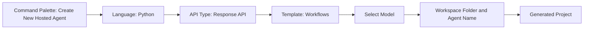
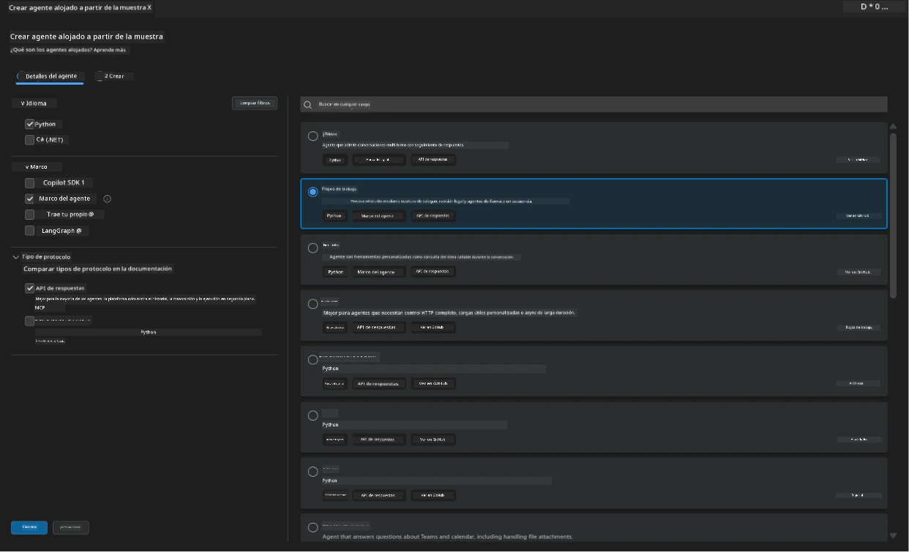
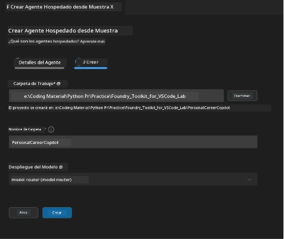

# Módulo 2 - Crear la estructura del proyecto Multi-Agente

⏱️ ~5 min

En este módulo, usas [Foundry Toolkit para VS Code](https://aka.ms/foundrytk) para **crear la estructura de un proyecto multi-agente**. El asistente genera `agent.yaml`, `main.py`, `Dockerfile`, `requirements.txt`, `.env`, y la configuración de depuración para VS Code - para que puedas concentrarte en conectar el flujo de trabajo de 4 agentes en el Módulo 3.

> **Concepto clave:** La estructura es un esqueleto funcional con un agente. Reemplazas la lógica de marcador de posición con el grafo `WorkflowBuilder` en el Módulo 3. No escribes el código base desde cero.

> **Implementación de referencia:** [`PersonalCareerCopilot/`](../../../../../workshop/lab02-multi-agent/PersonalCareerCopilot) es un ejemplo completo y funcional. Úsalo para comparar tu trabajo conforme avanzas.

### Flujo del asistente para crear la estructura



---

## Paso 1: Abre el asistente Crear Agente Hospedado

1. Presiona `Ctrl+Shift+P` para abrir la **Paleta de Comandos**.
2. Escribe: **Foundry Toolkit: Crear nuevo Agente Hospedado** y selecciónalo.
3. El asistente se abre en la pestaña **Detalles del Agente**.

> **Alternativa:** Haz clic en el ícono **Foundry Toolkit** en la Barra de Actividad → haz clic en el ícono **+** junto a **Agentes Hospedados** → **Crear Nuevo Agente Hospedado**.

---

## Paso 2: Elige las configuraciones



1. En la sección de navegación/opciones a la izquierda selecciona lo siguiente:

| Menú | Selección | Notas |
|--------|-----------|-------|
| **Lenguaje** | Python | También soporta C# (.NET) |
| **Marco de trabajo** | Agent Framework | Proporciona `Agent`, `AgentExecutor`, `WorkflowBuilder` |
| **Tipo de API** | API de respuesta | `POST /responses` - historial gestionado por la plataforma, soporte para streaming |
| **Plantilla** | **Flujos de trabajo** | Procesa solicitudes a través de múltiples agentes en secuencia |

2. Una vez seleccionado, haz clic en **Siguiente**



3. En la siguiente ventana, selecciona lo siguiente:

| Menú | Selección | Notas |
|--------|-----------|-------|
| **Carpeta de espacio de trabajo** | Navega hasta la carpeta destino | p.ej., `workshop/lab02-multi-agent/` en este repositorio |
| **Nombre del agente** | `PersonalCareerCopilot` | Esto será el nombre del directorio del proyecto |
| **Despliegue del modelo** | Selecciona tu modelo desplegado | p.ej., `gpt-4.1-mini` del Laboratorio 01 |

4. Haz clic en **Crear** para generar la estructura del proyecto. VS Code genera los archivos y abre la carpeta.

> **Consejo:** [`gpt-4.1-mini`](https://learn.microsoft.com/azure/foundry/foundry-models/concepts/models-sold-directly-by-azure#gpt-41-series) equilibra bien la velocidad y calidad para el desarrollo multi-agente.

---

## Paso 3: Inspecciona el proyecto generado

Al completar la estructura, verifica que ves estos archivos en el Explorador (`Ctrl+Shift+E`):

```
📂 <your-agent-name>/
├── .azdignore          ← Files excluded from Azure Developer CLI deployments
├── .dockerignore       ← Files excluded from Docker builds
├── .env                ← Environment variables (placeholders - fill in Module 3)
├── .vscode/
│   ├── launch.json     ← Debug config (F5 → run + Agent Inspector)
│   └── tasks.json      ← VS Code task definitions
├── agent.yaml          ← Agent definition (kind: hosted, protocol: responses)
├── Dockerfile          ← Container config for deployment
├── main.py             ← Stub agent entry point (replace with WorkflowBuilder in Module 3)
└── requirements.txt    ← Python dependencies
```

> **Importante:** Abre esta carpeta estructurada directamente en VS Code para que `.vscode/launch.json` y `tasks.json` se apliquen correctamente para la depuración con F5.

### Archivos clave explicados

| Archivo | Propósito |
|------|---------|
| `agent.yaml` | Declara `kind: hosted`, mapea variables de entorno, define el protocolo `/responses` |
| `main.py` | Esqueleto: un `FoundryChatClient` → `Agent` → `ResponsesHostServer`. Lo reemplazas con 4 agentes + `WorkflowBuilder` en el Módulo 3 |
| `Dockerfile` | `python:3.12-slim`, instala `requirements.txt`, expone el puerto 8088, ejecuta `python main.py` |
| `requirements.txt` | `agent-framework-foundry`, `agent-framework-foundry-hosting`, `mcp<2,>=1.24.0`, `debugpy` |

> **Referencia:** Consulta [`PersonalCareerCopilot/agent.yaml`](../../../../../workshop/lab02-multi-agent/PersonalCareerCopilot/agent.yaml) y [`PersonalCareerCopilot/requirements.txt`](../../../../../workshop/lab02-multi-agent/PersonalCareerCopilot/requirements.txt) para el contenido completo generado.

---

### ✅ Punto de control

- [ ] Asistente para crear estructura completado - la nueva carpeta del proyecto es visible en el Explorador
- [ ] Todos los archivos esperados presentes: `agent.yaml`, `main.py`, `Dockerfile`, `requirements.txt`, `.env`
- [ ] `agent.yaml` muestra `kind: hosted` y `protocol: responses`
- [ ] `main.py` importa `Agent`, `FoundryChatClient`, `ResponsesHostServer`
- [ ] Carpeta estructurada está abierta como la raíz del espacio de trabajo en VS Code
- [ ] Entiendes que `main.py` es un esqueleto - `WorkflowBuilder` se añade en el Módulo 3

---

**Anterior:** [01 - Entender la Arquitectura Multi-Agente](01-understand-multi-agent.md) · **Siguiente:** [03 - Configurar Agentes y Entorno →](03-configure-agents.md)

---

<!-- CO-OP TRANSLATOR DISCLAIMER START -->
**Descargo de responsabilidad**:
Este documento ha sido traducido utilizando el servicio de traducción automática [Co-op Translator](https://github.com/Azure/co-op-translator). Aunque nos esforzamos por la precisión, tenga en cuenta que las traducciones automatizadas pueden contener errores o inexactitudes. El documento original en su idioma nativo debe considerarse la fuente autorizada. Para información crítica, se recomienda una traducción profesional humana. No somos responsables de cualquier malentendido o interpretación errónea que surja del uso de esta traducción.
<!-- CO-OP TRANSLATOR DISCLAIMER END -->