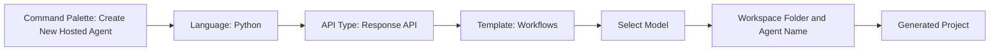

# Módulo 2 - Estructurar el proyecto multiagente

⏱️ ~5 minutos

En este módulo, usas [Foundry Toolkit for VS Code](https://aka.ms/foundrytk) para **estructurar un proyecto multiagente**. El asistente genera `agent.yaml`, `main.py`, `Dockerfile`, `requirements.txt`, `.env`, y la configuración de depuración de VS Code - para que puedas centrarte en conectar el flujo de trabajo de 4 agentes en el Módulo 3.

> **Concepto clave:** El scaffold es un esqueleto funcional con un agente. Reemplazarás la lógica de marcador de posición con el grafo `WorkflowBuilder` en el Módulo 3. No tienes que escribir el boilerplate desde cero.

> **Implementación de referencia:** [`PersonalCareerCopilot/`](../../../../../workshop/lab02-multi-agent/PersonalCareerCopilot) es un ejemplo completo y funcional. Úsalo para comparar tu trabajo a medida que avanzas.

### Flujo del asistente de creación



---

## Paso 1: Abrir el asistente Create Hosted Agent

1. Presiona `Ctrl+Shift+P` para abrir la **Paleta de comandos**.
2. Escribe: **Foundry Toolkit: Create a New Hosted Agent** y selecciónalo.
3. El asistente se abre en la pestaña **Agent Details**.

> **Alternativa:** Haz clic en el icono **Foundry Toolkit** en la Barra de Actividad → haz clic en el icono **+** junto a **Hosted Agents** → **Create New Hosted Agent**.

---

## Paso 2: Elegir configuraciones


1. En la sección de navegación/opciones a la izquierda selecciona lo siguiente:

| Menú | Selección | Notas |
|--------|-----------|-------|
| **Language** | Python | C# (.NET) también compatible |
| **Framework** | Agent Framework | Proporciona `Agent`, `AgentExecutor`, `WorkflowBuilder` |
| **Tipo de API** | Response API | `POST /responses` - historial gestionado por la plataforma, soporte de streaming |
| **Plantilla** | **Workflows** | Procesa solicitudes a través de múltiples agentes en secuencia |

2. Una vez seleccionado, haz clic en **Next**


3. En la siguiente ventana, selecciona lo siguiente:

| Menú | Selección | Notas |
|--------|-----------|-------|
| **Workspace folder** | Navega a la carpeta objetivo | p. ej., `workshop/lab02-multi-agent/` en este repo |
| **Agent name** | `PersonalCareerCopilot` | Esto se convierte en el nombre del directorio del proyecto |
| **Model Deployment** | Selecciona tu modelo desplegado | p. ej., `gpt-4.1-mini` del Lab 01 |

4. Haz clic en **Create** para estructurar el proyecto. VS Code genera los archivos y abre la carpeta.

> **Consejo:** [`gpt-4.1-mini`](https://learn.microsoft.com/azure/foundry/foundry-models/concepts/models-sold-directly-by-azure#gpt-41-series) equilibra bien velocidad y calidad para el desarrollo multiagente.

---

## Paso 3: Inspeccionar el proyecto generado

Después de que finalice la estructuración, verifica que ves estos archivos en el Explorador (`Ctrl+Shift+E`):

```
📂 <your-agent-name>/
├── .azdignore          ← Files excluded from Azure Developer CLI deployments
├── .dockerignore       ← Files excluded from Docker builds
├── .env                ← Environment variables (placeholders - fill in Module 3)
├── .vscode/
│   ├── launch.json     ← Debug config (F5 → run + Agent Inspector)
│   └── tasks.json      ← VS Code task definitions
├── agent.yaml          ← Agent definition (kind: hosted, protocol: responses)
├── Dockerfile          ← Container config for deployment
├── main.py             ← Stub agent entry point (replace with WorkflowBuilder in Module 3)
└── requirements.txt    ← Python dependencies
```

> **Importante:** Abre esta carpeta estructurada directamente en VS Code para que `.vscode/launch.json` y `tasks.json` apliquen correctamente para la depuración con F5.

### Explicación de archivos clave

| Archivo | Propósito |
|------|---------|
| `agent.yaml` | Declara `kind: hosted`, mapea variables de entorno, define el protocolo `/responses` |
| `main.py` | Stub: un `FoundryChatClient` → `Agent` → `ResponsesHostServer`. Reemplazarás esto con 4 agentes + `WorkflowBuilder` en el Módulo 3 |
| `Dockerfile` | `python:3.12-slim`, instala `requirements.txt`, expone el puerto 8088, ejecuta `python main.py` |
| `requirements.txt` | `agent-framework-foundry`, `agent-framework-foundry-hosting`, `mcp<2,>=1.24.0`, `debugpy` |

> **Referencia:** Consulta [`PersonalCareerCopilot/agent.yaml`](../../../../../workshop/lab02-multi-agent/PersonalCareerCopilot/agent.yaml) y [`PersonalCareerCopilot/requirements.txt`](../../../../../workshop/lab02-multi-agent/PersonalCareerCopilot/requirements.txt) para el contenido completo generado.

---

### ✅ Punto de control

- [ ] Asistente de scaffold completado - la nueva carpeta del proyecto es visible en el Explorador
- [ ] Todos los archivos esperados presentes: `agent.yaml`, `main.py`, `Dockerfile`, `requirements.txt`, `.env`
- [ ] `agent.yaml` muestra `kind: hosted` y `protocol: responses`
- [ ] `main.py` importa `Agent`, `FoundryChatClient`, `ResponsesHostServer`
- [ ] La carpeta generada está abierta como la raíz del espacio de trabajo de VS Code
- [ ] Entiendes que `main.py` es un stub - `WorkflowBuilder` se añade en el Módulo 3

---

**Anterior:** [01 - Entender la arquitectura multiagente](01-understand-multi-agent.md) · **Siguiente:** [03 - Configurar agentes y entorno →](03-configure-agents.md)

---

<!-- CO-OP TRANSLATOR DISCLAIMER START -->
**Descargo de responsabilidad**:
Este documento ha sido traducido utilizando el servicio de traducción automática [Co-op Translator](https://github.com/Azure/co-op-translator). Aunque nos esforzamos por la precisión, tenga en cuenta que las traducciones automatizadas pueden contener errores o inexactitudes. El documento original en su idioma nativo debe considerarse la fuente autorizada. Para información crítica, se recomienda una traducción profesional humana. No somos responsables de cualquier malentendido o interpretación errónea que surja del uso de esta traducción.
<!-- CO-OP TRANSLATOR DISCLAIMER END -->