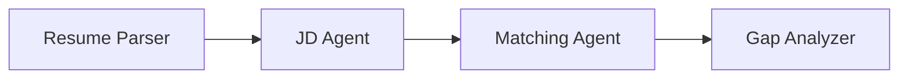
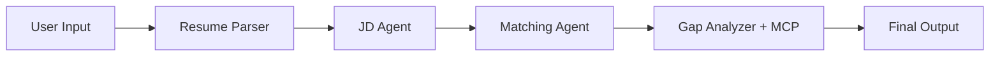

# Módulo 4 - Patrones de Orquestación

⏱️ ~10 min

En este módulo, exploras los patrones de orquestación utilizados en el Evaluador de Ajuste de Trabajo del Currículum y aprendes cómo leer, modificar y extender el gráfico del flujo de trabajo. Comprender estos patrones es esencial para depurar problemas de flujo de datos y construir tus propios [flujos de trabajo multiagente](https://learn.microsoft.com/agent-framework/workflows/).

---

## Patrón 1: Cadena secuencial

El patrón fundamental en el flujo de trabajo es una **cadena secuencial**: la salida de cada agente alimenta directamente al siguiente.



En el código, cada llamada `add_edge()` crea un paso en la cadena:

```python
.add_edge(resume_executor, jd_executor)       # ResumeParser output → JD Agent
.add_edge(jd_executor, matching_executor)     # JD Agent output → MatchingAgent
.add_edge(matching_executor, gap_executor)    # MatchingAgent output → GapAnalyzer
```

> **¿Por qué secuencial y no fan-out/fan-in?** `WorkflowBuilder` utiliza **semántica OR** para las entradas: un ejecutor descendente se activa tan pronto como **cualquiera** de sus predecesores finaliza. Si `matching_executor` tuviera dos entradas (tanto de `resume_executor` como de `jd_executor`), se activaría dos veces: una cuando ResumeParser termina y otra cuando JD Agent termina, haciendo que GapAnalyzer también se ejecute dos veces y la salida apareciera dos veces. La tubería secuencial evita esto por completo.

## Patrón 2: Relevo de contenido

Debido a que `context_mode="last_agent"` significa que cada ejecutor solo ve la salida de su **predecesor directo**, los agentes en una cadena secuencial deben pasar explícitamente cualquier dato que los agentes posteriores necesiten.

En este flujo de trabajo:
- **ResumeParser** copia la JD palabra por palabra en `[JOB DESCRIPTION PASS-THROUGH]` (para que JD Agent pueda encontrarla).
- **JD Agent** copia la `[PARSED RESUME]` palabra por palabra en `[PARSED RESUME PASS-THROUGH]` (para que MatchingAgent pueda comparar ambos perfiles).

```
ResumeParser output
└─ [PARSED RESUME]               ← extracted by JD Agent
└─ [JOB DESCRIPTION PASS-THROUGH] ← extracted by JD Agent

JD Agent output
└─ [JD REQUIREMENTS]             ← extracted by MatchingAgent
└─ [PARSED RESUME PASS-THROUGH]  ← extracted by MatchingAgent
```

Cada sección de relevo debe copiarse **literalmente**: resumirla o parafrasearla rompe el agente descendente que depende de ella.

---

## El gráfico completo

Combinar los patrones de cadena secuencial y relevo de contenido produce el flujo de trabajo completo:



El Inspector de Agentes muestra esta misma estructura de gráfico cuando el agente se ejecuta localmente. Consulta [Módulo 5 - Prueba Localmente](05-test-locally.md) para capturas de pantalla.

---

## Lectura del código WorkflowBuilder

El gráfico del flujo de trabajo se construye en la función `main()` en [`PersonalCareerCopilot/main.py`](../../../../../workshop/lab02-multi-agent/PersonalCareerCopilot/main.py). Las tres llamadas `add_edge()` construyen la tubería secuencial:

| # | Arista | Efecto |
|---|--------|--------|
| 1 | `resume_executor → jd_executor` | JD Agent recibe `[PARSED RESUME]` + `[JOB DESCRIPTION PASS-THROUGH]` |
| 2 | `jd_executor → matching_executor` | MatchingAgent recibe `[JD REQUIREMENTS]` + `[PARSED RESUME PASS-THROUGH]` |
| 3 | `matching_executor → gap_executor` | GapAnalyzer recibe informe de ajuste + lista de brechas |

---

## Modificación del gráfico

### Agregando un nuevo agente

Para agregar un quinto agente (por ejemplo, un **InterviewPrepAgent** después de GapAnalyzer):

1. Define una constante `INTERVIEW_PREP_INSTRUCTIONS`.
2. Crea objetos `Agent` + `AgentExecutor` (el mismo patrón que los cuatro existentes).
3. Agrega `.add_edge(gap_executor, interview_exec)` en `WorkflowBuilder`.
4. Actualiza `output_executors=[interview_exec]`.

> **Importante:** `start_executor` es el único agente que recibe entrada de usuario cruda. Todos los demás agentes reciben salida desde su arista upstream.

---

## Errores comunes en el gráfico

| Error | Síntoma | Solución |
|-------|---------|---------|
| Arista faltante hacia `output_executors` | El agente se ejecuta pero la salida está vacía | Asegúrate de que haya un camino desde `start_executor` hacia cada agente en `output_executors` |
| Dependencia circular | Bucle infinito o tiempo de espera | Verifica que ningún agente retroalimente a un agente upstream |
| Agente en `output_executors` sin arista entrante | Salida vacía | Añade al menos una `add_edge(source, that_agent)` |
| Múltiples `output_executors` sin fan-in | La salida contiene solo la respuesta de un agente | Usa un solo agente de salida que agregue, o acepta múltiples salidas |
| Falta `start_executor` | `ValueError` en tiempo de compilación | Siempre especifica `start_executor` en `WorkflowBuilder()` |

---

## Depuración del gráfico

### Uso del Inspector de Agentes

1. Inicia el agente localmente con F5.
2. Abre Inspector de Agentes (`Ctrl+Shift+P` → **Foundry Toolkit: Abrir Inspector de Agentes**).
3. Envía un mensaje de prueba.
4. En el panel de respuesta del Inspector, busca la **salida en streaming**: muestra la contribución de cada agente en secuencia.


### Uso del registro de eventos

Añade registro a `main.py` para rastrear el flujo de datos:

```python
import logging
logger = logging.getLogger("resume-job-fit")

# In main(), after building the workflow:
logger.info("Workflow graph built with edges: RP→JD, JD→MA, MA→GA")
```

Los registros del servidor muestran el orden de ejecución de agentes y llamadas a la herramienta MCP:

```
INFO:agent_framework:Executing agent: ResumeParser
INFO:agent_framework:Executing agent: JobDescriptionAgent
INFO:agent_framework:Executing agent: MatchingAgent
INFO:agent_framework:Executing agent: GapAnalyzer
INFO:agent_framework:Tool call: search_microsoft_learn_for_plan(skill="Kubernetes")
POST https://learn.microsoft.com/api/mcp → 200
INFO:agent_framework:Tool call: search_microsoft_learn_for_plan(skill="Terraform")
POST https://learn.microsoft.com/api/mcp → 200
```

---

### Punto de control

- [ ] Puedes identificar los dos patrones de orquestación en el flujo de trabajo: cadena secuencial y relevo de contenido
- [ ] Entiendes por qué `context_mode="last_agent"` requiere relevo explícito de datos entre agentes
- [ ] Puedes leer el código `WorkflowBuilder` y mapear cada llamada `add_edge()` al gráfico visual
- [ ] Sabes cómo agregar un nuevo agente al final de la tubería
- [ ] Puedes identificar errores comunes en el gráfico y sus síntomas

---

**Anterior:** [03 - Configurar Agentes y Entorno](03-configure-agents.md) · **Siguiente:** [05 - Prueba Localmente →](05-test-locally.md)

---

<!-- CO-OP TRANSLATOR DISCLAIMER START -->
**Descargo de responsabilidad**:
Este documento ha sido traducido utilizando el servicio de traducción automática [Co-op Translator](https://github.com/Azure/co-op-translator). Aunque nos esforzamos por la precisión, tenga en cuenta que las traducciones automatizadas pueden contener errores o inexactitudes. El documento original en su idioma nativo debe considerarse la fuente autorizada. Para información crítica, se recomienda una traducción profesional humana. No somos responsables de cualquier malentendido o interpretación errónea que surja del uso de esta traducción.
<!-- CO-OP TRANSLATOR DISCLAIMER END -->