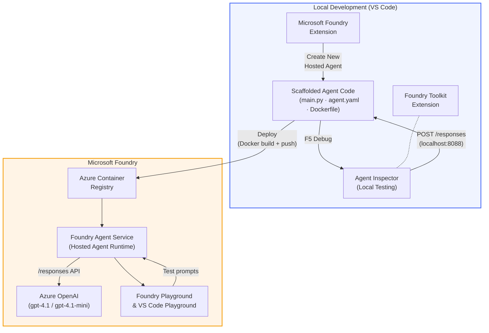

# Foundry Toolkit + Foundry Hostitud Agendid Töötoad

[](https://www.python.org/)
[](https://learn.microsoft.com/agent-framework/)
[](https://learn.microsoft.com/azure/foundry/agents/concepts/hosted-agents)
[](https://ai.azure.com/)
[](https://learn.microsoft.com/azure/ai-services/openai/)
[](https://learn.microsoft.com/cli/azure/install-azure-cli)
[](https://learn.microsoft.com/azure/developer/azure-developer-cli/install-azd)
[](https://www.docker.com/)
[](https://marketplace.visualstudio.com/items?itemName=ms-windows-ai-studio.windows-ai-studio)
[](LICENSE)

Koosta, testi ja juuruta tehisintellekti agendid **Microsoft Foundry Agent Teenusesse** kui **Hostitud Agentideks** - täielikult VS Code'i kaudu, kasutades **Microsoft Foundry laiendust** ja **Foundry Toolkiti**.

> **Hostitud Agendid on praegu eelvaates.** Toetatud regioonid on piiratud - vaata [regiooni saadavust](https://learn.microsoft.com/azure/foundry/agents/concepts/hosted-agents#region-availability).

> Kaust `agent/` iga labori sees on **automaatselt loodud** Foundry laienduse poolt - seejärel kohandad koodi, testid lokaalselt ja juurutad.

### 🌐 Mitmekeelne tugi

#### Toetatud GitHub Actioni kaudu (Automaatne ja alati ajakohane)

<!-- CO-OP TRANSLATOR LANGUAGES TABLE START -->
[Araabia](../ar/README.md) | [Bengali](../bn/README.md) | [Bulgaaria](../bg/README.md) | [Burma (Myanmar)](../my/README.md) | [Hiina (Lihtsustatud)](../zh-CN/README.md) | [Hiina (Traditsiooniline, Hongkong)](../zh-HK/README.md) | [Hiina (Traditsiooniline, Macau)](../zh-MO/README.md) | [Hiina (Traditsiooniline, Taiwan)](../zh-TW/README.md) | [Horvaadi](../hr/README.md) | [Tšehhi](../cs/README.md) | [Taani](../da/README.md) | [Hollandi](../nl/README.md) | [Eesti](./README.md) | [Sooma](../fi/README.md) | [Prantsuse](../fr/README.md) | [Saksa](../de/README.md) | [Kreeka](../el/README.md) | [Heebrea](../he/README.md) | [Hindi](../hi/README.md) | [Ungari](../hu/README.md) | [Indoneesia](../id/README.md) | [Itaalia](../it/README.md) | [Jaapani](../ja/README.md) | [Kannada](../kn/README.md) | [Khmeri](../km/README.md) | [Korea](../ko/README.md) | [Leedu](../lt/README.md) | [Malai](../ms/README.md) | [Malajalami](../ml/README.md) | [Marathi](../mr/README.md) | [Nepali](../ne/README.md) | [Nigeeria pidžin](../pcm/README.md) | [Norra](../no/README.md) | [Pärsia (Farsi)](../fa/README.md) | [Pools](../pl/README.md) | [Portugali (Brasiilia)](../pt-BR/README.md) | [Portugali (Portugal)](../pt-PT/README.md) | [Punjabi (Gurmukhi)](../pa/README.md) | [Rumeenia](../ro/README.md) | [Vene](../ru/README.md) | [Serbia (Kirilitsas)](../sr/README.md) | [Slovaki](../sk/README.md) | [Sloveeni](../sl/README.md) | [Hispaania](../es/README.md) | [Suaheli](../sw/README.md) | [Rootsi](../sv/README.md) | [Tagalogi (Filipino)](../tl/README.md) | [Tamili](../ta/README.md) | [Telugu](../te/README.md) | [Tai](../th/README.md) | [Türgi](../tr/README.md) | [Ukraina](../uk/README.md) | [Urdu](../ur/README.md) | [Vietnami](../vi/README.md)

> **Eelistad kloonimist lokaalselt?**
>
> See repositoorium sisaldab üle 50 keele tõlkeid, mis suurendab oluliselt allalaadimise mahtu. Tõlgeteta kloonimiseks kasuta sparse checkouti:
>
> **Bash / macOS / Linux:**
> ```bash
> git clone --filter=blob:none --sparse https://github.com/microsoft-foundry/Foundry_Toolkit_for_VSCode_Lab.git
> cd Foundry_Toolkit_for_VSCode_Lab
> git sparse-checkout set --no-cone '/*' '!translations' '!translated_images'
> ```
>
> **CMD (Windows):**
> ```cmd
> git clone --filter=blob:none --sparse https://github.com/microsoft-foundry/Foundry_Toolkit_for_VSCode_Lab.git
> cd Foundry_Toolkit_for_VSCode_Lab
> git sparse-checkout set --no-cone "/*" "!translations" "!translated_images"
> ```
>
> See annab sulle kõik vajaliku kursuse läbimiseks palju kiiremalt.
<!-- CO-OP TRANSLATOR LANGUAGES TABLE END -->

---

## Arhitektuur



**Voog:** Foundry laiendus genereerib agendi raamistiku → sa kohandad koodi ja juhiseid → testid lokaalselt Agent Inspektoriga → juurutad Foundrys (Docker pilt lükatakse ACR-i) → kontrollid Playgroundis.

---

## Mida sa ehitad

| Labor | Kirjeldus | Olemasolu |
|-----|-------------|--------|
| **Labor 01 - Üksikagent** | Ehita **"Selgita nagu ma oleksin juhatuses" agent**, testi seda lokaalselt ja juuruta Foundrys | ✅ Saadaval |
| **Labor 02 - Mitmeagendi töövoog** | Ehita **"CV → Töö sobivuse hindaja"** - 4 agenti teevad koostööd CV sobivuse hindamiseks ja õppekava koostamiseks | ✅ Saadaval |

---

## Tutvu juhatuses agendiga

Selles töötoas ehitad **"Selgita nagu ma oleksin juhatuses" agendi** - tehisintellekti agent, mis võtab keerulise tehnilise kõnepruugi ja tõlgib selle rahulikuks, juhatuse koosolekuks valmis kokkuvõtteks. Sest olgem ausad, ükski C-taseme juht ei taha kuulda "niidivõrgu ammendumist, mida põhjustasid sünkroonsed kõned, mis lisati versioonis 3.2."

Selle agendi ehitasin pärast liiga mitut juhtumit, kus minu laitmatu vigade järel analüüs sai vastuseks: *"Nii et... kas veebileht on maas või mitte?"*

### Kuidas see töötab

Sa annad sellele tehnilise värskenduse. See väljastab juhatuse kokkuvõtte - kolm peamist punkti, ilma žargoonita, ilma virnast vihjeteta, ilma olemasolu hirmuta. Lihtsalt **mis juhtus**, **äriline mõju** ja **järgmine samm**.

### Vaata seda töös

**Sa ütled:**
> "API viide suurenes seoses niidivõrgu ammendumisega, mida põhjustasid sünkroonsed kõned, mis lisati versioonis 3.2."

**Agent vastab:**

> **Juhatuse kokkuvõte:**
> - **Mis juhtus:** Pärast viimast versiooni aeglustus süsteem.
> - **Äriline mõju:** Mõned kasutajad kogenud teenuse kasutamisel viivitusi.
> - **Järgmine samm:** Muudatus tagasi võetud ja parandus valmistamisel enne uuesti juurutamist.

### Miks just see agent?

See on lihtne, üheotstarbeline agent - ideaalne selleks, et õppida hostitud agendi töövoogu täielikult läbi ilma keeruliste tööriistadega kinni jäämata. Ja tõtt-öelda? Iga inseneritiim võiks sellist vajada.

---

## Töötoa ülesehitus

```
📂 Foundry_Toolkit_for_VSCode_Lab/
├── 📄 README.md                      ← You are here
└── 📂 workshop/
    ├── 📂 lab01-single-agent/        ← Full lab: docs + agent code
    │   ├── README.md                 ← Hands-on lab instructions
    │   ├── 📂 docs/                  ← Step-by-step tutorial modules
    │   │   ├── 00-prerequisites.md
    │   │   ├── 01-setup.md
    │   │   ├── 02-create-hosted-agent.md
    │   │   ├── 03-configure-and-code.md
    │   │   ├── 04-test-locally.md
    │   │   ├── 05-deploy-to-foundry.md
    │   │   ├── 06-verify-in-playground.md
    │   │   ├── 07-summary.md
    │   │   └── 08-troubleshooting.md
    │   └── 📂 agent/                 ← Reference solution (auto-scaffolded by Foundry extension)
    │       ├── agent.yaml
    │       ├── Dockerfile
    │       ├── main.py
    │       └── requirements.txt
    └── 📂 lab02-multi-agent/         ← Resume → Job Fit Evaluator
        ├── README.md                 ← Hands-on lab instructions (end-to-end)
        ├── 📂 docs/                  ← Step-by-step tutorial modules
        │   ├── 00-prerequisites.md
        │   ├── 01-understand-multi-agent.md
        │   ├── 02-scaffold-multi-agent.md
        │   ├── 03-configure-agents.md
        │   ├── 04-orchestration-patterns.md
        │   ├── 05-test-locally.md
        │   ├── 06-deploy-to-foundry.md
        │   ├── 07-verify-in-playground.md
        │   ├── 08-troubleshooting.md
        │   └── 09-summary.md
        └── 📂 PersonalCareerCopilot/ ← Reference solution (multi-agent workflow)
            ├── agent.yaml
            ├── Dockerfile
            ├── main.py
            └── requirements.txt
```

> **Märkus:** Kaust `agent/` iga labori sees on see, mida **Microsoft Foundry laiendus** genereerib, kui sa jooksutad `Microsoft Foundry: Create a New Hosted Agent` käsupaletist. Failid kohandatakse seejärel sinu agendi juhiste, tööriistade ja konfiguratsiooniga. Labor 01 juhatab sind läbi selle uuesti loomise nullist.

---

## Alustamine

### 1. Klooni repositoorium

```bash
git clone https://github.com/microsoft-foundry/Foundry_Toolkit_for_VSCode_Lab.git
cd Foundry_Toolkit_for_VSCode_Lab
```

### 2. Loo Python virtuaalkeskkond

```bash
python -m venv venv
```

Aktiveeri see:

- **Windows (PowerShell):**
  ```powershell
  .\venv\Scripts\Activate.ps1
  ```
- **macOS / Linux:**
  ```bash
  source venv/bin/activate
  ```

### 3. Paigalda sõltuvused

```bash
pip install -r workshop/lab01-single-agent/agent/requirements.txt
```

### 4. Seadista keskkonnamuutujad

Kopeeri näidisfail `.env` agendi kausta ja täida oma väärtused:

```bash
cp workshop/lab01-single-agent/agent/.env.example workshop/lab01-single-agent/agent/.env
```

Muuda `workshop/lab01-single-agent/agent/.env`:

```env
FOUNDRY_PROJECT_ENDPOINT=https://<your-account>.services.ai.azure.com/api/projects/<your-project>
AZURE_AI_MODEL_DEPLOYMENT_NAME=<your-model-deployment-name>
```

### 5. Järgige töötoa laboreid

Iga labor on iseseisev oma moodulitega. Alusta **Laboriga 01**, et õppida algtõdesid, seejärel liigu **Labor 02** juurde mitmeagendi töövoogude jaoks.

#### Labor 01 - Üksikagent ([täielikud juhised](workshop/lab01-single-agent/README.md))

| # | Moodul | Link |
|---|--------|------|
| 1 | Loe eeltingimused | [00-prerequisites.md](workshop/lab01-single-agent/docs/00-prerequisites.md) |
| 2 | Paigalda Foundry Toolkit & Foundry laiendus | [01-setup.md](workshop/lab01-single-agent/docs/01-setup.md) |
| 3 | Loo Foundry projekt | [01-setup.md](workshop/lab01-single-agent/docs/01-setup.md) |
| 4 | Loo hostitud agent | [02-create-hosted-agent.md](workshop/lab01-single-agent/docs/02-create-hosted-agent.md) |
| 5 | Seadista juhised ja keskkond | [03-configure-and-code.md](workshop/lab01-single-agent/docs/03-configure-and-code.md) |
| 6 | Testi lokaalselt | [04-test-locally.md](workshop/lab01-single-agent/docs/04-test-locally.md) |
| 7 | Juuruta Foundrys | [05-deploy-to-foundry.md](workshop/lab01-single-agent/docs/05-deploy-to-foundry.md) |
| 8 | Kontrolli playgroundis | [06-verify-in-playground.md](workshop/lab01-single-agent/docs/06-verify-in-playground.md) |
| 9 | Kokkuvõte ja järgmised sammud | [07-summary.md](workshop/lab01-single-agent/docs/07-summary.md) |
| 10 | Tõrkeotsing | [08-troubleshooting.md](workshop/lab01-single-agent/docs/08-troubleshooting.md) |

#### Labor 02 - Mitmeagendi töövoog ([täielikud juhised](workshop/lab02-multi-agent/README.md))

| # | Moodul | Link |
|---|--------|------|
| 1 | Eeltingimused (Labor 02) | [00-prerequisites.md](workshop/lab02-multi-agent/docs/00-prerequisites.md) |
| 2 | SAA mitmeagendi arhitektuuri | [01-understand-multi-agent.md](workshop/lab02-multi-agent/docs/01-understand-multi-agent.md) |
| 3 | Genereeri mitmeagendi projekt | [02-scaffold-multi-agent.md](workshop/lab02-multi-agent/docs/02-scaffold-multi-agent.md) |
| 4 | Seadista agendid ja keskkond | [03-configure-agents.md](workshop/lab02-multi-agent/docs/03-configure-agents.md) |
| 5 | Orkestreerimise mustrid | [04-orchestration-patterns.md](workshop/lab02-multi-agent/docs/04-orchestration-patterns.md) |
| 6 | Testi lokaalselt (mitmeagent) | [05-test-locally.md](workshop/lab02-multi-agent/docs/05-test-locally.md) |
| 7 | Juuruta Foundrys | [06-deploy-to-foundry.md](workshop/lab02-multi-agent/docs/06-deploy-to-foundry.md) |
| 8 | Kontrolli playgroundis | [07-verify-in-playground.md](workshop/lab02-multi-agent/docs/07-verify-in-playground.md) |
| 9 | Tõrkeotsing (mitmeagent) | [08-troubleshooting.md](workshop/lab02-multi-agent/docs/08-troubleshooting.md) |
| 10 | Kokkuvõte ja järgmised sammud | [09-summary.md](workshop/lab02-multi-agent/docs/09-summary.md) |

---

## Halduse eest vastutab

<table>
<tr>
    <td align="center"><a href="https://github.com/ShivamGoyal03">
        <br />
        <sub><b>Shivam Goyal</b></sub>
    </a><br />
    </td>
</tr>
</table>

---

## Vajalikud õigused (kiirviide)

| Stsenaarium | Vajalikud rollid |
|----------|---------------|
| Loo uus Foundry projekt | **Azure AI Omanik** Foundry ressursil |
| Juuruta olemasolevasse projekti (uued ressursid) | **Azure AI Omanik** + **Kaastööline** tellimuses |
| Juuruta täielikult seadistatud projekti | **Lugeja** kontol + **Azure AI Kasutaja** projektis |

> **Tähtis:** Azure `Owner` ja `Contributor` rollid hõlmavad ainult *haldustegevuse* õigusi, mitte *arendus* (andmetega seotud tegevuste) õigusi. Agentide loomiseks ja juurutamiseks on vaja **Azure AI User** või **Azure AI Owner** rolli.

---

## Viited

- [Kiirstart: juurutage oma esimene majutatud agent (VS Code)](https://learn.microsoft.com/azure/foundry/agents/quickstarts/quickstart-hosted-agent)
- [Mis on majutatud agendid?](https://learn.microsoft.com/azure/foundry/agents/concepts/hosted-agents)
- [Looge VS Code'is majutatud agentide töövood](https://learn.microsoft.com/azure/foundry/agents/how-to/vs-code-agents-workflow-pro-code)
- [Juurutage majutatud agent](https://learn.microsoft.com/azure/foundry/agents/how-to/deploy-hosted-agent)
- [RBAC Microsoft Foundry jaoks](https://learn.microsoft.com/azure/foundry/concepts/rbac-foundry)
- [Arhitektuuri ülevaate agendi näidis](https://github.com/Azure-Samples/agent-architecture-review-sample) - Reaalmaailma majutatud agent MCP tööriistade, Excalidraw diagrammide ja kahetasandilise juurutusega

---


## Litsents

[MIT](../../LICENSE)

---

<!-- CO-OP TRANSLATOR DISCLAIMER START -->
**Lahtiütlus**:
See dokument on tõlgitud kasutades AI tõlketeenust [Co-op Translator](https://github.com/Azure/co-op-translator). Kuigi me püüdleme täpsuse poole, palun pange tähele, et automatiseeritud tõlgetes võib esineda vigu või ebatäpsusi. Originaaldokument selle emakeeles tuleks pidada autoriteetseks allikaks. Olulise teabe puhul soovitatakse kasutada professionaalset inimtõlget. Me ei vastuta selle tõlkega seotud eksimustest või valesti mõistmistest.
<!-- CO-OP TRANSLATOR DISCLAIMER END -->