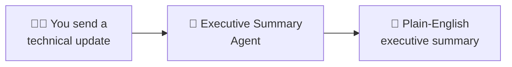

# Moodul 0 - Sissejuhatus

⏱️ ~10 min

> [!WARNING]
> **Eelvaade ja piirangud:** [Hostitud agendid](https://learn.microsoft.com/azure/foundry/agents/concepts/hosted-agents) on praegu **avalikus eelvaates** - ei ole soovitatav tootmiskoormuste jaoks. Ole teadlik järgmistest:
> - **Toetatud piirkonnad on piiratud** - kontrolli enne ressursside loomist [piirkonna saadavust](https://learn.microsoft.com/azure/foundry/agents/concepts/hosted-agents#region-availability). Kui valid mittetoetatud piirkonna, ebaõnnestub juurutus.
> - `agent-framework-foundry-hosting` pakett on enam-vähem valmis versioon - API-d võivad versioonide vahel muutuda.
> - Skaalalimiidid: hostitud agendid toetavad 0–5 koopiat (kaasa arvatud nulli skaala).
> - Mõned selles töötoas näidatud funktsioonid võivad muutuda, kui teenus liigub GA poole.

## Mida sa ehitad

Selles töötoas ehitad sa **"Seleta nagu oleksin direktor"** agendi - hostitud tehisintellekti agendi, mis võtab vastu keerulisi tehnilisi uuendusi ja tõlgib need lihtsustatud ingliskeelseteks direktorite kokkuvõteteks.

**Agent kasutab:**
- **Microsofti agentide raamistikku** - agenedi loogika ja struktuuri jaoks
- **Foundry Toolkit for VS Code’i** - raamistiku loomiseks, lokaalseks testimiseks ja juurutamiseks
- **Tehisintellekti mudelit** (näiteks `gpt-4.1-mini/gpt-5-mini`) - kokkuvõtete loomise jaoks

Selle töötoa lõpuks on sul töökorras agent, mida saad lokaalselt testida Agent Inspectoriga ja vajadusel pilve juurutada.

---

## Mis on hostitud agendid?

**Hostitud agent** on tehisintellekti agent, mis töötab Microsoft Foundrys hallatud teenusena. Oma infrastruktuuri haldamise asemel paki oma agent koodi konteinerisse ja Foundry haldab selle skaleerimist, majutamist ja avaldab selle tavalise HTTP-lõpp-punkti kaudu.

| Mõiste | Mida see tähendab |
|---------|--------------|
| **Agent** | Su Python kood, mis võtab vastu kasutaja sõnumi, kutsub AI mudelit ja tagastab struktureeritud vastuse |
| **Hostitud** | Foundry käitab sinu konteinerit - pole VM-e, pole Kubernetesit, pole infrastruktuuri haldamiseks |
| **Vastuste protokoll** | Standardne HTTP API (`POST /responses`), mida iga klient saab kasutada suhtlemiseks sinu agendiga |
| **Agent Inspector** | Kohalik testimisliides (Foundry Toolkitis sees), mis võimaldab sul enne juurutamist agenti vestelda |

Selles töötoas saad alustada nullist kuni täielikult hostitud agendini või peatuda kohalikul testimisel, kui soovid.

---

## Vali oma tee

> ⚠️ **Vali üks tee enne jätkamist.** Sinu valik määrab, millised tööriistad paigaldada ja millised moodulid kehtivad. Võid hiljem minna Tee B → Tee A peale, kui saad tellimuse.

<strong>🅰️ Tee A - Azure pilv (nõuab Azure tellimust)</strong>

| | Detailid |
|---|---|
| **Kellele see on?** | Sul on aktiivne Azure tellimus ja võid luua Foundry ressursse |
| **Mudelite valik** | Azure OpenAI Foundrys (näiteks `gpt-4.1-mini/gpt-5-mini`) |
| **Kaetud moodulid** | Kõik moodulid (00–07) |
| **Juuruta pilve?** | ✅ Jah - täissüsteemi deploy |

<strong>🅱️ Tee B - Kohalik / tasuta tase (ei vaja Azure tellimust)</strong>

| | Detailid |
|---|---|
| **Kellele see on?** | MVP-d, üliõpilased või keegi ilma Azure ligipääsuta |
| **Mudeli valik** | **Foundry Local** (tasuta, töötab sinu masinas) |
| **Kaetud moodulid** | Moodulid 00–04 (jäta vahele deploy ja pilve verifitseerimine) |
| **Juuruta pilve?** | ❌ Ei - ainult kohalik testimine Agent Inspectoriga |

---

## Kõik teed: Nõutavad tööriistad

Paigalda alljärgnevad tööriistad. Pärast paigaldust kontrolli nende tööd, jooksutades kontrollkäskluse.

| # | Tööriist | Versioon | Paigaldus | Kontroll (Oodatud väljund) |
|---|----------|-----------|-----------|--------------------------|
| 1 | **Visual Studio Code** | Viimane | [code.visualstudio.com](https://code.visualstudio.com/) | Avaneb ilma vigadeta |
| 2 | **Python** | 3.12 või uuem | [python.org/downloads](https://www.python.org/downloads/) | `python --version` $\rightarrow$ `Python 3.12.x` |
| 3 | **Foundry Toolkit for VS Code** | Viimane | Laiendi ID: `ms-windows-ai-studio.windows-ai-studio` | Foundry ikoon aktiivsusribal |
| 4 | **Python laiendus VS Code’ile** | Viimane | Laiendi ID: `ms-python.python` | Paigaldatud laienduste paneelis |

> [!TIP]
> **Paigaldusnõuanded:**
> - **Python PATH (Windows):** Alati märgi **"Add Python to PATH"** Python paigaldaja esimesel ekraanil. Ilma selleta `python` ei tunne terminal seda ära.
> - **Mitme Python versiooni olemasolu:** Kui sul on paigaldatud nii Python 3.10 kui ka 3.12, kasuta `python3.12 -m venv .venv`, et tagada õige versiooni kasutamine virtuaalmasinas.
> - **Docker WSL 2 (Windows):** Docker Desktopi paigaldamisel veendu, et oleks valitud **WSL 2 backend**. Hyper-V-ga Docker on aeglasem ja võib tekitada raskusi Foundry konteineriehitusega.
> - **Docker ei käivitu?** Oota 30–60 sekundit pärast Docker Desktopi käivitamist. Käivita `docker info` - kui näed "Cannot connect to the Docker daemon", on Docker veel initsialiseerimas.
> - **VS Code laiendid ei lae?** Pärast laiendite paigaldamist laadi aken uuesti: `Ctrl+Shift+P` → `Developer: Reload Window`.

> **Windowsi kasutajad:** Kontrollige Pythoni installeerimisel valikut **"Add Python to PATH"**.

**Järgmine:** [01 - Setup →](01-setup.md)

---

<!-- CO-OP TRANSLATOR DISCLAIMER START -->
**Lahtiütlus**:
See dokument on tõlgitud kasutades AI tõlketeenust [Co-op Translator](https://github.com/Azure/co-op-translator). Kuigi me püüdleme täpsuse poole, palun pange tähele, et automatiseeritud tõlgetes võib esineda vigu või ebatäpsusi. Originaaldokument selle emakeeles tuleks pidada autoriteetseks allikaks. Olulise teabe puhul soovitatakse kasutada professionaalset inimtõlget. Me ei vastuta selle tõlkega seotud eksimustest või valesti mõistmistest.
<!-- CO-OP TRANSLATOR DISCLAIMER END -->