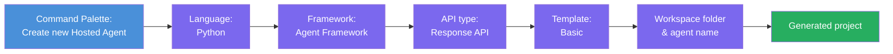
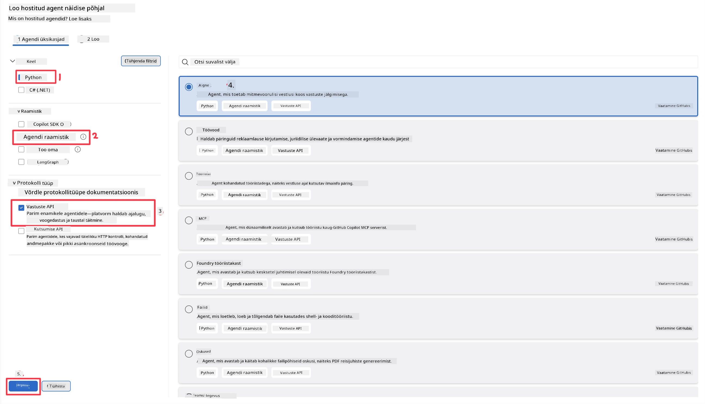
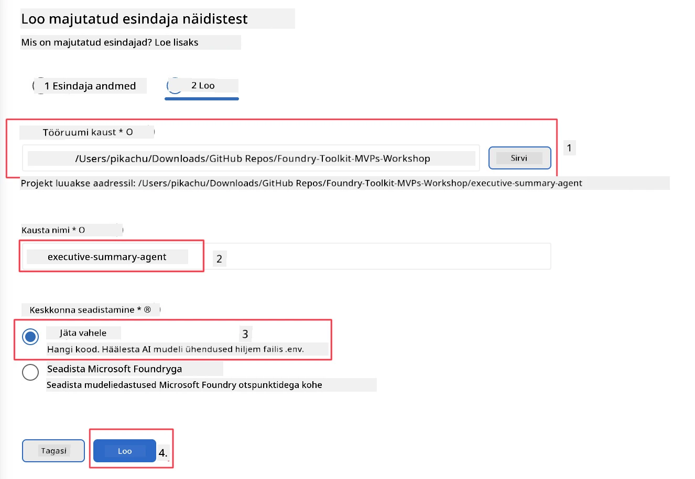

# Moodul 2 - Loo uus hostitud agent

⏱️ ~5 minutit

Selles moodulis kasutad Foundry Toolkitit, et **luua hostitud agendi projekt**. Scaffold genereerib täieliku projekti struktuuri - `agent.yaml`, `main.py`, `Dockerfile`, `requirements.txt` ja VS Code'i silumis konfi- guratsiooni -, nii et saad keskenduda agendi käitumise kohandamisele.

> **Oluline mõiste:** Selles laboris olev `agent/` kaust on näide sellest, mida Foundry Toolkit genereerib. Sa ei kirjuta neid faile nullist.

### Scaffold’i viisardi voog



---

## Samm 1: Ava Create Hosted Agent viisard

1. Vajuta `Ctrl+Shift+P`, et avada **Command Palette**.
2. Tippige: **Foundry Toolkit: Create new Hosted Agent** ja vali see.

> **Alternatiiv: Loo Foundry portaalist**
> Kui eelistad brauserit, saad oma projekti luua aadressil [https://ai.azure.com](https://ai.azure.com). Kui projekt on loodud, naase VS Code’i ja kasuta **Foundry Toolkit** külgriba, et sellega ühenduda.

> **Alternatiiv:** Foundry Toolkit külgribal liigu oma projekti all **Agents** peale, klõpsa **+** ikooni ning vali **Create in Code With Template**.

## Samm 2: Vali sätted



1. Vasakul navigeerimis-/valikute sektsioonis vali järgnevad:

| Menüü | Valik | Märkused |
|--------|-----------|-------|
| **Keel** | Python | Toetatud on ka C# |
| **Raamistik** | Agent Framework | Lihtne alguspunkt, kasutades Agent Framework SDK-d |
| **API tüüp** | Response API | `POST /responses` - vestluslik, platvormi hallatava ajaloo toetusega |
| **Mall** | Basic | Lihtne alguspunkt, kasutades Agent Framework SDK-d |

2. Kui valikud tehtud, klõpsa **Next**



3. Järgmises aknas vali järgnevad:

| Menüü | Valik | Märkused |
|--------|-----------|-------|
| **Workspace kaust** | Vali sihtkaust | nt `/workspace/Foundry_Toolkit_for_VSCode_Lab/` või alamkaust sellest repos |
| **Agendi nimi** | Sisesta nimi | nt `executive-summary-agent` |
| **Keskkonna seadistus** | jäta praegu vahele |  |

Klõpsa **create**, et luua agent. Luuakse uus kaust hostitud agendi nimega.

## Samm 3: Kontrolli genereeritud projekti

Pärast scaffold’i valmimist kontrolli, et Explorer’is näeksid neid faile (`Ctrl+Shift+E`):

```
📂 executive-summary-agent/
├── .env                ← Environment variables (placeholders)
├── .vscode/
│   ├── launch.json     ← Debug config (F5 → run + Agent Inspector)
│   └── tasks.json      ← VS Code task definitions
├── agent.yaml          ← Agent definition (kind: hosted)
├── Dockerfile          ← Container config for deployment
├── main.py             ← Agent entry point (your main code)
└── requirements.txt    ← Python dependencies
```

### Olulised failid selgitatud

| Fail | Eesmärk |
|------|---------|
| `agent.yaml` | Declareerib agendi `kind: hosted`-ks, kaardistab keskkonnamuutujad, määratleb `/responses` protokolli |
| `main.py` | Loob `FoundryChatClient` → mähkib selle `Agent` sisse koos juhistega → teenindab `ResponsesHostServer` kaudu porti 8088 |
| `Dockerfile` | Kasutab `python:3.12-slim`, paigaldab sõltuvused, avab pordi 8088, käivitab `main.py` |
| `requirements.txt` | `agent-framework-foundry`, `agent-framework-foundry-hosting`, `mcp`, `debugpy` |

> **Oluline:** Ava koostatud agendi kaust otse VS Code’is (just `agent/` kaust), et `.vscode/launch.json` ja `tasks.json` töötaksid F5 silumiseks korrektselt.

---

### ✅ Kontrollpunkt

- [ ] Scaffolditud projekt loodud koos kõigi oodatud failidega
- [ ] `agent.yaml` näitab `kind: hosted` ja `protocol: responses`
- [ ] `main.py` impordib `Agent`, `FoundryChatClient`, `ResponsesHostServer`
- [ ] Agendi kaust on VS Code’is avatud töölaua juurena

---

**Eelmine:** [01 - Setup](01-setup.md) · **Järgmine:** [03 - Configure & Code →](03-configure-and-code.md)

---

<!-- CO-OP TRANSLATOR DISCLAIMER START -->
**Lahtiütlus**:
See dokument on tõlgitud kasutades AI tõlketeenust [Co-op Translator](https://github.com/Azure/co-op-translator). Kuigi me püüdleme täpsuse poole, palun pange tähele, et automatiseeritud tõlgetes võib esineda vigu või ebatäpsusi. Originaaldokument selle emakeeles tuleks pidada autoriteetseks allikaks. Olulise teabe puhul soovitatakse kasutada professionaalset inimtõlget. Me ei vastuta selle tõlkega seotud eksimustest või valesti mõistmistest.
<!-- CO-OP TRANSLATOR DISCLAIMER END -->