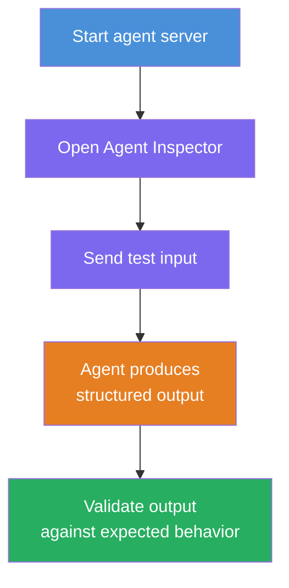
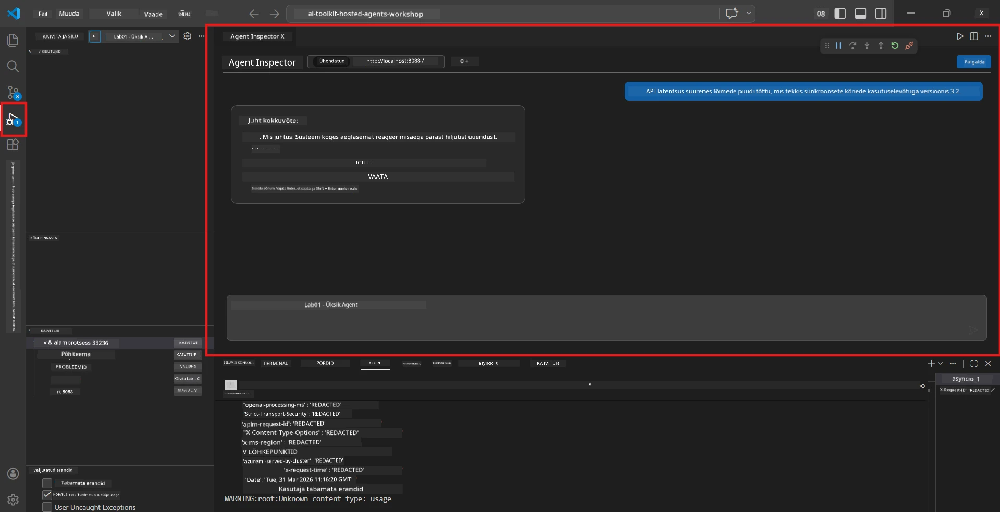
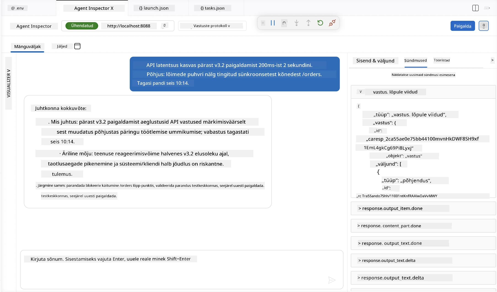

# Moodul 4 - Testi lokaalselt

⏱️ ~10 minutit

Selles moodulis käivitad oma agendi lokaalselt ja kinnitad, et see töötab korrektselt, kasutades **happy-path funktsionaalseid teste**. Kasutad Agent Inspectorit (visuaalne kasutajaliides) või otseseid HTTP-kõnesid, et kinnitada, et agent annab struktureeritud ja täpseid vastuseid.

### Kohaliku testimise voog



---

## Variant 1: Vajuta F5 - silumine Agent Inspectoriga (soovitatav)

### Käivita silur

1. Ava kaust **executive-summary-agent/** otse VS Code’is (`File → Open Folder`).
2. Ava **Run and Debug** paneel (`Ctrl+Shift+D`).
3. Vali rippmenüüst **Debug Local Agent HTTP Server**.
4. Vajuta **F5** (või klõpsa ▶ Käivita silumine).

> ⚠️ **Oluline: vali oma Python Interpreter**
> Kui saad "ModuleNotFoundError" või silur ei käivitu, pead VS Code’ile ütlema, et ta kasutaks su virtuaalset keskkonda:
  > 1. Vajuta `Ctrl+Shift+P` $\rightarrow$ kirjuta **Python: Select Interpreter**.
  > 2. Vali interpreter, mis asub sinu projekti kaustas `.venv` (nt `.\.venv\Scripts\python.exe` Windowsi puhul).
  > 3. Taaskäivita silumise sessioon.
> Kui saad ikka vigu, uuenda käsitsi faili `tasks.json` järgmiselt:
  > 1. Ava fail `.vscode/tasks.json`
  > 2. Otsi üles ülesanne nimetusega: `Run Agent HTTP Server`
  > 3. Uuenda käsu väärtus nii:
  >    - **Windows:** `"value": "${workspaceFolder}/.venv/Scripts/python.exe",`
  >    - **macOS/Linux:** `"value": "${workspaceFolder}/.venv/bin/python",`

### Mis juhtub

1. HTTP-server käivitub aadressil `http://localhost:8088/responses`.
2. **Agent Inspector** paneel avaneb automaatselt - visuaalne vestlusliides testimiseks.
3. Lõhke-punktid on lubatud failis `main.py`.

Vaata Terminali:
```
Starting executive summary hosted agent
Executive agent server running on http://localhost:8088
```

> **Kui Agent Inspector ei ava:** Vajuta `Ctrl+Shift+P` → **Foundry Toolkit: Open Agent Inspector**.



> *Ekraanipilt võib näidata vanemat 'AI TOOLKIT' brändingut varasemast laienduse versioonist.*

---

## Variant 2: Testi Terminali kaudu (alternatiiv)

Käivita agent ühes terminalis, saada päringuid teisest:

```bash
# Terminal 1: Start agent
cd executive-summary-agent/
source .venv/bin/activate
python main.py
```

```bash
# Terminal 2: Send test (curl)
curl -sS -X POST http://localhost:8088/responses \
  -H "Content-Type: application/json" \
  -d '{"input": "The API latency increased due to thread pool exhaustion caused by sync calls in v3.2.", "stream": false}'
```

---

## Stsenaariumitestid: happy-path funktsionaalne valideerimine

Käivita **kõik kolm** stsenaariumi allpool. Need kinnitavad, et sinu agent annab struktureeritud ja õige väljundi reaalse sisendi korral.



### Stsenaarium 1: IT intsident - API latentsi tõus

**Sisend:**
```
The API latency increased from 200ms to 2s after deploying v3.2.
Root cause: thread pool starvation from synchronous calls in /orders.
Rolled back at 10:14.
```

**Oodatud käitumine:**
- ✅ Järgib "Executive Summary" struktuuri (Mis juhtus / Äri mõju / Järgmine samm)
- ✅ Ei kasuta tehnilist žargooni (pole "thread pool", pole "/orders", pole "v3.2")
- ✅ Selgelt väljendab äri mõju (nt kasutajad kogesid viivitusi)
- ✅ Lisab järgmise sammu (nt paranduse juurutamine, jälgimine käib)

---

### Stsenaarium 2: Andmevoog - ETL tõrge

**Sisend:**
```
The nightly ETL job failed because the upstream schema changed. APAC dashboards show missing data.
```

**Oodatud käitumine:**
- ✅ Kokkuvõtte andmete värskenduse ebaõnnestumisest lihtsas keeles
- ✅ Mainib APAC dashboardi mõju
- ✅ Lisab parandava järgmise sammu
- ✅ Ei maini "ETL" ega "skeemi" või muid tehnilisi termineid

---

### Stsenaarium 3: Turvalisus - avalikustatud mandaadid

**Sisend:**
```
Static analysis flagged a hardcoded secret in the repository.
The secret may have been exposed in commit history.
```

**Oodatud käitumine:**
- ✅ Kirjeldab mandaadi/turvaprobleemi juhatajale sobivas keeles
- ✅ Toob välja võimaliku riski (loata ligipääs)
- ✅ Märgib parandustegevuse (mandaadi vahetus, audit)
- ✅ Ei sisalda termineid nagu "staatiline analüüs", "commit ajalugu" ega "kõvakodeeritud"

---

## Kinnituskriteeriumid

Kontrolli igas stsenaariumis:

| # | Kriteerium | Läbitulemuse tingimus |
|---|------------|-----------------------|
| 1 | **Struktuur** | Vastus kasutab "Executive Summary" vormingut kõigi kolme punktiga |
| 2 | **Lihtne keel** | Puudub tehniline žargoon, mida juht ei mõistaks |
| 3 | **Täpne** | Kokkuvõte peegeldab sisendit - pole väljamõeldud detaile |
| 4 | **Lühidus** | Vastus on alla 100 sõna |
| 5 | **Järgmine samm** | On selge tegevus või leevendus märgitud |

---

## Silumise nõuanded

| Probleem | Lahendus |
|---------|---------|
| Agent ei käivitu | Kontrolli `.env` väärtusi, veendu, et venv on aktiveeritud, käivita `pip install -r requirements.txt` |
| Vastus tühi või üldine | Vaata juhiseid failis `main.py` - veendu, et väljundi formaat on määratud |
| Vastus sisaldab žargooni | Tugevda juhistes "eemalda tehnilised terminid" reegleid |
| Agent Inspector ei ava | `Ctrl+Shift+P` → **Foundry Toolkit: Open Agent Inspector** |
| Mudeli vead Terminalis | Kontrolli, et `AZURE_AI_MODEL_DEPLOYMENT_NAME` vastab täpselt (suur- ja väiketähed tähtsad) |

---

### ✅ Kontrollpunkt

- [ ] Agent käivitub lokaalselt vigadeta
- [ ] Agent Inspector avaneb ja näitab vestlusliidest (kui kasutatakse F5)
- [ ] **Stsenaarium 1** (IT intsident) - struktureeritud Executive Summary, ilma žargoonita
- [ ] **Stsenaarium 2** (andmevoog) - asjakohane kokkuvõte äri mõjuga
- [ ] **Stsenaarium 3** (turvahoiatus) - sobiv riskiteavitamine
- [ ] Kõik vastused järgivad määratletud väljundstruktuuri

> **Salvesta oma vastused** (kopeeri või tee ekraanipilt) - võrdled neid pilves saadud tulemustega Moodulis 06.

---

**Eelmine:** [03 - Konfigureerimine ja kodeerimine](03-configure-and-code.md) · **Järgmine:** [05 - Deploy to Foundry →](05-deploy-to-foundry.md)

---

<!-- CO-OP TRANSLATOR DISCLAIMER START -->
**Lahtiütlus**:
See dokument on tõlgitud kasutades AI tõlketeenust [Co-op Translator](https://github.com/Azure/co-op-translator). Kuigi me püüdleme täpsuse poole, palun pange tähele, et automatiseeritud tõlgetes võib esineda vigu või ebatäpsusi. Originaaldokument selle emakeeles tuleks pidada autoriteetseks allikaks. Olulise teabe puhul soovitatakse kasutada professionaalset inimtõlget. Me ei vastuta selle tõlkega seotud eksimustest või valesti mõistmistest.
<!-- CO-OP TRANSLATOR DISCLAIMER END -->