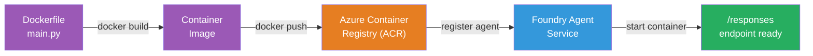
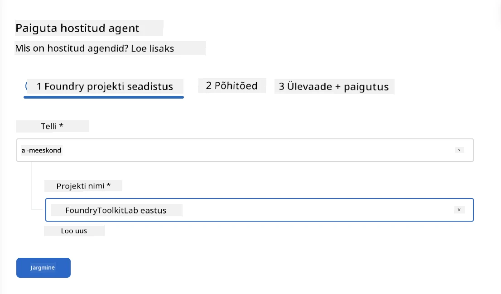
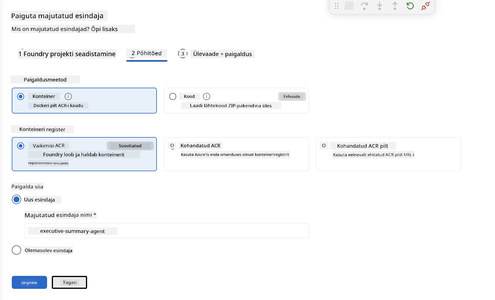
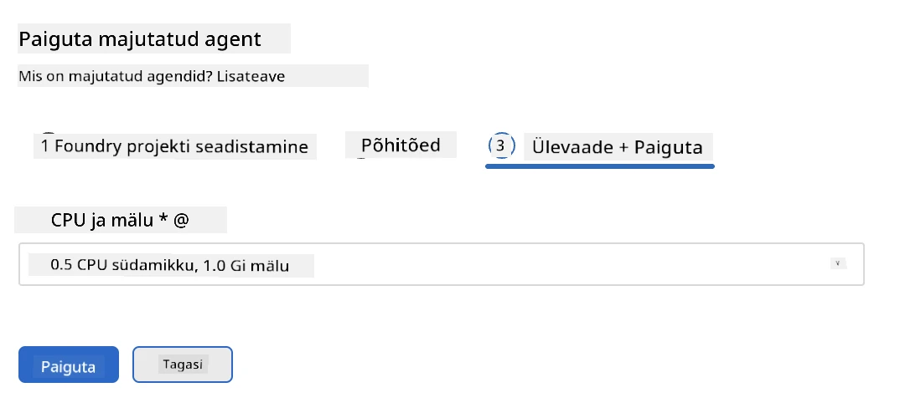
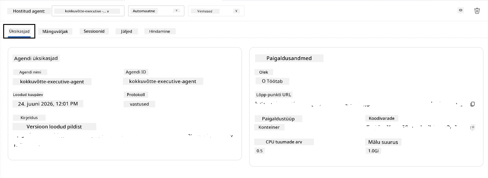

# Moodul 5 - Rakenda Foundry Agendi teenusesse

⏱️ ~10 min

> ⚠️ **Tee B kasutajad:** See moodul nõuab Foundry tellimust. Kui kasutate Foundry Locali, jätke see vahele ja minge järgmise juurde: [Moodul 07 - Kokkuvõte](07-summary.md). Olete edukalt lõpetanud kohaliku arenduse töövoo!

Selles moodulis rakendate oma kohapeal testitud agendi Microsoft Foundry'sse kui **Hostitud Agenti**. Rakendamine loob konteineripildi, saadab selle Azure Container Registry'sse ja käivitab agendi Foundry hallatud infrastruktuuris.

### Rakendamise torujuht

---

## Eeltingimuste kontroll

Enne rakendamist veenduge:

- [ ] Agent läbib kõik 3 kohalikku stsenaariumi [Moodul 04](04-test-locally.md)
- [ ] Teil on projekti tasandil **Azure AI User** roll ([Moodul 01, Määra RBAC](01-setup.md#juuruta-mudel-ja-määra-rbac))
- [ ] Olete VS Code'is Azure sisse logitud (Kontoikoonil kuvatakse teie nimi)

---

## Samm 1: Alusta rakendamist

### Variant A: Rakenda Agent Inspectori kaudu (soovitatav)

Kui Agent Inspector on avatud (testimisest):
1. Klõpsake paremas ülanurgas nuppu **Deploy** (pilveikoon ↑).

### Variant B: Rakenda käsupaleti kaudu

1. Vajutage `Ctrl+Shift+P` → **Foundry Toolkit: Deploy Hosted Agent**.

---

## Samm 2: Konfigureeri rakendus

Võlur küsib teilt:

| Küsitav | Valik |
|--------|-----------|
| **Tellimus** | Teie Azure tellimus |
| **Sihtprojekt** | Teie Foundry projekt (nt `workshop-agents`) |

Klõpsake **järgmine**, et oma agenti konfigureerida.

| Küsitav | Valik |
|--------|-----------|
| **Rakendamise meetod** | Konteiner |
| **Konteineriregister** | **Vaikimisi ACR** (Microsoft Foundry loob ja haldab seda teie eest) |
| **Rakenda** | Uuele agentile (nimi, `executive-summary-agent`) |

Klõpsake **järgmine**, et üle vaadata ja rakendada oma agent.

| Küsitav | Valik |
|--------|-----------|
| **CPU ja mälu** | **0.25 CPU tuuma, 0.5 Gi mälu** (töötoa jaoks piisav) |

---

## Samm 3: Rakenda ja jälgi

1. Klõpsake **Deploy**.
2. Vaadake **Output** paneeli (valige rippmenüüst **Microsoft Foundry**).
3. Rakendamine toimub järgmistes etappides:
   - **Docker buildeerimine** - ehitab konteineri teie Dockerfile'ist
   - **Docker push** - saadab pildi ACR-i (1–3 min esimesel rakendamisel)
   - **Agendi registreerimine** - loob hostitud agendi Foundrys
   - **Konteineri käivitamine** - käivitub süsteemi hallatava identiteediga

4. Kui lõpetatud, ilmub teavitus:
   > **my-agent on edukalt rakendatud.** `View logs` `Run agent`

5. Klõpsake **Run agent**, et avada Agent Playground.

### Rakendamise staatuste väärtused

| Staatus | Tähendus |
|--------|---------|
| **Running** | Konteiner valmis, agent reageerib |
| **Pending** | Konteiner käivitub - oodake 30–60 sekundit |
| **Failed** | Kontrollige logisid (vt veaotsing allpool) |

---

## Levinumad rakenduse vead

| Viga | Põhjus | Lahendus |
|-------|-----------|-----|
| `agents/write` luba keelatud | Puudub **Azure AI User** roll projekti tasandil | [Moodul 01, Määra RBAC](01-setup.md#juuruta-mudel-ja-määra-rbac) |
| Docker ei jookse | Docker Desktop pole käivitatud | Käivita Docker Desktop → kontrolli `docker info` |
| ACR autoriseerimine | Hallataval identiteedil pole pildi tõmbamise õigust | Vaata [Moodul 08 - Veaotsing](08-troubleshooting.md) |

---

### ✅ Kontrollpunkt

- [ ] Rakendamine lõpetatud ilma vigadeta
- [ ] Agent on nähtaval **Hosted Agents (Preview)** Foundry külgribal
- [ ] Konteineri staatus näitab **Running**
- [ ] Agent Playground vahekaart avatud, kuvatakse agendi andmed ja lõpp-punkti URL

---

**Eelmine:** [04 - Testi kohapeal](04-test-locally.md) · **Järgmine:** [06 - Kontrolli Playground'is →](06-verify-in-playground.md)

---

<!-- CO-OP TRANSLATOR DISCLAIMER START -->
**Lahtiütlus**:
See dokument on tõlgitud kasutades AI tõlketeenust [Co-op Translator](https://github.com/Azure/co-op-translator). Kuigi me püüdleme täpsuse poole, palun pange tähele, et automatiseeritud tõlgetes võib esineda vigu või ebatäpsusi. Originaaldokument selle emakeeles tuleks pidada autoriteetseks allikaks. Olulise teabe puhul soovitatakse kasutada professionaalset inimtõlget. Me ei vastuta selle tõlkega seotud eksimustest või valesti mõistmistest.
<!-- CO-OP TRANSLATOR DISCLAIMER END -->
