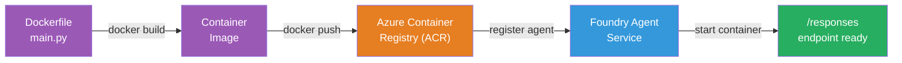
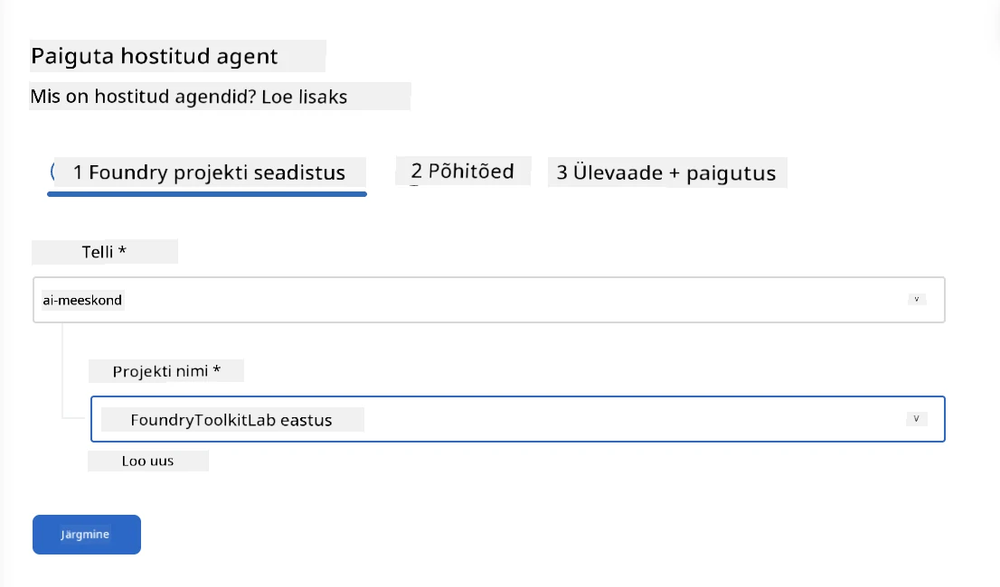
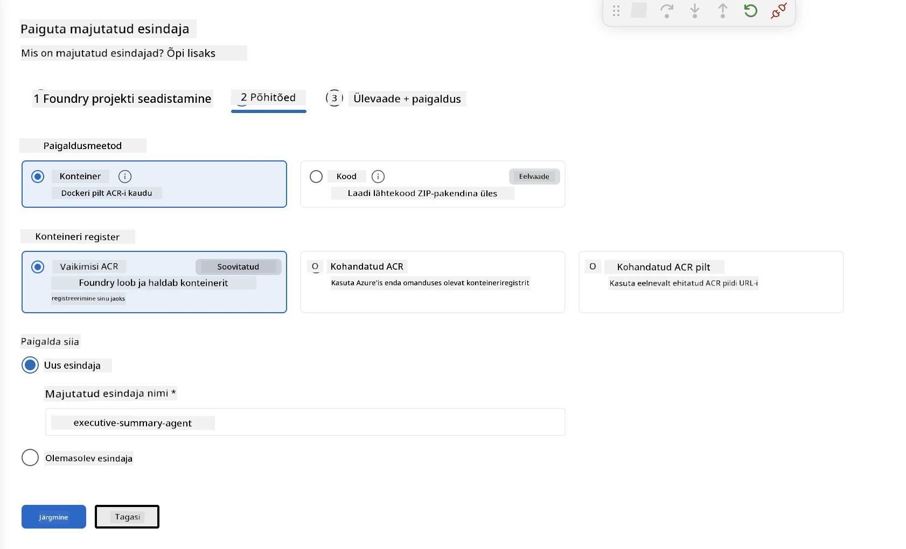
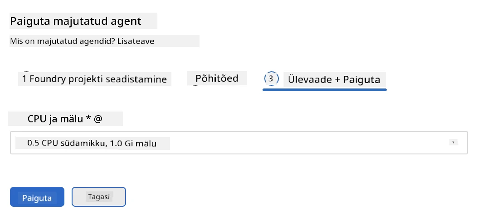
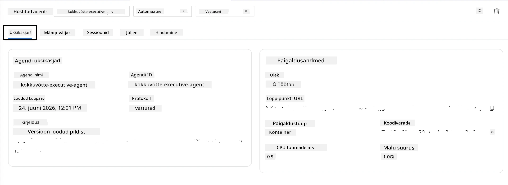

# Moodul 5 - Paigalda Foundry agendi teenusesse

⏱️ ~10 minutit

> ⚠️ **Path B kasutajad:** See moodul nõuab Foundry tellimust. Kui kasutate Foundry Locali, minge edasi [Moodul 07 - Kokkuvõte](07-summary.md). Olete edukalt lõpetanud kohaliku arenduse töövoo!

Selles moodulis paigaldate oma kohapeal testitud agendi Microsoft Foundrysse kui **majutatava agendi**. Paigaldus ehitab konteineri kujutise, saadab selle Azure konteineri registrisse ja käivitab agendi Foundry hallatud infrastruktuuris.

### Paigalduse töövoog

---

## Eeltingimuste kontroll

Enne paigaldust kontrollige:

- [ ] Agent läbib kõik 3 kohalikku stsenaariumi [Moodul 04](04-test-locally.md)
- [ ] Teil on projekti tasandil **Azure AI kasutaja** roll ([Moodul 01, RBAC määramine](01-setup.md#deploy-a-model--assign-rbac))
- [ ] Olete VS Code'is Azure'i sisse logitud (konto ikoonil kuvatakse teie nimi)

---

## 1. samm: Alustage paigaldust

### Variant A: Paigalda Agent Inspectori kaudu (soovitatav)

Kui Agent Inspector on avatud (testimisest):
1. Klõpsake paremas ülanurgas nuppu **Deploy** (pilveikoon ↑).

### Variant B: Paigalda käsuplaadilt

1. Vajutage `Ctrl+Shift+P` → **Foundry Toolkit: Deploy Hosted Agent**.

---

## 2. samm: Seadistage paigaldus

Väli palub teil valida:

| Väli | Valik |
|--------|-----------|
| **Tellimus** | Teie Azure’i tellimus |
| **Sihtprojekt** | Teie Foundry projekt (nt `workshop-agents`) |

Klõpsake **next**, et seadistada agent.

| Väli | Valik |
|--------|-----------|
| **Paigalduse meetod** | Konteiner |
| **Konteineriregister** | **Vaikimisi ACR** (Microsoft Foundry loob ja haldab teie jaoks üht) |
| **Paigalda** | Uus agent (nimi, `executive-summary-agent`) |

Klõpsake **next**, et üle vaadata ja paigaldada agent.

| Väli | Valik |
|--------|-----------|
| **CPU ja mälu** | **0,5 CPU südamikku, 1,0 Gi mälu** (vaikimisi - piisav töötoaks) |

---

## 3. samm: Paigalda ja jälgi

1. Klõpsake **Deploy**.
2. Vaadake **Output** paneeli (valige rippmenüüst **Microsoft Foundry**).
3. Paigaldus kulgeb järgmistes etappides:
   - **Docker build** - ehitab konteineri teie Dockerfile'ist
   - **Docker push** - saadab kujutise ACR-i (1–3 minutit esimesel paigalduse korral)
   - **Agendi registreerimine** - loob majutatud agendi Foundrys
   - **Konteineri käivitamine** - käivitatakse süsteemihaldatud identiteediga

4. Kui valmis, kuvatakse teade:
   > **executive-summary-agent paigaldati edukalt.** `View logs` `Run agent`

5. Klõpsake **Run agent**, et avada Agent Playground.

### Paigalduse oleku väärtused

| Oleku väärtus | Tähendus |
|--------|---------|
| **Jookseb** | Konteiner valmis, agent vastab |
| **Ootel** | Konteiner käivitub - oodake 30–60 sekundit |
| **Ebaõnnestus** | Kontrollige logisid (vt allolevalt veaotsingut) |

---

## Levinumad paigaldusvead

| Viga | Põhjus | Lahendus |
|-------|-----------|-----|
| `agents/write` luba keelatud | Puudub projekti tasandi **Azure AI kasutaja** roll | [Moodul 01, RBAC määramine](01-setup.md#deploy-a-model--assign-rbac) |
| Docker ei tööta | Docker Desktop pole käivitatud | Käivitage Docker Desktop → kontrollige `docker info` |
| ACR autoriseerimine | Hallatav identiteet ei saa kujutist alla laadida | Vaadake [Moodul 08 - Veaotsing](08-troubleshooting.md) |

---

### ✅ Kontrollpunkt

- [ ] Paigaldus valmis ilma vigadeta
- [ ] Agent kuvatakse vahekaardil **Hosted Agent**, kui klõpsate oma projekti alt Foundry Toolkit küljeribal **Agents**
- [ ] Konteineri olek näitab **Jookseb**
- [ ] Agent Playground vahekaart avatud, näidates agendi üksikasju ja lõpp-punkti URL-i

---

**Eelmine:** [04 - Testi kohalikult](04-test-locally.md) · **Järgmine:** [06 - Kontrolli Playground'is →](06-verify-in-playground.md)

---

<!-- CO-OP TRANSLATOR DISCLAIMER START -->
**Lahtiütlus**:
See dokument on tõlgitud kasutades AI tõlketeenust [Co-op Translator](https://github.com/Azure/co-op-translator). Kuigi me püüdleme täpsuse poole, palun pange tähele, et automatiseeritud tõlgetes võib esineda vigu või ebatäpsusi. Originaaldokument selle emakeeles tuleks pidada autoriteetseks allikaks. Olulise teabe puhul soovitatakse kasutada professionaalset inimtõlget. Me ei vastuta selle tõlkega seotud eksimustest või valesti mõistmistest.
<!-- CO-OP TRANSLATOR DISCLAIMER END -->