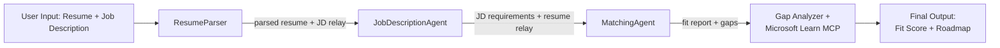

# PersonalCareerCopilot - CV → Töö sobivuse hindaja

Töökäigusüsteemiga mitmeagentuuri rakendus, mis hindab, kui hästi CV vastab töökuulutusele, seejärel genereerib isikupärastatud õppekava, et sulgeda puudujäägid.

---

## Agentide rollid

| Agent | Roll | Tööriistad |
|-------|------|-------|
| **ResumeParser** | Eristab strukureeritud oskused, kogemused, sertifikaadid CV tekstist | - |
| **JobDescriptionAgent** | Eristab nõutud/soovitud oskused, kogemused, sertifikaadid töökuulutusest | - |
| **MatchingAgent** | Võrdleb profiili ja nõudeid → sobivuse skoor (0-100) + leitud/puuduvad oskused | - |
| **GapAnalyzer** | Koostab isikupärastatud õppekava Microsoft Learn ressurssidega | `search_microsoft_learn_for_plan` (MCP) |

## Töökäigusüsteem



---

## Kiire algus

### 1. Keskkonna seadistamine

See kaust on viitereaalne teostus töökäigu-põhise Lab 02 raamistiku jaoks. Selle `main.py` kasutab olemasolevaid promptplokke ning `WorkflowBuilder`, et ühendada neli agenti omavahel.

```powershell
cd workshop\lab02-multi-agent\PersonalCareerCopilot
python -m venv .venv
.\.venv\Scripts\Activate.ps1          # Windows PowerShell
# source .venv/bin/activate            # macOS / Linux
pip install -r requirements.txt
```

### 2. Volituste konfigureerimine

Loo selles kaustas `.env` fail:

```powershell
copy .env .env.bak 2>$null; echo $null > .env
```

Muuda `.env`:

```env
FOUNDRY_PROJECT_ENDPOINT=https://<your-account>.services.ai.azure.com/api/projects/<your-project>
AZURE_AI_MODEL_DEPLOYMENT_NAME=gpt-4.1-mini
```

| Väärtus | Kus leida |
|-------|------------------|
| `FOUNDRY_PROJECT_ENDPOINT` | Foundry Toolkit külgriba → paremklõps projektil → **Kopeeri projekti lõpp-punkt** |
| `AZURE_AI_MODEL_DEPLOYMENT_NAME` | Foundry külgriba → ava projekt → **Mudelite + lõpp-punktide** alt → juurutuse nimi |

### 3. Käivita lokaalselt

```powershell
python -m debugpy --listen 127.0.0.1:5679 main.py --port 8088
```

Või kasuta VS Code ülesannet: `Ctrl+Shift+P` → **Tasks: Run Task** → **Run Agent HTTP Server**.

F5 silumiskäivituseks kasuta **Debug Local Agent HTTP Server**.

### 4. Testi Agent Inspectoriga

Ava Agent Inspector: `Ctrl+Shift+P` → **Foundry Toolkit: Open Agent Inspector**.

Kleebi see testimispäring:

```
Resume:
Jane Doe
Senior Software Engineer with 5 years of experience in Python, Django, and AWS.
Built microservices handling 10K+ requests/second. Led a team of 4 developers.
Certifications: AWS Solutions Architect Associate.
Education: B.S. Computer Science, State University.

Job Description:
Senior Cloud Engineer at Contoso Ltd.
Required: Python, Azure, Kubernetes, Terraform, CI/CD pipelines.
Preferred: Go, monitoring (Prometheus/Grafana), cost optimization.
Experience: 5+ years in cloud infrastructure.
Certifications: Azure Solutions Architect Expert preferred.
```

**Oodatud:** Ühendatuse skoor (0-100), leitud/puuduvad oskused ning Microsoft Learni URLidega isikupärastatud õppekava.

### 5. Juuruta Foundrysse

`Ctrl+Shift+P` → **Foundry Toolkit: Deploy Hosted Agent** → vali oma projekt → kinnita.

---

## Projekti struktuur

```
PersonalCareerCopilot/
├── .env                ← Your credentials (git-ignored)
├── agent.yaml          ← Hosted agent definition (name, resources, env vars)
├── Dockerfile          ← Container image for Foundry deployment
├── main.py             ← 4-agent workflow (instructions, MCP tool, WorkflowBuilder)
└── requirements.txt    ← Python dependencies
```

## Põhifailid

### `agent.yaml`

Määratleb hostitud agendi Foundry Agent Service jaoks:
- `kind: hosted` - käitub haldatud konteinerina
- `protocols` - `responses` protokoll koos `version: 2.0.0`, ekposeerides `/responses` HTTP lõpp-punkti
- `environment_variables` - `AZURE_AI_MODEL_DEPLOYMENT_NAME` on siin deklareeritud; `FOUNDRY_PROJECT_ENDPOINT` süstitakse automaatselt juurutuse ajal

### `main.py`

Sisaldab:
- **Agendi juhised** - neli `*_INSTRUCTIONS` konstantset väärtust, üks iga agendi kohta
- **MCP tööriist** - `search_microsoft_learn_for_plan()` kutsub `https://learn.microsoft.com/api/mcp` Streamable HTTP kaudu
- **Agendi loomine** - neli `Agent()` + `AgentExecutor()` eksemplari, mis jagavad üht `FoundryChatClient`
- **Töökäigusüsteemi graafik** - `WorkflowBuilder` ühendab agendid järjestikusena: ResumeParser → JD Agent → MatchingAgent → GapAnalyzer
- **Serveri käivitamine** - `ResponsesHostServer` jookseb pordil 8088

### `requirements.txt`

| Pakett | Eesmärk |
|---------|----------|
| `agent-framework-foundry` | Tööajatuum: `Agent`, `AgentExecutor`, `WorkflowBuilder`, `@tool`, `FoundryChatClient` |
| `agent-framework-foundry-hosting` | `ResponsesHostServer` + Foundry majutuse integratsioon |
| `mcp<2,>=1.24.0` | MCP klient GapAnalyzeri jaoks (`streamable_http_client`) |
| `debugpy` | Python silumine (F5 VS Code's) |

---

## Probleemide lahendamine

| Probleem | Lahendus |
|-------|-----|
| `KeyError: 'FOUNDRY_PROJECT_ENDPOINT'` või `KeyError: 'AZURE_AI_MODEL_DEPLOYMENT_NAME'` | Loo `.env`, kus on mõlemad `FOUNDRY_PROJECT_ENDPOINT` ja `AZURE_AI_MODEL_DEPLOYMENT_NAME` seatud |
| `ModuleNotFoundError: No module named 'agent_framework'` | Aktiveeri venv ja käivita `pip install -r requirements.txt` |
| Puuduvad Microsoft Learni URL-id väljundis | Kontrolli internetiühendust `https://learn.microsoft.com/api/mcp` vastu |
| Ainult 1 gap kaart (tükeldatud) | Kinnita, et `GAP_ANALYZER_INSTRUCTIONS` sisaldab `CRITICAL:` plokki |
| Port 8088 on hõivatud | Peata muud serverid: `netstat -ano \| findstr :8088` |

Täpsemaks probleemide lahendamiseks vaata [Moodul 8 - Probleemide lahendamine](../docs/08-troubleshooting.md).

---

**Täielik juhend:** [Lab 02 Docs](../docs/README.md) · **Tagasi:** [Lab 02 README](../README.md) · [Töötoa avaleht](../../../README.md)

---

<!-- CO-OP TRANSLATOR DISCLAIMER START -->
**Lahtiütlus**:
See dokument on tõlgitud kasutades AI tõlketeenust [Co-op Translator](https://github.com/Azure/co-op-translator). Kuigi me püüdleme täpsuse poole, palun pange tähele, et automatiseeritud tõlgetes võib esineda vigu või ebatäpsusi. Originaaldokument selle emakeeles tuleks pidada autoriteetseks allikaks. Olulise teabe puhul soovitatakse kasutada professionaalset inimtõlget. Me ei vastuta selle tõlkega seotud eksimustest või valesti mõistmistest.
<!-- CO-OP TRANSLATOR DISCLAIMER END -->