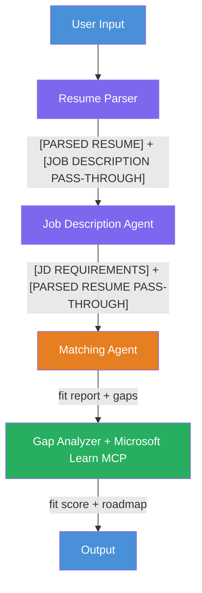

# Labor 02 - Mitmeagendi töövoog: CV → Tööpakkumise sobivuse hindaja

## Ülevaade

Selles praktilises laboris ehitate **töövoog-esimese mitmeagendi rakenduse** Foundry Tööriistakomplekti abil VS Code’is ja juurutate selle Microsoft Foundry Agendi teenusesse.

**Mida te ehitate:** CV → Tööpakkumise sobivuse hindaja, mis analüüsib CV ja töökirjelduse, hindab sobivust ning koostab isikupärastatud õppimise teekaardi Microsoft Learni ressursside põhjal.

---

## Arhitektuur

**Kuidas see töötab:**
1. Kasutaja kleebib CV ja töökirjelduse.
2. **ResumeParser** töötleb CV ja kopeerib töökirjelduse samasuguselt `[JOB DESCRIPTION PASS-THROUGH]` sektsiooni.
3. **JD Agent** eraldab struktuurseid nõudeid edasiantud osast, seejärel edastab `[PARSED RESUME]` edasi kui `[PARSED RESUME PASS-THROUGH]`.
4. **MatchingAgent** võrdleb `[PARSED RESUME PASS-THROUGH]` ja `[JD REQUIREMENTS]` ning genereerib sobivuse skoori.
5. **GapAnalyzer** muudab puudujäägid praktiliseks teekaardiks ja hangib Microsoft Learni tegelikke linke MCP kaudu.

---

## Eeldused

Lõpetage esmalt Labor 01:

- [Labor 01 - Üksikagent](../lab01-single-agent/README.md)

---

## Osa 1: Loe mooduleid järjestikku

Täielik õpperada asub:

- [Labor 2 Dokumendid - Eeldused](docs/00-prerequisites.md)
- [Labor 2 Dokumendid - Täielik õpperada](docs/README.md)
- [PersonalCareerCopilot kasutusjuhend](PersonalCareerCopilot/README.md)

---

## Osa 2: Ehita ja testi töövoogu

1. Kasuta Foundry Tööriistakomplekti võlurit töövoopõhise projekti ehitamiseks.
2. Kopeeri promptiplokid ja töövoogude graafik `PersonalCareerCopilot/main.py`-st oma töökeskkonda.
3. Käivita lokaalselt Agent Inspectoriga ja kontrolli kõiki nelja agenti ning MCP tööriista.
4. Kui lokaaltestis õnnestub, juuruta majutatud agent Foundrys.

---

## Orkestreerimismustrid

Labor 02 kasutab **järjestikust torujuhet**: iga agendi väljund söödab järgmist, ja töövoog tagastab viimase agendi vastuse. Seda toimimist toetavad kaks mustrit:

- **Järjestikune ahel** - `WorkflowBuilder` ühendab ResumeParser → JD Agent → MatchingAgent → GapAnalyzer ühe `add_edge()`-kutsena igas etapis
- **Sisu edastamine** - kuna iga agent näeb ainult oma otsest eelkäijat, kopeerivad ResumeParser ja JD Agent allapoole agentidele vajaliku info märgistatud läbivaatud sektsioonidesse

Dokumendid selgitavad ka, miks labor ei kasuta fan-out/fan-in mustrit ja kuidas graafikut saab laiendada teise agendiga.

Vaata [docs/04-orchestration-patterns.md](docs/04-orchestration-patterns.md).

---

**Eelmine:** [Labor 01 - Üksikagent](../lab01-single-agent/README.md) · **Tagasi:** [Töötoa avaleht](../../README.md)

---

<!-- CO-OP TRANSLATOR DISCLAIMER START -->
**Lahtiütlus**:
See dokument on tõlgitud kasutades AI tõlketeenust [Co-op Translator](https://github.com/Azure/co-op-translator). Kuigi me püüdleme täpsuse poole, palun pange tähele, et automatiseeritud tõlgetes võib esineda vigu või ebatäpsusi. Originaaldokument selle emakeeles tuleks pidada autoriteetseks allikaks. Olulise teabe puhul soovitatakse kasutada professionaalset inimtõlget. Me ei vastuta selle tõlkega seotud eksimustest või valesti mõistmistest.
<!-- CO-OP TRANSLATOR DISCLAIMER END -->