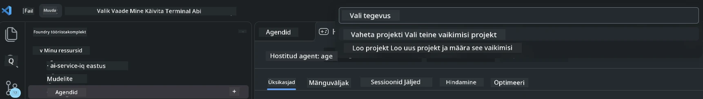

# Moodul 0 - Sissejuhatus

⏱️ ~10 minutit

> [!WARNING]
> **Eelvaade & piirangud:** [Hostitud agendid](https://learn.microsoft.com/azure/foundry/agents/concepts/hosted-agents) on hetkel **avalikus eelvaates** – tootmiskoormuste jaoks ei soovitata. Mõned selle töötoa funktsioonid võivad muutuda teenuse GA-sse jõudes.

## Mida sa ehitad

Selles laboris laiendad üheaagentsete oskuste komplekti Laborist 01 ja ehitad **mitmeagendilise töövoo** - CV → Töö sobivuse hindaja.

Sisestad **cv** ja **töö kirjelduse**. Neli spetsialiseerunud agenti töötlevad sisendi järjestikku ning tagastavad:
- Sobivuse skoori (0–100 skooride jaotusega)
- Oskuste ja sertifikaatide puuduste nimekirja
- Isikupärastatud õppeplaani koos tegelike Microsoft Learni linkidega iga puuduse jaoks

**Töövoog kasutab:**
- **Microsoft Agent Frameworki** - `WorkflowBuilder` järjestikuse torujuhtme orkestreerimiseks
- **Foundry VS Code tööriistakomplekti** - karkass, kohalik testimine, juurutamine
- **Tehisintellekti mudelit** (nt `gpt-4.1-mini`) - mida kasutavad kõik neli agenti
- **Microsoft Learni MCP serverit** - pakub tegelikke õppematerjalide linke iga oskuspuuduse jaoks

---

## Vali oma tee

> ⚠️ **Jätka sama teega, mida kasutasid Laboris 01.**

<details open>
<summary><strong>🅰️ Tee A - Azure pilv (nõuab Azure tellimust)</strong></summary>

| | Üksikasjad |
|---|---|
| **Kellele see on?** | Sa lõpetasid Labor 01 kasutades Azure tellimust |
| **Mudelitüüp** | Azure OpenAI läbi Foundry (nt `gpt-4.1-mini`) |
| **Kaetud moodulid** | Kõik moodulid (00–09) |
| **Juurutada pilve?** | ✅ Jah – täielik otsast lõpuni juurutus |

</details>

<details open>
<summary><strong>🅱️ Tee B - Foundry kohalik (ei nõua Azure tellimust)</strong></summary>

| | Üksikasjad |
|---|---|
| **Kellele see on?** | Sa lõpetasid Labor 01 kasutades Foundry Kohalikku |
| **Mudelitüüp** | Foundry Kohalik (tasuta, jookseb su masina peal) |
| **Kaetud moodulid** | Moodulid 00–05 (vahele jätta 06–07 - juurutamine ja pilvekinnitamine) |
| **Juurutada pilve?** | ❌ Ei – ainult kohalik testimine Agent Inspectori kaudu |

</details>

---

## Labor 01 kontroll

Labor 02 ehitab otseselt Labor 01 peale. Enne alustamist lõpeta Labor 01.

Pole veel Labor 01 lõpetanud? Alusta siit: [Labor 01 - Sissejuhatus](../../lab01-single-agent/docs/00-prerequisites.md)

<details open>
<summary><strong>🅰️ Tee A - Azure pilv</strong></summary>

```powershell
az account show --query "{name:name, id:id}" --output table
```

Kui see ebaõnnestub, käivita `az login`. Seejärel kontrolli VS Code’is:

1. `Ctrl+Shift+P` → tipi **Foundry Toolkit** → kinnita, et käsud kuvatakse.
2. Klõpsa **Foundry Toolkit** ikoonile → su projekt ja juurutatud mudel näitab **On õnnestunud**.



> **RBAC:** Sa määrasid Laboris 01 **Foundry Kasutaja** rolli. Kui vajad rolli uuesti määramist, vaata [Labor 01, Moodul 1](../../lab01-single-agent/docs/01-setup.md#deploy-a-model--assign-rbac). Roll kandis varem nime **Azure AI Kasutaja** – samad õigused.

</details>

<details open>
<summary><strong>🅱️ Tee B - Foundry kohalik</strong></summary>

```powershell
Invoke-WebRequest -Uri "http://localhost:5273/v1/health" -UseBasicParsing | Select-Object StatusCode
```

Oodatav: `StatusCode: 200`. Kui ei, taaskäivita Foundry Kohalik Foundry Toolkit külgribalt.

> Kõik inferentsid töötavad su masinas. Ainuke väljaminev kõne on MCP tööriistale aadressile `https://learn.microsoft.com/api/mcp`.

</details>

---

## Mis on uut laboris 02

| | Labor 01 | Labor 02 |
|--|--------|--------|
| Agendid | 1 | 4 (järjestatud WorkflowBuilderiga) |
| Karkassimall | Põhiline - Agent Framework | Töövood - Agent Framework |
| Uus pakett | - | `mcp` |
| Orkestreerimine | Üks vestlusagent | Järjestikune torujuhtme orkestreerimine (WorkflowBuilder) |
| Uus tööriist | - | `search_microsoft_learn_for_plan` (MCP) |

---

**Järgmine:** [01 - Arhitektuuri mõistmine →](01-understand-multi-agent.md)

---

<!-- CO-OP TRANSLATOR DISCLAIMER START -->
**Lahtiütlus**:
See dokument on tõlgitud kasutades AI tõlketeenust [Co-op Translator](https://github.com/Azure/co-op-translator). Kuigi me püüdleme täpsuse poole, palun pange tähele, et automatiseeritud tõlgetes võib esineda vigu või ebatäpsusi. Originaaldokument selle emakeeles tuleks pidada autoriteetseks allikaks. Olulise teabe puhul soovitatakse kasutada professionaalset inimtõlget. Me ei vastuta selle tõlkega seotud eksimustest või valesti mõistmistest.
<!-- CO-OP TRANSLATOR DISCLAIMER END -->