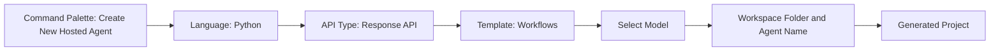
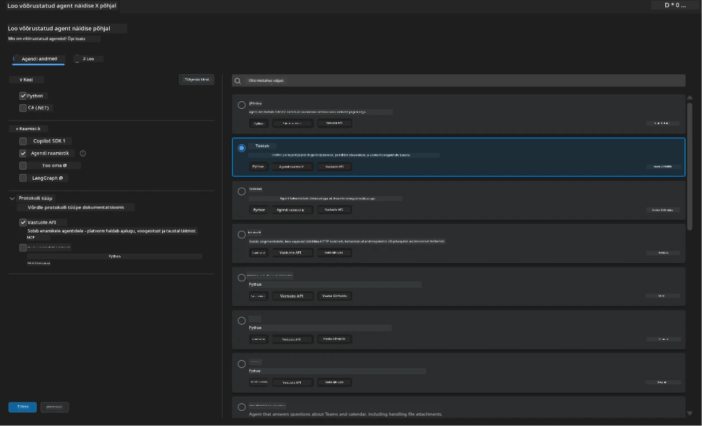
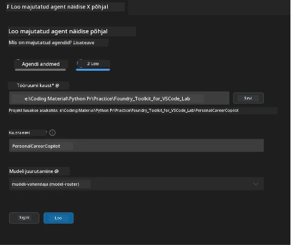

# Moodul 2 - Mitme agendi projekti karkassi ülespanek

⏱️ ~5 min

Selles moodulis kasutate [Foundry Toolkit for VS Code](https://aka.ms/foundrytk), et **karkassida mitme agendi projekt**. Vürst genereerib `agent.yaml`, `main.py`, `Dockerfile`, `requirements.txt`, `.env` ja VS Code silumise konfiguratsiooni – nii et saate keskenduda 4-agendi töövoo ühendamisele Moodulis 3.

> **Põhikontseptsioon:** Karkass on toimiv alus ühe agendiga. Asendate kohatäite loogika `WorkflowBuilder` graafikuga Moodulis 3. Te ei kirjuta boilerplate'i nullist.

> **Võrdlusnäide:** [`PersonalCareerCopilot/`](../../../../../workshop/lab02-multi-agent/PersonalCareerCopilot) on täielik toimiv näide. Kasutage seda, et võrrelda oma tööd jooksvalt.

### Karkassi vürsti voog



---

## 1. samm: Ava Create Hosted Agent vürst

1. Vajutage `Ctrl+Shift+P`, et avada **Command Palette**.
2. Tippige: **Foundry Toolkit: Create new Hosted Agent** ja valige see.
3. Vürst avaneb **Agent Details** vahekaardil.

> **Alternatiiv:** Klõpsake Activity Baril **Foundry Toolkit** ikooni → klõpsake **+** ikooni **Hosted Agents** kõrval → **Create New Hosted Agent**.

---

## 2. samm: Valige seaded



1. Vasakpoolses navigeerimis-/valikute jaotises valige järgmised:

| Menüü | Valik | Märkused |
|--------|-----------|-------|
| **Keel** | Python | Toetatud on ka C# (.NET) |
| **Raamistik** | Agent Framework | Pakub `Agent`, `AgentExecutor`, `WorkflowBuilder` |
| **API tüüp** | Response API | `POST /responses` - platvormi hallatud ajalugu, voogedastuse tugi |
| **Mall** | **Workflows** | Töötleb päringuid järjestikku mitme agendi kaudu |

2. Kui valitud, klõpsake **Next**



3. Järgmises aknas valige järgmised:

| Menüü | Valik | Märkused |
|--------|-----------|-------|
| **Tööruumi kaust** | Sirvige sihtkausta | nt `workshop/lab02-multi-agent/` selles reposis |
| **Agendi nimi** | `PersonalCareerCopilot` | See saab projekti kataloogi nimeks |
| **Mudeli juurutus** | Valige juurutatud mudel | nt `gpt-4.1-mini` Laborist 01 |

4. Klõpsake **Create**, et projekti karkassida. VS Code genereerib failid ja avab kausta.

> **Nipid:** [`gpt-4.1-mini`](https://learn.microsoft.com/azure/foundry/foundry-models/concepts/models-sold-directly-by-azure#gpt-41-series) tasakaalustab mitme agendi arenduse kiiruse ja kvaliteedi hästi.

---

## 3. samm: Kontrollige genereeritud projekti

Pärast karkassi valmimist veenduge, et Exploreris (`Ctrl+Shift+E`) on need failid nähtavad:

```
📂 <your-agent-name>/
├── .azdignore          ← Files excluded from Azure Developer CLI deployments
├── .dockerignore       ← Files excluded from Docker builds
├── .env                ← Environment variables (placeholders - fill in Module 3)
├── .vscode/
│   ├── launch.json     ← Debug config (F5 → run + Agent Inspector)
│   └── tasks.json      ← VS Code task definitions
├── agent.yaml          ← Agent definition (kind: hosted, protocol: responses)
├── Dockerfile          ← Container config for deployment
├── main.py             ← Stub agent entry point (replace with WorkflowBuilder in Module 3)
└── requirements.txt    ← Python dependencies
```

> **Oluline:** Avage see karkassitud kaust otse VS Codes, et `.vscode/launch.json` ja `tasks.json` rakenduksid õigesti F5 silumisel.

### Põhilised failid selgitatud

| Fail | Eesmärk |
|------|---------|
| `agent.yaml` | Deklareerib `kind: hosted`, kaardistab env-muutujad, määratleb `/responses` protokolli |
| `main.py` | Stub: üks `FoundryChatClient` → `Agent` → `ResponsesHostServer`. Asendate selle 4 agendi + `WorkflowBuilder` vastu Moodulis 3 |
| `Dockerfile` | `python:3.12-slim`, installib `requirements.txt`, avab pordi 8088, käivitab `python main.py` |
| `requirements.txt` | `agent-framework-foundry`, `agent-framework-foundry-hosting`, `mcp<2,>=1.24.0`, `debugpy` |

> **Viide:** Vaadake [`PersonalCareerCopilot/agent.yaml`](../../../../../workshop/lab02-multi-agent/PersonalCareerCopilot/agent.yaml) ja [`PersonalCareerCopilot/requirements.txt`](../../../../../workshop/lab02-multi-agent/PersonalCareerCopilot/requirements.txt) täieliku genereeritud sisu jaoks.

---

### ✅ Kontrollpunkt

- [ ] Karkassi vürst lõpetatud – uus projekti kaust on Exploreri vaates nähtav
- [ ] Kõik oodatud failid olemas: `agent.yaml`, `main.py`, `Dockerfile`, `requirements.txt`, `.env`
- [ ] `agent.yaml` kuvab `kind: hosted` ja `protocol: responses`
- [ ] `main.py` impordib `Agent`, `FoundryChatClient`, `ResponsesHostServer`
- [ ] Karkassitud kaust on avatud kui VS Code tööruumi juurkataloog
- [ ] Sa mõistad, et `main.py` on stub – `WorkflowBuilder` lisatakse Moodulis 3

---

**Eelmine:** [01 - Mõista mitme agendi arhitektuuri](01-understand-multi-agent.md) · **Järgmine:** [03 - Konfigureeri agendid ja keskkond →](03-configure-agents.md)

---

<!-- CO-OP TRANSLATOR DISCLAIMER START -->
**Lahtiütlus**:
See dokument on tõlgitud kasutades AI tõlketeenust [Co-op Translator](https://github.com/Azure/co-op-translator). Kuigi me püüdleme täpsuse poole, palun pange tähele, et automatiseeritud tõlgetes võib esineda vigu või ebatäpsusi. Originaaldokument selle emakeeles tuleks pidada autoriteetseks allikaks. Olulise teabe puhul soovitatakse kasutada professionaalset inimtõlget. Me ei vastuta selle tõlkega seotud eksimustest või valesti mõistmistest.
<!-- CO-OP TRANSLATOR DISCLAIMER END -->