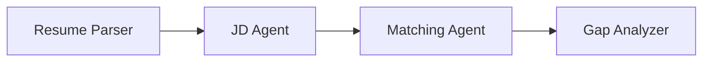
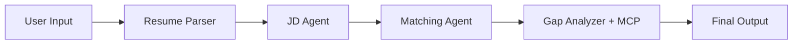

# Moodul 4 - Otsustusmustrid

⏱️ ~10 minutit

Selles moodulis uurite orkestreerimise mustreid, mida kasutatakse Resume Job Fit Evaluatori juures, ning õpite lugema, muutma ja laiendama töövoo graafikut. Nende mustrite mõistmine on oluline andmevoo probleemide silumiseks ja omaenda [mitmeagentsete töövoogude](https://learn.microsoft.com/agent-framework/workflows/) loomiseks.

---

## Muster 1: Järjestikune ahel

Töövoo põhistruktuur on **järjestikune ahel** – iga agendi väljund läheb otse järgmisele.



Koodis loob iga `add_edge()` kõne ühe sammu ahelas:

```python
.add_edge(resume_executor, jd_executor)       # ResumeParser output → JD Agent
.add_edge(jd_executor, matching_executor)     # JD Agent output → MatchingAgent
.add_edge(matching_executor, gap_executor)    # MatchingAgent output → GapAnalyzer
```

> **Miks järjestikune, mitte harunemine/koondumine?** `WorkflowBuilder` kasutab sisenevate servade jaoks **VÕI-semantikat**: järeltöötlus käivitub kohe, kui **ükskõik milline** eelkäija lõpetab. Kui `matching_executor` oleksil kaks sisendserva (nii `resume_executor` kui ka `jd_executor` poolt), käivituks see kaks korda – korra ResumeParser-i lõpetamisel ja korra JD Agent-i lõpetamisel – mis põhjustaks GapAnalyzeri käivitumise kahel korral ja väljundi ilmumise kahel korral. Järjestikune torujuhe väldib seda täiesti.

## Muster 2: Sisu edastamine

Kuna `context_mode="last_agent"` tähendab, et iga täitja näeb ainult oma **otse eelkäija väljundit**, peavad järjestiku ahela agendid edastama selgesõnaliselt edasi kõik andmed, mida järeltöötluse agendid vajavad.

Selles töövoos:
- **ResumeParser** kopeerib JD otse `[JOB DESCRIPTION PASS-THROUGH]` (nii et JD Agent leiab selle).
- **JD Agent** kopeerib `[PARSED RESUME]` otse `[PARSED RESUME PASS-THROUGH]` (nii et MatchingAgent saab mõlema profiili võrrelda).

```
ResumeParser output
└─ [PARSED RESUME]               ← extracted by JD Agent
└─ [JOB DESCRIPTION PASS-THROUGH] ← extracted by JD Agent

JD Agent output
└─ [JD REQUIREMENTS]             ← extracted by MatchingAgent
└─ [PARSED RESUME PASS-THROUGH]  ← extracted by MatchingAgent
```

Iga edastamise sektsioon tuleb kopeerida **sõna-sõnalt** – selle kokkuvõtlemine või ümberütlemine rikub selle järeltöötlusagendi, mis sellest sõltub.

---

## Täielik graaf

Järjestikuse ahela ja sisu edastamise mustrite kombineerimine annab täieliku töövoo:



Agent Inspector kuvab sama graafiku struktuuri siis, kui agent töötab lokaalselt. Vaadake ekraanipilte [Moodul 5 - Testi lokaalselt](05-test-locally.md).

---

## WorkflowBuilder koodi lugemine

Töövoo graaf on ehitatud funktsioonis `main()` failis [`PersonalCareerCopilot/main.py`](../../../../../workshop/lab02-multi-agent/PersonalCareerCopilot/main.py). Kolm `add_edge()` kõnet ehitavad järjestikuse torujuhe:

| # | Serv | Mõju |
|---|------|--------|
| 1 | `resume_executor → jd_executor` | JD Agent saab `[PARSED RESUME]` + `[JOB DESCRIPTION PASS-THROUGH]` |
| 2 | `jd_executor → matching_executor` | MatchingAgent saab `[JD REQUIREMENTS]` + `[PARSED RESUME PASS-THROUGH]` |
| 3 | `matching_executor → gap_executor` | GapAnalyzer saab sobivusaruande + vahede nimekirja |

---

## Graafiku muutmine

### Uue agendi lisamine

Viienda agendi lisamiseks (nt **InterviewPrepAgent** pärast GapAnalyzer-it):

1. Määrake `INTERVIEW_PREP_INSTRUCTIONS` konstant.
2. Looge `Agent` + `AgentExecutor` objektid (sama muster nagu olemasolevatel neljal).
3. Lisage `.add_edge(gap_executor, interview_exec)` funktsioonis `WorkflowBuilder`.
4. Uuendage `output_executors=[interview_exec]`.

> **Oluline:** `start_executor` on ainus agent, kes saab otse kasutaja sisendi. Kõik teised agendid saavad väljundi oma ülesvoolu servast.

---

## Levinud graafikavead

| Viga | Sümptom | Parandus |
|---------|---------|-----|
| Puuduv serv `output_executors` jaoks | Agent töötab, aga väljund on tühi | Veenduge, et oleks tee `start_executor`-st iga `output_executors` agrendi juurde |
| Tsükliline sõltuvus | Lõpmatu tsükkel või ajalõpp | Kontrollige, et ükski agent ei toidaks tagasi ülesvoolu agenti |
| Agent `output_executors`, kellel puudub sissetulev serv | Tühi väljund | Lisage vähemalt üks `add_edge(source, that_agent)` |
| Mitmed `output_executors` ilma fan-in-ta | Väljundis on ainult ühe agendi vastus | Kasutage ühte väljundagentit, mis koondab, või aktsepteerige mitut väljundit |
| Puuduv `start_executor` | `ValueError` ehitamise ajal | Määrake alati `start_executor` `WorkflowBuilder()`-s |

---

## Graafiku silumine

### Agent Inspectori kasutamine

1. Käivitage agent lokaalselt F5-ga.
2. Avage Agent Inspector (`Ctrl+Shift+P` → **Foundry Toolkit: Open Agent Inspector**).
3. Saada test-sõnum.
4. Inspector'i vastuse paneelis otsige **voogedastuse väljundit** - see näitab iga agendi panust järjestuses.


### Logimise kasutamine

Lisage logimine `main.py`, et jälgida andmevoogu:

```python
import logging
logger = logging.getLogger("resume-job-fit")

# In main(), after building the workflow:
logger.info("Workflow graph built with edges: RP→JD, JD→MA, MA→GA")
```

Serveri logides kuvatakse agendi täitmise järjekord ja MCP tööriistakõned:

```
INFO:agent_framework:Executing agent: ResumeParser
INFO:agent_framework:Executing agent: JobDescriptionAgent
INFO:agent_framework:Executing agent: MatchingAgent
INFO:agent_framework:Executing agent: GapAnalyzer
INFO:agent_framework:Tool call: search_microsoft_learn_for_plan(skill="Kubernetes")
POST https://learn.microsoft.com/api/mcp → 200
INFO:agent_framework:Tool call: search_microsoft_learn_for_plan(skill="Terraform")
POST https://learn.microsoft.com/api/mcp → 200
```

---

### Kontrollpunkt

- [ ] Sa suudad tuvastada töövoos kaks orkestreerimise mustrit: järjestikune ahel ja sisu edastamine
- [ ] Sa mõistad, miks `context_mode="last_agent"` nõuab agentide vahel selgesõnalist andmete edastamist
- [ ] Sa oskad lugeda `WorkflowBuilder` koodi ja siduda iga `add_edge()` kõne visuaalse graafikuga
- [ ] Sa tead, kuidas lisada torujuhtme lõppu uus agent
- [ ] Sa suudad tuvastada levinud graafikuvigu ja nende sümptomeid

---

**Eelmine:** [03 - Konfigureeri Agendid & Keskkond](03-configure-agents.md) · **Järgmine:** [05 - Testi lokaalselt →](05-test-locally.md)

---

<!-- CO-OP TRANSLATOR DISCLAIMER START -->
**Lahtiütlus**:
See dokument on tõlgitud kasutades AI tõlketeenust [Co-op Translator](https://github.com/Azure/co-op-translator). Kuigi me püüdleme täpsuse poole, palun pange tähele, et automatiseeritud tõlgetes võib esineda vigu või ebatäpsusi. Originaaldokument selle emakeeles tuleks pidada autoriteetseks allikaks. Olulise teabe puhul soovitatakse kasutada professionaalset inimtõlget. Me ei vastuta selle tõlkega seotud eksimustest või valesti mõistmistest.
<!-- CO-OP TRANSLATOR DISCLAIMER END -->