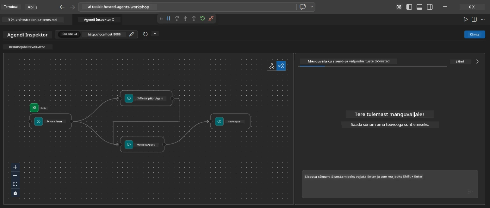
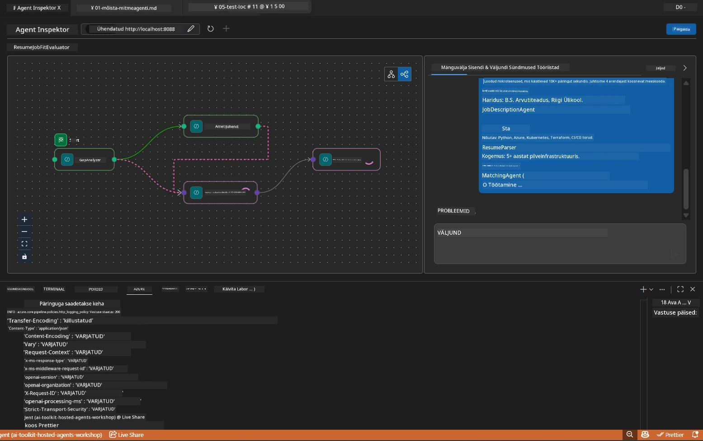
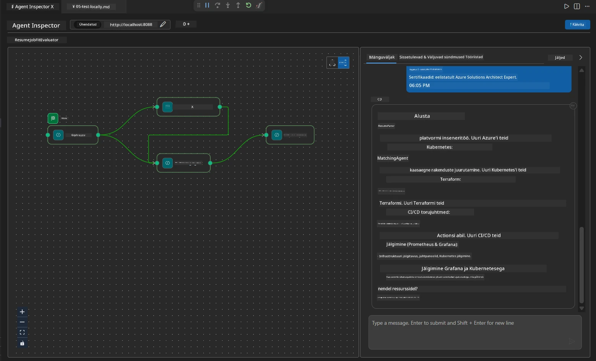

# Moodul 5 - Testi lokaalselt

⏱️ ~15 min

Selles moodulis käivitad mitme agendi töövoo lokaalselt, testid seda Agent Inspectori abil ja kontrollid, et kõik neli agenti ning MCP tööriist töötavad korrektselt enne juurutamist.

---

## Samm 1: Käivita agendi server

### Valik A: Kasuta VS Code ülesannet (soovitatav)

1. Ava `workshop/lab02-multi-agent/PersonalCareerCopilot/` kui oma VS Code kaust.
2. Vajuta `Ctrl+Shift+P` → kirjuta **Tasks: Run Task** → vali **Run Agent HTTP Server**.
3. Ülesanne käivitab serveri debugpy-ga pordil `5679` ja agendi pordil `8088`.
4. Oota, kuni väljundis kuvatakse käivitussõnum ja seejärel serveri enda valmisoleku sõnum (teised logiread ilmuvad vahepeal):

```
INFO:resume-job-fit:Starting Resume -> Job Fit Evaluator HTTP server...
...
INFO:hypercorn.error:Running on http://0.0.0.0:8088 (CTRL + C to quit)
```

### Valik B: Kasuta F5 (silumisrežiim)

1. Vajuta `F5` → vali **Debug Local Agent HTTP Server**.
2. Server käivitub täieliku murdepunkte toe abil - kasulik MCP vastuste või agendi väljundite uurimiseks.

---

## Samm 2: Ava Agent Inspector

1. Vajuta `Ctrl+Shift+P` → kirjuta **Foundry Toolkit: Open Agent Inspector**.
2. Agent Inspector avaneb VS Code paneelina, ühendatud aadressile `http://localhost:8088`.
3. Sa peaksid nägema agendi liidest, mis on valmis sõnumeid vastu võtma.



> **Kui Agent Inspector ei avane:** Veendu, et server on täielikult käivitatud (näed `Running on http://0.0.0.0:8088` lokeeringut). Kui port 5679 on hõivatud, vaata [Moodul 8 - Tõrkeotsing](08-troubleshooting.md).

---

## Samm 2b: (Valikuline) Ava töövoo visualisaator

Foundry Toolkit sisaldab reaalajas **Töövoo Visualisaatorit**, mis näitab, kuidas agendid suhtlevad graafiku täitmise ajal. See on eriti kasulik mitme agendi silumisel.

1. Vajuta `Ctrl+Shift+P` → kirjuta **Foundry Toolkit: Open Visualizer for Hosted Agents**.
2. Avaneb uus VS Code vaheleht, mis kuvab jooksva täitmisgraafiku.
3. Kui saadad sõnumeid Agent Inspectoris, uuendab visualisaator automaatselt — rohelised sõlmed tähistavad lõpetatud agente ja animeeritud servad näitavad andmevoogu nende vahel.

> **Pordi konflikt:** Kui visualisaatori port on juba kasutuses, muuda seda VS Code seadetes → **Extensions** → **Microsoft Foundry Configuration** → **Hosted Agents: Visualizer Port**.

---

## Samm 3: Käivita esmased testid

Käivita need kaks testi järjest. Igaüks testib järjest rohkem töövoogu.

### Test 1: Põhiline CV + töökuulutuse kirjeldus

Kleebi järgnev Agent Inspectori:

```
Resume:
Jane Doe
Senior Software Engineer with 5 years of experience in Python, Django, and AWS.
Built microservices handling 10K+ requests/second. Led a team of 4 developers.
Certifications: AWS Solutions Architect Associate.
Education: B.S. Computer Science, State University.

Job Description:
Senior Cloud Engineer at Contoso Ltd.
Required: Python, Azure, Kubernetes, Terraform, CI/CD pipelines.
Preferred: Go, monitoring (Prometheus/Grafana), cost optimization.
Experience: 5+ years in cloud infrastructure.
Certifications: Azure Solutions Architect Expert preferred.
```

**Oodatav väljundi struktuur:**

Vastus peaks sisaldama kõigi nelja agendi väljundit järjestuses:

1. **Resume Parser väljund** – Kaks märgistatud lõiku: `[PARSED RESUME]` (kandidaadi profiil rühmitatud oskustega) ja `[JOB DESCRIPTION PASS-THROUGH]` (sõnasõnaline töökuulutuse tekst, mis sisendub JD agendile)
2. **JD Agent väljund** – Struktureeritud nõuded koos nõutud ja eelistatud oskuste eraldamisega
3. **Matching Agent väljund** – Sobivuse skoor (0–100) koos jaotusega, vastavate oskuste, puuduvate oskuste ja puudujääkidega
4. **Gap Analyzer väljund** – Iga puuduva oskuse kohta individuaalsed puudujääkide kaardid koos Microsoft Learn URL-idega





### Mida kontrollida Test 1 puhul

| Kontrolli | Oodatav | Läbi? |
|-------|----------|-------|
| Vastus sisaldab sobivuse skoori | Arv vahemikus 0–100 koos jaotusega | |
| Loetletud sobivad oskused | Python, CI/CD (osaliselt), jms | |
| Loetletud puuduvad oskused | Azure, Kubernetes, Terraform, jms | |
| Puudujääkide kaardid olemas iga puuduva oskuse kohta | Üks kaart oskuse kohta | |
| Microsoft Learn URL-id on olemas | Tõelised `learn.microsoft.com` lingid | |
| Vastas ei ole veateateid | Puhtalt struktureeritud väljund | |

### Test 2: Servajuhtum – kõrge sobivusega kandidaat

Kleebi CV, mis lähedalt vastab töökuulutusele, et kontrollida, kas GapAnalyzer käsitleb kõrge sobivusega situatsioone:

```
Resume:
Alex Chen
Senior Cloud Engineer with 7 years of experience.
Skills: Python, Azure (AKS, Functions, DevOps), Kubernetes, Terraform, CI/CD (GitHub Actions, Azure Pipelines), Go, Prometheus, Grafana, cost optimization.
Certifications: Azure Solutions Architect Expert, Azure DevOps Engineer Expert.
Led infrastructure migration to Azure for 3 enterprise clients.
Education: M.S. Computer Science, Tech University.

Job Description:
Senior Cloud Engineer at Contoso Ltd.
Required: Python, Azure, Kubernetes, Terraform, CI/CD pipelines.
Preferred: Go, monitoring (Prometheus/Grafana), cost optimization.
Experience: 5+ years in cloud infrastructure.
Certifications: Azure Solutions Architect Expert preferred.
```

**Oodatav käitumine:**
- Sobivuse skoor peaks olema **80+** (enamus oskusi vastab)
- Puudujääkide kaardid peaksid keskenduma lihvimisele/intervjuuks ettevalmistamisele, mitte põhioskuste õppimisele
- GapAnalyzer juhised: "Kui sobivus >= 80, keskendu lihvimisele/intervjuuks ettevalmistamisele"

---

## Samm 4: Testi oma andmetega (valikuline)

Proovi kleepida oma CV ja tõeline töökuulutuse kirjeldus. See aitab kontrollida:

- Agendid töötlevad erinevaid CV formaate (kronoloogiline, funktsionaalne, hübriid)
- JD Agent töötleb erinevaid töökuulutuse stiile (punktid, lõigud, struktureeritud)
- MCP tööriist tagastab asjakohased ressursid tõeliste oskuste jaoks
- Puudujääkide kaardid on isikupärastatud vastavalt sinu konkreetsele taustale

> **Privaatsus – viis A (Foundry pilv):** CV ja töökuulutuse tekst saadetakse sinu Azure OpenAI juurutusse inferenceks. See ei salvestu ega logita töötoa infrastruktuuris. Kasuta kohatäite nimesid (näiteks "Jane Doe"), kui soovid.
>
> **Privaatsus – viis B (Foundry lokaalne):** Kõik neli agendi inference’i töötavad täielikult sinu seadmes. Sinu CV ja töökuulutuse tekst **ei lahku kunagi sinu masinast**. Ainus väljaminev kõne on MCP tööriist, mis hangib ressursse aadressilt `https://learn.microsoft.com/api/mcp`; see päring sisaldab ainult oskuse nime, mitte sinu isikuandmeid.

---

### Kontrollpunkt

- [ ] Server käivitus edukalt pordil `8088` (logis kuvatakse `Running on http://0.0.0.0:8088`)
- [ ] Agent Inspector avatud ja ühendatud agendiga
- [ ] Test 1: Täielik vastus koos sobivuse skoori, sobitatud/puuduvate oskuste, puudujääkide kaartide ja Microsoft Learn URL-idega
- [ ] Test 2: Kõrge sobivusega kandidaat saab skoori 80+ koos lihvimisele suunatud soovitustega
- [ ] Kõik puudujääkide kaardid olemas (üks iga puuduva oskuse kohta, ei ole lühendatud)
- [ ] Serveri terminalis ei ole vigu ega stack trace’e

---

**Eelmine:** [04 - Orkestreerimismustrid](04-orchestration-patterns.md) · **Järgmine:** [06 - Juuruta Foundry’isse →](06-deploy-to-foundry.md)

---

<!-- CO-OP TRANSLATOR DISCLAIMER START -->
**Lahtiütlus**:
See dokument on tõlgitud kasutades AI tõlketeenust [Co-op Translator](https://github.com/Azure/co-op-translator). Kuigi me püüdleme täpsuse poole, palun pange tähele, et automatiseeritud tõlgetes võib esineda vigu või ebatäpsusi. Originaaldokument selle emakeeles tuleks pidada autoriteetseks allikaks. Olulise teabe puhul soovitatakse kasutada professionaalset inimtõlget. Me ei vastuta selle tõlkega seotud eksimustest või valesti mõistmistest.
<!-- CO-OP TRANSLATOR DISCLAIMER END -->