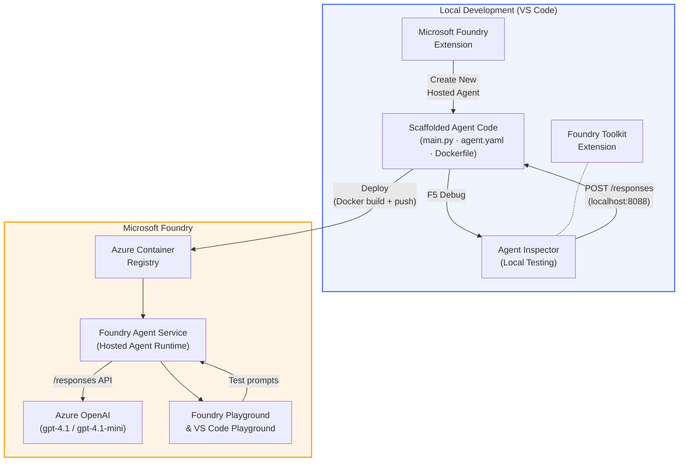

# کارگاه Foundry Toolkit و Foundry Hosted Agents

[](https://www.python.org/)
[](https://github.com/microsoft/agents)
[](https://learn.microsoft.com/azure/foundry/agents/concepts/hosted-agents)
[](https://ai.azure.com/)
[](https://learn.microsoft.com/azure/ai-services/openai/)
[](https://learn.microsoft.com/cli/azure/install-azure-cli)
[](https://learn.microsoft.com/azure/developer/azure-developer-cli/install-azd)
[](https://www.docker.com/)
[](https://marketplace.visualstudio.com/items?itemName=ms-windows-ai-studio.windows-ai-studio)
[](../../LICENSE)

ساخت، تست و استقرار عامل‌های هوش مصنوعی در **Microsoft Foundry Agent Service** به‌عنوان **Hosted Agents** — کاملاً از داخل VS Code با استفاده از **Microsoft Foundry extension** و **Foundry Toolkit**.

> **Hosted Agents در حال حاضر در پیش‌نمایش هستند.** مناطق پشتیبانی‌شده محدود هستند - ببینید [دسترسی منطقه‌ای](https://learn.microsoft.com/azure/foundry/agents/concepts/hosted-agents#region-availability).

> پوشه `agent/` داخل هر آزمایشگاه به‌طور **خودکار ایجاد می‌شود** توسط افزونه Foundry - سپس کد را سفارشی می‌کنید، به‌صورت محلی تست می‌کنید، و مستقر می‌کنید.

### 🌐 پشتیبانی چندزبانه

#### پشتیبانی شده از طریق GitHub Action (خودکار و همیشه به‌روز)

<!-- CO-OP TRANSLATOR LANGUAGES TABLE START -->
[Arabic](../ar/README.md) | [Bengali](../bn/README.md) | [Bulgarian](../bg/README.md) | [Burmese (Myanmar)](../my/README.md) | [Chinese (Simplified)](../zh-CN/README.md) | [Chinese (Traditional, Hong Kong)](../zh-HK/README.md) | [Chinese (Traditional, Macau)](../zh-MO/README.md) | [Chinese (Traditional, Taiwan)](../zh-TW/README.md) | [Croatian](../hr/README.md) | [Czech](../cs/README.md) | [Danish](../da/README.md) | [Dutch](../nl/README.md) | [Estonian](../et/README.md) | [Finnish](../fi/README.md) | [French](../fr/README.md) | [German](../de/README.md) | [Greek](../el/README.md) | [Hebrew](../he/README.md) | [Hindi](../hi/README.md) | [Hungarian](../hu/README.md) | [Indonesian](../id/README.md) | [Italian](../it/README.md) | [Japanese](../ja/README.md) | [Kannada](../kn/README.md) | [Khmer](../km/README.md) | [Korean](../ko/README.md) | [Lithuanian](../lt/README.md) | [Malay](../ms/README.md) | [Malayalam](../ml/README.md) | [Marathi](../mr/README.md) | [Nepali](../ne/README.md) | [Nigerian Pidgin](../pcm/README.md) | [Norwegian](../no/README.md) | [Persian (Farsi)](./README.md) | [Polish](../pl/README.md) | [Portuguese (Brazil)](../pt-BR/README.md) | [Portuguese (Portugal)](../pt-PT/README.md) | [Punjabi (Gurmukhi)](../pa/README.md) | [Romanian](../ro/README.md) | [Russian](../ru/README.md) | [Serbian (Cyrillic)](../sr/README.md) | [Slovak](../sk/README.md) | [Slovenian](../sl/README.md) | [Spanish](../es/README.md) | [Swahili](../sw/README.md) | [Swedish](../sv/README.md) | [Tagalog (Filipino)](../tl/README.md) | [Tamil](../ta/README.md) | [Telugu](../te/README.md) | [Thai](../th/README.md) | [Turkish](../tr/README.md) | [Ukrainian](../uk/README.md) | [Urdu](../ur/README.md) | [Vietnamese](../vi/README.md)

> **ترجیح می‌دهید به‌صورت محلی کلون کنید؟**
>
> این مخزن شامل بیش از 50 ترجمه زبانی است که به‌طور قابل‌توجهی حجم دانلود را افزایش می‌دهد. برای کلون کردن بدون ترجمه‌ها، از sparse checkout استفاده کنید:
>
> **Bash / macOS / Linux:**
> ```bash
> git clone --filter=blob:none --sparse https://github.com/microsoft-foundry/Foundry_Toolkit_for_VSCode_Lab.git
> cd Foundry_Toolkit_for_VSCode_Lab
> git sparse-checkout set --no-cone '/*' '!translations' '!translated_images'
> ```
>
> **CMD (Windows):**
> ```cmd
> git clone --filter=blob:none --sparse https://github.com/microsoft-foundry/Foundry_Toolkit_for_VSCode_Lab.git
> cd Foundry_Toolkit_for_VSCode_Lab
> git sparse-checkout set --no-cone "/*" "!translations" "!translated_images"
> ```
>
> این به شما همه چیز لازم برای تکمیل دوره را با دانلودی بسیار سریع‌تر می‌دهد.
<!-- CO-OP TRANSLATOR LANGUAGES TABLE END -->

---

## معماری



**روند:** افزونه Foundry عامل را اسکافولد می‌کند → شما کد و دستورالعمل‌ها را سفارشی می‌کنید → با Agent Inspector به‌صورت محلی تست می‌کنید → به Foundry مستقر می‌کنید (تصویر Docker به ACR ارسال می‌شود) → در Playground بررسی می‌کنید.

---

## آنچه خواهید ساخت

| Lab | Description | Status |
|-----|-------------|--------|
| **لاب 01 - عامل تک‌نفره** | ساخت عامل **"Explain Like I'm an Executive"**, آزمایش آن به‌صورت محلی، و استقرار در Foundry | ✅ در دسترس |
| **لاب 02 - جریان‌کار چندعاملی** | ساخت **"Resume → Job Fit Evaluator"** - چهار عامل با هم همکاری می‌کنند تا تناسب رزومه را امتیازدهی کنند و یک نقشه راه آموزشی تولید کنند | ✅ در دسترس |

---

## آشنایی با عامل اجرایی

در این کارگاه شما عامل **"Explain Like I'm an Executive"** را خواهید ساخت — یک عامل هوش مصنوعی که اصطلاحات فنی پیچیده را می‌گیرد و آن‌ها را به خلاصه‌هایی آرام و آماده برای جلسه هیئت‌مدیره تبدیل می‌کند. راستش را بخواهید، هیچ‌کس در سطح مدیریت ارشد نمی‌خواهد درباره‌ی "thread pool exhaustion caused by synchronous calls introduced in v3.2." بشنود.

من این عامل را بعد از چندین مورد که پس‌مرگ (post-mortem) کاملاً تهیه‌شده‌ام با پاسخ *"خب... آیا وب‌سایت قطع است یا نه؟"* روبه‌رو شد، ساختم.

### چگونه کار می‌کند

شما یک به‌روزرسانی فنی به آن می‌دهید. او یک خلاصه اجرایی برمی‌گرداند - سه نکته بولت‌شده، بدون اصطلاحات فنی، بدون گزارش‌های stack trace، بدون ترس‌های هستی‌شناسانه. فقط **چه اتفاقی افتاد**، **تأثیر تجاری**، و **گام بعدی**.

### اجرای آن را ببینید

**شما می‌گویید:**
> "تاخیر API به‌دلیل تمام شدن thread pool ناشی از فراخوانی‌های همزمان معرفی‌شده در v3.2 افزایش یافت."

**عامل پاسخ می‌دهد:**

> **خلاصه اجرایی:**
> - **چه اتفاقی افتاد:** پس از آخرین انتشار، سیستم کند شد.
> - **تأثیر تجاری:** برخی کاربران هنگام استفاده از سرویس با تأخیر مواجه شدند.
> - **گام بعدی:** تغییر برگشت داده شد و یک اصلاح در حال آماده‌سازی است قبل از استقرار مجدد.

### چرا این عامل؟

این یک عامل بسیار ساده و تک‌منظوره است — عالی برای یادگیری جریان‌کار hosted agent از ابتدا تا انتها بدون گرفتار شدن در زنجیره ابزارهای پیچیده. و صادقانه بگویم؟ هر تیم مهندسی می‌تواند یکی از این‌ها را داشته باشد.

---

## ساختار کارگاه

```
📂 Foundry_Toolkit_for_VSCode_Lab/
├── 📄 README.md                      ← You are here
└── 📂 workshop/
    ├── 📂 lab01-single-agent/        ← Full lab: docs + agent code
    │   ├── README.md                 ← Hands-on lab instructions
    │   ├── 📂 docs/                  ← Step-by-step tutorial modules
    │   │   ├── 00-prerequisites.md
    │   │   ├── 01-setup.md
    │   │   ├── 02-create-hosted-agent.md
    │   │   ├── 03-configure-and-code.md
    │   │   ├── 04-test-locally.md
    │   │   ├── 05-deploy-to-foundry.md
    │   │   ├── 06-verify-in-playground.md
    │   │   ├── 07-summary.md
    │   │   └── 08-troubleshooting.md
    │   └── 📂 agent/                 ← Reference solution (auto-scaffolded by Foundry extension)
    │       ├── agent.yaml
    │       ├── Dockerfile
    │       ├── main.py
    │       └── requirements.txt
    └── 📂 lab02-multi-agent/         ← Resume → Job Fit Evaluator
        ├── README.md                 ← Hands-on lab instructions (end-to-end)
        ├── 📂 docs/                  ← Step-by-step tutorial modules
        │   ├── 00-prerequisites.md
        │   ├── 01-understand-multi-agent.md
        │   ├── 02-scaffold-multi-agent.md
        │   ├── 03-configure-agents.md
        │   ├── 04-orchestration-patterns.md
        │   ├── 05-test-locally.md
        │   ├── 06-deploy-to-foundry.md
        │   ├── 07-verify-in-playground.md
        │   └── 08-troubleshooting.md
        └── 📂 PersonalCareerCopilot/ ← Reference solution (multi-agent workflow)
            ├── agent.yaml
            ├── Dockerfile
            ├── main.py
            └── requirements.txt
```

> **توجه:** پوشه `agent/` داخل هر لاب همان چیزی است که **Microsoft Foundry extension** هنگام اجرای `Microsoft Foundry: Create a New Hosted Agent` از Command Palette تولید می‌کند. سپس فایل‌ها با دستورالعمل‌ها، ابزارها و پیکربندی عامل شما سفارشی می‌شوند. لاب 01 شما را در بازسازی این از ابتدا راهنمایی می‌کند.

---

## شروع کنید

### 1. کلون کردن مخزن

```bash
git clone https://github.com/microsoft-foundry/Foundry_Toolkit_for_VSCode_Lab.git
cd Foundry_Toolkit_for_VSCode_Lab
```

### 2. راه‌اندازی محیط مجازی Python

```bash
python -m venv venv
```

آن را فعال کنید:

- **ویندوز (PowerShell):**
  ```powershell
  .\venv\Scripts\Activate.ps1
  ```
- **macOS / Linux:**
  ```bash
  source venv/bin/activate
  ```

### 3. نصب وابستگی‌ها

```bash
pip install -r workshop/lab01-single-agent/agent/requirements.txt
```

### 4. پیکربندی متغیرهای محیطی

فایل نمونه `.env` را داخل پوشه عامل کپی کنید و مقادیر خود را پر کنید:

```bash
cp workshop/lab01-single-agent/agent/.env.example workshop/lab01-single-agent/agent/.env
```

فایل `workshop/lab01-single-agent/agent/.env` را ویرایش کنید:

```env
AZURE_AI_PROJECT_ENDPOINT=https://<your-account>.services.ai.azure.com/api/projects/<your-project>
AZURE_AI_MODEL_DEPLOYMENT_NAME=<your-model-deployment-name>
```

### 5. دنبال کردن لاب‌های کارگاه

هر لاب خودکفا و شامل ماژول‌های مخصوص به خود است. با **لاب 01** برای یادگیری اصول شروع کنید، سپس به **لاب 02** برای جریان‌های کاری چندعاملی بروید.

#### لاب 01 - عامل تک‌نفره ([دستورالعمل کامل](workshop/lab01-single-agent/README.md))

| # | ماژول | لینک |
|---|--------|------|
| 1 | خواندن پیش‌نیازها | [00-prerequisites.md](workshop/lab01-single-agent/docs/00-prerequisites.md) |
| 2 | نصب Foundry Toolkit و افزونه Foundry | [01-setup.md](workshop/lab01-single-agent/docs/01-setup.md) |
| 3 | ایجاد یک پروژه Foundry | [01-setup.md](workshop/lab01-single-agent/docs/01-setup.md) |
| 4 | ایجاد یک hosted agent | [02-create-hosted-agent.md](workshop/lab01-single-agent/docs/02-create-hosted-agent.md) |
| 5 | پیکربندی دستورالعمل‌ها و محیط | [03-configure-and-code.md](workshop/lab01-single-agent/docs/03-configure-and-code.md) |
| 6 | تست به‌صورت محلی | [04-test-locally.md](workshop/lab01-single-agent/docs/04-test-locally.md) |
| 7 | استقرار در Foundry | [05-deploy-to-foundry.md](workshop/lab01-single-agent/docs/05-deploy-to-foundry.md) |
| 8 | بررسی در playground | [06-verify-in-playground.md](workshop/lab01-single-agent/docs/06-verify-in-playground.md) |
| 9 | رفع اشکال | [08-troubleshooting.md](workshop/lab01-single-agent/docs/08-troubleshooting.md) |

#### لاب 02 - جریان‌کار چندعاملی ([دستورالعمل کامل](workshop/lab02-multi-agent/README.md))

| # | ماژول | لینک |
|---|--------|------|
| 1 | پیش‌نیازها (لاب 02) | [00-prerequisites.md](workshop/lab02-multi-agent/docs/00-prerequisites.md) |
| 2 | درک معماری چندعاملی | [01-understand-multi-agent.md](workshop/lab02-multi-agent/docs/01-understand-multi-agent.md) |
| 3 | اسکافولد پروژه چندعاملی | [02-scaffold-multi-agent.md](workshop/lab02-multi-agent/docs/02-scaffold-multi-agent.md) |
| 4 | پیکربندی عوامل و محیط | [03-configure-agents.md](workshop/lab02-multi-agent/docs/03-configure-agents.md) |
| 5 | الگوهای ارکستراسیون | [04-orchestration-patterns.md](workshop/lab02-multi-agent/docs/04-orchestration-patterns.md) |
| 6 | تست محلی (چندعاملی) | [05-test-locally.md](workshop/lab02-multi-agent/docs/05-test-locally.md) |
| 7 | استقرار در Foundry | [06-deploy-to-foundry.md](workshop/lab02-multi-agent/docs/06-deploy-to-foundry.md) |
| 8 | بررسی در playground | [07-verify-in-playground.md](workshop/lab02-multi-agent/docs/07-verify-in-playground.md) |
| 9 | رفع اشکال (چندعاملی) | [08-troubleshooting.md](workshop/lab02-multi-agent/docs/08-troubleshooting.md) |

---

## نگهدارنده

<table>
<tr>
    <td align="center"><a href="https://github.com/ShivamGoyal03">
        <br />
        <sub><b>Shivam Goyal</b></sub>
    </a><br />
    </td>
</tr>
</table>

---

## مجوزهای مورد نیاز (مرجع سریع)

| سناریو | نقش‌های مورد نیاز |
|----------|---------------|
| ایجاد پروژه جدید Foundry | **Azure AI Owner** روی منبع Foundry |
| استقرار در پروژه موجود (منابع جدید) | **Azure AI Owner** + **Contributor** در اشتراک |
| استقرار در پروژه کاملاً پیکربندی‌شده | **Reader** روی حساب + **Azure AI User** روی پروژه |

> **مهم:** نقش‌های Azure `Owner` و `Contributor` تنها شامل *مجوزهای مدیریتی* هستند، نه *مجوزهای توسعه* (عملیات داده). برای ساخت و استقرار عوامل نیاز به **Azure AI User** یا **Azure AI Owner** دارید.

---

## منابع

- [شروع سریع: استقرار اولین عامل میزبانی‌شدهٔ خود (VS Code)](https://learn.microsoft.com/azure/foundry/agents/quickstarts/quickstart-hosted-agent)
- [عامل‌های میزبانی‌شده چیستند؟](https://learn.microsoft.com/azure/foundry/agents/concepts/hosted-agents)
- [ایجاد گردش‌کارهای عامل میزبانی‌شده در VS Code](https://learn.microsoft.com/azure/foundry/agents/how-to/vs-code-agents-workflow-pro-code)
- [استقرار یک عامل میزبانی‌شده](https://learn.microsoft.com/azure/foundry/agents/how-to/deploy-hosted-agent)
- [RBAC برای Microsoft Foundry](https://learn.microsoft.com/azure/foundry/concepts/rbac-foundry)
- [نمونهٔ عامل بازبینی معماری](https://github.com/Azure-Samples/agent-architecture-review-sample) - عامل میزبانی‌شدهٔ واقعی با ابزارهای MCP، نمودارهای Excalidraw، و استقرار دوگانه

---


## مجوز

[MIT](../../LICENSE)

---

<!-- CO-OP TRANSLATOR DISCLAIMER START -->
**سلب مسئولیت**:
این سند با استفاده از سرویس ترجمه هوش مصنوعی [Co-op Translator](https://github.com/Azure/co-op-translator) ترجمه شده است. در حالی که ما در تلاش برای دقت هستیم، لطفاً توجه داشته باشید که ترجمه‌های خودکار ممکن است شامل خطاها یا نادرستی‌هایی باشند. سند اصلی به زبان مادری خود باید به عنوان منبع معتبر در نظر گرفته شود. برای اطلاعات حیاتی، ترجمه حرفه‌ای انسانی توصیه می‌شود. ما در قبال هرگونه سوء تفاهم یا برداشت نادرست ناشی از استفاده از این ترجمه مسئولیتی نداریم.
<!-- CO-OP TRANSLATOR DISCLAIMER END -->
