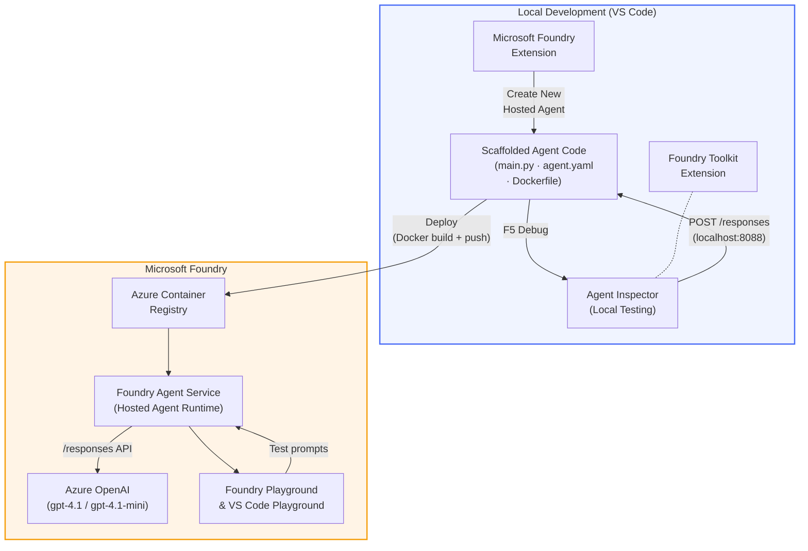

# کارگاه Foundry Toolkit + Foundry Hosted Agents

[](https://www.python.org/)
[](https://learn.microsoft.com/agent-framework/)
[](https://learn.microsoft.com/azure/foundry/agents/concepts/hosted-agents)
[](https://ai.azure.com/)
[](https://learn.microsoft.com/azure/ai-services/openai/)
[](https://learn.microsoft.com/cli/azure/install-azure-cli)
[](https://learn.microsoft.com/azure/developer/azure-developer-cli/install-azd)
[](https://www.docker.com/)
[](https://marketplace.visualstudio.com/items?itemName=ms-windows-ai-studio.windows-ai-studio)
[](LICENSE)

ساخت، آزمایش و استقرار عامل‌های هوش مصنوعی در **Microsoft Foundry Agent Service** به‌عنوان **Hosted Agents** - کاملاً از طریق VS Code با استفاده از **الحاقیه Microsoft Foundry** و **Foundry Toolkit**.

> **عامل‌های میزبان در حال حاضر در پیش‌نمایش هستند.** مناطق پشتیبانی شده محدود است - به [دسترس‌پذیری منطقه](https://learn.microsoft.com/azure/foundry/agents/concepts/hosted-agents#region-availability) مراجعه کنید.

> پوشه `agent/` در هر آزمایشگاه توسط الحاقیه Foundry به‌صورت **خودکار اسکلتی** ایجاد می‌شود - سپس کد را سفارشی‌سازی کرده، به‌صورت محلی تست کرده و مستقر می‌کنید.

### 🌐 پشتیبانی چندزبانه

#### از طریق GitHub Action پشتیبانی می‌شود (خودکار و همیشه به‌روز)

<!-- CO-OP TRANSLATOR LANGUAGES TABLE START -->
[Arabic](../ar/README.md) | [Bengali](../bn/README.md) | [Bulgarian](../bg/README.md) | [Burmese (Myanmar)](../my/README.md) | [Chinese (Simplified)](../zh-CN/README.md) | [Chinese (Traditional, Hong Kong)](../zh-HK/README.md) | [Chinese (Traditional, Macau)](../zh-MO/README.md) | [Chinese (Traditional, Taiwan)](../zh-TW/README.md) | [Croatian](../hr/README.md) | [Czech](../cs/README.md) | [Danish](../da/README.md) | [Dutch](../nl/README.md) | [Estonian](../et/README.md) | [Finnish](../fi/README.md) | [French](../fr/README.md) | [German](../de/README.md) | [Greek](../el/README.md) | [Hebrew](../he/README.md) | [Hindi](../hi/README.md) | [Hungarian](../hu/README.md) | [Indonesian](../id/README.md) | [Italian](../it/README.md) | [Japanese](../ja/README.md) | [Kannada](../kn/README.md) | [Khmer](../km/README.md) | [Korean](../ko/README.md) | [Lithuanian](../lt/README.md) | [Malay](../ms/README.md) | [Malayalam](../ml/README.md) | [Marathi](../mr/README.md) | [Nepali](../ne/README.md) | [Nigerian Pidgin](../pcm/README.md) | [Norwegian](../no/README.md) | [Persian (Farsi)](./README.md) | [Polish](../pl/README.md) | [Portuguese (Brazil)](../pt-BR/README.md) | [Portuguese (Portugal)](../pt-PT/README.md) | [Punjabi (Gurmukhi)](../pa/README.md) | [Romanian](../ro/README.md) | [Russian](../ru/README.md) | [Serbian (Cyrillic)](../sr/README.md) | [Slovak](../sk/README.md) | [Slovenian](../sl/README.md) | [Spanish](../es/README.md) | [Swahili](../sw/README.md) | [Swedish](../sv/README.md) | [Tagalog (Filipino)](../tl/README.md) | [Tamil](../ta/README.md) | [Telugu](../te/README.md) | [Thai](../th/README.md) | [Turkish](../tr/README.md) | [Ukrainian](../uk/README.md) | [Urdu](../ur/README.md) | [Vietnamese](../vi/README.md)

> **ترجیح می‌دهید به‌صورت محلی کلون کنید؟**
>
> این مخزن شامل بیش از ۵۰ ترجمه زبانی است که اندازه دانلود را به طرز قابل توجهی افزایش می‌دهد. برای کلون کردن بدون ترجمه‌ها، از sparse checkout استفاده کنید:
>
> **Bash / macOS / Linux:**
> ```bash
> git clone --filter=blob:none --sparse https://github.com/microsoft-foundry/Foundry_Toolkit_for_VSCode_Lab.git
> cd Foundry_Toolkit_for_VSCode_Lab
> git sparse-checkout set --no-cone '/*' '!translations' '!translated_images'
> ```
>
> **CMD (ویندوز):**
> ```cmd
> git clone --filter=blob:none --sparse https://github.com/microsoft-foundry/Foundry_Toolkit_for_VSCode_Lab.git
> cd Foundry_Toolkit_for_VSCode_Lab
> git sparse-checkout set --no-cone "/*" "!translations" "!translated_images"
> ```
>
> این به شما همه چیز لازم برای کامل کردن دوره را با سرعت دانلود بسیار بیشتری می‌دهد.
<!-- CO-OP TRANSLATOR LANGUAGES TABLE END -->

---

## معماری



**جریان:** الحاقیه Foundry عامل را اسکلتی می‌کند → شما کد و دستورالعمل‌ها را سفارشی می‌کنید → با Agent Inspector به‌صورت محلی تست می‌کنید → به Foundry مستقر می‌کنید (تصویر Docker به ACR منتقل می‌شود) → در Playground بررسی می‌کنید.

---

## چیزی که خواهید ساخت

| آزمایشگاه | توضیحات | وضعیت |
|-----|-------------|--------|
| **آزمایشگاه ۰۱ - عامل تکی** | ساخت **عامل "توضیح بده مثل اینکه مدیرعامل هستم"**، تست آن به صورت محلی، و استقرار به Foundry | ✅ در دسترس |
| **آزمایشگاه ۰۲ - جریان کاری چندعامله** | ساخت **"ارزیابی فیت رزومه → شغل"** - چهار عامل همکاری می‌کنند تا امتیاز فیت رزومه را بدهند و نقشه راه یادگیری تولید کنند | ✅ در دسترس |

---

## آشنایی با عامل مدیرعامل

در این کارگاه شما **عامل "توضیح بده مثل اینکه مدیرعامل هستم"** را می‌سازید - یک عامل هوش مصنوعی که اصطلاحات فنی پیچیده را می‌گیرد و آن را به خلاصه‌های آرام، آماده برای هیئت‌مدیره تبدیل می‌کند. چون بی‌خیال، هیچکسی در سطوح مدیریتی بالا دوست ندارد درباره «خستگی thread pool ناشی از تماس‌های همزمان معرفی شده در نسخه ۳٫۲» بشنود.

من این عامل را بعد از چند بار که پس از گزارش کامل من جواب شنیدم: *"پس... وب‌سایت قطع شده یا نه؟"* ساختم.

### چگونه کار می‌کند

شما یک بروزرسانی فنی به آن می‌دهید. او یک خلاصه مدیریتی تحویل می‌دهد - سه نکته اصلی، بدون اصطلاحات تخصصی، بدون ردیابی استک، بدون ترس وجودی. فقط **چه اتفاقی افتاده**، **تأثیر تجاری** و **گام بعدی**.

### آن را در عمل ببینید

**شما می‌گویید:**
> "تاخیر API به دلیل خستگی thread pool که ناشی از تماس‌های همزمان معرفی شده در v3.2 است افزایش یافته."

**عامل پاسخ می‌دهد:**

> **خلاصه مدیریتی:**
> - **چه اتفاقی افتاد:** بعد از آخرین انتشار، سیستم کند شد.
> - **تأثیر تجاری:** برخی کاربران هنگام استفاده از سرویس تأخیر را تجربه کردند.
> - **گام بعدی:** تغییرات بازگردانده شده و یک رفع مشکل قبل از مستقر سازی دوباره آماده می‌شود.

### چرا این عامل؟

این یک عامل بسیار ساده و تک‌مصرف است - عالی برای یادگیری کامل جریان کاری عامل‌های میزبان بدون گیر کردن در زنجیره‌های ابزار پیچیده. و صادقانه بگویم، هر تیم مهندسی به یکی از این‌ها نیاز دارد.

---

## ساختار کارگاه

```
📂 Foundry_Toolkit_for_VSCode_Lab/
├── 📄 README.md                      ← You are here
└── 📂 workshop/
    ├── 📂 lab01-single-agent/        ← Full lab: docs + agent code
    │   ├── README.md                 ← Hands-on lab instructions
    │   ├── 📂 docs/                  ← Step-by-step tutorial modules
    │   │   ├── 00-prerequisites.md
    │   │   ├── 01-setup.md
    │   │   ├── 02-create-hosted-agent.md
    │   │   ├── 03-configure-and-code.md
    │   │   ├── 04-test-locally.md
    │   │   ├── 05-deploy-to-foundry.md
    │   │   ├── 06-verify-in-playground.md
    │   │   ├── 07-summary.md
    │   │   └── 08-troubleshooting.md
    │   └── 📂 agent/                 ← Reference solution (auto-scaffolded by Foundry extension)
    │       ├── agent.yaml
    │       ├── Dockerfile
    │       ├── main.py
    │       └── requirements.txt
    └── 📂 lab02-multi-agent/         ← Resume → Job Fit Evaluator
        ├── README.md                 ← Hands-on lab instructions (end-to-end)
        ├── 📂 docs/                  ← Step-by-step tutorial modules
        │   ├── 00-prerequisites.md
        │   ├── 01-understand-multi-agent.md
        │   ├── 02-scaffold-multi-agent.md
        │   ├── 03-configure-agents.md
        │   ├── 04-orchestration-patterns.md
        │   ├── 05-test-locally.md
        │   ├── 06-deploy-to-foundry.md
        │   ├── 07-verify-in-playground.md
        │   ├── 08-troubleshooting.md
        │   └── 09-summary.md
        └── 📂 PersonalCareerCopilot/ ← Reference solution (multi-agent workflow)
            ├── agent.yaml
            ├── Dockerfile
            ├── main.py
            └── requirements.txt
```

> **توجه:** پوشه `agent/` در هر آزمایشگاه همان چیزی است که **الحاقیه Microsoft Foundry** هنگام اجرای `Microsoft Foundry: Create a New Hosted Agent` از Command Palette تولید می‌کند. سپس فایل‌ها با دستورالعمل‌ها، ابزارها و پیکربندی عامل شما سفارشی می‌شوند. آزمایشگاه ۰۱ شما را در ساخت این از ابتدا راهنمایی می‌کند.

---

## شروع کار

### ۱. کلون کردن مخزن

```bash
git clone https://github.com/microsoft-foundry/Foundry_Toolkit_for_VSCode_Lab.git
cd Foundry_Toolkit_for_VSCode_Lab
```

### ۲. راه‌اندازی محیط مجازی پایتون

```bash
python -m venv venv
```

آن را فعال کنید:

- **ویندوز (PowerShell):**
  ```powershell
  .\venv\Scripts\Activate.ps1
  ```
- **macOS / لینوکس:**
  ```bash
  source venv/bin/activate
  ```

### ۳. نصب وابستگی‌ها

```bash
pip install -r workshop/lab01-single-agent/agent/requirements.txt
```

### ۴. پیکربندی متغیرهای محیطی

فایل نمونه `.env` را درون پوشه عامل کپی کرده و مقادیر خود را وارد کنید:

```bash
cp workshop/lab01-single-agent/agent/.env.example workshop/lab01-single-agent/agent/.env
```

ویرایش `workshop/lab01-single-agent/agent/.env`:

```env
FOUNDRY_PROJECT_ENDPOINT=https://<your-account>.services.ai.azure.com/api/projects/<your-project>
AZURE_AI_MODEL_DEPLOYMENT_NAME=<your-model-deployment-name>
```

### ۵. پیگیری آزمایشگاه‌های کارگاه

هر آزمایشگاه به صورت مستقل با ماژول‌های خود است. با **آزمایشگاه ۰۱** برای یادگیری اصول پایه شروع کرده، سپس به **آزمایشگاه ۰۲** برای جریان‌های کاری چندعامله بروید.

#### آزمایشگاه ۰۱ - عامل تکی ([دستورالعمل کامل](workshop/lab01-single-agent/README.md))

| شماره | ماژول | لینک |
|---|--------|------|
| ۱ | مطالعه پیش‌نیازها | [00-prerequisites.md](workshop/lab01-single-agent/docs/00-prerequisites.md) |
| ۲ | نصب Foundry Toolkit و الحاقیه Foundry | [01-setup.md](workshop/lab01-single-agent/docs/01-setup.md) |
| ۳ | ایجاد پروژه Foundry | [01-setup.md](workshop/lab01-single-agent/docs/01-setup.md) |
| ۴ | ایجاد عامل میزبان | [02-create-hosted-agent.md](workshop/lab01-single-agent/docs/02-create-hosted-agent.md) |
| ۵ | پیکربندی دستورالعمل‌ها و محیط | [03-configure-and-code.md](workshop/lab01-single-agent/docs/03-configure-and-code.md) |
| ۶ | تست به صورت محلی | [04-test-locally.md](workshop/lab01-single-agent/docs/04-test-locally.md) |
| ۷ | استقرار در Foundry | [05-deploy-to-foundry.md](workshop/lab01-single-agent/docs/05-deploy-to-foundry.md) |
| ۸ | بررسی در playground | [06-verify-in-playground.md](workshop/lab01-single-agent/docs/06-verify-in-playground.md) |
| ۹ | خلاصه و گام‌های بعدی | [07-summary.md](workshop/lab01-single-agent/docs/07-summary.md) |
| ۱۰ | رفع اشکال | [08-troubleshooting.md](workshop/lab01-single-agent/docs/08-troubleshooting.md) |

#### آزمایشگاه ۰۲ - جریان کاری چندعامله ([دستورالعمل کامل](workshop/lab02-multi-agent/README.md))

| شماره | ماژول | لینک |
|---|--------|------|
| ۱ | پیش‌نیازها (آزمایشگاه ۰۲) | [00-prerequisites.md](workshop/lab02-multi-agent/docs/00-prerequisites.md) |
| ۲ | درک معماری چندعامله | [01-understand-multi-agent.md](workshop/lab02-multi-agent/docs/01-understand-multi-agent.md) |
| ۳ | اسکلت پروژه چندعامله | [02-scaffold-multi-agent.md](workshop/lab02-multi-agent/docs/02-scaffold-multi-agent.md) |
| ۴ | پیکربندی عامل‌ها و محیط | [03-configure-agents.md](workshop/lab02-multi-agent/docs/03-configure-agents.md) |
| ۵ | الگوهای هماهنگی | [04-orchestration-patterns.md](workshop/lab02-multi-agent/docs/04-orchestration-patterns.md) |
| ۶ | تست به صورت محلی (چندعامله) | [05-test-locally.md](workshop/lab02-multi-agent/docs/05-test-locally.md) |
| ۷ | استقرار به Foundry | [06-deploy-to-foundry.md](workshop/lab02-multi-agent/docs/06-deploy-to-foundry.md) |
| ۸ | بررسی در playground | [07-verify-in-playground.md](workshop/lab02-multi-agent/docs/07-verify-in-playground.md) |
| ۹ | رفع اشکال (چندعامله) | [08-troubleshooting.md](workshop/lab02-multi-agent/docs/08-troubleshooting.md) |
| ۱۰ | خلاصه و گام‌های بعدی | [09-summary.md](workshop/lab02-multi-agent/docs/09-summary.md) |

---

## نگهدارنده

<table>
<tr>
    <td align="center"><a href="https://github.com/ShivamGoyal03">
        <br />
        <sub><b>شیوام گویال</b></sub>
    </a><br />
    </td>
</tr>
</table>

---

## مجوزهای موردنیاز (مرجع سریع)

| سناریو | نقش‌های مورد نیاز |
|----------|---------------|
| ایجاد پروژه Foundry جدید | **مالک Azure AI** روی منبع Foundry |
| استقرار در پروژه موجود (منابع جدید) | **مالک Azure AI** + **مشارکت‌کننده** روی اشتراک |
| استقرار روی پروژه کاملاً پیکربندی‌شده | **خواننده** روی حساب + **کاربر Azure AI** روی پروژه |

> **مهم:** نقش‌های Azure `Owner` و `Contributor` فقط شامل مجوزهای *مدیریت* هستند، نه مجوزهای *توسعه* (عملیات داده). برای ساخت و استقرار عوامل نیاز به **Azure AI User** یا **Azure AI Owner** دارید.

---

## مراجع

- [شروع سریع: استقرار اولین عامل میزبانی‌شده‌تان (VS Code)](https://learn.microsoft.com/azure/foundry/agents/quickstarts/quickstart-hosted-agent)
- [عوامل میزبانی‌شده چیستند؟](https://learn.microsoft.com/azure/foundry/agents/concepts/hosted-agents)
- [ایجاد گردش‌کارهای عامل میزبانی‌شده در VS Code](https://learn.microsoft.com/azure/foundry/agents/how-to/vs-code-agents-workflow-pro-code)
- [استقرار عامل میزبانی‌شده](https://learn.microsoft.com/azure/foundry/agents/how-to/deploy-hosted-agent)
- [RBAC برای Microsoft Foundry](https://learn.microsoft.com/azure/foundry/concepts/rbac-foundry)
- [نمونه عامل بازبینی معماری](https://github.com/Azure-Samples/agent-architecture-review-sample) - عامل میزبانی‌شده دنیای واقعی با ابزارهای MCP، نمودارهای Excalidraw و استقرار دوگانه

---


## مجوز

[MIT](../../LICENSE)

---

<!-- CO-OP TRANSLATOR DISCLAIMER START -->
**سلب مسئولیت**:
این سند با استفاده از سرویس ترجمه هوش مصنوعی [Co-op Translator](https://github.com/Azure/co-op-translator) ترجمه شده است. در حالی که ما در تلاش برای دقت هستیم، لطفاً توجه داشته باشید که ترجمه‌های خودکار ممکن است شامل خطاها یا نادرستی‌هایی باشند. سند اصلی به زبان مادری خود باید به عنوان منبع معتبر در نظر گرفته شود. برای اطلاعات حیاتی، ترجمه حرفه‌ای انسانی توصیه می‌شود. ما در قبال هرگونه سوء تفاهم یا برداشت نادرست ناشی از استفاده از این ترجمه مسئولیتی نداریم.
<!-- CO-OP TRANSLATOR DISCLAIMER END -->