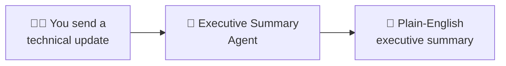

# ماژول ۰ - مقدمه

⏱️ ~۱۰ دقیقه

> [!WARNING]
> **پیش‌نمایش و محدودیت‌ها:** [نمایندگان میزبانی‌شده](https://learn.microsoft.com/azure/foundry/agents/concepts/hosted-agents) در حال حاضر در **پیش‌نمایش عمومی** هستند - برای بارهای کاری تولیدی توصیه نمی‌شوند. به موارد زیر توجه کنید:
> - **مناطق پشتیبانی‌شده محدود هستند** - قبل از ایجاد منابع، [دسترسی منطقه](https://learn.microsoft.com/azure/foundry/agents/concepts/hosted-agents#region-availability) را بررسی کنید. اگر منطقه‌ای که پشتیبانی نمی‌شود را انتخاب کنید، استقرار با شکست مواجه خواهد شد.
> - بسته `agent-framework-foundry-hosting` نسخه پیش‌انتشار است - رابط‌های برنامه‌نویسی ممکن است بین نسخه‌ها تغییر کنند.
> - محدودیت‌های مقیاس: عامل‌های میزبانی شده از ۰ تا ۵ نسخه (شامل مقیاس به صفر) را پشتیبانی می‌کنند.
> - برخی ویژگی‌های نمایش داده شده در این کارگاه ممکن است با رسیدن سرویس به نسخه GA تغییر کنند.

## آنچه خواهید ساخت

در این کارگاه، یک عامل **«توضیح بده مثل اینکه مدیر اجرایی هستم»** می‌سازید - یک عامل هوش مصنوعی میزبانی شده که به‌روزرسانی‌های فنی پیچیده را گرفته و به خلاصه‌های اجرایی ساده و به زبان انگلیسی بازنویسی می‌کند.

**این عامل از موارد زیر استفاده می‌کند:**
- **چارچوب عامل مایکروسافت** - برای منطق و ساختار عامل
- **Foundry Toolkit برای VS Code** - برای ساختاردهی، آزمون محلی و استقرار
- **یک مدل هوش مصنوعی** (مثلاً `gpt-4.1-mini/gpt-5-mini`) - برای تولید خلاصه‌ها

تا پایان این آزمایشگاه، یک عامل کارآمد خواهید داشت که می‌توانید آن را به صورت محلی از طریق Agent Inspector تست کنید و در صورت تمایل به فضای ابری مستقر نمایید.

---

## عامل‌های میزبانی شده چیستند؟

یک **عامل میزبانی شده** عاملی هوش مصنوعی است که به عنوان یک سرویس مدیریت شده در Microsoft Foundry اجرا می‌شود. به جای مدیریت زیرساخت خود، کد عامل خود را در یک کانتینر بسته‌بندی می‌کنید و Foundry مقیاس‌دهی، میزبانی و ارائه آن را از طریق یک نقطه پایان HTTP استاندارد مدیریت می‌کند.

| مفهوم | معنای آن |
|---------|--------------|
| **عامل** | کد پایتون شما که پیام کاربر را دریافت می‌کند، مدل هوش مصنوعی را فراخوانی می‌کند و پاسخی ساختاریافته برمی‌گرداند |
| **میزبانی شده** | Foundry کانتینر شما را برایتان اجرا می‌کند - بدون ماشین‌های مجازی، بدون Kubernetes، بدون زیرساختی برای مدیریت |
| **پروتکل پاسخ‌ها** | API استاندارد HTTP (`POST /responses`) که هر کلاینتی می‌تواند برای تعامل با عامل شما فراخوانی کند |
| **Agent Inspector** | رابط کاربری تست محلی (که در Foundry Toolkit تعبیه شده) که به شما اجازه می‌دهد قبل از استقرار با عامل خود گفتگو کنید |

در این کارگاه، از صفر تا ساخت یک عامل کاملاً میزبانی شده پیش می‌روید - یا اگر می‌خواهید فقط تست محلی انجام دهید، آنجا متوقف می‌شوید.

---

## مسیر خود را انتخاب کنید

> ⚠️ **قبل از ادامه یک مسیر انتخاب کنید.** انتخاب شما تعیین می‌کند که کدام ابزارها نصب شوند و چه ماژول‌هایی اعمال می‌شوند. اگر دارای اشتراک بودید، می‌توانید بعداً از مسیر ب به مسیر آ تغییر دهید.

<strong>🅰️ مسیر آ - ابر Azure (نیازمند اشتراک Azure)</strong>

|  | جزئیات |
|---|---|
| **مخاطب کیست؟** | اشتراک Azure فعال دارید و می‌توانید منابع Foundry ایجاد کنید |
| **مدل** | Azure OpenAI از طریق Foundry (مثلاً `gpt-4.1-mini/gpt-5-mini`) |
| **ماژول‌های پوشش داده شده** | همه ماژول‌ها (۰۰ تا ۰۷) |
| **استقرار در ابر؟** | ✅ بله - استقرار کامل انتها به انتها |

<strong>🅱️ مسیر ب - محلی / لایه رایگان (نیازی به اشتراک Azure نیست)</strong>

|  | جزئیات |
|---|---|
| **مخاطب کیست؟** | MVPها، دانشجویان یا هر کسی بدون دسترسی به Azure |
| **مدل** | **Foundry Local** (رایگان، روی دستگاه شما اجرا می‌شود) |
| **ماژول‌های پوشش داده شده** | ماژول‌های ۰۰ تا ۰۴ (استقرار و بررسی ابر را رد کنید) |
| **استقرار در ابر؟** | ❌ خیر - فقط تست محلی از طریق Agent Inspector |

---

## همه مسیرها: ابزارهای موردنیاز

هر ابزار زیر را نصب کنید. پس از نصب، با اجرای دستور بررسی، کارکرد آن را تأیید کنید.

| # | ابزار | نسخه | نصب | تأیید (خروجی مورد انتظار) |
|---|------|---------|---------|---------------------------|
| 1 | **Visual Studio Code** | آخرین نسخه | [code.visualstudio.com](https://code.visualstudio.com/) | بدون خطا باز می‌شود |
| 2 | **Python** | ۳٫۱۲ یا بالاتر| [python.org/downloads](https://www.python.org/downloads/) | `python --version` $\rightarrow$ `Python 3.12.x` |
| 3 | **Foundry Toolkit برای VS Code** | آخرین نسخه | شناسه افزونه: `ms-windows-ai-studio.windows-ai-studio` | آیکون Foundry در نوار فعالیت |
| 4 | **افزونه Python برای VS Code** | آخرین نسخه | شناسه افزونه: `ms-python.python` | در پنل Extensions نصب شده است |

> [!TIP]
> **نکات حرفه‌ای برای نصب:**
> - **مسیر Python (ویندوز):** همیشه در صفحه اول نصب‌کننده Python گزینه **"Add Python to PATH"** را علامت بزنید. بدون این، `python` در ترمینال شما شناخته نخواهد شد.
> - **نسخه‌های مختلف Python:** اگر هم پایتون ۳٫۱۰ و هم ۳٫۱۲ نصب دارید، از `python3.12 -m venv .venv` استفاده کنید تا مطمئن شوید نسخه صحیح برای محیط مجازی شما به کار می‌رود.
> - **Docker WSL 2 (ویندوز):** هنگام نصب Docker Desktop، مطمئن شوید گزینه **WSL 2 backend** انتخاب شده است. Docker با Hyper-V کندتر است و ممکن است مشکلاتی در ساخت کانتینرهای Foundry ایجاد کند.
> - **Docker راه‌اندازی نمی‌شود؟** ۳۰ تا ۶۰ ثانیه پس از راه‌اندازی Docker Desktop صبر کنید. دستور `docker info` را اجرا کنید - اگر به پیام "Cannot connect to the Docker daemon" برخوردید، یعنی Docker هنوز در حال راه‌اندازی است.
> - **افزونه‌های VS Code بارگیری نمی‌شوند؟** پس از نصب افزونه‌ها، پنجره را رفرش کنید: `Ctrl+Shift+P` → `Developer: Reload Window`.

> **کاربران ویندوز:** هنگام نصب Python گزینه **"Add Python to PATH"** را علامت بزنید.

**بعدی:** [01 - راه‌اندازی →](01-setup.md)

---

<!-- CO-OP TRANSLATOR DISCLAIMER START -->
**سلب مسئولیت**:
این سند با استفاده از سرویس ترجمه هوش مصنوعی [Co-op Translator](https://github.com/Azure/co-op-translator) ترجمه شده است. در حالی که ما در تلاش برای دقت هستیم، لطفاً توجه داشته باشید که ترجمه‌های خودکار ممکن است شامل خطاها یا نادرستی‌هایی باشند. سند اصلی به زبان مادری خود باید به عنوان منبع معتبر در نظر گرفته شود. برای اطلاعات حیاتی، ترجمه حرفه‌ای انسانی توصیه می‌شود. ما در قبال هرگونه سوء تفاهم یا برداشت نادرست ناشی از استفاده از این ترجمه مسئولیتی نداریم.
<!-- CO-OP TRANSLATOR DISCLAIMER END -->