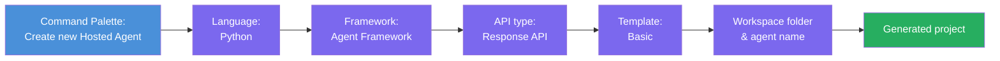
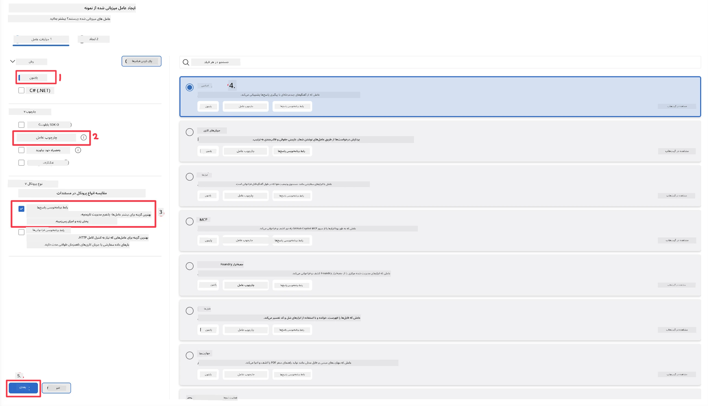
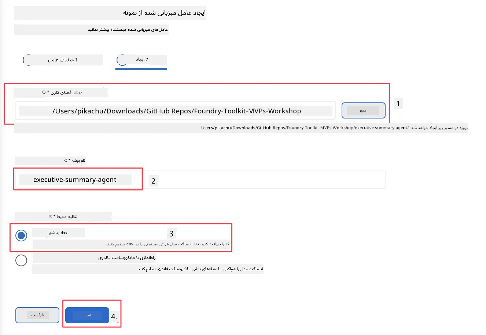

# ماژول ۲ - ایجاد یک عامل میزبانی شده جدید

⏱️ ~۵ دقیقه

در این ماژول، شما از Foundry Toolkit برای **ایجاد چهارچوب پروژه عامل میزبانی شده** استفاده می‌کنید. این چهارچوب ساختار کامل پروژه را تولید می‌کند - `agent.yaml`، `main.py`، `Dockerfile`، `requirements.txt` و پیکربندی خطایابی VS Code - بنابراین می‌توانید روی سفارشی‌سازی رفتار عامل تمرکز کنید.

> **مفهوم کلیدی:** پوشه `agent/` در این آزمایشگاه نمونه‌ای از چیزی است که Foundry Toolkit ایجاد می‌کند. شما این فایل‌ها را از ابتدا نمی‌نویسید.

### روند ویزارد چهارچوب‌بندی



---

## مرحله ۱: باز کردن ویزارد ایجاد عامل میزبانی شده

۱. دکمه `Ctrl+Shift+P` را فشار دهید تا **Command Palette** باز شود.
۲. تایپ کنید: **Foundry Toolkit: Create new Hosted Agent** و آن را انتخاب کنید.

> **گزینه جایگزین: ایجاد از طریق Foundry Portal**
> اگر مرورگر را ترجیح می‌دهید، می‌توانید پروژه خود را در [https://ai.azure.com](https://ai.azure.com) ایجاد کنید. پس از فراهم شدن پروژه، به VS Code بازگردید و از نوار کناری **Foundry Toolkit** برای اتصال به آن استفاده کنید.

> **گزینه جایگزین:** در نوار کناری Foundry Toolkit، روی **Agents** زیر پروژه خود حرکت کنید، روی آیکون **+** کلیک کنید، سپس **Create in Code With Template** را انتخاب کنید.

## مرحله ۲: انتخاب تنظیمات



۱. در بخش ناوبری/گزینه‌های سمت چپ موارد زیر را انتخاب کنید:

| منو | انتخاب | یادداشت‌ها |
|--------|-----------|-------|
| **زبان** | Python | همچنین C# پشتیبانی می‌شود |
| **چهارچوب** | Agent Framework | نقطه شروع ساده با استفاده از Agent Framework SDK |
| **نوع API** | Response API | `POST /responses` - محاوره‌ای، با تاریخچه مدیریت شده توسط پلتفرم |
| **قالب** | Basic | نقطه شروع ساده با استفاده از Agent Framework SDK |

۲. پس از انتخاب، روی **Next** کلیک کنید



۳. در پنجره بعد، موارد زیر را انتخاب کنید:

| منو | انتخاب | یادداشت‌ها |
|--------|-----------|-------|
| **پوشه کاری** | انتخاب یک پوشه هدف | مثلاً `/workspace/Foundry_Toolkit_for_VSCode_Lab/` یا زیربرنامه‌ای در این مخزن |
| **نام عامل** | وارد کردن یک نام | مثلاً `executive-summary-agent` |
| **تنظیم محیط** | فعلاً تنظیم را رد کنید |  |

برای ایجاد عامل روی **create** کلیک کنید. یک پوشه جدید با نام عامل میزبانی شده ایجاد می‌شود.

## مرحله ۳: بررسی پروژه تولید شده

پس از تکمیل چهارچوب‌بندی، اطمینان حاصل کنید که این فایل‌ها را در Explorer (`Ctrl+Shift+E`) می‌بینید:

```
📂 executive-summary-agent/
├── .env                ← Environment variables (placeholders)
├── .vscode/
│   ├── launch.json     ← Debug config (F5 → run + Agent Inspector)
│   └── tasks.json      ← VS Code task definitions
├── agent.yaml          ← Agent definition (kind: hosted)
├── Dockerfile          ← Container config for deployment
├── main.py             ← Agent entry point (your main code)
└── requirements.txt    ← Python dependencies
```

### توضیح فایل‌های کلیدی

| فایل | هدف |
|------|---------|
| `agent.yaml` | عامل را به عنوان `kind: hosted` اعلام می‌کند، متغیرهای محیطی را نگاشت می‌کند، پروتکل `/responses` را تعریف می‌کند |
| `main.py` | یک `FoundryChatClient` ایجاد می‌کند → آن را در یک `Agent` با دستورالعمل‌ها می‌پیچد → از طریق `ResponsesHostServer` روی پورت ۸۰۸۸ ارائه می‌دهد |
| `Dockerfile` | از `python:3.12-slim` استفاده می‌کند، وابستگی‌ها را نصب می‌کند، پورت ۸۰۸۸ را باز می‌کند، `main.py` را اجرا می‌کند |
| `requirements.txt` | `agent-framework-foundry`، `agent-framework-foundry-hosting`، `mcp`، `debugpy` |

> **مهم:** پوشه عامل چهارچوب‌بندی شده را مستقیماً در VS Code باز کنید (پوشه خود `agent/`) تا `.vscode/launch.json` و `tasks.json` به درستی برای خطایابی F5 کار کنند.

---

### ✅ نقطه بررسی

- [ ] پروژه چهارچوب‌بندی شده با تمام فایل‌های مورد انتظار ایجاد شده است
- [ ] `agent.yaml` `kind: hosted` و `protocol: responses` را نشان می‌دهد
- [ ] `main.py` `Agent`، `FoundryChatClient`، `ResponsesHostServer` را ایمپورت می‌کند
- [ ] پوشه عامل به عنوان ریشه فضای کاری در VS Code باز است

---

**قبلی:** [۰۱ - راه‌اندازی](01-setup.md) · **بعدی:** [۰۳ - پیکربندی و کد →](03-configure-and-code.md)

---

<!-- CO-OP TRANSLATOR DISCLAIMER START -->
**سلب مسئولیت**:
این سند با استفاده از سرویس ترجمه هوش مصنوعی [Co-op Translator](https://github.com/Azure/co-op-translator) ترجمه شده است. در حالی که ما در تلاش برای دقت هستیم، لطفاً توجه داشته باشید که ترجمه‌های خودکار ممکن است شامل خطاها یا نادرستی‌هایی باشند. سند اصلی به زبان مادری خود باید به عنوان منبع معتبر در نظر گرفته شود. برای اطلاعات حیاتی، ترجمه حرفه‌ای انسانی توصیه می‌شود. ما در قبال هرگونه سوء تفاهم یا برداشت نادرست ناشی از استفاده از این ترجمه مسئولیتی نداریم.
<!-- CO-OP TRANSLATOR DISCLAIMER END -->