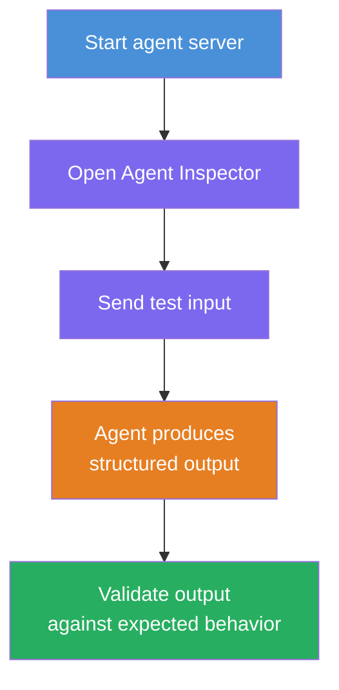
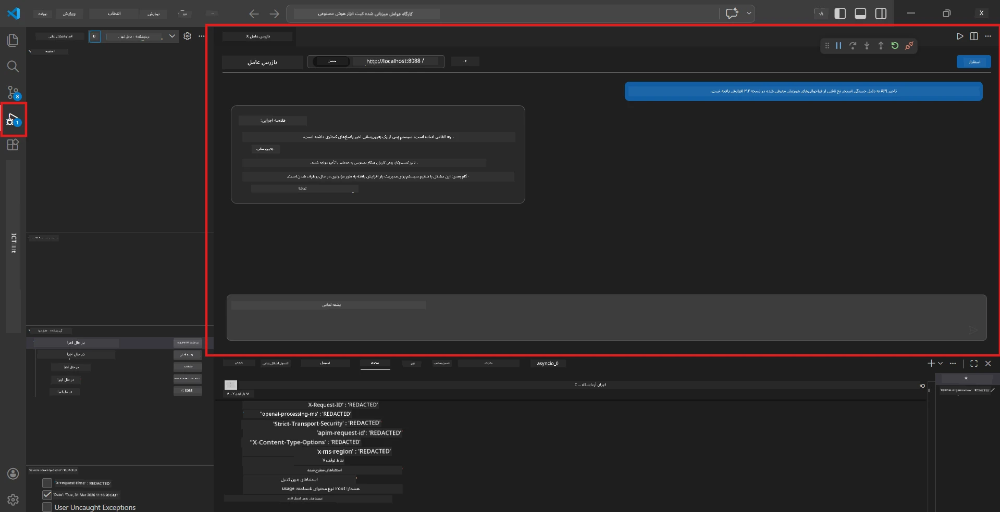
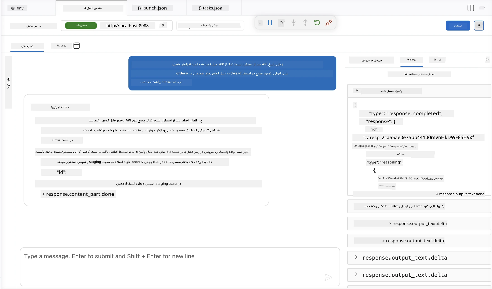

# ماژول ۴ - تست به صورت محلی

⏱️ ~۱۰ دقیقه

در این ماژول، شما عامل خود را به صورت محلی اجرا کرده و تأیید می‌کنید که به درستی کار می‌کند با استفاده از **آزمایش‌های عملکردی مسیر خوشحال**. شما از Agent Inspector (رابط کاربری بصری) یا تماس‌های HTTP مستقیم برای تأیید اینکه عامل پاسخ‌های ساختاریافته و دقیقی تولید می‌کند، استفاده خواهید کرد.

### جریان تست محلی



---

## گزینه ۱: فشار دادن F5 - اشکال‌زدایی با Agent Inspector (توصیه‌شده)

### شروع اشکال‌زدایی

۱. پوشه **executive-summary-agent/** را مستقیماً در VS Code باز کنید (`File → Open Folder`).
۲. پنل **Run and Debug** را باز کنید (`Ctrl+Shift+D`).
۳. گزینه **Debug Local Agent HTTP Server** را از فهرست کشویی انتخاب کنید.
۴. روی **F5** فشار دهید (یا روی ▶ شروع اشکال‌زدایی کلیک کنید).

> ⚠️ **مهم: مفسر پایتون خود را انتخاب کنید**
> اگر با خطای "ModuleNotFoundError" مواجه شدید یا اشکال‌زدای شروع نشد، باید به VS Code بگویید تا از محیط مجازی خود استفاده کند:
  > ۱. دکمه `Ctrl+Shift+P` را فشار دهید $\rightarrow$ تایپ کنید **Python: Select Interpreter**.
  > 2. مفسر موجود در پوشه `.venv` پروژه خود را انتخاب کنید (به عنوان مثال، `.\.venv\Scripts\python.exe` در ویندوز).
  > 3. جلسه اشکال‌زدایی را مجدداً راه‌اندازی کنید.
> اگر هنوز خطا دریافت می‌کنید، فایل `tasks.json` خود را به صورت دستی به شرح زیر بروزرسانی کنید:
  > 1. به فایل `.vscode/tasks.json` بروید
  > 2. به تسکی با برچسب: `Run Agent HTTP Server` بروید
  > 3. مقدار دستور را به شرح زیر بروزرسانی کنید:
  >    - **ویندوز:** `"value": "${workspaceFolder}/.venv/Scripts/python.exe",`
  >    - **macOS/Linux:** `"value": "${workspaceFolder}/.venv/bin/python",`

### چه اتفاقی می‌افتد

1. سرور HTTP در `http://localhost:8088/responses` شروع به کار می‌کند.
2. پنل **Agent Inspector** به صورت خودکار باز می‌شود - یک رابط چت بصری برای تست.
3. نقطه توقف‌ها در `main.py` فعال می‌شوند.

ترمینال را برای موارد زیر تماشا کنید:
```
Starting executive summary hosted agent
Executive agent server running on http://localhost:8088
```

> **اگر Agent Inspector باز نشد:** کلید `Ctrl+Shift+P` را فشار دهید → **Foundry Toolkit: Open Agent Inspector**.



> *تصویر ممکن است برندینگ قدیمی 'AI TOOLKIT' از نسخه‌های قبلی افزونه را نشان دهد.*

---

## گزینه ۲: تست از طریق ترمینال (جایگزین)

ایجنت را در یک ترمینال راه‌اندازی کنید و درخواست‌ها را از ترمینال دیگر ارسال کنید:

```bash
# Terminal 1: Start agent
cd executive-summary-agent/
source .venv/bin/activate
python main.py
```

```bash
# Terminal 2: Send test (curl)
curl -sS -X POST http://localhost:8088/responses \
  -H "Content-Type: application/json" \
  -d '{"input": "The API latency increased due to thread pool exhaustion caused by sync calls in v3.2.", "stream": false}'
```

---

## تست‌های سناریو: اعتبارسنجی عملکرد مسیر خوشحال

هر **سه** سناریوی زیر را اجرا کنید. این‌ها اعتبار می‌دهند که ایجنت شما خروجی درست و ساختاریافته برای ورودی‌های واقعی تولید می‌کند.



### سناریو ۱: حادثه IT - افزایش تأخیر API

**ورودی:**
```
The API latency increased from 200ms to 2s after deploying v3.2.
Root cause: thread pool starvation from synchronous calls in /orders.
Rolled back at 10:14.
```

**رفتار مورد انتظار:**
- ✅ ساختار "Executive Summary" را دنبال می‌کند (چه اتفاقی افتاد / تأثیر کسب‌وکار / گام بعدی)
- ✅ از اصطلاحات فنی استفاده نمی‌کند (هیچ "thread pool"، "/orders"، یا "v3.2")
- ✅ تأثیر کسب‌وکار را به وضوح بیان می‌کند (مثلاً کاربران با تأخیر مواجه شدند)
- ✅ شامل یک گام بعدی است (مثلاً رفع مشکل انجام شده، نظارت برقرار شده)

---

### سناریو ۲: خط لوله داده - شکست ETL

**ورودی:**
```
The nightly ETL job failed because the upstream schema changed. APAC dashboards show missing data.
```

**رفتار مورد انتظار:**
- ✅ شکست تازه‌سازی داده‌ها را به زبان ساده خلاصه می‌کند
- ✅ تأثیر داشبورد APAC را ذکر می‌کند
- ✅ شامل گام بعدی برای اصلاح است
- ✅ از اصطلاحاتی مانند "ETL"، "schema" یا دیگر اصطلاحات فنی استفاده نمی‌کند

---

### سناریو ۳: امنیت - افشای اطلاعات ورود

**ورودی:**
```
Static analysis flagged a hardcoded secret in the repository.
The secret may have been exposed in commit history.
```

**رفتار مورد انتظار:**
- ✅ مشکل مربوط به اطلاعات ورود/امنیت را به زبان قابل فهم برای مدیران توصیف می‌کند
- ✅ ریسک بالقوه (دسترسی غیرمجاز) را بیان می‌کند
- ✅ اقدام اصلاحی (چرخش اطلاعات ورود، حسابرسی) را ذکر می‌کند
- ✅ از اصطلاحاتی مانند "static analysis"، "commit history" یا "hardcoded" استفاده نمی‌کند

---

## معیارهای اعتبارسنجی

برای هر سناریو، موارد زیر را بررسی کنید:

| شماره | معیار | شرط قبولی |
|---|----------|---------------|
| ۱ | **ساختار** | پاسخ از فرمت "Executive Summary" با هر سه مورد استفاده می‌کند |
| ۲ | **زبان ساده** | بدون اصطلاحات فنی که مدیر متوجه نشود |
| ۳ | **دقت** | خلاصه ورودی را منعکس می‌کند - هیچ جزئیات ساختگی وجود ندارد |
| ۴ | **اختصار** | پاسخ کمتر از ۱۰۰ کلمه است |
| ۵ | **گام بعدی** | اقدام یا کاهش خطر مشخص و روشنی ذکر شده است |

---

## نکات اشکال‌زدایی

| مشکل | راه حل |
|-------|-----|
| ایجنت شروع نمی‌شود | مقادیر `.env` را بررسی کنید، اطمینان حاصل کنید که venv فعال است، اجرای `pip install -r requirements.txt` |
| پاسخ خالی یا کلی | دستور العمل‌های موجود در `main.py` را مرور کنید - مطمئن شوید فرمت خروجی مشخص شده |
| پاسخ شامل اصطلاحات فنی است | قوانین "حذف اصطلاحات فنی" در دستورالعمل‌ها را تقویت کنید |
| Agent Inspector باز نمی‌شود | `Ctrl+Shift+P` → **Foundry Toolkit: Open Agent Inspector** |
| خطاهای مدل در ترمینال | مطمئن شوید `AZURE_AI_MODEL_DEPLOYMENT_NAME` دقیقاً مطابقت دارد (حساس به حروف) |

---

### ✅ نقطه بررسی

- [ ] ایجنت به صورت محلی بدون خطا شروع می‌شود
- [ ] Agent Inspector باز می‌شود و یک رابط چت نمایش می‌دهد (اگر از F5 استفاده می‌کنید)
- [ ] **سناریو ۱** (حادثه IT) - خلاصه اجرایی ساختاریافته، بدون اصطلاحات فنی
- [ ] **سناریو ۲** (خط لوله داده) - خلاصه مرتبط با تأثیر کسب‌وکار
- [ ] **سناریو ۳** (هشدار امنیتی) - ارتباط ریسک مناسب
- [ ] همه پاسخ‌ها ساختار تعریف شده خروجی را دنبال می‌کنند

> **پاسخ‌های خود را ذخیره کنید** (کپی یا اسکرین‌شات) - آنها را با نتایج ابری در ماژول ۰۶ مقایسه خواهید کرد.

---

**قبلی:** [03 - Configure & Code](03-configure-and-code.md) · **بعدی:** [05 - Deploy to Foundry →](05-deploy-to-foundry.md)

---

<!-- CO-OP TRANSLATOR DISCLAIMER START -->
**سلب مسئولیت**:
این سند با استفاده از سرویس ترجمه هوش مصنوعی [Co-op Translator](https://github.com/Azure/co-op-translator) ترجمه شده است. در حالی که ما در تلاش برای دقت هستیم، لطفاً توجه داشته باشید که ترجمه‌های خودکار ممکن است شامل خطاها یا نادرستی‌هایی باشند. سند اصلی به زبان مادری خود باید به عنوان منبع معتبر در نظر گرفته شود. برای اطلاعات حیاتی، ترجمه حرفه‌ای انسانی توصیه می‌شود. ما در قبال هرگونه سوء تفاهم یا برداشت نادرست ناشی از استفاده از این ترجمه مسئولیتی نداریم.
<!-- CO-OP TRANSLATOR DISCLAIMER END -->