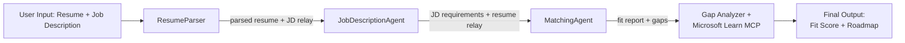

# PersonalCareerCopilot - ارزیاب تناسب رزومه با شغل  

یک برنامه چندعاملی مبتنی بر گردش کار که میزان تطابق یک رزومه با توضیحات شغلی را ارزیابی می‌کند و سپس نقشه راه یادگیری شخصی‌سازی شده‌ای برای پر کردن شکاف‌ها ایجاد می‌کند.  

---

## عوامل  

| عامل | نقش | ابزارها |  
|-------|------|-------|  
| **ResumeParser** | استخراج مهارت‌ها، تجربه‌ها، گواهینامه‌های ساختاریافته از متن رزومه | - |  
| **JobDescriptionAgent** | استخراج مهارت‌ها، تجربه‌ها، گواهینامه‌های مورد نیاز/ترجیحی از توضیحات شغلی | - |  
| **MatchingAgent** | مقایسه پروفایل با ملزومات → امتیاز تناسب (۰-۱۰۰) + مهارت‌های مطابقت داده شده/مفقود | - |  
| **GapAnalyzer** | ساخت نقشه راه یادگیری شخصی‌سازی شده با منابع Microsoft Learn | `search_microsoft_learn_for_plan` (MCP) |  

## گردش کار  


  
---

## شروع سریع  

### ۱. راه‌اندازی محیط  

این پوشه پیاده‌سازی مرجع برای چارچوب مبتنی بر گردش کار آزمایشگاه شماره ۰۲ است. `main.py` آن از بلوک‌های آماده موجود به همراه `WorkflowBuilder` برای اتصال چهار عامل به هم استفاده می‌کند.  

```powershell
cd workshop\lab02-multi-agent\PersonalCareerCopilot
python -m venv .venv
.\.venv\Scripts\Activate.ps1          # Windows PowerShell
# source .venv/bin/activate            # macOS / Linux
pip install -r requirements.txt
```
  
### ۲. پیکربندی اطلاعات کاربری  

یک فایل `.env` در این پوشه بسازید:  

```powershell
copy .env .env.bak 2>$null; echo $null > .env
```
  
فایل `.env` را ویرایش کنید:  

```env
FOUNDRY_PROJECT_ENDPOINT=https://<your-account>.services.ai.azure.com/api/projects/<your-project>
AZURE_AI_MODEL_DEPLOYMENT_NAME=gpt-4.1-mini
```
  
| مقدار | محل یافتن |  
|-------|------------------|  
| `FOUNDRY_PROJECT_ENDPOINT` | نوار کناری Foundry Toolkit → کلیک راست روی پروژه → **Copy Project Endpoint** |  
| `AZURE_AI_MODEL_DEPLOYMENT_NAME` | نوار کناری Foundry → پروژه را باز کنید → **Models + endpoints** → نام استقرار |  

### ۳. اجرای محلی  

```powershell
python -m debugpy --listen 127.0.0.1:5679 main.py --port 8088
```
  
یا از تسک VS Code استفاده کنید: `Ctrl+Shift+P` → **Tasks: Run Task** → **Run Agent HTTP Server**.  

برای اشکال‌زدایی با F5، از **Debug Local Agent HTTP Server** استفاده کنید.  

### ۴. تست با Agent Inspector  

Agent Inspector را باز کنید: `Ctrl+Shift+P` → **Foundry Toolkit: Open Agent Inspector**.  

این متن تست را بچسبانید:  

```
Resume:
Jane Doe
Senior Software Engineer with 5 years of experience in Python, Django, and AWS.
Built microservices handling 10K+ requests/second. Led a team of 4 developers.
Certifications: AWS Solutions Architect Associate.
Education: B.S. Computer Science, State University.

Job Description:
Senior Cloud Engineer at Contoso Ltd.
Required: Python, Azure, Kubernetes, Terraform, CI/CD pipelines.
Preferred: Go, monitoring (Prometheus/Grafana), cost optimization.
Experience: 5+ years in cloud infrastructure.
Certifications: Azure Solutions Architect Expert preferred.
```
  
**انتظار می‌رود:** امتیاز تناسب (۰-۱۰۰)، مهارت‌های مطابقت داده شده/مفقود، و نقشه راه یادگیری شخصی‌سازی شده با آدرس‌های Microsoft Learn.  

### ۵. استقرار در Foundry  

`Ctrl+Shift+P` → **Foundry Toolkit: Deploy Hosted Agent** → پروژه‌تان را انتخاب کنید → تأیید کنید.  

---

## ساختار پروژه  

```
PersonalCareerCopilot/
├── .env                ← Your credentials (git-ignored)
├── agent.yaml          ← Hosted agent definition (name, resources, env vars)
├── Dockerfile          ← Container image for Foundry deployment
├── main.py             ← 4-agent workflow (instructions, MCP tool, WorkflowBuilder)
└── requirements.txt    ← Python dependencies
```
  
## فایل‌های کلیدی  

### `agent.yaml`  

عامل میزبانی شده برای Foundry Agent Service را تعریف می‌کند:  
- `kind: hosted` - به صورت یک کانتینر مدیریت شده اجرا می‌شود  
- `protocols` - پروتکل `responses` با `version: 2.0.0`، درگاه HTTP `/responses` را باز می‌کند  
- `environment_variables` - `AZURE_AI_MODEL_DEPLOYMENT_NAME` در اینجا اعلام می‌شود؛ `FOUNDRY_PROJECT_ENDPOINT` در زمان استقرار به صورت خودکار تزریق می‌گردد  

### `main.py`  

شامل:  
- **دستورات عامل** - چهار ثابت `*_INSTRUCTIONS`، یکی برای هر عامل  
- **ابزار MCP** - `search_microsoft_learn_for_plan()` به `https://learn.microsoft.com/api/mcp` از طریق HTTP قابل استریم تماس می‌گیرد  
- **ساخت عامل** - چهار نمونه `Agent()` + `AgentExecutor()` که یک `FoundryChatClient` را به اشتراک می‌گذارند  
- **گراف گردش کار** - `WorkflowBuilder` عوامل را مانند یک خط لوله متوالی به هم متصل می‌کند: ResumeParser → JD Agent → MatchingAgent → GapAnalyzer  
- **راه‌اندازی سرور** - `ResponsesHostServer` روی پورت ۸۰۸۸ اجرا می‌شود  

### `requirements.txt`  

| بسته | هدف |  
|---------|----------|  
| `agent-framework-foundry` | هسته زمان اجرا: `Agent`، `AgentExecutor`، `WorkflowBuilder`، `@tool`، `FoundryChatClient` |  
| `agent-framework-foundry-hosting` | ادغام میزبانی با Foundry + `ResponsesHostServer` |  
| `mcp<2,>=1.24.0` | کلاینت MCP برای GapAnalyzer (`streamable_http_client`) |  
| `debugpy` | اشکال‌زدایی پایتون (F5 در VS Code) |  

---

## عیب‌یابی  

| مشکل | راه حل |  
|-------|-----|  
| `KeyError: 'FOUNDRY_PROJECT_ENDPOINT'` یا `KeyError: 'AZURE_AI_MODEL_DEPLOYMENT_NAME'` | یک `.env` با هر دو مقدار `FOUNDRY_PROJECT_ENDPOINT` و `AZURE_AI_MODEL_DEPLOYMENT_NAME` ایجاد کنید |  
| `ModuleNotFoundError: No module named 'agent_framework'` | محیط مجازی را فعال کرده و `pip install -r requirements.txt` را اجرا کنید |  
| خروجی شامل آدرس‌های Microsoft Learn نیست | اتصال اینترنت به `https://learn.microsoft.com/api/mcp` را بررسی کنید |  
| فقط یک کارت شکاف نمایش داده می‌شود (کوتاه شده) | اطمینان حاصل کنید `GAP_ANALYZER_INSTRUCTIONS` شامل بلوک `CRITICAL:` باشد |  
| پورت ۸۰۸۸ در حال استفاده است | سایر سرورها را متوقف کنید: `netstat -ano \| findstr :8088` |  

برای عیب‌یابی دقیق‌تر، به [Module 8 - Troubleshooting](../docs/08-troubleshooting.md) مراجعه کنید.  

---

**راهنمای کامل:** [اسناد آزمایشگاه ۰۲](../docs/README.md) · **بازگشت به:** [README آزمایشگاه ۰۲](../README.md) · [خانه کارگاه](../../../README.md)  

---

<!-- CO-OP TRANSLATOR DISCLAIMER START -->
**سلب مسئولیت**:
این سند با استفاده از سرویس ترجمه هوش مصنوعی [Co-op Translator](https://github.com/Azure/co-op-translator) ترجمه شده است. در حالی که ما در تلاش برای دقت هستیم، لطفاً توجه داشته باشید که ترجمه‌های خودکار ممکن است شامل خطاها یا نادرستی‌هایی باشند. سند اصلی به زبان مادری خود باید به عنوان منبع معتبر در نظر گرفته شود. برای اطلاعات حیاتی، ترجمه حرفه‌ای انسانی توصیه می‌شود. ما در قبال هرگونه سوء تفاهم یا برداشت نادرست ناشی از استفاده از این ترجمه مسئولیتی نداریم.
<!-- CO-OP TRANSLATOR DISCLAIMER END -->