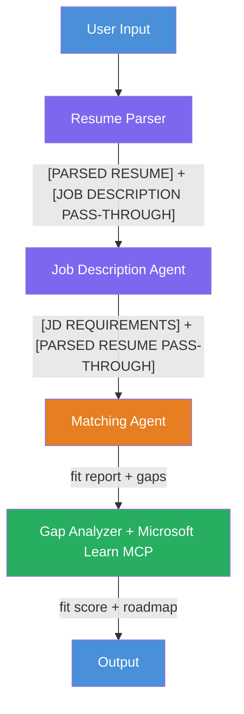

# آزمایشگاه ۰۲ - گردش کار چندعامله: ارزیاب تناسب رزومه به شغل

## مرور کلی

در این آزمایشگاه عملی، شما یک اپلیکیشن چندعامله مبتنی بر گردش کار می‌سازید با استفاده از Foundry Toolkit در VS Code و آن را در سرویس Microsoft Foundry Agent مستقر می‌کنید.

**چیزی که خواهید ساخت:** یک ارزیاب تناسب رزومه به شغل که رزومه و شرح شغل را تجزیه می‌کند، امتیاز تطابق می‌دهد، و یک نقشه راه یادگیری شخصی‌سازی شده با استفاده از منابع Microsoft Learn تولید می‌کند.

---

## معماری

**نحوه کارکرد:**
۱. کاربر رزومه و شرح شغل را جای‌گذاری می‌کند.
۲. **ResumeParser** رزومه را تجزیه کرده و شرح شغل را دقیقاً در یک بخش `[JOB DESCRIPTION PASS-THROUGH]` کپی می‌کند.
۳. **JD Agent** نیازمندی‌های ساختاریافته را از داده‌های عبوری استخراج می‌کند، سپس `[PARSED RESUME]` را به صورت `[PARSED RESUME PASS-THROUGH]` ارسال می‌کند.
۴. **MatchingAgent** `[PARSED RESUME PASS-THROUGH]` را با `[JD REQUIREMENTS]` مقایسه کرده و یک امتیاز تناسب ایجاد می‌کند.
۵. **GapAnalyzer** خلا‌ها را به یک نقشه راه عملی تبدیل کرده و لینک‌های واقعی Microsoft Learn را از طریق MCP دریافت می‌کند.

---

## پیش‌نیازها

ابتدا آزمایشگاه ۰۱ را کامل کنید:

- [آزمایشگاه ۰۱ - عامل تک‌نفره](../lab01-single-agent/README.md)

---

## بخش ۱: ماژول‌ها را به ترتیب بخوانید

مسیر کامل یادگیری را ببینید:

- [مستندات آزمایشگاه ۲ - پیش‌نیازها](docs/00-prerequisites.md)
- [مستندات آزمایشگاه ۲ - مسیر کامل یادگیری](docs/README.md)
- [راهنمای اجرای PersonalCareerCopilot](PersonalCareerCopilot/README.md)

---

## بخش ۲: ساخت و آزمایش گردش کار

۱. از مربی Foundry Toolkit برای چارچوب‌بندی پروژه مبتنی بر گردش کار استفاده کنید.
۲. بلوک‌های پرسش و نمودار گردش کار را از `PersonalCareerCopilot/main.py` به فضای کاری خود کپی کنید.
۳. به صورت محلی با Agent Inspector اجرا کرده و صحت عملکرد چهار عامل و ابزار MCP را تأیید کنید.
۴. پس از موفقیت آزمایش محلی، عامل میزبانی شده را در Foundry مستقر کنید.

---

## الگوهای هماهنگی

آزمایشگاه ۰۲ از یک **خط لوله متوالی** استفاده می‌کند: خروجی هر عامل به عامل بعدی می‌رود، و گردش کار پاسخ نهایی عامل آخر را بازمی‌گرداند. دو الگو این کار را انجام می‌دهند:

- **زنجیره متوالی** - `WorkflowBuilder` اتصال ResumeParser → JD Agent → MatchingAgent → GapAnalyzer با یک فراخوانی `add_edge()` برای هر مرحله
- **انتقال محتوا** - چون هر عامل فقط خروجی مستقیم عامل قبلی را می‌بیند، ResumeParser و JD Agent داده‌های لازم برای عوامل پایین‌دستی را به بخش‌های عبوری دارای برچسب کپی می‌کنند

مستندات همچنین توضیح می‌دهد چرا آزمایشگاه از fan-out/fan-in استفاده نمی‌کند و چگونه می‌توان نمودار را با یک عامل دیگر گسترش داد.

ببینید [docs/04-orchestration-patterns.md](docs/04-orchestration-patterns.md).

---

**قبلی:** [آزمایشگاه ۰۱ - عامل تک‌نفره](../lab01-single-agent/README.md) · **بازگشت به:** [صفحه اصلی کارگاه](../../README.md)

---

<!-- CO-OP TRANSLATOR DISCLAIMER START -->
**سلب مسئولیت**:
این سند با استفاده از سرویس ترجمه هوش مصنوعی [Co-op Translator](https://github.com/Azure/co-op-translator) ترجمه شده است. در حالی که ما در تلاش برای دقت هستیم، لطفاً توجه داشته باشید که ترجمه‌های خودکار ممکن است شامل خطاها یا نادرستی‌هایی باشند. سند اصلی به زبان مادری خود باید به عنوان منبع معتبر در نظر گرفته شود. برای اطلاعات حیاتی، ترجمه حرفه‌ای انسانی توصیه می‌شود. ما در قبال هرگونه سوء تفاهم یا برداشت نادرست ناشی از استفاده از این ترجمه مسئولیتی نداریم.
<!-- CO-OP TRANSLATOR DISCLAIMER END -->