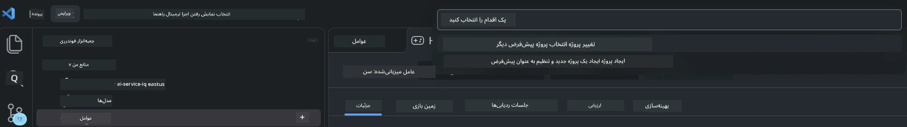

# ماژول ۰ - مقدمه

⏱️ ~۱۰ دقیقه

> [!WARNING]
> **پیش‌نمایش و محدودیت‌ها:** [عامل‌های میزبانی‌شده](https://learn.microsoft.com/azure/foundry/agents/concepts/hosted-agents) در حال حاضر در **پیش‌نمایش عمومی** هستند - برای بارهای کاری تولید توصیه نمی‌شوند. برخی از ویژگی‌های نشان داده شده در این کارگاه ممکن است با حرکت سرویس به سمت انتشار عمومی تغییر کنند.

## آنچه خواهید ساخت

در این آزمایشگاه، مهارت‌های تک‌عامل را از آزمایشگاه ۰۱ گسترش می‌دهید تا یک **گردش کار چندعامله** بسازید - ارزیاب تناسب رزومه به شغل.

شما یک **رزومه** و یک **توصیف شغل** جای‌گذاری می‌کنید. چهار عامل تخصصی ورودی را به ترتیب پردازش می‌کنند و سپس بازمی‌گردانند:
- امتیاز تناسب (۰–۱۰۰ همراه با تجزیه امتیاز)
- فهرست شکاف مهارت و گواهینامه
- نقشه راه یادگیری شخصی‌سازی‌شده با لینک‌های واقعی Microsoft Learn برای هر شکاف

**گردش کار از موارد زیر استفاده می‌کند:**
- **چارچوب عامل مایکروسافت** - `WorkflowBuilder` برای هماهنگی به صورت متوالی خط لوله
- **Foundry Toolkit برای VS Code** - اسکافولد، تست محلی، استقرار
- **یک مدل هوش مصنوعی** (مثلاً `gpt-4.1-mini`) - استفاده شده توسط همهٔ چهار عامل
- **سرور MCP مایکروسافت لرن** - ارائه لینک‌های منابع واقعی یادگیری برای هر شکاف مهارتی

---

## مسیر خود را انتخاب کنید

> ⚠️ **با همان مسیری که در آزمایشگاه ۰۱ استفاده کردید ادامه دهید.**

<details open>
<summary><strong>🅰️ مسیر A - ابر Azure (نیاز به اشتراک Azure دارد)</strong></summary>

| | جزئیات |
|---|---|
| **این برای چه کسانی است؟** | شما آزمایشگاه ۰۱ را با اشتراک Azure کامل کردید |
| **مدل** | Azure OpenAI از طریق Foundry (مثلاً `gpt-4.1-mini`) |
| **ماژول‌های پوشش داده شده** | همه ماژول‌ها (۰۰–۰۹) |
| **استقرار در ابر؟** | ✅ بله - استقرار کامل انتها به انتها |

</details>

<details open>
<summary><strong>🅱️ مسیر B - Foundry Local (نیاز به اشتراک Azure ندارد)</strong></summary>

| | جزئیات |
|---|---|
| **این برای چه کسانی است؟** | شما آزمایشگاه ۰۱ را با Foundry Local کامل کردید |
| **مدل** | Foundry Local (رایگان، روی دستگاه شما اجرا می‌شود) |
| **ماژول‌های پوشش داده شده** | ماژول‌های ۰۰–۰۵ (رد ۰۶–۰۷ - استقرار و تأیید ابر) |
| **استقرار در ابر؟** | ❌ خیر - فقط تست محلی از طریق Agent Inspector |

</details>

---

## بررسی آزمایشگاه ۰۱

آزمایشگاه ۰۲ مستقیماً بر روی آزمایشگاه ۰۱ ساخته شده است. ابتدا آزمایشگاه ۰۱ را تکمیل کنید سپس اینجا را شروع کنید.

هنوز آزمایشگاه ۰۱ را انجام نداده‌اید؟ از اینجا شروع کنید: [Lab 01 - Introduction](../../lab01-single-agent/docs/00-prerequisites.md)

<details open>
<summary><strong>🅰️ مسیر A - ابر Azure</strong></summary>

```powershell
az account show --query "{name:name, id:id}" --output table
```

اگر ناموفق بود، `az login` را اجرا کنید. سپس در VS Code تأیید کنید:

۱. `Ctrl+Shift+P` → تایپ کنید **Foundry Toolkit** → تأیید کنید دستورات ظاهر شده‌اند.
۲. روی آیکون **Foundry Toolkit** کلیک کنید → پروژه شما و مدل مستقر شده نشان دهند **Succeeded** باشد.



> **RBAC:** شما در آزمایشگاه ۰۱ نقش **Foundry User** را اختصاص دادید. اگر نیاز به اختصاص مجدد دارید، به [Lab 01, Module 1](../../lab01-single-agent/docs/01-setup.md#deploy-a-model--assign-rbac) مراجعه کنید. این نقش قبلاً **Azure AI User** نامیده می‌شد - با همان دسترسی‌ها.

</details>

<details open>
<summary><strong>🅱️ مسیر B - Foundry Local</strong></summary>

```powershell
Invoke-WebRequest -Uri "http://localhost:5273/v1/health" -UseBasicParsing | Select-Object StatusCode
```

انتظار می‌رود: `StatusCode: 200`. اگر نه، Foundry Local را از نوار کناری Foundry Toolkit دوباره راه‌اندازی کنید.

> همه پیش‌بینی‌ها روی دستگاه شما انجام می‌شود. تنها تماس خروجی ابزار MCP به `https://learn.microsoft.com/api/mcp` است.

</details>

---

## چه چیز جدیدی در آزمایشگاه ۰۲ است

| | آزمایشگاه ۰۱ | آزمایشگاه ۰۲ |
|--|--------|--------|
| عوامل | ۱ | ۴ (زنجیره شده با WorkflowBuilder) |
| قالب اسکافولد | پایه - چارچوب عامل | گردش‌کارها - چارچوب عامل |
| بسته جدید | - | `mcp` |
| هماهنگی | عامل مکالمه تک‌تایی | خط لوله متوالی (WorkflowBuilder) |
| ابزار جدید | - | `search_microsoft_learn_for_plan` (MCP) |

---

**بعدی:** [۰۱ - درک معماری →](01-understand-multi-agent.md)

---

<!-- CO-OP TRANSLATOR DISCLAIMER START -->
**سلب مسئولیت**:
این سند با استفاده از سرویس ترجمه هوش مصنوعی [Co-op Translator](https://github.com/Azure/co-op-translator) ترجمه شده است. در حالی که ما در تلاش برای دقت هستیم، لطفاً توجه داشته باشید که ترجمه‌های خودکار ممکن است شامل خطاها یا نادرستی‌هایی باشند. سند اصلی به زبان مادری خود باید به عنوان منبع معتبر در نظر گرفته شود. برای اطلاعات حیاتی، ترجمه حرفه‌ای انسانی توصیه می‌شود. ما در قبال هرگونه سوء تفاهم یا برداشت نادرست ناشی از استفاده از این ترجمه مسئولیتی نداریم.
<!-- CO-OP TRANSLATOR DISCLAIMER END -->