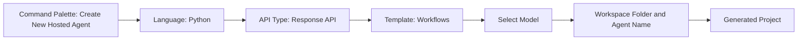
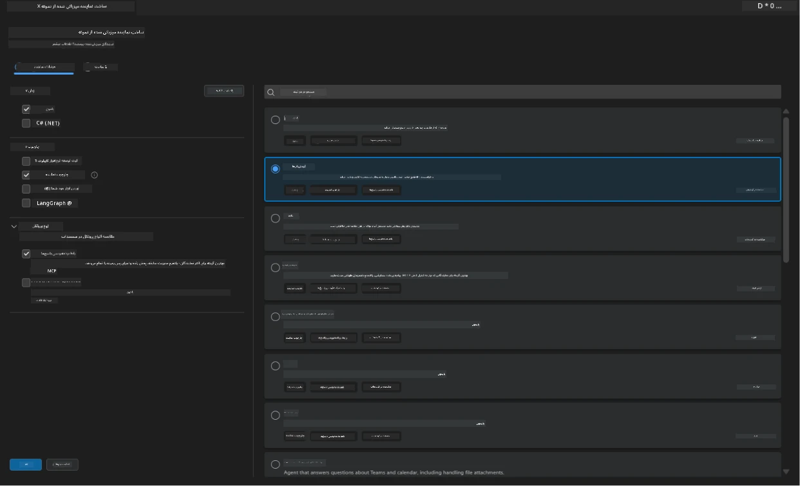
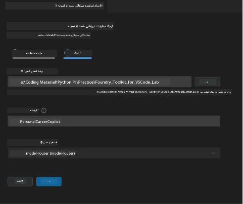

# ماژول ۲ - ایجاد چارچوب پروژه چندعامله‌ای

⏱️ ~۵ دقیقه

در این ماژول، شما از [Foundry Toolkit برای VS Code](https://aka.ms/foundrytk) برای **ایجاد چارچوب یک پروژه چندعامله‌ای** استفاده می‌کنید. جادوگر `agent.yaml`، `main.py`، `Dockerfile`، `requirements.txt`، `.env`، و پیکربندی اشکال‌زدایی VS Code را تولید می‌کند - بنابراین می‌توانید روی ایجاد جریان کاری ۴ عامله در ماژول ۳ تمرکز کنید.

> **مفهوم کلیدی:** چارچوب یک نمونه کاری با یک عامل است. شما منطق نماینده جای‌گذاری شده را با گراف `WorkflowBuilder` در ماژول ۳ جایگزین می‌کنید. شما از ابتدا قالب‌بندی را نمی‌نویسید.

> **پیاده‌سازی مرجع:** [`PersonalCareerCopilot/`](../../../../../workshop/lab02-multi-agent/PersonalCareerCopilot) یک نمونه کاری کامل است. از آن برای مقایسه کار خود در حین پیشرفت استفاده کنید.

### جریان جادوگر ایجاد چارچوب



---

## گام ۱: باز کردن جادوگر Create Hosted Agent

۱. دکمه `Ctrl+Shift+P` را فشار دهید تا **پالت فرمان** باز شود.
۲. تایپ کنید: **Foundry Toolkit: Create new Hosted Agent** و آن را انتخاب کنید.
۳. جادوگر در برگه **Agent Details** باز می‌شود.

> **راه جایگزین:** روی آیکون **Foundry Toolkit** در نوار فعالیت کلیک کنید → روی آیکون **+** کنار **Hosted Agents** کلیک کنید → **Create New Hosted Agent**.

---

## گام ۲: انتخاب تنظیمات



۱. در بخش ناوبری/گزینه‌های سمت چپ موارد زیر را انتخاب کنید:

| منو | انتخاب | توضیحات |
|--------|-----------|-------|
| **زبان** | Python | همچنین C# (.NET) پشتیبانی می‌شود |
| **فریمورک** | Agent Framework | ارائه دهنده `Agent`، `AgentExecutor`، `WorkflowBuilder` |
| **نوع API** | Response API | `POST /responses` - تاریخچه مدیریت شده توسط پلتفرم، پشتیبانی از پخش داده‌ها |
| **قالب** | **Workflows** | پردازش درخواست‌ها از طریق چند عامل به ترتیب |

۲. پس از انتخاب، روی **Next** کلیک کنید



۳. در پنجره بعدی موارد زیر را انتخاب کنید:

| منو | انتخاب | توضیحات |
|--------|-----------|-------|
| **پوشه کاری** | مرور به پوشه هدف | مثلاً `workshop/lab02-multi-agent/` در این مخزن |
| **نام عامل** | `PersonalCareerCopilot` | این نام پوشه پروژه خواهد شد |
| **مدل استقرار** | مدل مستقر خود را انتخاب کنید | مثلاً `gpt-4.1-mini` از آزمایشگاه ۰۱ |

۴. روی **Create** کلیک کنید تا چارچوب پروژه ساخته شود. VS Code فایل‌ها را تولید و پوشه را باز می‌کند.

> **نکته:** [`gpt-4.1-mini`](https://learn.microsoft.com/azure/foundry/foundry-models/concepts/models-sold-directly-by-azure#gpt-41-series) تعادل خوبی بین سرعت و کیفیت برای توسعه چندعامله برقرار می‌کند.

---

## گام ۳: بررسی پروژه تولیدشده

پس از اتمام ساخت چارچوب، مطمئن شوید این فایل‌ها را در اکسپلورر (`Ctrl+Shift+E`) می‌بینید:

```
📂 <your-agent-name>/
├── .azdignore          ← Files excluded from Azure Developer CLI deployments
├── .dockerignore       ← Files excluded from Docker builds
├── .env                ← Environment variables (placeholders - fill in Module 3)
├── .vscode/
│   ├── launch.json     ← Debug config (F5 → run + Agent Inspector)
│   └── tasks.json      ← VS Code task definitions
├── agent.yaml          ← Agent definition (kind: hosted, protocol: responses)
├── Dockerfile          ← Container config for deployment
├── main.py             ← Stub agent entry point (replace with WorkflowBuilder in Module 3)
└── requirements.txt    ← Python dependencies
```

> **مهم:** این پوشه چارچوب‌سازی شده را مستقیماً در VS Code باز کنید تا `.vscode/launch.json` و `tasks.json` به درستی برای اشکال‌زدایی F5 اعمال شوند.

### فایل‌های کلیدی توضیح داده شده

| فایل | هدف |
|------|---------|
| `agent.yaml` | اعلان `kind: hosted`، نگاشت متغیرهای محیطی، تعریف پروتکل `/responses` |
| `main.py` | نمونه: یک `FoundryChatClient` → `Agent` → `ResponsesHostServer`. این را با ۴ عامل + `WorkflowBuilder` در ماژول ۳ جایگزین می‌کنید |
| `Dockerfile` | `python:3.12-slim`، نصب `requirements.txt`، نمایان کردن پورت 8088، اجرای `python main.py` |
| `requirements.txt` | `agent-framework-foundry`، `agent-framework-foundry-hosting`، `mcp<2,>=1.24.0`، `debugpy` |

> **مرجع:** محتویات کامل تولیدشده را در [`PersonalCareerCopilot/agent.yaml`](../../../../../workshop/lab02-multi-agent/PersonalCareerCopilot/agent.yaml) و [`PersonalCareerCopilot/requirements.txt`](../../../../../workshop/lab02-multi-agent/PersonalCareerCopilot/requirements.txt) ببینید.

---

### ✅ نقاط بررسی

- [ ] جادوگر چارچوب‌سازی کامل شده - پوشه پروژه جدید در اکسپلورر قابل مشاهده است
- [ ] همه فایل‌های مورد انتظار موجود هستند: `agent.yaml`، `main.py`، `Dockerfile`، `requirements.txt`، `.env`
- [ ] `agent.yaml` فقط `kind: hosted` و `protocol: responses` را نشان می‌دهد
- [ ] `main.py` واردات `Agent`، `FoundryChatClient`، `ResponsesHostServer` را انجام می‌دهد
- [ ] پوشه چارچوب‌سازی شده به عنوان ریشه فضای کاری VS Code باز است
- [ ] می‌دانید `main.py` یک نمونه است - `WorkflowBuilder` در ماژول ۳ اضافه می‌شود

---

**قبلی:** [۰۱ - درک معماری چندعامله](01-understand-multi-agent.md) · **بعدی:** [۰۳ - پیکربندی عوامل و محیط →](03-configure-agents.md)

---

<!-- CO-OP TRANSLATOR DISCLAIMER START -->
**سلب مسئولیت**:
این سند با استفاده از سرویس ترجمه هوش مصنوعی [Co-op Translator](https://github.com/Azure/co-op-translator) ترجمه شده است. در حالی که ما در تلاش برای دقت هستیم، لطفاً توجه داشته باشید که ترجمه‌های خودکار ممکن است شامل خطاها یا نادرستی‌هایی باشند. سند اصلی به زبان مادری خود باید به عنوان منبع معتبر در نظر گرفته شود. برای اطلاعات حیاتی، ترجمه حرفه‌ای انسانی توصیه می‌شود. ما در قبال هرگونه سوء تفاهم یا برداشت نادرست ناشی از استفاده از این ترجمه مسئولیتی نداریم.
<!-- CO-OP TRANSLATOR DISCLAIMER END -->