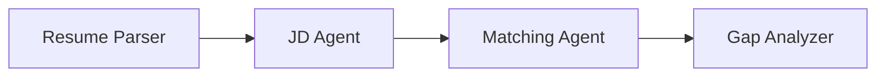
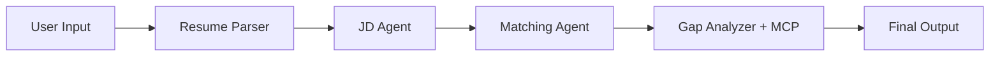

# ماژول ۴ - الگوهای ارکستراسیون

⏱️ حدود ۱۰ دقیقه

در این ماژول، الگوهای ارکستراسیونی که در Resume Job Fit Evaluator استفاده شده‌اند را بررسی می‌کنید و یاد می‌گیرید چگونه نمودار جریان کاری را بخوانید، اصلاح کنید و گسترش دهید. درک این الگوها برای رفع اشکال مسائل جریان داده‌ها و ساخت [workflow‌های چندععاملی](https://learn.microsoft.com/agent-framework/workflows/) خودتان ضروری است.

---

## الگو ۱: زنجیره ترتیبی

الگوی پایه‌ای در جریان کاری یک **زنجیره ترتیبی** است - خروجی هر عامل مستقیما وارد عامل بعدی می‌شود.



در کد، هر فراخوانی `add_edge()` یک قدم در زنجیره ایجاد می‌کند:

```python
.add_edge(resume_executor, jd_executor)       # ResumeParser output → JD Agent
.add_edge(jd_executor, matching_executor)     # JD Agent output → MatchingAgent
.add_edge(matching_executor, gap_executor)    # MatchingAgent output → GapAnalyzer
```

> **چرا ترتیبی، نه fan-out/fan-in؟** `WorkflowBuilder` از **OR-سمانتیک** برای یال‌های ورودی استفاده می‌کند: یک اجراکننده پایین‌دستی به محض تکمیل شدن **هرکدام** از پیشینیان فعال می‌شود. اگر `matching_executor` دو یال ورودی داشت (از هر دو `resume_executor` و `jd_executor`)، دو بار فعال می‌شد - یکبار وقتی ResumeParser تمام می‌شود و یکبار وقتی JD Agent تمام می‌شود - که باعث می‌شد GapAnalyzer هم دو بار اجرا شود و خروجی دو بار ظاهر شود. خط لوله ترتیبی این مشکل را کاملا رفع می‌کند.

## الگو ۲: انتقال محتوا

چون `context_mode="last_agent"` یعنی هر اجراکننده فقط خروجی **پیشینی مستقیم خودش** را می‌بیند، عوامل در یک زنجیره ترتیبی باید صراحتا هر داده‌ای را که عوامل پایین‌دستی نیاز دارند، به جلو منتقل کنند.

در این جریان کاری:
- **ResumeParser** متن JD را کلمه به کلمه در `[JOB DESCRIPTION PASS-THROUGH]` کپی می‌کند (تا JD Agent بتواند آن را پیدا کند).
- **JD Agent** خروجی `[PARSED RESUME]` را کلمه به کلمه در `[PARSED RESUME PASS-THROUGH]` کپی می‌کند (تا MatchingAgent هر دو پروفایل را مقایسه کند).

```
ResumeParser output
└─ [PARSED RESUME]               ← extracted by JD Agent
└─ [JOB DESCRIPTION PASS-THROUGH] ← extracted by JD Agent

JD Agent output
└─ [JD REQUIREMENTS]             ← extracted by MatchingAgent
└─ [PARSED RESUME PASS-THROUGH]  ← extracted by MatchingAgent
```

هر بخش رله باید **کلمه به کلمه** کپی شود - خلاصه کردن یا بازنویسی آن باعث خراب شدن عاملی می‌شود که به آن وابسته است.

---

## نمودار کامل

ترکیب الگوهای زنجیره ترتیبی و انتقال محتوا، جریان کاری کامل را می‌سازد:



Agent Inspector همین ساختار نمودار را هنگام اجرای محلی عامل نمایش می‌دهد. به [ماژول ۵ - تست محلی](05-test-locally.md) برای تصاویر مراجعه کنید.

---

## خواندن کد WorkflowBuilder

نمودار جریان کاری در تابع `main()` در [`PersonalCareerCopilot/main.py`](../../../../../workshop/lab02-multi-agent/PersonalCareerCopilot/main.py) ساخته می‌شود. سه فراخوانی `add_edge()` خط لوله ترتیبی را می‌سازند:

| # | یال | تاثیر |
|---|------|--------|
| ۱ | `resume_executor → jd_executor` | عامل JD ورودی `[PARSED RESUME]` + `[JOB DESCRIPTION PASS-THROUGH]` را دریافت می‌کند |
| ۲ | `jd_executor → matching_executor` | عامل MatchingAgent ورودی `[JD REQUIREMENTS]` + `[PARSED RESUME PASS-THROUGH]` را دریافت می‌کند |
| ۳ | `matching_executor → gap_executor` | عامل GapAnalyzer گزارش تناسب + لیست شکاف‌ها را دریافت می‌کند |

---

## تغییر نمودار

### اضافه کردن عامل جدید

برای اضافه کردن عامل پنجم (مثلا یک **InterviewPrepAgent** بعد از GapAnalyzer):

۱. یک ثابت `INTERVIEW_PREP_INSTRUCTIONS` تعریف کنید.
۲. اشیاء `Agent` + `AgentExecutor` ایجاد کنید (همان الگوی چهار عامل موجود).
۳. `.add_edge(gap_executor, interview_exec)` را در `WorkflowBuilder` اضافه کنید.
۴. `output_executors=[interview_exec]` را به‌روزرسانی کنید.

> **مهم:** فقط `start_executor` ورودی خام کاربر را دریافت می‌کند. سایر عوامل خروجی را از یال بالادستی خود دریافت می‌کنند.

---

## اشتباهات رایج نمودار

| اشتباه | نشانه | رفع |
|---------|---------|-----|
| فقدان یال به `output_executors` | عامل اجرا می‌شود ولی خروجی خالی است | مطمئن شوید راهی از `start_executor` به هر عامل در `output_executors` وجود دارد |
| وابستگی حلقوی | حلقه بی‌نهایت یا تایم‌اوت | بررسی کنید که هیچ عاملی به یک عامل بالادستی خود بازخورد ندهد |
| عاملی در `output_executors` بدون یال ورودی | خروجی خالی | حداقل یک `add_edge(source, that_agent)` اضافه کنید |
| چندین `output_executors` بدون fan-in | خروجی فقط پاسخ یک عامل را دارد | از یک عامل خروجی واحد که همه را تجمیع می‌کند استفاده کنید، یا چند خروجی قبول کنید |
| فقدان `start_executor` | `ValueError` در زمان ساخت | همیشه `start_executor` را در `WorkflowBuilder()` مشخص کنید |

---

## رفع اشکال نمودار

### استفاده از Agent Inspector

۱. عامل را با F5 به‌صورت محلی اجرا کنید.
۲. Agent Inspector را باز کنید (`Ctrl+Shift+P` → **Foundry Toolkit: Open Agent Inspector**).
۳. یک پیام تست ارسال کنید.
۴. در پنل پاسخ Inspector به دنبال **خروجی جریان‌یافته** بگردید - که مشارکت هر عامل به ترتیب را نشان می‌دهد.


### استفاده از لاگ‌برداری

به `main.py` لاگ‌برداری اضافه کنید تا جریان داده را دنبال کنید:

```python
import logging
logger = logging.getLogger("resume-job-fit")

# In main(), after building the workflow:
logger.info("Workflow graph built with edges: RP→JD, JD→MA, MA→GA")
```

لاگ‌های سرور ترتیب اجرای عامل و فراخوانی‌های ابزار MCP را نشان می‌دهد:

```
INFO:agent_framework:Executing agent: ResumeParser
INFO:agent_framework:Executing agent: JobDescriptionAgent
INFO:agent_framework:Executing agent: MatchingAgent
INFO:agent_framework:Executing agent: GapAnalyzer
INFO:agent_framework:Tool call: search_microsoft_learn_for_plan(skill="Kubernetes")
POST https://learn.microsoft.com/api/mcp → 200
INFO:agent_framework:Tool call: search_microsoft_learn_for_plan(skill="Terraform")
POST https://learn.microsoft.com/api/mcp → 200
```

---

### ایستگاه بررسی

- [ ] شما می‌توانید دو الگوی ارکستراسیون در جریان کاری را شناسایی کنید: زنجیره ترتیبی و انتقال محتوا
- [ ] شما دلیل اینکه چرا `context_mode="last_agent"` نیاز به انتقال صریح داده بین عوامل دارد را می‌فهمید
- [ ] می‌توانید کد `WorkflowBuilder` را بخوانید و هر فراخوانی `add_edge()` را به نمودار تصویری نگاشت کنید
- [ ] شما می‌دانید چگونه یک عامل جدید در انتهای خط لوله اضافه کنید
- [ ] شما می‌توانید اشتباهات رایج نمودار و نشانه‌های آن‌ها را شناسایی کنید

---

**قبلی:** [03 - پیکربندی عوامل و محیط](03-configure-agents.md) · **بعدی:** [05 - تست محلی →](05-test-locally.md)

---

<!-- CO-OP TRANSLATOR DISCLAIMER START -->
**سلب مسئولیت**:
این سند با استفاده از سرویس ترجمه هوش مصنوعی [Co-op Translator](https://github.com/Azure/co-op-translator) ترجمه شده است. در حالی که ما در تلاش برای دقت هستیم، لطفاً توجه داشته باشید که ترجمه‌های خودکار ممکن است شامل خطاها یا نادرستی‌هایی باشند. سند اصلی به زبان مادری خود باید به عنوان منبع معتبر در نظر گرفته شود. برای اطلاعات حیاتی، ترجمه حرفه‌ای انسانی توصیه می‌شود. ما در قبال هرگونه سوء تفاهم یا برداشت نادرست ناشی از استفاده از این ترجمه مسئولیتی نداریم.
<!-- CO-OP TRANSLATOR DISCLAIMER END -->