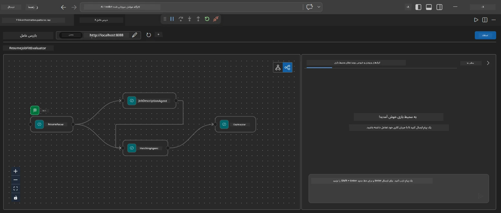
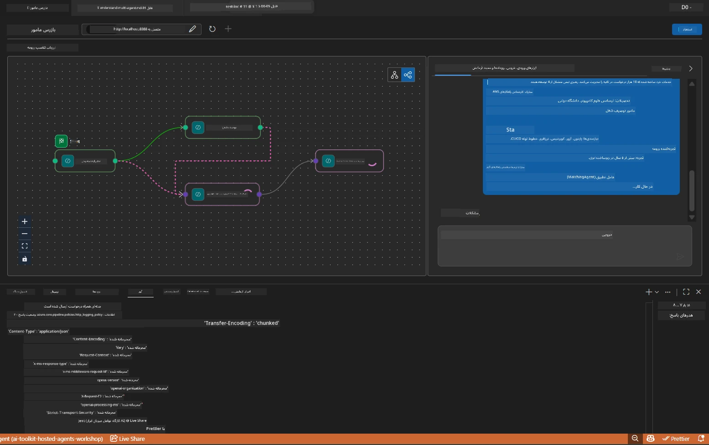
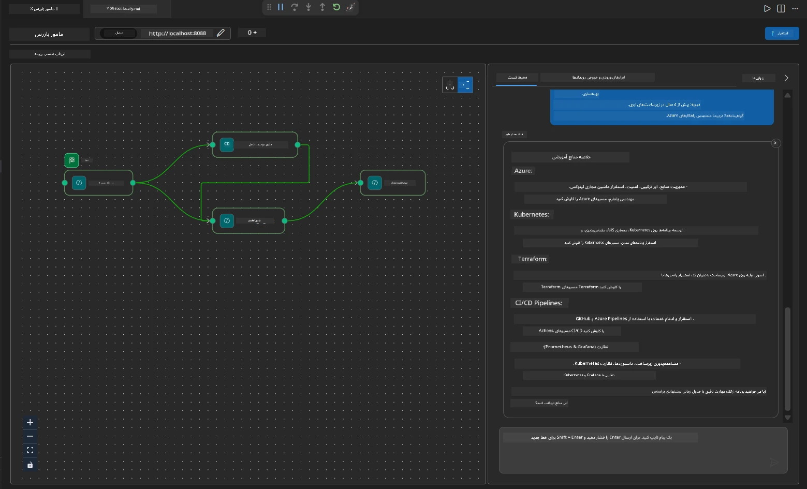

# ماژول ۵ - تست به صورت محلی

⏱️ ~۱۵ دقیقه

در این ماژول، گردش کار چندعامله را به صورت محلی اجرا می‌کنید، با Agent Inspector تست می‌کنید و اطمینان حاصل می‌کنید که هر چهار عامل و ابزار MCP قبل از استقرار به درستی کار می‌کنند.

---

## گام ۱: راه‌اندازی سرور عامل

### گزینه الف: استفاده از تسک VS Code (توصیه‌شده)

۱. `workshop/lab02-multi-agent/PersonalCareerCopilot/` را به عنوان پوشه VS Code خود باز کنید.
۲. کلید `Ctrl+Shift+P` را فشار دهید → تایپ کنید **Tasks: Run Task** → گزینه **Run Agent HTTP Server** را انتخاب کنید.
۳. این تسک سرور را با debugpy متصل روی پورت `5679` و عامل روی پورت `8088` راه‌اندازی می‌کند.
۴. منتظر بمانید تا خروجی پیام شروع به کار را نشان دهد، سپس پیام آماده‌باش سرور (سطرهای دیگر لاگ در بین ظاهر می‌شوند):

```
INFO:resume-job-fit:Starting Resume -> Job Fit Evaluator HTTP server...
...
INFO:hypercorn.error:Running on http://0.0.0.0:8088 (CTRL + C to quit)
```

### گزینه ب: استفاده از F5 (حالت اشکال‌زدایی)

۱. کلید `F5` را فشار دهید → گزینه **Debug Local Agent HTTP Server** را انتخاب کنید.
۲. سرور با پشتیبانی کامل از breakpoint شروع می‌شود - مفید برای بررسی پاسخ‌های MCP یا خروجی‌های عامل.

---

## گام ۲: باز کردن Agent Inspector

۱. کلید `Ctrl+Shift+P` را فشار دهید → تایپ کنید **Foundry Toolkit: Open Agent Inspector**.
۲. Agent Inspector به عنوان یک پنل VS Code که به `http://localhost:8088` متصل است باز می‌شود.
۳. باید رابط کاربری عامل را ببینید که آماده دریافت پیام‌ها است.



> **اگر Agent Inspector باز نشد:** اطمینان حاصل کنید که سرور کامل راه‌اندازی شده است (پیام لاگ `Running on http://0.0.0.0:8088` را ببینید). اگر پورت ۵۶۷۹ مشغول است، به [ماژول ۸ - رفع اشکال](08-troubleshooting.md) مراجعه کنید.

---

## گام ۲ب: (اختیاری) باز کردن Visualizer گردش کار

Foundry Toolkit شامل یک **Workflow Visualizer** به صورت زمان واقعی است که نشان می‌دهد چگونه عوامل در حین اجرای گراف با هم تعامل دارند. این ابزار به‌خصوص برای اشکال‌زدایی چندعامله مفید است.

۱. کلید `Ctrl+Shift+P` را فشار دهید → تایپ کنید **Foundry Toolkit: Open Visualizer for Hosted Agents**.
۲. یک تب جدید در VS Code باز می‌شود که گراف اجرای زنده را نشان می‌دهد.
۳. وقتی در Agent Inspector پیام می‌فرستید، Visualizer به طور خودکار به‌روز می‌شود - گره‌های سبز نمایانگر عوامل کامل شده و لبه‌های متحرک جریان داده بین آن‌ها را نشان می‌دهند.

> **اختلاف پورت:** اگر پورت Visualizer قبلاً استفاده شده باشد، آن را در تنظیمات VS Code → **Extensions** → **Microsoft Foundry Configuration** → **Hosted Agents: Visualizer Port** تغییر دهید.

---

## گام ۳: اجرای تست‌های ساده

این دو تست را به ترتیب اجرا کنید. هر تست به تدریج بخش بیشتری از گردش کار را بررسی می‌کند.

### تست ۱: رزومه پایه + شرح شغل

متن زیر را در Agent Inspector جای‌گذاری کنید:

```
Resume:
Jane Doe
Senior Software Engineer with 5 years of experience in Python, Django, and AWS.
Built microservices handling 10K+ requests/second. Led a team of 4 developers.
Certifications: AWS Solutions Architect Associate.
Education: B.S. Computer Science, State University.

Job Description:
Senior Cloud Engineer at Contoso Ltd.
Required: Python, Azure, Kubernetes, Terraform, CI/CD pipelines.
Preferred: Go, monitoring (Prometheus/Grafana), cost optimization.
Experience: 5+ years in cloud infrastructure.
Certifications: Azure Solutions Architect Expert preferred.
```

**ساختار خروجی مورد انتظار:**

پاسخ باید شامل خروجی تمام چهار عامل به ترتیب باشد:

۱. **خروجی Resume Parser** - دو بخش برچسب‌خورده: `[PARSED RESUME]` (پروفایل نامزد با مهارت‌های گروه‌بندی شده) و `[JOB DESCRIPTION PASS-THROUGH]` (متن اصلی شرح شغل که به JD Agent داده می‌شود)
۲. **خروجی JD Agent** - نیازمندی‌های ساختاریافته با مهارت‌های اجباری و ترجیحی جدا شده
۳. **خروجی Matching Agent** - امتیاز تناسب (۰-۱۰۰) با تجزیه و تحلیل، مهارت‌های مطابق، مهارت‌های کمبود، شکاف‌ها
۴. **خروجی Gap Analyzer** - کارت‌های شکاف فردی برای هر مهارت کمبود، هر کدام با لینک‌های Microsoft Learn





### مواردی که در تست ۱ باید بررسی کنید

| مورد بررسی | مورد انتظار | موفق؟ |
|-------|----------|-------|
| پاسخ شامل امتیاز تناسب باشد | عددی بین ۰-۱۰۰ با تجزیه و تحلیل | |
| مهارت‌های مطابق فهرست شده باشند | Python، CI/CD (جزئی)، و غیره | |
| مهارت‌های کمبود فهرست شده باشند | Azure، Kubernetes، Terraform و غیره | |
| کارت‌های شکاف برای هر مهارت کمبود موجود باشد | یک کارت برای هر مهارت | |
| لینک‌های Microsoft Learn وجود داشته باشند | لینک‌های واقعی `learn.microsoft.com` | |
| هیچ پیام خطا در پاسخ نباشد | خروجی ساختاریافته و تمیز | |

### تست ۲: حالت لبه‌ای - نامزد با تناسب بالا

یک رزومه که بسیار به شرح شغل نزدیک است را جای‌گذاری کنید تا مطمئن شوید GapAnalyzer در سناریوهای تناسب بالا به درستی کار می‌کند:

```
Resume:
Alex Chen
Senior Cloud Engineer with 7 years of experience.
Skills: Python, Azure (AKS, Functions, DevOps), Kubernetes, Terraform, CI/CD (GitHub Actions, Azure Pipelines), Go, Prometheus, Grafana, cost optimization.
Certifications: Azure Solutions Architect Expert, Azure DevOps Engineer Expert.
Led infrastructure migration to Azure for 3 enterprise clients.
Education: M.S. Computer Science, Tech University.

Job Description:
Senior Cloud Engineer at Contoso Ltd.
Required: Python, Azure, Kubernetes, Terraform, CI/CD pipelines.
Preferred: Go, monitoring (Prometheus/Grafana), cost optimization.
Experience: 5+ years in cloud infrastructure.
Certifications: Azure Solutions Architect Expert preferred.
```

**رفتار مورد انتظار:**
- امتیاز تناسب باید **۸۰+** باشد (بیشتر مهارت‌ها منطبق)
- کارت‌های شکاف باید بیشتر روی آماده‌سازی مصاحبه/تکمیل نواقص تمرکز کنند تا یادگیری پایه‌ای
- دستورالعمل‌های GapAnalyzer می‌گوید: "اگر تناسب >=۸۰ باشد، روی آماده‌سازی مصاحبه تمرکز کنید"

---

## گام ۴: تست با داده‌های خودتان (اختیاری)

سعی کنید رزومه خود و یک شرح شغل واقعی را جای‌گذاری کنید. این کمک می‌کند که:

- عوامل فرمت‌های مختلف رزومه (زمانی، عملکردی، ترکیبی) را مدیریت کنند
- JD Agent سبک‌های مختلف شرح شغل را مدیریت کند (بولت پوینت، پاراگراف، ساختاری)
- ابزار MCP منابع مرتبط برای مهارت‌های واقعی را بازمی‌گرداند
- کارت‌های شکاف به طور شخصی‌سازی شده برای پس‌زمینه خاص شما هستند

> **حریم خصوصی - مسیر A (Foundry cloud):** متن رزومه و شرح شغل برای استنتاج به استقرار Azure OpenAI شما ارسال می‌شود. توسط زیرساخت کارگاه لاگ یا ذخیره نمی‌شود. در صورت تمایل از نام‌های جایگزین استفاده کنید (مثلاً "جین دو").
>
> **حریم خصوصی - مسیر B (Foundry Local):** هر چهار استنتاج عامل کاملاً روی دستگاه شما اجرا می‌شود. متن رزومه و شرح شغل شما **هرگز از دستگاه شما خارج نمی‌شود**. تنها تماس خروجی، ابزار MCP است که منابع را از `https://learn.microsoft.com/api/mcp` می‌گیرد؛ این پرسش تنها شامل نام مهارت است، نه اطلاعات شخصی شما.

---

### نقطه بررسی

- [ ] سرور با موفقیت روی پورت `8088` راه‌اندازی شده است (لاگ نشان‌دهنده `Running on http://0.0.0.0:8088`)
- [ ] Agent Inspector باز و به عامل متصل شده است
- [ ] تست ۱: پاسخ کامل با امتیاز تناسب، مهارت‌های مطابق/کمبود، کارت‌های شکاف و لینک‌های Microsoft Learn
- [ ] تست ۲: نامزد با تناسب بالا امتیاز ۸۰+ با توصیه‌های تمرکز بر پالایش می‌گیرد
- [ ] همه کارت‌های شکاف حاضر باشند (یک کارت برای هر مهارت کمبود، بدون قطع شدن)
- [ ] هیچ خطا یا استک‌ترسی در ترمینال سرور وجود ندارد

---

**قبلی:** [۰۴ - الگوهای اورکستراسیون](04-orchestration-patterns.md) · **بعدی:** [۰۶ - استقرار به Foundry →](06-deploy-to-foundry.md)

---

<!-- CO-OP TRANSLATOR DISCLAIMER START -->
**سلب مسئولیت**:
این سند با استفاده از سرویس ترجمه هوش مصنوعی [Co-op Translator](https://github.com/Azure/co-op-translator) ترجمه شده است. در حالی که ما در تلاش برای دقت هستیم، لطفاً توجه داشته باشید که ترجمه‌های خودکار ممکن است شامل خطاها یا نادرستی‌هایی باشند. سند اصلی به زبان مادری خود باید به عنوان منبع معتبر در نظر گرفته شود. برای اطلاعات حیاتی، ترجمه حرفه‌ای انسانی توصیه می‌شود. ما در قبال هرگونه سوء تفاهم یا برداشت نادرست ناشی از استفاده از این ترجمه مسئولیتی نداریم.
<!-- CO-OP TRANSLATOR DISCLAIMER END -->