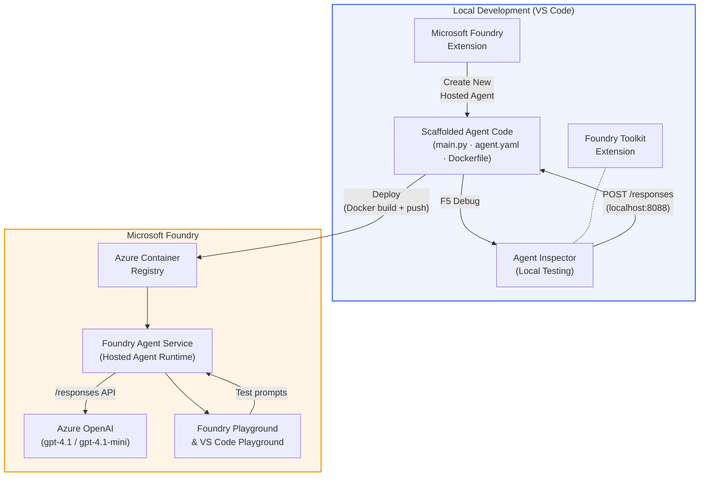

# Foundry Toolkit + Foundry Hosted Agents -työpaja

[](https://www.python.org/)
[](https://github.com/microsoft/agents)
[](https://learn.microsoft.com/azure/foundry/agents/concepts/hosted-agents)
[](https://ai.azure.com/)
[](https://learn.microsoft.com/azure/ai-services/openai/)
[](https://learn.microsoft.com/cli/azure/install-azure-cli)
[](https://learn.microsoft.com/azure/developer/azure-developer-cli/install-azd)
[](https://www.docker.com/)
[](https://marketplace.visualstudio.com/items?itemName=ms-windows-ai-studio.windows-ai-studio)
[](../../LICENSE)

Rakenna, testaa ja ota käyttöön tekoälyagentteja **Microsoft Foundry Agent Service** -palveluun **Hosted Agents** -muodossa — kokonaan VS Codesta käyttäen **Microsoft Foundry extension** ja **Foundry Toolkit**.

> **Hosted Agents ovat tällä hetkellä esikatseluvaiheessa.** Tuetut alueet ovat rajalliset - katso [region availability](https://learn.microsoft.com/azure/foundry/agents/concepts/hosted-agents#region-availability).

> Kunkin labin `agent/`-kansio luodaan **automaattisesti** Foundry-laajennuksen toimesta - sen jälkeen mukautat koodin, testaat paikallisesti ja otat sen käyttöön.

### 🌐 Monikielinen tuki

#### Tuettu GitHub Actionin kautta (automaattinen & aina ajan tasalla)

<!-- CO-OP TRANSLATOR LANGUAGES TABLE START -->
[Arabic](../ar/README.md) | [Bengali](../bn/README.md) | [Bulgarian](../bg/README.md) | [Burmese (Myanmar)](../my/README.md) | [Chinese (Simplified)](../zh-CN/README.md) | [Chinese (Traditional, Hong Kong)](../zh-HK/README.md) | [Chinese (Traditional, Macau)](../zh-MO/README.md) | [Chinese (Traditional, Taiwan)](../zh-TW/README.md) | [Croatian](../hr/README.md) | [Czech](../cs/README.md) | [Danish](../da/README.md) | [Dutch](../nl/README.md) | [Estonian](../et/README.md) | [Finnish](./README.md) | [French](../fr/README.md) | [German](../de/README.md) | [Greek](../el/README.md) | [Hebrew](../he/README.md) | [Hindi](../hi/README.md) | [Hungarian](../hu/README.md) | [Indonesian](../id/README.md) | [Italian](../it/README.md) | [Japanese](../ja/README.md) | [Kannada](../kn/README.md) | [Khmer](../km/README.md) | [Korean](../ko/README.md) | [Lithuanian](../lt/README.md) | [Malay](../ms/README.md) | [Malayalam](../ml/README.md) | [Marathi](../mr/README.md) | [Nepali](../ne/README.md) | [Nigerian Pidgin](../pcm/README.md) | [Norwegian](../no/README.md) | [Persian (Farsi)](../fa/README.md) | [Polish](../pl/README.md) | [Portuguese (Brazil)](../pt-BR/README.md) | [Portuguese (Portugal)](../pt-PT/README.md) | [Punjabi (Gurmukhi)](../pa/README.md) | [Romanian](../ro/README.md) | [Russian](../ru/README.md) | [Serbian (Cyrillic)](../sr/README.md) | [Slovak](../sk/README.md) | [Slovenian](../sl/README.md) | [Spanish](../es/README.md) | [Swahili](../sw/README.md) | [Swedish](../sv/README.md) | [Tagalog (Filipino)](../tl/README.md) | [Tamil](../ta/README.md) | [Telugu](../te/README.md) | [Thai](../th/README.md) | [Turkish](../tr/README.md) | [Ukrainian](../uk/README.md) | [Urdu](../ur/README.md) | [Vietnamese](../vi/README.md)

> **Haluatko mieluummin kloonata paikallisesti?**
>
> Tämä repositorio sisältää yli 50 kielikäännöstä, mikä lisää merkittävästi latauskokoa. Kloonaa ilman käännöksiä käyttämällä sparse checkout:
>
> **Bash / macOS / Linux:**
> ```bash
> git clone --filter=blob:none --sparse https://github.com/microsoft-foundry/Foundry_Toolkit_for_VSCode_Lab.git
> cd Foundry_Toolkit_for_VSCode_Lab
> git sparse-checkout set --no-cone '/*' '!translations' '!translated_images'
> ```
>
> **CMD (Windows):**
> ```cmd
> git clone --filter=blob:none --sparse https://github.com/microsoft-foundry/Foundry_Toolkit_for_VSCode_Lab.git
> cd Foundry_Toolkit_for_VSCode_Lab
> git sparse-checkout set --no-cone "/*" "!translations" "!translated_images"
> ```
>
> Näin saat kaiken tarvittavan kurssin suorittamiseen ja lataus on paljon nopeampi.
<!-- CO-OP TRANSLATOR LANGUAGES TABLE END -->

---

## Arkkitehtuuri



**Prosessi:** Foundry-laajennus luo agentin → mukautat koodin & ohjeet → testaat paikallisesti Agent Inspectorilla → otat käyttöön Foundryyn (Docker-kuva työnnetään ACR:ään) → tarkistat Playgroundissa.

---

## Mitä rakennat

| Lab | Description | Status |
|-----|-------------|--------|
| **Lab 01 - Yksittäinen agentti** | Rakenna **"Explain Like I'm an Executive" Agent**, testaa se paikallisesti ja ota käyttöön Foundryyn | ✅ Saatavilla |
| **Lab 02 - Moni-agenttinen työnkulku** | Rakenna **"Resume → Job Fit Evaluator"** – neljä agenttia tekevät yhteistyötä arvioidakseen ansioluettelon sopivuutta ja laativat oppimissuunnitelman | ✅ Saatavilla |

---

## Tutustu Executive-agenttiin

Tässä työpajassa rakennat **"Explain Like I'm an Executive" Agent** -tekoälyagentin, joka ottaa monimutkaisen teknisen jargonin ja muuntaa sen rauhallisiksi, hallitukselle sopiviksi yhteenvetoiksi. Koska rehellisesti, kukaan johdossa ei halua kuulla "thread pool exhaustion caused by synchronous calls introduced in v3.2."

Rakensin tämän agentin yhden liian monen tapauksen jälkeen, jolloin täydellisesti laadittu jälkiarviointini sai vastaukseksi: *"So... is the website down or not?"*

### Miten se toimii

Syötät sille teknisen päivityksen. Se palauttaa johtoryhmälle sopivan yhteenvedon - kolme luettelokohtaa, ei jargonia, ei stack traceja, ei eksistentiaalista kauhua. Vain **mitä tapahtui**, **liiketoimintavaikutus**, ja **seuraava askel**.

### Katso se toiminnassa

**Sinä sanot:**
> "The API latency increased due to thread pool exhaustion caused by synchronous calls introduced in v3.2."

**Agentti vastaa:**

> **Yhteenveto johdolle:**
> - **Mitä tapahtui:** Viimeisimmän julkaisun jälkeen järjestelmä hidastui.
> - **Liiketoimintavaikutus:** Jotkut käyttäjät kokivat viiveitä palvelun käytössä.
> - **Seuraava askel:** Muutos on palautettu ja korjaus valmistellaan ennen uudelleenkäyttöönottoa.

### Miksi tämä agentti?

Se on äärimmäisen yksinkertainen, yksitarkoituksinen agentti — täydellinen tapa oppia hosted agent -työnkulku päästä päähän ilman, että upotat itsesi monimutkaisiin työkaluketjuihin. Ja rehellisesti? Jokainen kehitystiimi voisi hyötyä yhdestä tällaisesta.

---

## Työpajan rakenne

```
📂 Foundry_Toolkit_for_VSCode_Lab/
├── 📄 README.md                      ← You are here
└── 📂 workshop/
    ├── 📂 lab01-single-agent/        ← Full lab: docs + agent code
    │   ├── README.md                 ← Hands-on lab instructions
    │   ├── 📂 docs/                  ← Step-by-step tutorial modules
    │   │   ├── 00-prerequisites.md
    │   │   ├── 01-setup.md
    │   │   ├── 02-create-hosted-agent.md
    │   │   ├── 03-configure-and-code.md
    │   │   ├── 04-test-locally.md
    │   │   ├── 05-deploy-to-foundry.md
    │   │   ├── 06-verify-in-playground.md
    │   │   ├── 07-summary.md
    │   │   └── 08-troubleshooting.md
    │   └── 📂 agent/                 ← Reference solution (auto-scaffolded by Foundry extension)
    │       ├── agent.yaml
    │       ├── Dockerfile
    │       ├── main.py
    │       └── requirements.txt
    └── 📂 lab02-multi-agent/         ← Resume → Job Fit Evaluator
        ├── README.md                 ← Hands-on lab instructions (end-to-end)
        ├── 📂 docs/                  ← Step-by-step tutorial modules
        │   ├── 00-prerequisites.md
        │   ├── 01-understand-multi-agent.md
        │   ├── 02-scaffold-multi-agent.md
        │   ├── 03-configure-agents.md
        │   ├── 04-orchestration-patterns.md
        │   ├── 05-test-locally.md
        │   ├── 06-deploy-to-foundry.md
        │   ├── 07-verify-in-playground.md
        │   └── 08-troubleshooting.md
        └── 📂 PersonalCareerCopilot/ ← Reference solution (multi-agent workflow)
            ├── agent.yaml
            ├── Dockerfile
            ├── main.py
            └── requirements.txt
```

> **Huom:** Kunkin labin `agent/`-kansio on se, jonka **Microsoft Foundry extension** generoi, kun suoritat `Microsoft Foundry: Create a New Hosted Agent` komentopaletista. Tiedostoja mukautetaan sitten agenttisi ohjeilla, työkaluilla ja konfiguraatiolla. Lab 01 opastaa sinua luomaan tämän alusta alkaen.

---

## Aloittaminen

### 1. Kloonaa repositorio

```bash
git clone https://github.com/microsoft-foundry/Foundry_Toolkit_for_VSCode_Lab.git
cd Foundry_Toolkit_for_VSCode_Lab
```

### 2. Luo Python-virtuaaliympäristö

```bash
python -m venv venv
```

Aktivoi se:

- **Windows (PowerShell):**
  ```powershell
  .\venv\Scripts\Activate.ps1
  ```
- **macOS / Linux:**
  ```bash
  source venv/bin/activate
  ```

### 3. Asenna riippuvuudet

```bash
pip install -r workshop/lab01-single-agent/agent/requirements.txt
```

### 4. Määritä ympäristömuuttujat

Kopioi esimerkkitiedosto `.env` agenttikansion sisälle ja täytä arvosi:

```bash
cp workshop/lab01-single-agent/agent/.env.example workshop/lab01-single-agent/agent/.env
```

Muokkaa `workshop/lab01-single-agent/agent/.env`:

```env
AZURE_AI_PROJECT_ENDPOINT=https://<your-account>.services.ai.azure.com/api/projects/<your-project>
AZURE_AI_MODEL_DEPLOYMENT_NAME=<your-model-deployment-name>
```

### 5. Seuraa työpajan labroja

Jokainen lab on itsenäinen omine moduuleineen. Aloita **Lab 01** oppiaksesi perusteet, ja siirry sitten **Lab 02**:een moni-agenttisiin työnkulkuihin.

#### Lab 01 - Yksittäinen agentti ([täydelliset ohjeet](workshop/lab01-single-agent/README.md))

| # | Moduuli | Linkki |
|---|--------|------|
| 1 | Lue vaatimukset | [00-prerequisites.md](workshop/lab01-single-agent/docs/00-prerequisites.md) |
| 2 | Asenna Foundry Toolkit ja Foundry-laajennus | [01-setup.md](workshop/lab01-single-agent/docs/01-setup.md) |
| 3 | Luo Foundry-projekti | [01-setup.md](workshop/lab01-single-agent/docs/01-setup.md) |
| 4 | Luo hosted agent | [02-create-hosted-agent.md](workshop/lab01-single-agent/docs/02-create-hosted-agent.md) |
| 5 | Määritä ohjeet ja ympäristö | [03-configure-and-code.md](workshop/lab01-single-agent/docs/03-configure-and-code.md) |
| 6 | Testaa paikallisesti | [04-test-locally.md](workshop/lab01-single-agent/docs/04-test-locally.md) |
| 7 | Ota käyttöön Foundryyn | [05-deploy-to-foundry.md](workshop/lab01-single-agent/docs/05-deploy-to-foundry.md) |
| 8 | Vahvista Playgroundissa | [06-verify-in-playground.md](workshop/lab01-single-agent/docs/06-verify-in-playground.md) |
| 9 | Vianmääritys | [08-troubleshooting.md](workshop/lab01-single-agent/docs/08-troubleshooting.md) |

#### Lab 02 - Moni-agenttinen työnkulku ([täydelliset ohjeet](workshop/lab02-multi-agent/README.md))

| # | Moduuli | Linkki |
|---|--------|------|
| 1 | Edellytykset (Lab 02) | [00-prerequisites.md](workshop/lab02-multi-agent/docs/00-prerequisites.md) |
| 2 | Ymmärrä moni-agenttinen arkkitehtuuri | [01-understand-multi-agent.md](workshop/lab02-multi-agent/docs/01-understand-multi-agent.md) |
| 3 | Luo moni-agenttiprojektin runko | [02-scaffold-multi-agent.md](workshop/lab02-multi-agent/docs/02-scaffold-multi-agent.md) |
| 4 | Määritä agentit ja ympäristö | [03-configure-agents.md](workshop/lab02-multi-agent/docs/03-configure-agents.md) |
| 5 | Orkestroinnin mallit | [04-orchestration-patterns.md](workshop/lab02-multi-agent/docs/04-orchestration-patterns.md) |
| 6 | Testaa paikallisesti (moni-agentti) | [05-test-locally.md](workshop/lab02-multi-agent/docs/05-test-locally.md) |
| 7 | Ota käyttöön Foundryyn | [06-deploy-to-foundry.md](workshop/lab02-multi-agent/docs/06-deploy-to-foundry.md) |
| 8 | Vahvista Playgroundissa | [07-verify-in-playground.md](workshop/lab02-multi-agent/docs/07-verify-in-playground.md) |
| 9 | Vianmääritys (moni-agentti) | [08-troubleshooting.md](workshop/lab02-multi-agent/docs/08-troubleshooting.md) |

---

## Ylläpitäjä

<table>
<tr>
    <td align="center"><a href="https://github.com/ShivamGoyal03">
        <br />
        <sub><b>Shivam Goyal</b></sub>
    </a><br />
    </td>
</tr>
</table>

---

## Vaaditut käyttöoikeudet (nopea viite)

| Scenario | Required roles |
|----------|---------------|
| Create new Foundry project | **Azure AI Owner** on Foundry resource |
| Deploy to existing project (new resources) | **Azure AI Owner** + **Contributor** on subscription |
| Deploy to fully configured project | **Reader** on account + **Azure AI User** on project |

> **Tärkeää:** Azure `Owner` ja `Contributor` -roolit sisältävät vain *hallinnolliset* oikeudet, eivät *kehitys* (data action) -oikeuksia. Tarvitset **Azure AI User** tai **Azure AI Owner** rakentamiseen ja agenttien julkaisuun.

---

## Viitteet

- [Pikaopas: Ota käyttöön ensimmäinen isännöity agenttisi (VS Code)](https://learn.microsoft.com/azure/foundry/agents/quickstarts/quickstart-hosted-agent)
- [Mitä ovat isännöidyt agentit?](https://learn.microsoft.com/azure/foundry/agents/concepts/hosted-agents)
- [Luo isännöityjen agenttien työnkulkuja VS Codessa](https://learn.microsoft.com/azure/foundry/agents/how-to/vs-code-agents-workflow-pro-code)
- [Ota isännöity agentti käyttöön](https://learn.microsoft.com/azure/foundry/agents/how-to/deploy-hosted-agent)
- [RBAC Microsoft Foundrylle](https://learn.microsoft.com/azure/foundry/concepts/rbac-foundry)
- [Arkkitehtuurin tarkastusagentin esimerkki](https://github.com/Azure-Samples/agent-architecture-review-sample) - Todellinen isännöity agentti, jossa on MCP-työkaluja, Excalidraw-kaavioita ja kaksoiskäyttöönotto

---


## Lisenssi

[MIT](../../LICENSE)

---

<!-- CO-OP TRANSLATOR DISCLAIMER START -->
**Vastuuvapauslauseke**:
Tämä asiakirja on käännetty käyttämällä tekoälypohjaista käännöspalvelua [Co-op Translator](https://github.com/Azure/co-op-translator). Vaikka pyrimme tarkkuuteen, otathan huomioon, että automaattiset käännökset saattavat sisältää virheitä tai epätarkkuuksia. Alkuperäinen asiakirja sen alkuperäiskielellä on virallinen lähde. Tärkeissä asioissa suositellaan ammattimaista ihmiskäännöstä. Emme ole vastuussa tämän käännöksen käytöstä aiheutuvista väärinymmärryksistä tai tulkinnoista.
<!-- CO-OP TRANSLATOR DISCLAIMER END -->
