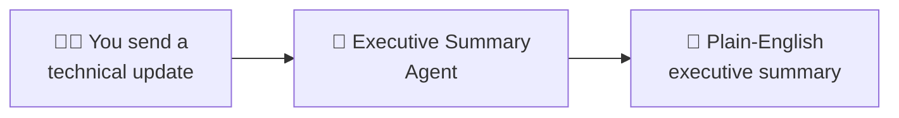

# Moduuli 0 - Johdanto

⏱️ ~10 min

> [!WARNING]
> **Esikatselu & rajoitukset:** [Isännöidyt agentit](https://learn.microsoft.com/azure/foundry/agents/concepts/hosted-agents) ovat tällä hetkellä **julkisessa esikatselussa** - eivät suositeltavia tuotantokuormituksiin. Huomioi seuraavat seikat:
> - **Tuetut alueet ovat rajoitettuja** - tarkista [alueiden saatavuus](https://learn.microsoft.com/azure/foundry/agents/concepts/hosted-agents#region-availability) ennen resurssien luomista. Jos valitset tukemattoman alueen, käyttöönotto epäonnistuu.
> - `agent-framework-foundry-hosting` -paketti on ennakkoversio - sovellusrajapinnat saattavat muuttua versioiden välillä.
> - Skaalausrajat: isännöidyt agentit tukevat 0–5 kopiota (mukaan lukien nollaan skaalaus).
> - Joitain tässä työpajassa esitettyjä ominaisuuksia saatetaan muuttaa palvelun siirtyessä yleiseen saatavuuteen (GA).

## Mitä rakennat

Tässä työpajassa rakennat **"Selitä ikään kuin olisin johtaja"** -agentin – isännöidyn tekoälyagentin, joka ottaa monimutkaiset tekniset päivitykset ja kirjoittaa ne uudelleen yksinkertaisina johtajayhteenvetoina.

**Agentti käyttää:**
- **Microsoft Agent Frameworkia** - agentin logiikkaan ja rakenteeseen
- **Foundry Toolkit for VS Codea** - kehykseen, paikalliseen testaukseen ja käyttöönottoon
- **Tekoälymallia** (esim. `gpt-4.1-mini/gpt-5-mini`) - yhteenvetojen luomiseen

Tämän harjoituksen lopussa sinulla on toimiva agentti, jota voit testata paikallisesti Agenttien tarkastajan avulla ja tarvittaessa ottaa käyttöön pilvessä.

---

## Mitä ovat isännöidyt agentit?

**Isännöity agentti** on tekoälyagentti, joka toimii Microsoft Foundryn hallittuna palveluna. Sen sijaan, että hallinnoisit omaa infrastruktuuria, pakkaat agenttikoodisi konttiin, ja Foundry huolehtii skaalaamisesta, isännöinnistä ja altistaa sen vakiomuotoisen HTTP-päätepisteen kautta.

| Käsite | Mitä se tarkoittaa |
|---------|--------------|
| **Agentti** | Python-koodisi, joka vastaanottaa käyttäjän viestin, kutsuu tekoälymallia ja palauttaa rakenteellisen vastauksen |
| **Isännöity** | Foundry ajaa konttisi puolestasi - ei virtuaalikoneita, ei Kubernetesia, ei infrastruktuurin hallintaa |
| **Vastausprotokolla** | Standardi HTTP-rajapinta (`POST /responses`), jonka mikä tahansa asiakas voi kutsua kommunikoidakseen agenttisi kanssa |
| **Agenttien tarkastaja** | Paikallinen testauskäyttöliittymä (sisältyy Foundry Toolkitiin), jonka avulla voit keskustella agenttisi kanssa ennen vaihetta käyttöön |

Tässä työpajassa etenet nollasta täysin isännöityyn agenttiin – tai pysähdyt paikalliseen testaukseen, jos haluat.

---

## Valitse polkusi

> ⚠️ **Valitse yksi polku ennen jatkamista.** Valintasi määrää, mitkä työkalut asennetaan ja mitkä moduulit soveltuvat. Voit vaihtaa polkua myöhemmin Polusta B → Polkuun A, jos saat tilauksen.

<strong>🅰️ Polku A - Azure-pilvi (vaatii Azure-tilauksen)</strong>

| | Yksityiskohdat |
|---|---|
| **Kenelle tämä on tarkoitettu?** | Sinulla on aktiivinen Azure-tilaus ja voit luoda Foundry-resursseja |
| **Malli** | Azure OpenAI Foundryn kautta (esim. `gpt-4.1-mini/gpt-5-mini`) |
| **Käsitellyt moduulit** | Kaikki moduulit (00–07) |
| **Käyttöönotto pilveen?** | ✅ Kyllä - täysi päästä päähän käyttöönotto |

<strong>🅱️ Polku B - Paikallinen / ilmainen taso (ei vaadi Azure-tilausta)</strong>

| | Yksityiskohdat |
|---|---|
| **Kenelle tämä on tarkoitettu?** | MVP:t, opiskelijat tai kaikki, joilla ei ole Azure-käyttöoikeutta |
| **Malli** | **Foundry Local** (ilmainen, toimii omalla koneellasi) |
| **Käsitellyt moduulit** | Moduulit 00–04 (ohita käyttöönotto & pilvitarkistus) |
| **Käyttöönotto pilveen?** | ❌ Ei - vain paikallinen testaus Agenttien tarkastajalla |

---

## Kaikki polut: vaaditut työkalut

Asenna alla jokainen työkalu. Asennuksen jälkeen varmista, että se toimii suorittamalla tarkistuskomento.

| # | Työkalu | Versio | Asennus | Vahvistus (Odotettu tulos) |
|---|------|---------|---------|---------------------------|
| 1 | **Visual Studio Code** | Uusin | [code.visualstudio.com](https://code.visualstudio.com/) | Aukeaa ilman virheitä |
| 2 | **Python** | 3.12 tai uudempi | [python.org/downloads](https://www.python.org/downloads/) | `python --version` $\rightarrow$ `Python 3.12.x` |
| 3 | **Foundry Toolkit for VS Code** | Uusin | Laajennuksen tunnus: `ms-windows-ai-studio.windows-ai-studio` | Foundryn kuvake Aktiviteettipalkissa |
| 4 | **Python-laajennus VS Codeen** | Uusin | Laajennuksen tunnus: `ms-python.python` | Asennettu Laajennukset-paneelissa |

> [!TIP]
> **Asennuksen vinkkejä:**
> - **Python PATH (Windows):** Muista aina valita **"Add Python to PATH"** Python-asennuksen ensimmäisellä näytöllä. Ilman tätä `python` ei tunnisteta komentoikkunassasi.
> - **Useita Python-versioita:** Jos sinulla on asennettuna sekä Python 3.10 että 3.12, käytä `python3.12 -m venv .venv` varmistaaksesi, että oikea versio käytetään virtuaaliympäristössäsi.
> - **Docker WSL 2 (Windows):** Docker Desktopin asennuksessa varmista, että **WSL 2 back-end** on valittu. Docker Hyper-V:llä on hitaampi ja voi aiheuttaa ongelmia Foundryn konttirakennuksissa.
> - **Docker ei käynnisty?** Odota 30–60 sekuntia Docker Desktopin käynnistyksen jälkeen. Suorita `docker info` - jos näkyy "Cannot connect to the Docker daemon", Docker on vielä käynnistymässä.
> - **VS Code -laajennukset eivät lataudu?** Asennuksen jälkeen lataa ikkuna uudelleen: `Ctrl+Shift+P` → `Developer: Reload Window`.

> **Windows-käyttäjille:** Muista valita **"Add Python to PATH"** Pythonin asennuksen yhteydessä.

**Seuraava:** [01 - Asennus →](01-setup.md)

---

<!-- CO-OP TRANSLATOR DISCLAIMER START -->
**Vastuuvapauslauseke**:
Tämä asiakirja on käännetty käyttämällä tekoälypohjaista käännöspalvelua [Co-op Translator](https://github.com/Azure/co-op-translator). Vaikka pyrimme tarkkuuteen, otathan huomioon, että automaattiset käännökset saattavat sisältää virheitä tai epätarkkuuksia. Alkuperäinen asiakirja sen alkuperäiskielellä on virallinen lähde. Tärkeissä asioissa suositellaan ammattimaista ihmiskäännöstä. Emme ole vastuussa tämän käännöksen käytöstä aiheutuvista väärinymmärryksistä tai tulkinnoista.
<!-- CO-OP TRANSLATOR DISCLAIMER END -->