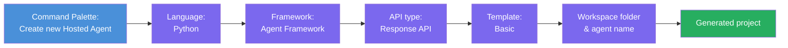
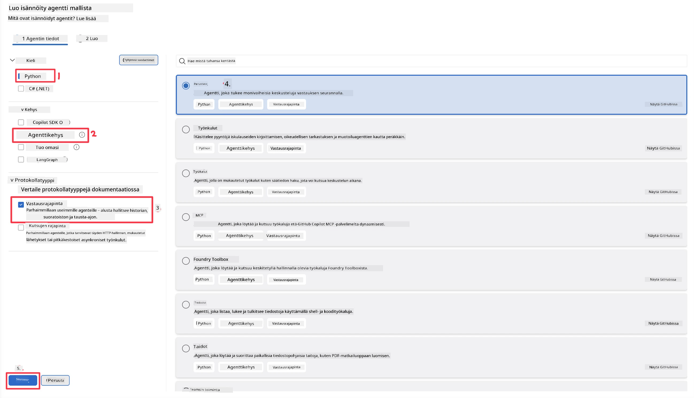
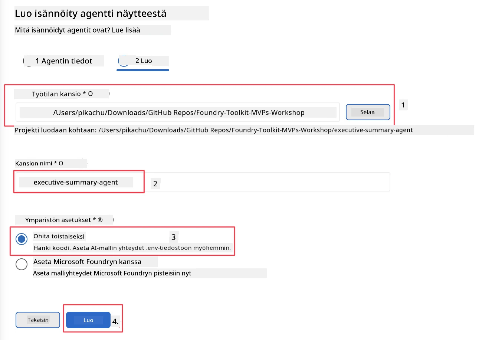

# Moduuli 2 - Luo uusi isännöity agentti

⏱️ ~5 min

Tässä moduulissa käytät Foundry Toolkitia **isännöidyn agenttiprojektin luomiseen**. Työkalu luo koko projektin rakenteen - `agent.yaml`, `main.py`, `Dockerfile`, `requirements.txt` ja VS Code debug-konfiguraation - jotta voit keskittyä agentin toiminnan räätälöintiin.

> **Keskeinen käsite:** Tässä labrassa `agent/` -kansio on esimerkki siitä, mitä Foundry Toolkit generoi. Et kirjoita näitä tiedostoja alusta alkaen.

### Luontiopas



---

## Vaihe 1: Avaa Create Hosted Agent -velho

1. Paina `Ctrl+Shift+P` avataksesi **Komentopaletti**.
2. Kirjoita: **Foundry Toolkit: Create new Hosted Agent** ja valitse se.

> **Vaihtoehto: Luo Foundry Portaalin kautta**
> Jos haluat käyttää selainta, voit luoda projektisi osoitteessa [https://ai.azure.com](https://ai.azure.com). Kun projekti on luotu, palaa VS Codeen ja käytä **Foundry Toolkit** -sivupalkkia yhdistääksesi siihen.

> **Vaihtoehto:** Foundry Toolkit -sivupalkissa siirrä hiiri **Agents**-kohdan päälle projektissasi, klikkaa **+**-kuvaketta ja valitse sitten **Create in Code With Template**.

## Vaihe 2: Valitse asetukset



1. Vasemman sivun valikosta/valinnoista valitse seuraavat:

| Valikko | Valinta | Huomiot |
|--------|-----------|-------|
| **Language** | Python | C# on myös tuettu |
| **Framework** | Agent Framework | Yksinkertainen aloituspiste Agent Framework SDK:lla |
| **API type** | Response API | `POST /responses` - keskusteleva, alustalla hallittu historia |
| **Template** | Basic | Yksinkertainen aloituspiste Agent Framework SDK:lla |

2. Kun valinnat on tehty, klikkaa **Next**



3. Seuraavassa ikkunassa valitse seuraavat:

| Valikko | Valinta | Huomiot |
|--------|-----------|-------|
| **Workspace folder** | Valitse kohdekansio | esim. `/workspace/Foundry_Toolkit_for_VSCode_Lab/` tai alikansio tässä repossa |
| **Agent name** | Syötä nimi | esim. `executive-summary-agent` |
| **Environment Setup** | ohita asennus toistaiseksi |  |

Klikkaa **create** luodaksesi agenttimme. Uusi kansio luodaan isännöidyn agentin nimellä.

## Vaihe 3: Tarkista luotu projekti

Kun luonti on valmis, varmista että näet nämä tiedostot Explorerissa (`Ctrl+Shift+E`):

```
📂 executive-summary-agent/
├── .env                ← Environment variables (placeholders)
├── .vscode/
│   ├── launch.json     ← Debug config (F5 → run + Agent Inspector)
│   └── tasks.json      ← VS Code task definitions
├── agent.yaml          ← Agent definition (kind: hosted)
├── Dockerfile          ← Container config for deployment
├── main.py             ← Agent entry point (your main code)
└── requirements.txt    ← Python dependencies
```

### Keskeisten tiedostojen selitykset

| Tiedosto | Tarkoitus |
|------|---------|
| `agent.yaml` | Määrittelee agentin `kind: hosted`:ksi, kartoittaa ympäristömuuttujat, määrittelee `/responses`-protokollan |
| `main.py` | Luo `FoundryChatClient` → käärii sen `Agent`:ksi ohjeineen → palvelee `ResponsesHostServer`:n kautta portissa 8088 |
| `Dockerfile` | Käyttää `python:3.12-slim`, asentaa riippuvuudet, paljastaa portin 8088, ajaa `main.py` |
| `requirements.txt` | `agent-framework-foundry`, `agent-framework-foundry-hosting`, `mcp`, `debugpy` |

> **Tärkeää:** Avaa luotu agenttikansio suoraan VS Codessa (itse `agent/` -kansio) jotta `.vscode/launch.json` ja `tasks.json` toimivat F5 virheenkorjauksessa oikein.

---

### ✅ Tarkistuslista

- [ ] Luotu scaffoldata projekti sisältää kaikki odotetut tiedostot
- [ ] `agent.yaml` näyttää `kind: hosted` ja `protocol: responses`
- [ ] `main.py` tuo `Agent`, `FoundryChatClient`, `ResponsesHostServer`
- [ ] Agenttikansio on auki VS Codessa työtilan juuri-kansiona

---

**Edellinen:** [01 - Setup](01-setup.md) · **Seuraava:** [03 - Configure & Code →](03-configure-and-code.md)

---

<!-- CO-OP TRANSLATOR DISCLAIMER START -->
**Vastuuvapauslauseke**:
Tämä asiakirja on käännetty käyttämällä tekoälypohjaista käännöspalvelua [Co-op Translator](https://github.com/Azure/co-op-translator). Vaikka pyrimme tarkkuuteen, otathan huomioon, että automaattiset käännökset saattavat sisältää virheitä tai epätarkkuuksia. Alkuperäinen asiakirja sen alkuperäiskielellä on virallinen lähde. Tärkeissä asioissa suositellaan ammattimaista ihmiskäännöstä. Emme ole vastuussa tämän käännöksen käytöstä aiheutuvista väärinymmärryksistä tai tulkinnoista.
<!-- CO-OP TRANSLATOR DISCLAIMER END -->