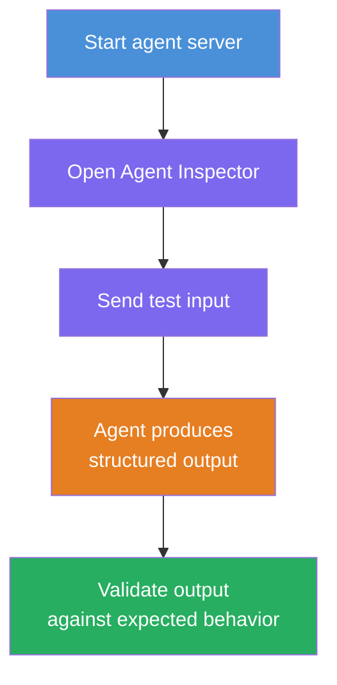
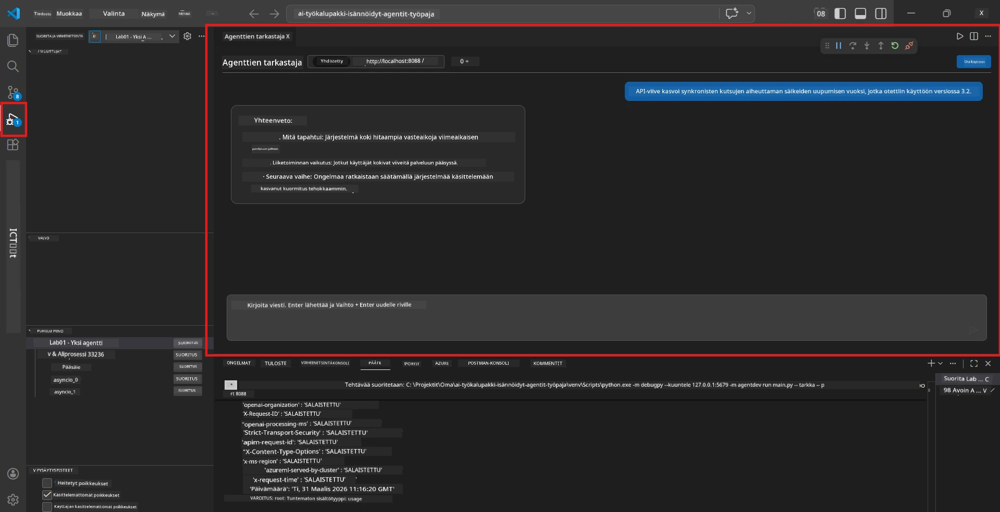
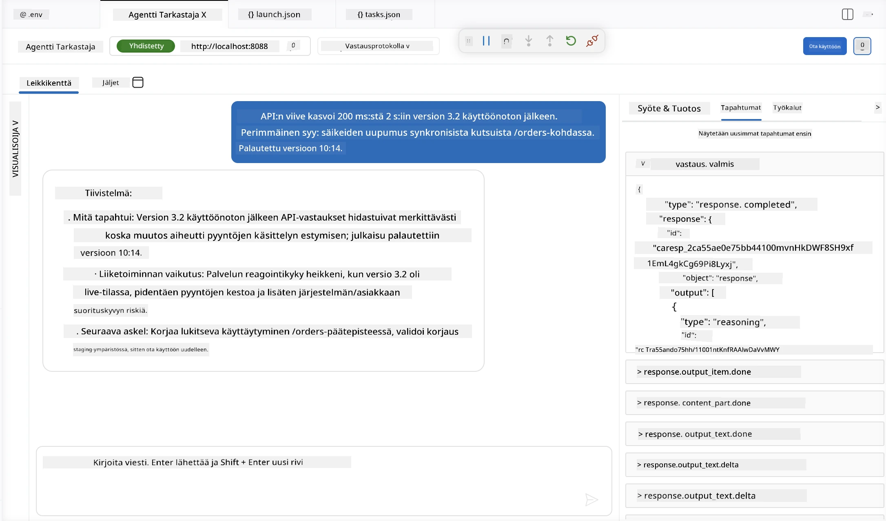

# Moduuli 4 - Testaa paikallisesti

⏱️ ~10 min

Tässä moduulissa ajat agenttisi paikallisesti ja varmistat, että se toimii oikein käyttämällä **onnistuneen polun toiminnallisia testejä**. Käytät Agent Inspector -työkalua (visuaalinen käyttöliittymä) tai suoria HTTP-kutsuja vahvistaaksesi, että agentti tuottaa rakenteellisia ja tarkkoja vastauksia.

### Paikallisen testauksen kulku



---

## Vaihtoehto 1: Paina F5 - Virheenkorjaus Agent Inspectorin kanssa (suositeltu)

### Käynnistä virheenkorjaaja

1. Avaa kansio **executive-summary-agent/** suoraan VS Codessa (`File → Open Folder`).
2. Avaa **Suorita ja virheenkorjaa** -paneeli (`Ctrl+Shift+D`).
3. Valitse pudotusvalikosta **Debug Local Agent HTTP Server**.
4. Paina **F5** (tai klikkaa ▶ Käynnistä virheenkorjaus).

> ⚠️ **Tärkeää: Valitse Python-tulkki**
> Jos saat "ModuleNotFoundError" -virheen tai virheenkorjaaja ei käynnisty, sinun täytyy kertoa VS Codelle käyttää virtuaaliympäristöäsi:
  > 1. Paina `Ctrl+Shift+P` $\rightarrow$ kirjoita **Python: Select Interpreter**.
  > 2. Valitse tulkki, joka sijaitsee projektisi `.venv`-kansiossa (esim. `.\.venv\Scripts\python.exe` Windowsissa).
  > 3. Käynnistä virheenkorjaussessio uudelleen.
> Jos saat edelleen virheitä, päivitä käsin tiedosto `tasks.json` seuraavasti:
  > 1. Siirry tiedostoon `.vscode/tasks.json`
  > 2. Mene tehtävään, jonka nimi on: `Run Agent HTTP Server`
  > 3. Päivitä komennon arvo näin:
  >    - **Windows:** `"value": "${workspaceFolder}/.venv/Scripts/python.exe",`
  >    - **macOS/Linux:** `"value": "${workspaceFolder}/.venv/bin/python",`

### Mitä tapahtuu

1. HTTP-palvelin käynnistyy osoitteessa `http://localhost:8088/responses`.
2. **Agent Inspector** -paneeli aukeaa automaattisesti – visuaalinen chat-käyttöliittymä testaamiseen.
3. Taukopisteet ovat käytössä kohdassa `main.py`.

Tarkkaile Terminalia seuraavaksi:
```
Starting executive summary hosted agent
Executive agent server running on http://localhost:8088
```

> **Jos Agent Inspector ei avaudu:** Paina `Ctrl+Shift+P` → **Foundry Toolkit: Open Agent Inspector**.



> *Näyttökuva saattaa näyttää aiemman 'AI TOOLKIT' -brändäyksen vanhemmasta laajennusversiosta.*

---

## Vaihtoehto 2: Testaa terminaalin kautta (vaihtoehto)

Käynnistä agentti yhdessä terminaalissa, lähetä pyyntöjä toisessa:

```bash
# Terminal 1: Start agent
cd executive-summary-agent/
source .venv/bin/activate
python main.py
```

```bash
# Terminal 2: Send test (curl)
curl -sS -X POST http://localhost:8088/responses \
  -H "Content-Type: application/json" \
  -d '{"input": "The API latency increased due to thread pool exhaustion caused by sync calls in v3.2.", "stream": false}'
```

---

## Tilanneskenaariot: Onnistuneen polun toiminnallinen validointi

Suorita **kaikki kolme** alla olevaa skenaariota. Ne varmistavat, että agenttisi tuottaa oikean, rakenteellisen vastauksen realistisiin syötteisiin.



### Skenaario 1: IT-häiriö – API:n viivepiikki

**Syöte:**
```
The API latency increased from 200ms to 2s after deploying v3.2.
Root cause: thread pool starvation from synchronous calls in /orders.
Rolled back at 10:14.
```

**Odotettu käyttäytyminen:**
- ✅ Noudattaa "Executive Summary" -rakennetta (Mitä tapahtui / Liiketoiminnan vaikutus / Seuraava askel)
- ✅ Ei teknistä jargonia (ei "thread pool", ei "/orders", ei "v3.2")
- ✅ Ilmaisee selkeästi liiketoiminnan vaikutuksen (esim. käyttäjät kokivat viiveitä)
- ✅ Sisältää seuraavan askeleen (esim. korjaus julkaistu, valvonta käytössä)

---

### Skenaario 2: Data Pipeline – ETL-virhe

**Syöte:**
```
The nightly ETL job failed because the upstream schema changed. APAC dashboards show missing data.
```

**Odotettu käyttäytyminen:**
- ✅ Tiivistää datan päivitysvirheen yksinkertaisella kielellä
- ✅ Mainitsee APAC-hallintapaneelin vaikutuksen
- ✅ Sisältää korjaavan seuraavan askeleen
- ✅ Ei mainitse "ETL", "skaema" tai muita teknisiä termejä

---

### Skenaario 3: Turvallisuus – Paljastunut tunnistetieto

**Syöte:**
```
Static analysis flagged a hardcoded secret in the repository.
The secret may have been exposed in commit history.
```

**Odotettu käyttäytyminen:**
- ✅ Kuvaa tunniste-/turvallisuusongelman johtavalle käyttäjälle sopivalla kielellä
- ✅ Korostaa mahdollisen riskin (valtuuttamaton pääsy)
- ✅ Ilmaisee korjaustoimenpiteen (tunnistetietojen kierto, tarkastus)
- ✅ EI sisällä termejä kuten "staattinen analyysi", "commit history" tai "kovakoodattu"

---

## Validointikriteerit

Tarkista jokaiselle skenaariolle:

| # | Kriteeri | Hyväksymisehto |
|---|----------|---------------|
| 1 | **Rakenne** | Vastaus käyttää "Executive Summary" -muotoa, jossa on kaikki kolme kohtaa |
| 2 | **Yksinkertainen kieli** | Ei teknistä jargonia, jota johtaja ei ymmärtäisi |
| 3 | **Tarkkuus** | Tiivistelmä vastaa syötettä – ei keksittyjä yksityiskohtia |
| 4 | **Ytimekkyys** | Vastaus on alle 100 sanan pituinen |
| 5 | **Seuraava askel** | Selkeä toimintakehotus tai lievennys on ilmaistu |

---

## Virheenkorjauksen vinkit

| Ongelmia | Ratkaisu |
|----------|---------|
| Agentti ei käynnisty | Tarkista `.env`-arvot, varmista että venv on aktivoitu, suorita `pip install -r requirements.txt` |
| Tyhjä tai geneerinen vastaus | Tarkista ohjeet tiedostossa `main.py` – varmista, että tulostemuoto on määritelty |
| Vastaus sisältää jargonia | Vahvista "poista tekniset termit" -säännöt ohjeissa |
| Agent Inspector ei aukea | `Ctrl+Shift+P` → **Foundry Toolkit: Open Agent Inspector** |
| Mallin virheitä terminaalissa | Varmista, että `AZURE_AI_MODEL_DEPLOYMENT_NAME` on kirjoitettu täsmälleen oikein (tarkka kirjainkoko) |

---

### ✅ Tarkistuspiste

- [ ] Agentti käynnistyy paikallisesti ilman virheitä
- [ ] Agent Inspector aukeaa ja näyttää chat-käyttöliittymän (jos käytät F5)
- [ ] **Skenaario 1** (IT-häiriö) - rakenteellinen Executive Summary, ei jargonia
- [ ] **Skenaario 2** (dataputki) - asiaankuuluva tiivistelmä liiketoiminnan vaikutuksella
- [ ] **Skenaario 3** (turvahälytys) - asianmukainen riskiviestintä
- [ ] Kaikki vastaukset noudattavat määriteltyä tulosteen rakennetta

> **Tallenna vastauksesi** (kopioi tai tee kuvakaappaus) – vertailet niitä pilven tuloksiin moduulissa 06.

---

**Edellinen:** [03 - Määritä & Koodaa](03-configure-and-code.md) · **Seuraava:** [05 - Julkaise Foundryssa →](05-deploy-to-foundry.md)

---

<!-- CO-OP TRANSLATOR DISCLAIMER START -->
**Vastuuvapauslauseke**:
Tämä asiakirja on käännetty käyttämällä tekoälypohjaista käännöspalvelua [Co-op Translator](https://github.com/Azure/co-op-translator). Vaikka pyrimme tarkkuuteen, otathan huomioon, että automaattiset käännökset saattavat sisältää virheitä tai epätarkkuuksia. Alkuperäinen asiakirja sen alkuperäiskielellä on virallinen lähde. Tärkeissä asioissa suositellaan ammattimaista ihmiskäännöstä. Emme ole vastuussa tämän käännöksen käytöstä aiheutuvista väärinymmärryksistä tai tulkinnoista.
<!-- CO-OP TRANSLATOR DISCLAIMER END -->