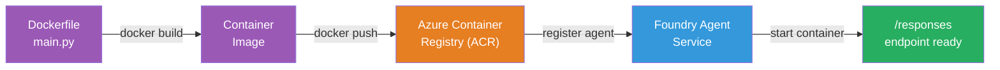
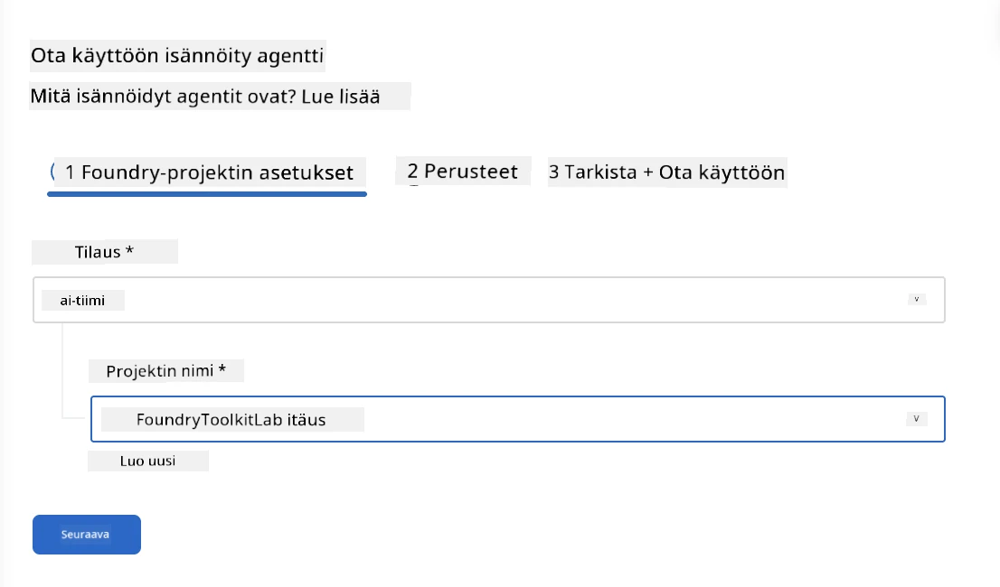
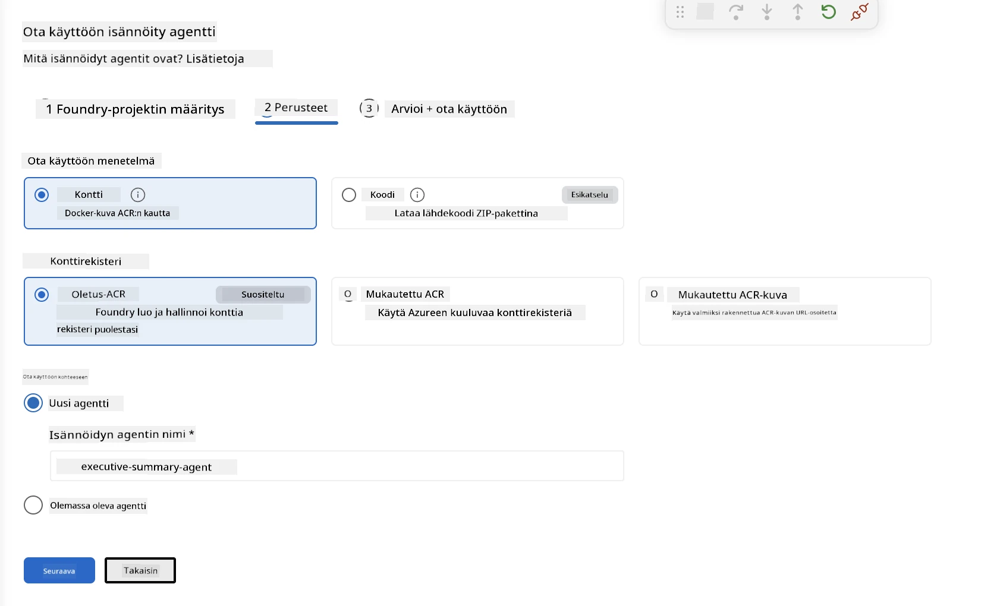
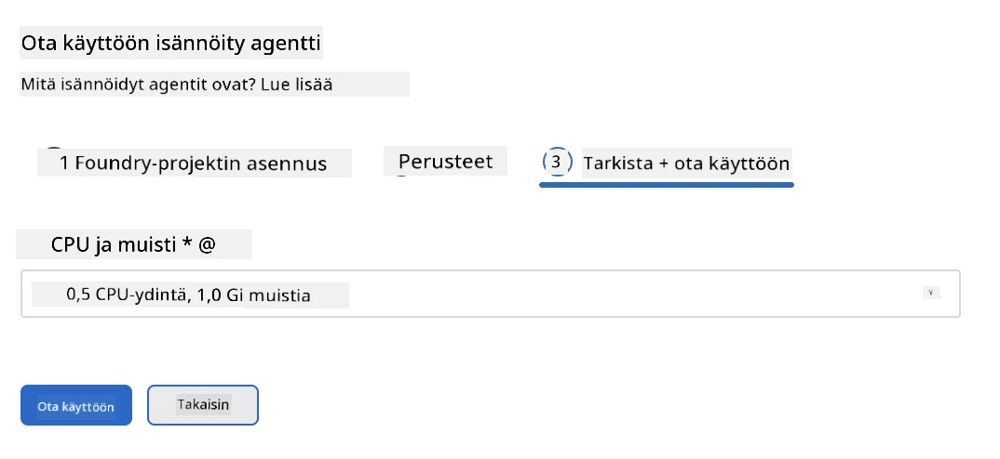
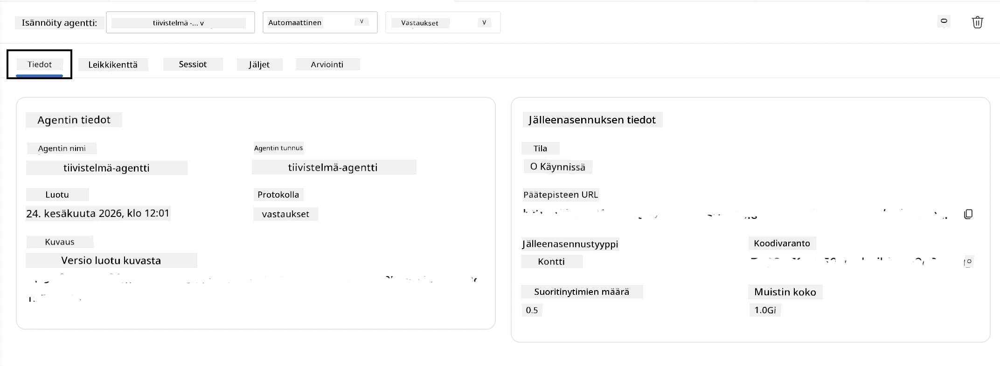

# Moduuli 5 - Julkaise Foundry Agent -palveluun

⏱️ ~10 min

> ⚠️ **Polku B:n käyttäjille:** Tämä moduuli vaatii Foundry-tilauksen. Jos käytät Foundry Localia, siirry suoraan kohtaan [Moduuli 07 - Yhteenveto](07-summary.md). Olet onnistuneesti suorittanut paikallisen kehitystyövirran!

Tässä moduulissa julkaiset paikallisesti testatun agenttisi Microsoft Foundryyn **Isännöitynä Agenttina**. Julkaisu rakentaa konttikuvan, työntää sen Azure Container Registryyn ja käynnistää agentin Foundryn hallinnoimassa infrastruktuurissa.

### Julkaisuputki

---

## Vaatimusten tarkistus

Ennen julkaisua varmista:

- [ ] Agentti läpäisee kaikki 3 paikallista skenaariota moduulista [04](04-test-locally.md)
- [ ] Sinulla on **Azure AI User** -rooli projektin tasolla ([Moduuli 01, RBAC:n määrittäminen](01-setup.md#deploy-a-model--assign-rbac))
- [ ] Olet kirjautuneena Azureen VS Codessa (tilikuvakkeessa näkyy nimesi)

---

## Vaihe 1: Käynnistä julkaisu

### Vaihtoehto A: Julkaise Agent Inspectorista (suositeltu)

Jos Agent Inspector on auki (testauksesta):
1. Napsauta **Deploy** -painiketta oikeassa yläkulmassa (pilvikuvake ↑).

### Vaihtoehto B: Julkaise komentopaletista

1. Paina `Ctrl+Shift+P` → **Foundry Toolkit: Deploy Hosted Agent**.

---

## Vaihe 2: Määritä julkaisu

Ohjelma kysyy sinulta:

| Kehote | Valinta |
|--------|-----------|
| **Tilaus** | Azure-tilauksesi |
| **Kohdeprojekti** | Foundry-projektisi (esim. `workshop-agents`) |

Napsauta **seuraava** määrittääksesi agenttisi.

| Kehote | Valinta |
|--------|-----------|
| **Julkaisutapa** | Kontti |
| **Konttirekisteri** | **Oletus-ACR** (Microsoft Foundry luo ja hallinnoi sitä puolestasi) |
| **Julkaise kohteeseen** | Uusi agentti (nimi, `executive-summary-agent`) |

Napsauta **seuraava** tarkistaaksesi ja julkaistaksesi agentin.

| Kehote | Valinta |
|--------|-----------|
| **Suoritin ja muisti** | **0,5 CPU-ydintä, 1,0 Gi muistia** (oletus - riittää työpajaan) |

---

## Vaihe 3: Julkaise ja seuraa

1. Napsauta **Deploy**.
2. Seuraa **Output**-paneelia (valitse alasvetovalikosta **Microsoft Foundry**).
3. Julkaisu etenee näissä vaiheissa:
   - **Docker build** - rakentaa kontin Dockerfilestäsi
   - **Docker push** - työntää kuvan ACR:ään (1–3 min ensimmäisellä julkaisulla)
   - **Agentin rekisteröinti** - luo isännöidyn agentin Foundryyn
   - **Kontin käynnistys** - käynnistyy järjestelmän hallinnoimalla identiteetillä

4. Valmistuttuaan näkyviin tulee ilmoitus:
   > **executive-summary-agent julkaistu onnistuneesti.** `View logs` `Run agent`

5. Napsauta **Aja agentti** avataksesi Agent Playgroundin.

### Julkaisun tilan arvot

| Tila | Merkitys |
|--------|---------|
| **Running** | Kontti valmis, agentti vastaa |
| **Pending** | Kontti käynnistyy - odota 30–60 sekuntia |
| **Failed** | Tarkista lokit (katso vianmääritys alla) |

---

## Yleisiä julkaisun virheitä

| Virhe | Perimmäinen syy | Korjaus |
|-------|-----------|-----|
| `agents/write` käyttöoikeus evätty | Puuttuu **Azure AI User** -rooli projektin tasolla | [Moduuli 01, RBAC:n määrittäminen](01-setup.md#deploy-a-model--assign-rbac) |
| Docker ei käynnissä | Docker Desktop ei ole käynnistetty | Käynnistä Docker Desktop → varmista `docker info` |
| ACR-valtuutus | Hallinnoitu identiteetti ei voi hakea kuvaa | Katso [Moduuli 08 - Vianmääritys](08-troubleshooting.md) |

---

### ✅ Tarkistuspiste

- [ ] Julkaisu onnistui ilman virheitä
- [ ] Agentti näkyy välilehdellä **Hosted Agent** kun napsautat **Agents** projektissasi Foundry Toolkit -sivupalkissa
- [ ] Kontin tila näyttää **Running**
- [ ] Agent Playground -välilehti avautui näyttäen agenttin tiedot ja päätepisteen URL-osoitteen

---

**Edellinen:** [04 - Testaa paikallisesti](04-test-locally.md) · **Seuraava:** [06 - Vahvista Playgroundissa →](06-verify-in-playground.md)

---

<!-- CO-OP TRANSLATOR DISCLAIMER START -->
**Vastuuvapauslauseke**:
Tämä asiakirja on käännetty käyttämällä tekoälypohjaista käännöspalvelua [Co-op Translator](https://github.com/Azure/co-op-translator). Vaikka pyrimme tarkkuuteen, otathan huomioon, että automaattiset käännökset saattavat sisältää virheitä tai epätarkkuuksia. Alkuperäinen asiakirja sen alkuperäiskielellä on virallinen lähde. Tärkeissä asioissa suositellaan ammattimaista ihmiskäännöstä. Emme ole vastuussa tämän käännöksen käytöstä aiheutuvista väärinymmärryksistä tai tulkinnoista.
<!-- CO-OP TRANSLATOR DISCLAIMER END -->