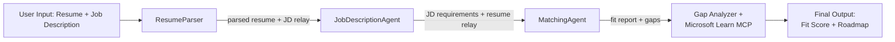

# PersonalCareerCopilot - CV → Työhön Soveltuvuuden Arvioija

Työnkulkuun perustuva moniedustajasovellus, joka arvioi, kuinka hyvin CV vastaa työkuvausta, ja laatii sitten henkilökohtaisen oppimissuunnitelman puutteiden korjaamiseksi.

---

## Edustajat

| Edustaja | Rooli | Työkalut |
|-------|------|-------|
| **ResumeParser** | Poimii rakenteelliset taidot, kokemuksen, sertifikaatit CV-tekstistä | - |
| **JobDescriptionAgent** | Poimii vaaditut/toivottavat taidot, kokemuksen, sertifikaatit työkuvauksesta | - |
| **MatchingAgent** | Vertaa profiilia vaatimuksiin → soveltuvuuspisteet (0-100) + täsmänneet/puuttuvat taidot | - |
| **GapAnalyzer** | Laatii henkilökohtaisen oppimissuunnitelman Microsoft Learn -resursseilla | `search_microsoft_learn_for_plan` (MCP) |

## Työnkulku



---

## Nopeasti alkuun

### 1. Ympäristön määrittäminen

Tämä kansio on työnkulkuun perustuvan Lab 02 -runkoalustan referenssitoteutus. Sen `main.py` käyttää olemassa olevia kehotelohkoja sekä `WorkflowBuilder` yhdistääkseen neljä agenttia.

```powershell
cd workshop\lab02-multi-agent\PersonalCareerCopilot
python -m venv .venv
.\.venv\Scripts\Activate.ps1          # Windows PowerShell
# source .venv/bin/activate            # macOS / Linux
pip install -r requirements.txt
```

### 2. Tunnistetietojen määritys

Luo `.env` -tiedosto tähän kansioon:

```powershell
copy .env .env.bak 2>$null; echo $null > .env
```

Muokkaa `.env`:

```env
FOUNDRY_PROJECT_ENDPOINT=https://<your-account>.services.ai.azure.com/api/projects/<your-project>
AZURE_AI_MODEL_DEPLOYMENT_NAME=gpt-4.1-mini
```

| Arvo | Missä löytää |
|-------|------------------|
| `FOUNDRY_PROJECT_ENDPOINT` | Foundry Toolkit -sivupalkki → oikean hiirinäppäimen valikko projektille → **Copy Project Endpoint** |
| `AZURE_AI_MODEL_DEPLOYMENT_NAME` | Foundry-sivupalkki → laajenna projekti → **Models + endpoints** → käyttöönoton nimi |

### 3. Suorita paikallisesti

```powershell
python -m debugpy --listen 127.0.0.1:5679 main.py --port 8088
```

Tai käytä VS Coden tehtävää: `Ctrl+Shift+P` → **Tasks: Run Task** → **Run Agent HTTP Server**.

F5-debuggaukseen käytä **Debug Local Agent HTTP Server**.

### 4. Testaa Agent Inspectorilla

Avaa Agent Inspector: `Ctrl+Shift+P` → **Foundry Toolkit: Open Agent Inspector**.

Liitä tämä testikehotus:

```
Resume:
Jane Doe
Senior Software Engineer with 5 years of experience in Python, Django, and AWS.
Built microservices handling 10K+ requests/second. Led a team of 4 developers.
Certifications: AWS Solutions Architect Associate.
Education: B.S. Computer Science, State University.

Job Description:
Senior Cloud Engineer at Contoso Ltd.
Required: Python, Azure, Kubernetes, Terraform, CI/CD pipelines.
Preferred: Go, monitoring (Prometheus/Grafana), cost optimization.
Experience: 5+ years in cloud infrastructure.
Certifications: Azure Solutions Architect Expert preferred.
```

**Odotettu:** Soveltuvuuspiste (0-100), täsmänneet/puuttuvat taidot ja henkilökohtainen oppimissuunnitelma Microsoft Learn -URL:eilla.

### 5. Julkaise Foundryyn

`Ctrl+Shift+P` → **Foundry Toolkit: Deploy Hosted Agent** → valitse projektisi → vahvista.

---

## Projektin rakenne

```
PersonalCareerCopilot/
├── .env                ← Your credentials (git-ignored)
├── agent.yaml          ← Hosted agent definition (name, resources, env vars)
├── Dockerfile          ← Container image for Foundry deployment
├── main.py             ← 4-agent workflow (instructions, MCP tool, WorkflowBuilder)
└── requirements.txt    ← Python dependencies
```

## Tärkeimmät tiedostot

### `agent.yaml`

Määrittelee isännöidyn agentin Foundry Agent Serviceä varten:
- `kind: hosted` - toimii hallittuna säilönä
- `protocols` - `responses` -protokolla `version: 2.0.0` kanssa, avaa `/responses` HTTP-päätepisteen
- `environment_variables` - `AZURE_AI_MODEL_DEPLOYMENT_NAME` määritellään täällä; `FOUNDRY_PROJECT_ENDPOINT` injektoidaan automaattisesti käyttöönoton yhteydessä

### `main.py`

Sisältää:
- **Agentin ohjeet** - neljä `*_INSTRUCTIONS` vakioita, yksi per agentti
- **MCP-työkalu** - `search_microsoft_learn_for_plan()` kutsuu `https://learn.microsoft.com/api/mcp` Streamable HTTP:n kautta
- **Agenttien luonti** - neljä `Agent()` + `AgentExecutor()` instanssia, jotka jakavat yhden `FoundryChatClient`
- **Työnkulun graafi** - `WorkflowBuilder` kytkee agentit peräkkäiseen putkeen: ResumeParser → JD Agent → MatchingAgent → GapAnalyzer
- **Palvelimen käynnistys** - `ResponsesHostServer` ajetaan portissa 8088

### `requirements.txt`

| Paketti | Tarkoitus |
|---------|----------|
| `agent-framework-foundry` | Ydinaikataulu: `Agent`, `AgentExecutor`, `WorkflowBuilder`, `@tool`, `FoundryChatClient` |
| `agent-framework-foundry-hosting` | `ResponsesHostServer` + Foundryn isännöintiintegratio |
| `mcp<2,>=1.24.0` | MCP-asiakas GapAnalyzerille (`streamable_http_client`) |
| `debugpy` | Python-debuggaus (F5 VS Codessa) |

---

## Vianmääritys

| Ongelma | Korjaus |
|-------|-----|
| `KeyError: 'FOUNDRY_PROJECT_ENDPOINT'` tai `KeyError: 'AZURE_AI_MODEL_DEPLOYMENT_NAME'` | Luo `.env`, jossa asetetaan sekä `FOUNDRY_PROJECT_ENDPOINT` että `AZURE_AI_MODEL_DEPLOYMENT_NAME` |
| `ModuleNotFoundError: No module named 'agent_framework'` | Aktivoi venv ja suorita `pip install -r requirements.txt` |
| Ei Microsoft Learn -URL:eja tulosteessa | Tarkista internet-yhteys `https://learn.microsoft.com/api/mcp`:iin |
| Vain 1 puutteiden kortti (katkaistu) | Varmista, että `GAP_ANALYZER_INSTRUCTIONS` sisältää `CRITICAL:`-lohkon |
| Portti 8088 käytössä | Pysäytä muut palvelimet: `netstat -ano \| findstr :8088` |

Yksityiskohtaisempaan vianmääritykseen katso [Module 8 - Troubleshooting](../docs/08-troubleshooting.md).

---

**Kattava läpikäynti:** [Lab 02 Docs](../docs/README.md) · **Takaisin:** [Lab 02 README](../README.md) · [Työpajan etusivu](../../../README.md)

---

<!-- CO-OP TRANSLATOR DISCLAIMER START -->
**Vastuuvapauslauseke**:
Tämä asiakirja on käännetty käyttämällä tekoälypohjaista käännöspalvelua [Co-op Translator](https://github.com/Azure/co-op-translator). Vaikka pyrimme tarkkuuteen, otathan huomioon, että automaattiset käännökset saattavat sisältää virheitä tai epätarkkuuksia. Alkuperäinen asiakirja sen alkuperäiskielellä on virallinen lähde. Tärkeissä asioissa suositellaan ammattimaista ihmiskäännöstä. Emme ole vastuussa tämän käännöksen käytöstä aiheutuvista väärinymmärryksistä tai tulkinnoista.
<!-- CO-OP TRANSLATOR DISCLAIMER END -->