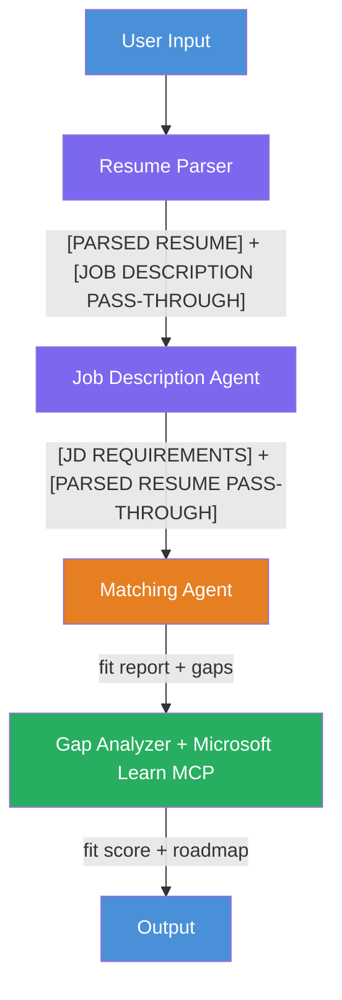

# Laboratorio 02 - Moni-agenttinen työnkulku: CV → Työhön sopivuuden arvioija

## Yleiskatsaus

Tässä käytännön laboratoriossa rakennat **työnkulkuun perustuvan moni-agenttisovelluksen** käyttäen Foundry Toolkitia VS Codessa ja otat sen käyttöön Microsoft Foundry Agent Servicessä.

**Mitä rakennat:** CV → Työhön sopivuuden arvioijan, joka tulkitsee CV:n ja työkuvauksen, arvioi yhteensopivuuden ja tuottaa henkilökohtaisen oppimispolun Microsoft Learn -resurssien avulla.

---

## Arkkitehtuuri

**Miten se toimii:**
1. Käyttäjä liittää CV:n ja työkuvauksen.
2. **ResumeParser** jäsentää CV:n ja kopioi työkuvauksen tarkalleen `[JOB DESCRIPTION PASS-THROUGH]`-osioon.
3. **JD Agent** poimii rakenteelliset vaatimukset pass-through-osasta, ja välittää `[PARSED RESUME]` eteenpäin `[PARSED RESUME PASS-THROUGH]`-muodossa.
4. **MatchingAgent** vertaa `[PARSED RESUME PASS-THROUGH]` vs `[JD REQUIREMENTS]` ja tuottaa sopivuuspisteet.
5. **GapAnalyzer** muuttaa aukot käytännön tiekartaksi ja hakee MCP:n kautta oikeat Microsoft Learn -linkit.

---

## Vaatimukset

Suorita ensin Laboratorio 01:

- [Laboratorio 01 - Yksittäinen agentti](../lab01-single-agent/README.md)

---

## Osa 1: Lue moduulit järjestyksessä

Katso koko oppimispolku:

- [Laboratorio 2 dokumentaatio - vaatimukset](docs/00-prerequisites.md)
- [Laboratorio 2 dokumentaatio - koko oppimispolku](docs/README.md)
- [PersonalCareerCopilot käyttöopas](PersonalCareerCopilot/README.md)

---

## Osa 2: Rakenna ja testaa työnkulku

1. Käytä Foundry Toolkit -velhoa työnkulkuun perustuvan projektin luonnissa.
2. Kopioi kehotelohkot ja työnkulkuverkko `PersonalCareerCopilot/main.py`-kohteesta työtilaan.
3. Suorita paikallisesti Agenttien tarkastajan kanssa ja varmista, että kaikki neljä agenttia ja MCP-työkalu toimivat.
4. Ota isännöity agentti käyttöön Foundryssa, kun paikalliset testit onnistuvat.

---

## Orkestrointimallit

Laboratorio 02 käyttää **peräkkäistä putkea**: kunkin agentin tuotos toimii seuraavan syötteenä, ja työnkulku palauttaa viimeisen agentin vastauksen. Kaksi mallia tekevät tämän mahdolliseksi:

- **Peräkkäinen ketju** - `WorkflowBuilder` yhdistää ResumeParser → JD Agent → MatchingAgent → GapAnalyzer yhdellä `add_edge()` -kutsulla vaihetta kohti
- **Sisällön välitys** - koska kukin agentti näkee vain edeltäjänsä suoran tuloksen, ResumeParser ja JD Agent kopioivat alasvirtaan tarvittavat tiedot merkittyihin pass-through-osioihin

Dokumentaatio selittää myös, miksi laboratoriossa ei käytetä haarautumista/koontimallia ja miten verkkoa voi laajentaa toisella agentilla.

Katso [docs/04-orchestration-patterns.md](docs/04-orchestration-patterns.md).

---

**Edellinen:** [Laboratorio 01 - Yksittäinen agentti](../lab01-single-agent/README.md) · **Takaisin:** [Työpajan etusivu](../../README.md)

---

<!-- CO-OP TRANSLATOR DISCLAIMER START -->
**Vastuuvapauslauseke**:
Tämä asiakirja on käännetty käyttämällä tekoälypohjaista käännöspalvelua [Co-op Translator](https://github.com/Azure/co-op-translator). Vaikka pyrimme tarkkuuteen, otathan huomioon, että automaattiset käännökset saattavat sisältää virheitä tai epätarkkuuksia. Alkuperäinen asiakirja sen alkuperäiskielellä on virallinen lähde. Tärkeissä asioissa suositellaan ammattimaista ihmiskäännöstä. Emme ole vastuussa tämän käännöksen käytöstä aiheutuvista väärinymmärryksistä tai tulkinnoista.
<!-- CO-OP TRANSLATOR DISCLAIMER END -->