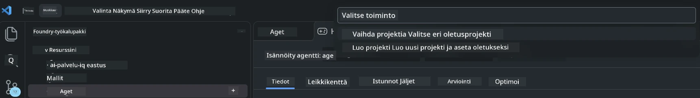

# Moduuli 0 - Johdanto

⏱️ ~10 min

> [!WARNING]
> **Esikatselu ja rajoitukset:** [Isännöidyt agentit](https://learn.microsoft.com/azure/foundry/agents/concepts/hosted-agents) ovat tällä hetkellä **julkisessa esikatselussa** – ei suositella tuotantokuormituksiin. Tämän työpajan joitakin esiteltyjä ominaisuuksia saatetaan muuttaa palvelun siirtyessä GA-vaiheeseen.

## Mitä rakennat

Tässä laboratoriossa laajennat yksittäisen agentin taitoja Lab 01:stä rakentaaksesi **moni-agenttisen työnkulun** – ansioluettelo → työpaikan sopivuuden arvioija.

Liität sisään **ansioluettelon** ja **työpaikkailmoituksen**. Neljä erikoistunutta agenttia käsittelee syötteen peräkkäin ja palauttaa:
- Soveltuvuuspisteet (0–100 pistemäärän erittelyllä)
- Taidot ja sertifikaattien puutteet -lista
- Personoidun oppimispolun, jossa on todelliset Microsoft Learn -linkit jokaiseen puutteeseen

**Työnkulku käyttää:**
- **Microsoft Agent Framework** - `WorkflowBuilder` peräkkäisen putkiston koordinointiin
- **Foundry Toolkit for VS Code** - runko, paikallinen testaus, käyttöönotto
- **AI-mallia** (esim. `gpt-4.1-mini`) - jota käyttävät kaikki neljä agenttia
- **Microsoft Learn MCP -palvelinta** - tarjoaa todelliset oppimisresurssien linkit jokaiseen taitopuutteeseen

---

## Valitse polkusi

> ⚠️ **Jatka samalla polulla kuin Lab 01:ssa.**

<details open>
<summary><strong>🅰️ Polku A - Azure-pilvi (vaatii Azure-tilauksen)</strong></summary>

| | Yksityiskohdat |
|---|---|
| **Kenelle tämä on?** | Suoritit Lab 01:n Azure-tilauksella |
| **Malli** | Azure OpenAI Foundryn kautta (esim. `gpt-4.1-mini`) |
| **Käsitellyt moduulit** | Kaikki moduulit (00–09) |
| **Käyttöönotto pilveen?** | ✅ Kyllä – täydellinen päästä päähän käyttöönotto |

</details>

<details open>
<summary><strong>🅱️ Polku B - Foundry Local (ei vaadi Azure-tilausta)</strong></summary>

| | Yksityiskohdat |
|---|---|
| **Kenelle tämä on?** | Suoritit Lab 01:n Foundry Localilla |
| **Malli** | Foundry Local (ilmainen, toimii koneellasi) |
| **Käsitellyt moduulit** | Moduulit 00–05 (ohita 06–07 – käyttöönotto ja pilvivarmistus) |
| **Käyttöönotto pilveen?** | ❌ Ei – vain paikallinen testaus Agent Inspectorilla |

</details>

---

## Lab 01:n tarkistus

Lab 02 rakentuu suoraan Lab 01:n päälle. Suorita Lab 01 ensin ennen kuin aloitat täällä.

Et ole vielä tehnyt Lab 01:stä? Aloita täältä: [Lab 01 - Johdanto](../../lab01-single-agent/docs/00-prerequisites.md)

<details open>
<summary><strong>🅰️ Polku A - Azure-pilvi</strong></summary>

```powershell
az account show --query "{name:name, id:id}" --output table
```

Jos tämä epäonnistuu, suorita `az login`. Tarkista sitten VS Codessa:

1. `Ctrl+Shift+P` → kirjoita **Foundry Toolkit** → varmista, että komennot näkyvät.
2. Klikkaa **Foundry Toolkit** -ikonia → projektisi ja otettu malli näyttävät **Onnistunut**.



> **RBAC:** Annoit itsellesi roolin **Foundry User** Lab 01:ssa. Jos sinun tarvitsee määrittää se uudelleen, katso [Lab 01, Moduuli 1](../../lab01-single-agent/docs/01-setup.md#deploy-a-model--assign-rbac). Rooli oli aiemmin nimeltään **Azure AI User** – samat oikeudet.

</details>

<details open>
<summary><strong>🅱️ Polku B - Foundry Local</strong></summary>

```powershell
Invoke-WebRequest -Uri "http://localhost:5273/v1/health" -UseBasicParsing | Select-Object StatusCode
```

Odotettu: `StatusCode: 200`. Jos ei, käynnistä Foundry Local uudelleen Foundry Toolkit -sivupalkista.

> Kaikki päättely tapahtuu koneellasi. Ainoa ulospäin menevä kutsu on MCP-työkalu `https://learn.microsoft.com/api/mcp`.

</details>

---

## Mikä on uutta Lab 02:ssa

| | Lab 01 | Lab 02 |
|--|--------|--------|
| Agentit | 1 | 4 (ketjutettu WorkflowBuilderillä) |
| Pohjamalli | Perus – Agent Framework | Työnkulut – Agent Framework |
| Uusi paketti | - | `mcp` |
| Orkestrointi | Yksi keskusteleva agentti | Peräkkäinen putkisto (WorkflowBuilder) |
| Uusi työkalu | - | `search_microsoft_learn_for_plan` (MCP) |

---

**Seuraavaksi:** [01 - Ymmärrä arkkitehtuuri →](01-understand-multi-agent.md)

---

<!-- CO-OP TRANSLATOR DISCLAIMER START -->
**Vastuuvapauslauseke**:
Tämä asiakirja on käännetty käyttämällä tekoälypohjaista käännöspalvelua [Co-op Translator](https://github.com/Azure/co-op-translator). Vaikka pyrimme tarkkuuteen, otathan huomioon, että automaattiset käännökset saattavat sisältää virheitä tai epätarkkuuksia. Alkuperäinen asiakirja sen alkuperäiskielellä on virallinen lähde. Tärkeissä asioissa suositellaan ammattimaista ihmiskäännöstä. Emme ole vastuussa tämän käännöksen käytöstä aiheutuvista väärinymmärryksistä tai tulkinnoista.
<!-- CO-OP TRANSLATOR DISCLAIMER END -->