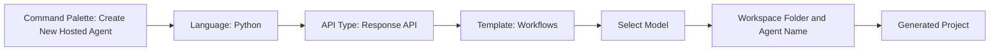

# Moduuli 2 - Luo moniagenttiprojektin perusrakenne

⏱️ noin 5 min

In this module, you use [Foundry Toolkit for VS Code](https://aka.ms/foundrytk) to **rakentaa moni-agenttiprojektin rungon**. The wizard generates `agent.yaml`, `main.py`, `Dockerfile`, `requirements.txt`, `.env`, and VS Code debug configuration - so you can focus on wiring the 4-agent workflow in Module 3.

> **Keskeinen käsite:** Luotu runko on toimiva esimerkkipohja, jossa on yksi agentti. Korvaat paikkamerkkilogiikan `WorkflowBuilder`-kaaviolla Moduulissa 3. Et kirjoita boilerplate-koodia alusta asti.

> **Viite-implementaatio:** [`PersonalCareerCopilot/`](../../../../../workshop/lab02-multi-agent/PersonalCareerCopilot) on täydellinen toimiva esimerkki. Käytä sitä vertaillaksesi työtäsi edetessä.

### Ohjatun luontitoiminnon kulku



---

## Vaihe 1: Avaa Create Hosted Agent -ohjattu toiminto

1. Paina `Ctrl+Shift+P` avataksesi **Komentopaletti**.
2. Kirjoita: **Foundry Toolkit: Create a New Hosted Agent** ja valitse se.
3. Ohjattu toiminto avautuu **Agent Details**-välilehdelle.

> **Vaihtoehto:** Napsauta **Foundry Toolkit** -kuvaketta Activity Barissa → napsauta **+** -kuvaketta kohdassa **Hosted Agents** → **Create New Hosted Agent**.

---

## Vaihe 2: Valitse asetukset


1. Vasemmanpuoleisesta navigointi/valintaosiosta valitse seuraavat:

| Valikko | Valinta | Huomautukset |
|--------|-----------|-------|
| **Kieli** | Python | C# (.NET) tuettu myös |
| **Kehys** | Agent Framework | Tarjoaa `Agent`, `AgentExecutor`, `WorkflowBuilder` |
| **API-tyyppi** | Response API | `POST /responses` - alustan hallinnoima historia, suoratoistotuki |
| **Mallipohja** | **Workflows** | Prosessoi pyyntöjä useiden agenttien läpi peräkkäin |

2. Kun valinnat on tehty, klikkaa **Next**


3. Seuraavassa ikkunassa valitse seuraavat:

| Valikko | Valinta | Huomautukset |
|--------|-----------|-------|
| **Työtilan kansio** | Selaa kohdekansioon | esim. `workshop/lab02-multi-agent/` tässä repossa |
| **Agentin nimi** | `PersonalCareerCopilot` | Tästä tulee projektihakemiston nimi |
| **Mallin käyttöönotto** | Valitse käyttöönotettu mallisi | esim. `gpt-4.1-mini` Lab 01:stä |

4. Klikkaa **Create** luodaksesi projektin rungon. VS Code generoi tiedostot ja avaa kansion.

> **Vinkki:** [`gpt-4.1-mini`](https://learn.microsoft.com/azure/foundry/foundry-models/concepts/models-sold-directly-by-azure#gpt-41-series) tarjoaa hyvän tasapainon nopeuden ja laadun välillä moni-agenttikehityksessä.

---

## Vaihe 3: Tarkista generoitu projekti

Kun rungon luonti on valmis, varmista että näet nämä tiedostot Explorerissa (`Ctrl+Shift+E`):

```
📂 <your-agent-name>/
├── .azdignore          ← Files excluded from Azure Developer CLI deployments
├── .dockerignore       ← Files excluded from Docker builds
├── .env                ← Environment variables (placeholders - fill in Module 3)
├── .vscode/
│   ├── launch.json     ← Debug config (F5 → run + Agent Inspector)
│   └── tasks.json      ← VS Code task definitions
├── agent.yaml          ← Agent definition (kind: hosted, protocol: responses)
├── Dockerfile          ← Container config for deployment
├── main.py             ← Stub agent entry point (replace with WorkflowBuilder in Module 3)
└── requirements.txt    ← Python dependencies
```

> **Tärkeää:** Avaa tämä luotu kansio suoraan VS Codessa, jotta `.vscode/launch.json` ja `tasks.json` toimivat oikein F5-virheenkorjauksessa.

### Keskeiset tiedostot

| Tiedosto | Tarkoitus |
|------|---------|
| `agent.yaml` | Määrittelee `kind: hosted`, kartoittaa ympäristömuuttujat, määrittelee `/responses`-protokollan |
| `main.py` | Stub: yksi `FoundryChatClient` → `Agent` → `ResponsesHostServer`. Korvaat tämän 4 agentilla + `WorkflowBuilder` Moduulissa 3 |
| `Dockerfile` | `python:3.12-slim`, asentaa `requirements.txt`, avaa portin 8088, ajaa `python main.py` |
| `requirements.txt` | `agent-framework-foundry`, `agent-framework-foundry-hosting`, `mcp<2,>=1.24.0`, `debugpy` |

> **Viite:** Katso [`PersonalCareerCopilot/agent.yaml`](../../../../../workshop/lab02-multi-agent/PersonalCareerCopilot/agent.yaml) ja [`PersonalCareerCopilot/requirements.txt`](../../../../../workshop/lab02-multi-agent/PersonalCareerCopilot/requirements.txt) saadaksesi täydellisen luodun sisällön.

---

### ✅ Tarkistuspiste

- [ ] Ohjattu luontitoiminto suoritettu - uusi projektikansio näkyy Explorerissa
- [ ] Kaikki odotetut tiedostot löytyvät: `agent.yaml`, `main.py`, `Dockerfile`, `requirements.txt`, `.env`
- [ ] `agent.yaml` näyttää `kind: hosted` ja `protocol: responses`
- [ ] `main.py` tuo `Agent`, `FoundryChatClient`, `ResponsesHostServer`
- [ ] Luotu kansio on avoinna VS Code -työtilan juurihakemistona
- [ ] Ymmärrät, että `main.py` on alustava malli - `WorkflowBuilder` lisätään Moduulissa 3

---

**Edellinen:** [01 - Understand Multi-Agent Architecture](01-understand-multi-agent.md) · **Seuraava:** [03 - Configure Agents & Environment →](03-configure-agents.md)

---

<!-- CO-OP TRANSLATOR DISCLAIMER START -->
**Vastuuvapauslauseke**:
Tämä asiakirja on käännetty käyttämällä tekoälypohjaista käännöspalvelua [Co-op Translator](https://github.com/Azure/co-op-translator). Vaikka pyrimme tarkkuuteen, otathan huomioon, että automaattiset käännökset saattavat sisältää virheitä tai epätarkkuuksia. Alkuperäinen asiakirja sen alkuperäiskielellä on virallinen lähde. Tärkeissä asioissa suositellaan ammattimaista ihmiskäännöstä. Emme ole vastuussa tämän käännöksen käytöstä aiheutuvista väärinymmärryksistä tai tulkinnoista.
<!-- CO-OP TRANSLATOR DISCLAIMER END -->