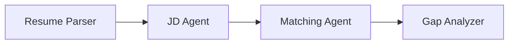
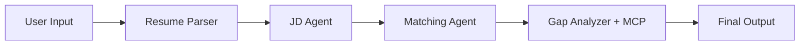

# Moduuli 4 - Orkestrointimallit

⏱️ ~10 min

Tässä moduulissa tutustut Resume Job Fit Evaluatorissa käytettyihin orkestrointimalleihin ja opit lukemaan, muokkaamaan ja laajentamaan työnkulun graafia. Näiden mallien ymmärtäminen on välttämätöntä tietovirheiden vianmäärityksessä ja omien [moni-agenttisten työnkulkujen](https://learn.microsoft.com/agent-framework/workflows/) rakentamisessa.

---

## Malli 1: Peräkkäinen ketju

Työnkulun perustavanlaatuinen malli on **peräkkäinen ketju** – jokaisen agentin tulos menee suoraan seuraavalle.



Koodissa jokainen `add_edge()`-kutsu luo yhden vaiheen ketjuun:

```python
.add_edge(resume_executor, jd_executor)       # ResumeParser output → JD Agent
.add_edge(jd_executor, matching_executor)     # JD Agent output → MatchingAgent
.add_edge(matching_executor, gap_executor)    # MatchingAgent output → GapAnalyzer
```

> **Miksi peräkkäinen, ei fan-out/fan-in?** `WorkflowBuilder` käyttää **TAI-semanttiikkaa** saapuville kaarille: alavirran toimija käynnistyy heti, kun **joku** edeltäjistä on valmis. Jos `matching_executor`:lla olisi kaksi tuloittain kaarta (sekä `resume_executor`:sta että `jd_executor`:sta), se laukeaisi kahdesti – kerran ResumeParserin valmistuttua ja uudestaan JD Agentin valmistuttua – aiheuttaen, että GapAnalyzer suoritetaan myös kahdesti ja tuloste näkyy kahdesti. Peräkkäinen putki välttää tämän täysin.

## Malli 2: Sisällön välitys

Koska `context_mode="last_agent"` tarkoittaa, että jokainen toimija näkee vain sen **suoran edeltäjänsä tuloksen**, toimijoiden peräkkäisessä ketjussa on nimenomaisesti siirrettävä eteenpäin kaikki tiedot, joita alavirran toimijat tarvitsevat.

Tässä työnkulussa:
- **ResumeParser** kopioi työpaikkailmoituksen sanatarkasti `[JOB DESCRIPTION PASS-THROUGH]`:iin (jotta JD Agent löytää sen).
- **JD Agent** kopioi `[PARSED RESUME]` sanatarkasti `[PARSED RESUME PASS-THROUGH]`:iin (jotta MatchingAgent voi vertailla molempia profiileja).

```
ResumeParser output
└─ [PARSED RESUME]               ← extracted by JD Agent
└─ [JOB DESCRIPTION PASS-THROUGH] ← extracted by JD Agent

JD Agent output
└─ [JD REQUIREMENTS]             ← extracted by MatchingAgent
└─ [PARSED RESUME PASS-THROUGH]  ← extracted by MatchingAgent
```

Jokainen välitysosa on kopioitava **sanasta sanaan** – sen tiivistäminen tai parafraasien tekeminen rikkoo alavirran toimijan, joka riippuu siitä.

---

## Täydellinen graafi

Peräkkäisen ketjun ja sisällön välityksen yhdistäminen tuottaa koko työnkulun:



Agent Inspector näyttää saman graafirakenteen, kun agentti ajetaan paikallisesti. Katso [Moduuli 5 - Testaa paikallisesti](05-test-locally.md) näytönkuvia varten.

---

## WorkflowBuilder-koodin lukeminen

Työnkulun graafi rakennetaan `main()`-funktiossa tiedostossa [`PersonalCareerCopilot/main.py`](../../../../../workshop/lab02-multi-agent/PersonalCareerCopilot/main.py). Kolme `add_edge()`-kutsua muodostavat peräkkäisen putken:

| # | Kaari | Vaikutus |
|---|------|---------|
| 1 | `resume_executor → jd_executor` | JD Agent saa `[PARSED RESUME]` + `[JOB DESCRIPTION PASS-THROUGH]` |
| 2 | `jd_executor → matching_executor` | MatchingAgent saa `[JD REQUIREMENTS]` + `[PARSED RESUME PASS-THROUGH]` |
| 3 | `matching_executor → gap_executor` | GapAnalyzer saa fit-raportin + gap-listan |

---

## Graafin muokkaaminen

### Uuden agentin lisääminen

Viidennen agentin lisäämiseksi (esimerkiksi **InterviewPrepAgent** GapAnalyzerin jälkeen):

1. Määrittele `INTERVIEW_PREP_INSTRUCTIONS`-vakio.
2. Luo `Agent` + `AgentExecutor` -oliot (sama malli kuin neljällä nykyisellä).
3. Lisää `.add_edge(gap_executor, interview_exec)` `WorkflowBuilder`:ssa.
4. Päivitä `output_executors=[interview_exec]`.

> **Tärkeää:** `start_executor` on ainoa agentti, joka saa raakakäyttäjän syötteen. Kaikki muut agentit saavat syötteen ylävirran kaaren kautta.

---

## Yleiset graafivirheet

| Virhe | Oire | Korjaus |
|-------|-------|--------|
| Puuttuva kaari `output_executors`:lle | Agentti suoritetaan mutta tulos on tyhjä | Varmista, että on polku `start_executor`:sta jokaiselle agentille `output_executors`:ssa |
| Ympyräinen riippuvuus | Loputon silmukka tai aikakatkaisu | Tarkista, ettei mikään agentti syötä takaisin ylävirran agentille |
| Agentti `output_executors` ilman tuloitettua kaarta | Tyhjä tulos | Lisää vähintään yksi `add_edge(source, that_agent)` |
| Useita `output_executors` ilman fan-in-mekanismia | Tuloste sisältää vain yhden agentin vastauksen | Käytä yhtä output-agenttia, joka kokoaa vastaukset, tai hyväksy useita tulosteita |
| Puuttuva `start_executor` | `ValueError` rakennusvaiheessa | Määritä aina `start_executor` `WorkflowBuilder()`:ssa |

---

## Graafin virheenkorjaus

### Agent Inspectorin käyttäminen

1. Käynnistä agentti paikallisesti F5-näppäimellä.
2. Avaa Agent Inspector (`Ctrl+Shift+P` → **Foundry Toolkit: Open Agent Inspector**).
3. Lähetä testiviesti.
4. Tarkastele Inspectorin vastauspaneelissa **streamaus-tulostetta** – se näyttää jokaisen agentin panoksen peräkkäin.


### Lokituksen käyttäminen

Lisää lokitusta `main.py` jäljittääksesi tietovirtausta:

```python
import logging
logger = logging.getLogger("resume-job-fit")

# In main(), after building the workflow:
logger.info("Workflow graph built with edges: RP→JD, JD→MA, MA→GA")
```

Palvelimen lokit näyttävät agenttien suoritusjärjestyksen ja MCP-työkalukutsut:

```
INFO:agent_framework:Executing agent: ResumeParser
INFO:agent_framework:Executing agent: JobDescriptionAgent
INFO:agent_framework:Executing agent: MatchingAgent
INFO:agent_framework:Executing agent: GapAnalyzer
INFO:agent_framework:Tool call: search_microsoft_learn_for_plan(skill="Kubernetes")
POST https://learn.microsoft.com/api/mcp → 200
INFO:agent_framework:Tool call: search_microsoft_learn_for_plan(skill="Terraform")
POST https://learn.microsoft.com/api/mcp → 200
```

---

### Välitarkistus

- [ ] Osaat tunnistaa kaksi orkestrointimallia työnkulussa: peräkkäinen ketju ja sisällön välitys
- [ ] Ymmärrät, miksi `context_mode="last_agent"` vaatii nimenomaista tietojen välitystä agenttien välillä
- [ ] Osaat lukea `WorkflowBuilder`-koodin ja yhdistää jokaisen `add_edge()`-kutsun visuaaliseen graafiin
- [ ] Tiedät, miten lisätään uusi agentti putken loppuun
- [ ] Osaat tunnistaa yleiset graafivirheet ja niiden oireet

---

**Edellinen:** [03 - Määritä agentit ja ympäristö](03-configure-agents.md) · **Seuraava:** [05 - Testaa paikallisesti →](05-test-locally.md)

---

<!-- CO-OP TRANSLATOR DISCLAIMER START -->
**Vastuuvapauslauseke**:
Tämä asiakirja on käännetty käyttämällä tekoälypohjaista käännöspalvelua [Co-op Translator](https://github.com/Azure/co-op-translator). Vaikka pyrimme tarkkuuteen, otathan huomioon, että automaattiset käännökset saattavat sisältää virheitä tai epätarkkuuksia. Alkuperäinen asiakirja sen alkuperäiskielellä on virallinen lähde. Tärkeissä asioissa suositellaan ammattimaista ihmiskäännöstä. Emme ole vastuussa tämän käännöksen käytöstä aiheutuvista väärinymmärryksistä tai tulkinnoista.
<!-- CO-OP TRANSLATOR DISCLAIMER END -->