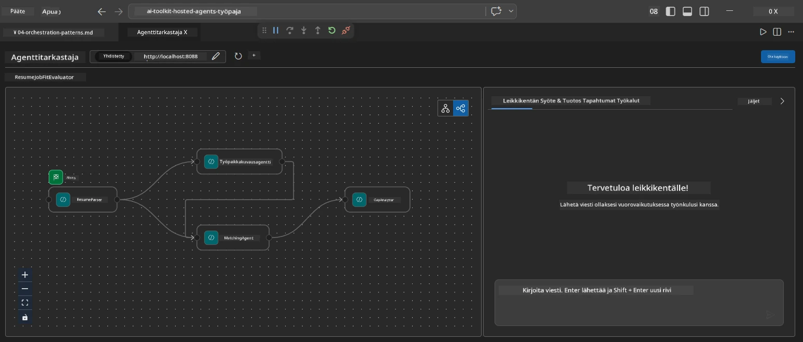
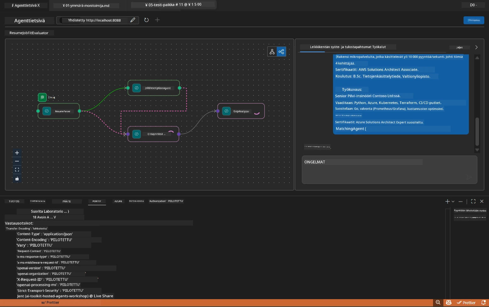
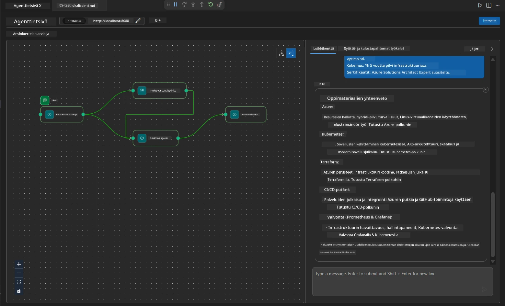

# Moduuli 5 - Testaa paikallisesti

⏱️ ~15 min

Tässä moduulissa suoritat moni-agenttisen työnkulun paikallisesti, testaat sitä Agent Inspectorilla ja varmistat, että kaikki neljä agenttia ja MCP-työkalu toimivat oikein ennen käyttöönottoa.

---

## Vaihe 1: Käynnistä agenttipalvelin

### Vaihtoehto A: VS Code -tehtävän käyttäminen (suositeltu)

1. Avaa `workshop/lab02-multi-agent/PersonalCareerCopilot/` VS Code -kansioon.
2. Paina `Ctrl+Shift+P` → kirjoita **Tasks: Run Task** → valitse **Run Agent HTTP Server**.
3. Tehtävä käynnistää palvelimen debugpy-liitännällä portissa `5679` ja agentin portissa `8088`.
4. Odota, että tuloste näyttää käynnistysviestin, jota seuraa palvelimen oma valmiusviesti (muita lokirivejä saattaa näkyä välissä):

```
INFO:resume-job-fit:Starting Resume -> Job Fit Evaluator HTTP server...
...
INFO:hypercorn.error:Running on http://0.0.0.0:8088 (CTRL + C to quit)
```

### Vaihtoehto B: F5:n käyttäminen (debug-tila)

1. Paina `F5` → valitse **Debug Local Agent HTTP Server**.
2. Palvelin käynnistyy täydellä breakpoint-tuesta - hyödyllistä MCP-vastausten tai agentin tulosteiden tarkasteluun.

---

## Vaihe 2: Avaa Agent Inspector

1. Paina `Ctrl+Shift+P` → kirjoita **Foundry Toolkit: Open Agent Inspector**.
2. Agent Inspector avautuu VS Code -paneelina, joka on yhdistetty palvelimeen `http://localhost:8088`.
3. Näet agentin käyttöliittymän valmiina vastaanottamaan viestejä.



> **Jos Agent Inspector ei aukea:** Varmista, että palvelin on täysin käynnistynyt (näet `Running on http://0.0.0.0:8088`-lokin). Jos portti 5679 on varattu, katso [Moduuli 8 - Vianmääritys](08-troubleshooting.md).

---

## Vaihe 2b: (Valinnainen) Avaa Workflow Visualizer

Foundry Toolkit sisältää reaaliaikaisen **Workflow Visualizerin**, joka näyttää, miten agentit vuorovaikuttavat työnkulun suorittamisen aikana. Tämä on erityisen hyödyllistä moni-agenttisen virheenkorjauksessa.

1. Paina `Ctrl+Shift+P` → kirjoita **Foundry Toolkit: Open Visualizer for Hosted Agents**.
2. Uusi VS Code -välilehti avautuu näyttäen käynnissä olevan suorituksen kaavion.
3. Kun lähetät viestejä Agent Inspectorissa, visualizer päivittyy automaattisesti - vihreät solmut kertovat suoritetuista agenteista ja animoidut reunat näyttävät tiedon virtaavan niiden välillä.

> **Porttikonflikti:** Jos visualizer-portti on jo käytössä, vaihda se VS Code -asetuksissa → **Extensions** → **Microsoft Foundry Configuration** → **Hosted Agents: Visualizer Port**.

---

## Vaihe 3: Suorita smoke-testit

Suorita nämä kaksi testiä tässä järjestyksessä. Jokainen testi kattaa sitä laajemmin työnkulkua.

### Testi 1: Perusansioluettelo + työkuvaus

Liitä seuraava Agent Inspectoriin:

```
Resume:
Jane Doe
Senior Software Engineer with 5 years of experience in Python, Django, and AWS.
Built microservices handling 10K+ requests/second. Led a team of 4 developers.
Certifications: AWS Solutions Architect Associate.
Education: B.S. Computer Science, State University.

Job Description:
Senior Cloud Engineer at Contoso Ltd.
Required: Python, Azure, Kubernetes, Terraform, CI/CD pipelines.
Preferred: Go, monitoring (Prometheus/Grafana), cost optimization.
Experience: 5+ years in cloud infrastructure.
Certifications: Azure Solutions Architect Expert preferred.
```

**Odotettu tulosteen rakenne:**

Vastauksen tulisi sisältää kaikkien neljän agentin tulosteet peräkkäin:

1. **Ansioluettelon jäsentäjän tuloste** - Kaksi nimettyä osiota: `[PARSED RESUME]` (ehdokkaan profiili ryhmiteltyine taitoineen) ja `[JOB DESCRIPTION PASS-THROUGH]` (sanasta sanaan työkuvauksen teksti, joka syötetään JD-agentille)
2. **JD-agentin tuloste** - Rakenteelliset vaatimukset, joissa eritelty vaaditut ja toivotut taidot
3. **Matching-agentin tuloste** - Soveltuvuuspisteet (0–100) erittelyineen, sovitetut taidot, puuttuvat taidot, aukot
4. **Gap Analyzerin tuloste** - Yksittäiset aukkokortit jokaiselle puuttuvalle taidolle, jokaisessa Microsoft Learn -URL-osoitteet





### Mitä varmistaa Testissä 1

| Tarkista | Odotettu | Läpäisy? |
|-------|----------|-------|
| Vastauksessa on soveltuvuuspiste | Numero 0-100 ja erittely | |
| Sovitetut taidot on listattu | Python, CI/CD (osittain), jne. | |
| Puuttuvat taidot on listattu | Azure, Kubernetes, Terraform jne. | |
| Aukonkortteja on kaikille puuttuville taidoille | Yksi kortti per taito | |
| Microsoft Learn -URL-osoitteet ovat läsnä | Todelliset `learn.microsoft.com` -linkit | |
| Ei virheilmoituksia vastauksessa | Selkeä ja jäsennelty tuloste | |

### Testi 2: Reunaustapaus - korkea soveltuvuus

Liitä ansioluettelo, joka vastaa tarkasti työkuvausta, varmistaaksesi, että GapAnalyzer käsittelee korkean soveltuvuuden tilanteet:

```
Resume:
Alex Chen
Senior Cloud Engineer with 7 years of experience.
Skills: Python, Azure (AKS, Functions, DevOps), Kubernetes, Terraform, CI/CD (GitHub Actions, Azure Pipelines), Go, Prometheus, Grafana, cost optimization.
Certifications: Azure Solutions Architect Expert, Azure DevOps Engineer Expert.
Led infrastructure migration to Azure for 3 enterprise clients.
Education: M.S. Computer Science, Tech University.

Job Description:
Senior Cloud Engineer at Contoso Ltd.
Required: Python, Azure, Kubernetes, Terraform, CI/CD pipelines.
Preferred: Go, monitoring (Prometheus/Grafana), cost optimization.
Experience: 5+ years in cloud infrastructure.
Certifications: Azure Solutions Architect Expert preferred.
```

**Odotettu käytös:**
- Soveltuvuuspisteen tulisi olla **80+** (suuri osa taidoista osuu)
- Aukonkorttien tulisi keskittyä hiomiseen/haastatteluun valmistautumiseen perustason oppimisen sijaan
- GapAnalyzerin ohjeistus sanoo: "Jos soveltuvuus >= 80, keskity hiomiseen/haastatteluun valmistautumiseen"

---

## Vaihe 4: Testaa omilla tiedoillasi (valinnainen)

Kokeile liittää oma ansioluettelosi ja oikea työkuvaus. Tämä auttaa varmistamaan:

- Agentit käsittelevät eri ansioluettelomuotoja (kronologinen, toiminnallinen, hybridi)
- JD-agentti käsittelee eri työkuvaustyylejä (luettelomerkit, kappaleet, jäsennelty)
- MCP-työkalu palauttaa aiheeseen liittyviä resursseja todellisille taidoille
- Aukonkortit ovat räätälöityjä sinun omaan taustaasi

> **Yksityisyys - Polku A (Foundry pilvi):** Ansioluettelo ja työkuvauksen teksti lähetetään Azure OpenAI -asennukseesi inferenssiä varten. Työpajan infrastruktuuri ei kirjaa tai tallenna näitä tietoja. Käytä tarvittaessa korvaavia nimiä (esim. "Jane Doe").
>
> **Yksityisyys - Polku B (Foundry paikallinen):** Kaikki neljä agentin inferenssiä ajetaan täysin omalla laitteellasi. Ansioluettelosi ja työkuvauksen tekstisi **ei koskaan poistu koneeltasi**. Ainoa ulospäin menevä kutsu on MCP-työkalun resurssien haku osoitteesta `https://learn.microsoft.com/api/mcp`; kysely sisältää vain taidon nimen, ei henkilökohtaisia tietojasi.

---

### Välitarkastus

- [ ] Palvelin käynnistyi onnistuneesti portissa `8088` (loki näyttää `Running on http://0.0.0.0:8088`)
- [ ] Agent Inspector on avattu ja yhdistetty agenttiin
- [ ] Testi 1: Täydellinen vastaus soveltuvuuspisteellä, sovitetut/puuttuvat taidot, aukkokortit ja Microsoft Learn -URL-osoitteet
- [ ] Testi 2: Korkean soveltuvuuden ehdokas saa pisteen 80+ ja hiomiseen keskittyvät suositukset
- [ ] Kaikki aukkokortit läsnä (yksi per puuttuva taito, ei katkaisuja)
- [ ] Ei virheitä tai pinojälkiä palvelinpäätteessä

---

**Edellinen:** [04 - Orkestrointimallit](04-orchestration-patterns.md) · **Seuraava:** [06 - Käyttöönotto Foundryssä →](06-deploy-to-foundry.md)

---

<!-- CO-OP TRANSLATOR DISCLAIMER START -->
**Vastuuvapauslauseke**:
Tämä asiakirja on käännetty käyttämällä tekoälypohjaista käännöspalvelua [Co-op Translator](https://github.com/Azure/co-op-translator). Vaikka pyrimme tarkkuuteen, otathan huomioon, että automaattiset käännökset saattavat sisältää virheitä tai epätarkkuuksia. Alkuperäinen asiakirja sen alkuperäiskielellä on virallinen lähde. Tärkeissä asioissa suositellaan ammattimaista ihmiskäännöstä. Emme ole vastuussa tämän käännöksen käytöstä aiheutuvista väärinymmärryksistä tai tulkinnoista.
<!-- CO-OP TRANSLATOR DISCLAIMER END -->