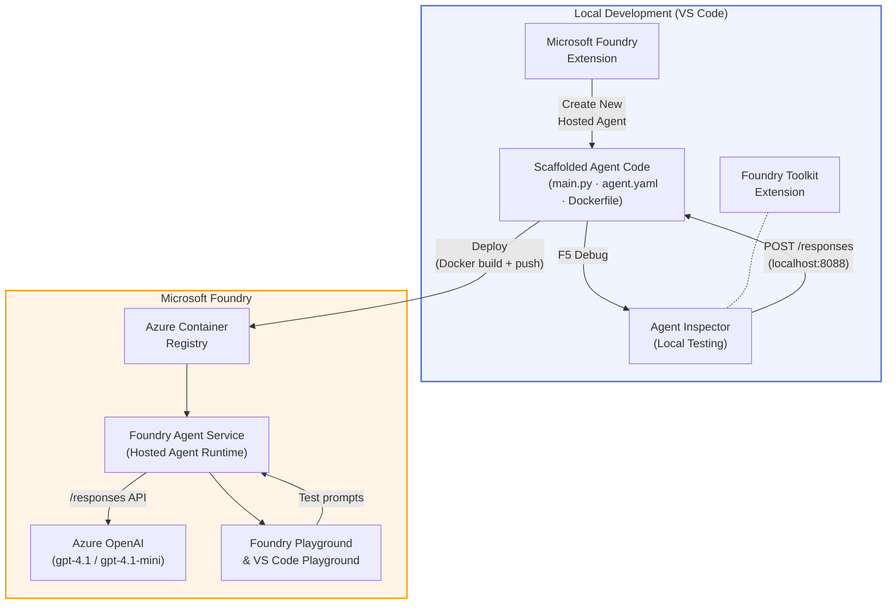

# Foundry Toolkit + Atelier Foundry Agents hébergés

[](https://www.python.org/)
[](https://github.com/microsoft/agents)
[](https://learn.microsoft.com/azure/foundry/agents/concepts/hosted-agents)
[](https://ai.azure.com/)
[](https://learn.microsoft.com/azure/ai-services/openai/)
[](https://learn.microsoft.com/cli/azure/install-azure-cli)
[](https://learn.microsoft.com/azure/developer/azure-developer-cli/install-azd)
[](https://www.docker.com/)
[](https://marketplace.visualstudio.com/items?itemName=ms-windows-ai-studio.windows-ai-studio)
[](../../LICENSE)

Construisez, testez et déployez des agents IA vers **Microsoft Foundry Agent Service** en tant qu'**Agents hébergés** - entièrement depuis VS Code en utilisant l'**extension Microsoft Foundry** et **Foundry Toolkit**.

> **Les Agents hébergés sont actuellement en aperçu.** Les régions prises en charge sont limitées - voir [disponibilité par région](https://learn.microsoft.com/azure/foundry/agents/concepts/hosted-agents#region-availability).

> Le dossier `agent/` à l'intérieur de chaque labo est **généré automatiquement** par l'extension Foundry - vous personnalisez ensuite le code, testez localement et déployez.

### 🌐 Prise en charge multilingue

#### Pris en charge via GitHub Action (Automatisé et toujours à jour)

<!-- CO-OP TRANSLATOR LANGUAGES TABLE START -->
[Arabic](../ar/README.md) | [Bengali](../bn/README.md) | [Bulgarian](../bg/README.md) | [Burmese (Myanmar)](../my/README.md) | [Chinese (Simplified)](../zh-CN/README.md) | [Chinese (Traditional, Hong Kong)](../zh-HK/README.md) | [Chinese (Traditional, Macau)](../zh-MO/README.md) | [Chinese (Traditional, Taiwan)](../zh-TW/README.md) | [Croatian](../hr/README.md) | [Czech](../cs/README.md) | [Danish](../da/README.md) | [Dutch](../nl/README.md) | [Estonian](../et/README.md) | [Finnish](../fi/README.md) | [French](./README.md) | [German](../de/README.md) | [Greek](../el/README.md) | [Hebrew](../he/README.md) | [Hindi](../hi/README.md) | [Hungarian](../hu/README.md) | [Indonesian](../id/README.md) | [Italian](../it/README.md) | [Japanese](../ja/README.md) | [Kannada](../kn/README.md) | [Khmer](../km/README.md) | [Korean](../ko/README.md) | [Lithuanian](../lt/README.md) | [Malay](../ms/README.md) | [Malayalam](../ml/README.md) | [Marathi](../mr/README.md) | [Nepali](../ne/README.md) | [Nigerian Pidgin](../pcm/README.md) | [Norwegian](../no/README.md) | [Persian (Farsi)](../fa/README.md) | [Polish](../pl/README.md) | [Portuguese (Brazil)](../pt-BR/README.md) | [Portuguese (Portugal)](../pt-PT/README.md) | [Punjabi (Gurmukhi)](../pa/README.md) | [Romanian](../ro/README.md) | [Russian](../ru/README.md) | [Serbian (Cyrillic)](../sr/README.md) | [Slovak](../sk/README.md) | [Slovenian](../sl/README.md) | [Spanish](../es/README.md) | [Swahili](../sw/README.md) | [Swedish](../sv/README.md) | [Tagalog (Filipino)](../tl/README.md) | [Tamil](../ta/README.md) | [Telugu](../te/README.md) | [Thai](../th/README.md) | [Turkish](../tr/README.md) | [Ukrainian](../uk/README.md) | [Urdu](../ur/README.md) | [Vietnamese](../vi/README.md)

> **Préférez cloner localement ?**
>
> Ce dépôt inclut plus de 50 traductions de langues, ce qui augmente considérablement la taille du téléchargement. Pour cloner sans les traductions, utilisez le sparse checkout :
>
> **Bash / macOS / Linux :**
> ```bash
> git clone --filter=blob:none --sparse https://github.com/microsoft-foundry/Foundry_Toolkit_for_VSCode_Lab.git
> cd Foundry_Toolkit_for_VSCode_Lab
> git sparse-checkout set --no-cone '/*' '!translations' '!translated_images'
> ```
>
> **CMD (Windows) :**
> ```cmd
> git clone --filter=blob:none --sparse https://github.com/microsoft-foundry/Foundry_Toolkit_for_VSCode_Lab.git
> cd Foundry_Toolkit_for_VSCode_Lab
> git sparse-checkout set --no-cone "/*" "!translations" "!translated_images"
> ```
>
> Cela vous donne tout ce dont vous avez besoin pour suivre le cours avec un téléchargement beaucoup plus rapide.
<!-- CO-OP TRANSLATOR LANGUAGES TABLE END -->

---

## Architecture



**Flux :** L'extension Foundry génère l'agent → vous personnalisez le code et les instructions → testez localement avec Agent Inspector → déployez sur Foundry (image Docker poussée vers ACR) → vérifiez dans le Playground.

---

## Ce que vous construirez

| Labo | Description | État |
|-----|-------------|--------|
| **Labo 01 - Agent unique** | Construisez l'agent **"Explain Like I'm an Executive"**, testez-le localement et déployez-le sur Foundry | ✅ Disponible |
| **Labo 02 - Flux de travail multi-agents** | Construisez le **"Resume → Job Fit Evaluator"** - 4 agents collaborent pour noter l'adéquation du CV et générer une feuille de route d'apprentissage | ✅ Disponible |

---

## Présentation de l'agent Executive

Dans cet atelier, vous construirez l'agent **"Explain Like I'm an Executive"** - un agent IA qui prend le jargon technique ardu et le traduit en résumés calmes et prêts pour la salle du conseil. Parce qu'honnêtement, personne dans la haute direction ne veut entendre parler de "thread pool exhaustion caused by synchronous calls introduced in v3.2."

J'ai créé cet agent après bien trop d'incidents où mon post-mortem parfaitement rédigé recevait la réponse : *"So... is the website down or not?"*

### Comment ça fonctionne

Vous lui fournissez une mise à jour technique. Il renvoie un résumé exécutif - trois points à puces, sans jargon, sans traces de pile, sans angoisse existentielle. Juste **ce qui s'est passé**, **l'impact sur l'activité**, et **la prochaine étape**.

### Voyez-le en action

**Vous dites :**
> "The API latency increased due to thread pool exhaustion caused by synchronous calls introduced in v3.2."

**L'agent répond :**

> **Résumé exécutif :**
> - **Ce qui s'est passé :** Après la dernière version, le système a ralenti.
> - **Impact sur l'activité :** Certains utilisateurs ont rencontré des ralentissements lors de l'utilisation du service.
> - **Prochaine étape :** Le changement a été annulé et une correction est en cours de préparation avant un nouveau déploiement.

### Pourquoi cet agent ?

C'est un agent extrêmement simple et mono-fonction - parfait pour apprendre le flux de travail des agents hébergés de bout en bout sans se perdre dans des chaînes d'outils complexes. Et honnêtement ? Chaque équipe d'ingénierie pourrait en utiliser un.

---

## Structure de l'atelier

```
📂 Foundry_Toolkit_for_VSCode_Lab/
├── 📄 README.md                      ← You are here
└── 📂 workshop/
    ├── 📂 lab01-single-agent/        ← Full lab: docs + agent code
    │   ├── README.md                 ← Hands-on lab instructions
    │   ├── 📂 docs/                  ← Step-by-step tutorial modules
    │   │   ├── 00-prerequisites.md
    │   │   ├── 01-setup.md
    │   │   ├── 02-create-hosted-agent.md
    │   │   ├── 03-configure-and-code.md
    │   │   ├── 04-test-locally.md
    │   │   ├── 05-deploy-to-foundry.md
    │   │   ├── 06-verify-in-playground.md
    │   │   ├── 07-summary.md
    │   │   └── 08-troubleshooting.md
    │   └── 📂 agent/                 ← Reference solution (auto-scaffolded by Foundry extension)
    │       ├── agent.yaml
    │       ├── Dockerfile
    │       ├── main.py
    │       └── requirements.txt
    └── 📂 lab02-multi-agent/         ← Resume → Job Fit Evaluator
        ├── README.md                 ← Hands-on lab instructions (end-to-end)
        ├── 📂 docs/                  ← Step-by-step tutorial modules
        │   ├── 00-prerequisites.md
        │   ├── 01-understand-multi-agent.md
        │   ├── 02-scaffold-multi-agent.md
        │   ├── 03-configure-agents.md
        │   ├── 04-orchestration-patterns.md
        │   ├── 05-test-locally.md
        │   ├── 06-deploy-to-foundry.md
        │   ├── 07-verify-in-playground.md
        │   └── 08-troubleshooting.md
        └── 📂 PersonalCareerCopilot/ ← Reference solution (multi-agent workflow)
            ├── agent.yaml
            ├── Dockerfile
            ├── main.py
            └── requirements.txt
```

> **Remarque :** Le dossier `agent/` à l'intérieur de chaque labo est ce que l'**extension Microsoft Foundry** génère lorsque vous exécutez `Microsoft Foundry: Create a New Hosted Agent` depuis la Palette de commandes. Les fichiers sont ensuite personnalisés avec les instructions, outils et configuration de votre agent. Le Labo 01 vous guide pour recréer cela à partir de zéro.

---

## Pour commencer

### 1. Cloner le dépôt

```bash
git clone https://github.com/microsoft-foundry/Foundry_Toolkit_for_VSCode_Lab.git
cd Foundry_Toolkit_for_VSCode_Lab
```

### 2. Mettre en place un environnement virtuel Python

```bash
python -m venv venv
```

Activez-le :

- **Windows (PowerShell) :**
  ```powershell
  .\venv\Scripts\Activate.ps1
  ```
- **macOS / Linux :**
  ```bash
  source venv/bin/activate
  ```

### 3. Installer les dépendances

```bash
pip install -r workshop/lab01-single-agent/agent/requirements.txt
```

### 4. Configurer les variables d'environnement

Copiez le fichier d'exemple `.env` dans le dossier de l'agent et remplissez vos valeurs :

```bash
cp workshop/lab01-single-agent/agent/.env.example workshop/lab01-single-agent/agent/.env
```

Modifiez `workshop/lab01-single-agent/agent/.env` :

```env
AZURE_AI_PROJECT_ENDPOINT=https://<your-account>.services.ai.azure.com/api/projects/<your-project>
AZURE_AI_MODEL_DEPLOYMENT_NAME=<your-model-deployment-name>
```

### 5. Suivez les modules de l'atelier

Chaque labo est autonome avec ses propres modules. Commencez par **Labo 01** pour apprendre les bases, puis passez à **Labo 02** pour les flux de travail multi-agents.

#### Labo 01 - Agent unique ([instructions complètes](workshop/lab01-single-agent/README.md))

| # | Module | Lien |
|---|--------|------|
| 1 | Lire les prérequis | [00-prerequisites.md](workshop/lab01-single-agent/docs/00-prerequisites.md) |
| 2 | Installer Foundry Toolkit & l'extension Foundry | [01-setup.md](workshop/lab01-single-agent/docs/01-setup.md) |
| 3 | Créer un projet Foundry | [01-setup.md](workshop/lab01-single-agent/docs/01-setup.md) |
| 4 | Créer un agent hébergé | [02-create-hosted-agent.md](workshop/lab01-single-agent/docs/02-create-hosted-agent.md) |
| 5 | Configurer les instructions et l'environnement | [03-configure-and-code.md](workshop/lab01-single-agent/docs/03-configure-and-code.md) |
| 6 | Tester localement | [04-test-locally.md](workshop/lab01-single-agent/docs/04-test-locally.md) |
| 7 | Déployer sur Foundry | [05-deploy-to-foundry.md](workshop/lab01-single-agent/docs/05-deploy-to-foundry.md) |
| 8 | Vérifier dans le playground | [06-verify-in-playground.md](workshop/lab01-single-agent/docs/06-verify-in-playground.md) |
| 9 | Dépannage | [08-troubleshooting.md](workshop/lab01-single-agent/docs/08-troubleshooting.md) |

#### Labo 02 - Flux de travail multi-agents ([instructions complètes](workshop/lab02-multi-agent/README.md))

| # | Module | Lien |
|---|--------|------|
| 1 | Prérequis (Labo 02) | [00-prerequisites.md](workshop/lab02-multi-agent/docs/00-prerequisites.md) |
| 2 | Comprendre l'architecture multi-agents | [01-understand-multi-agent.md](workshop/lab02-multi-agent/docs/01-understand-multi-agent.md) |
| 3 | Générer le projet multi-agents | [02-scaffold-multi-agent.md](workshop/lab02-multi-agent/docs/02-scaffold-multi-agent.md) |
| 4 | Configurer les agents et l'environnement | [03-configure-agents.md](workshop/lab02-multi-agent/docs/03-configure-agents.md) |
| 5 | Modèles d'orchestration | [04-orchestration-patterns.md](workshop/lab02-multi-agent/docs/04-orchestration-patterns.md) |
| 6 | Tester localement (multi-agent) | [05-test-locally.md](workshop/lab02-multi-agent/docs/05-test-locally.md) |
| 7 | Déployer sur Foundry | [06-deploy-to-foundry.md](workshop/lab02-multi-agent/docs/06-deploy-to-foundry.md) |
| 8 | Vérifier dans le playground | [07-verify-in-playground.md](workshop/lab02-multi-agent/docs/07-verify-in-playground.md) |
| 9 | Dépannage (multi-agent) | [08-troubleshooting.md](workshop/lab02-multi-agent/docs/08-troubleshooting.md) |

---

## Mainteneur

<table>
<tr>
    <td align="center"><a href="https://github.com/ShivamGoyal03">
        <br />
        <sub><b>Shivam Goyal</b></sub>
    </a><br />
    </td>
</tr>
</table>

---

## Autorisations requises (référence rapide)

| Scénario | Rôles requis |
|----------|---------------|
| Créer un nouveau projet Foundry | **Azure AI Owner** sur la ressource Foundry |
| Déployer sur un projet existant (nouvelles ressources) | **Azure AI Owner** + **Contributor** sur l'abonnement |
| Déployer sur un projet entièrement configuré | **Reader** sur le compte + **Azure AI User** sur le projet |

> **Important :** les rôles Azure `Owner` et `Contributor` n'incluent que des permissions de *gestion*, pas des permissions de *développement* (actions sur les données). Vous avez besoin de **Azure AI User** ou **Azure AI Owner** pour créer et déployer des agents.

---

## Références

- [Démarrage rapide : Déployez votre premier agent hébergé (VS Code)](https://learn.microsoft.com/azure/foundry/agents/quickstarts/quickstart-hosted-agent)
- [Que sont les agents hébergés ?](https://learn.microsoft.com/azure/foundry/agents/concepts/hosted-agents)
- [Créer des workflows d'agents hébergés dans VS Code](https://learn.microsoft.com/azure/foundry/agents/how-to/vs-code-agents-workflow-pro-code)
- [Déployer un agent hébergé](https://learn.microsoft.com/azure/foundry/agents/how-to/deploy-hosted-agent)
- [RBAC pour Microsoft Foundry](https://learn.microsoft.com/azure/foundry/concepts/rbac-foundry)
- [Exemple d'agent de revue d'architecture](https://github.com/Azure-Samples/agent-architecture-review-sample) - Agent hébergé réel avec des outils MCP, des diagrammes Excalidraw et un double déploiement

---


## Licence

[MIT](../../LICENSE)

---

<!-- CO-OP TRANSLATOR DISCLAIMER START -->
**Avertissement** :
Ce document a été traduit à l'aide du service de traduction automatique [Co-op Translator](https://github.com/Azure/co-op-translator). Bien que nous nous efforçions d'assurer l'exactitude, veuillez noter que les traductions automatisées peuvent contenir des erreurs ou des inexactitudes. Le document original dans sa langue native doit être considéré comme la source faisant autorité. Pour les informations critiques, il est recommandé de recourir à une traduction professionnelle réalisée par un humain. Nous ne saurions être tenus responsables des malentendus ou erreurs d'interprétation découlant de l'utilisation de cette traduction.
<!-- CO-OP TRANSLATOR DISCLAIMER END -->
