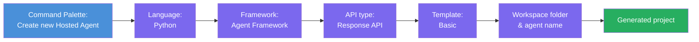
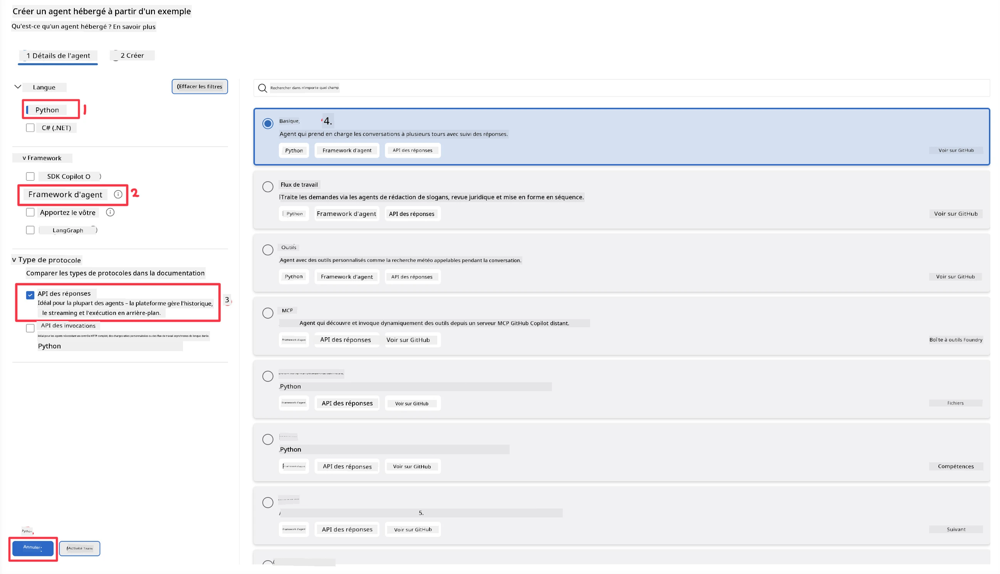
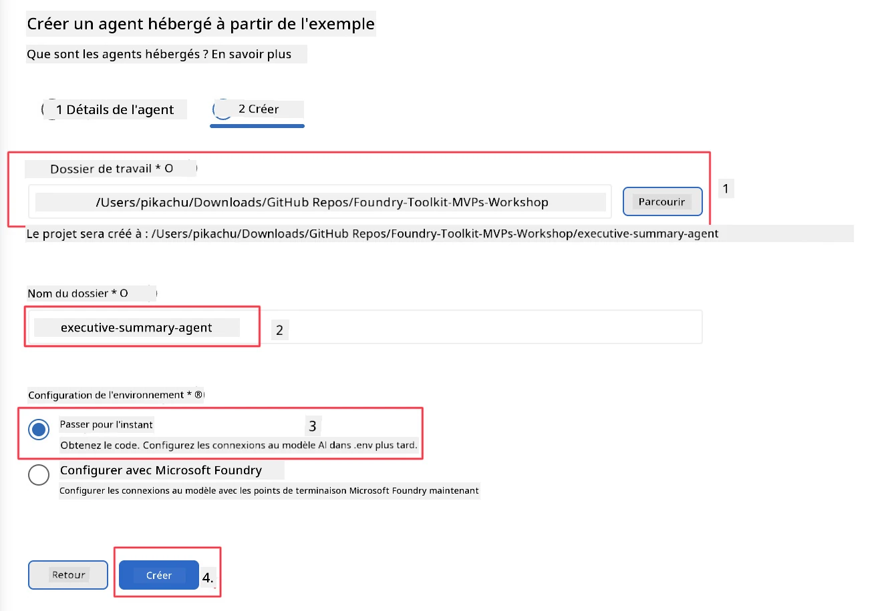

# Module 2 - Créer un nouvel agent hébergé

⏱️ ~5 min

Dans ce module, vous utilisez Foundry Toolkit pour **échafauder un projet d'agent hébergé**. L'échafaudage génère la structure complète du projet - `agent.yaml`, `main.py`, `Dockerfile`, `requirements.txt` et la configuration de débogage VS Code - afin que vous puissiez vous concentrer sur la personnalisation du comportement de l'agent.

> **Concept clé :** Le dossier `agent/` dans ce laboratoire est un exemple de ce que génère Foundry Toolkit. Vous ne devez pas écrire ces fichiers à partir de zéro.

### Flux de l'assistant d'échafaudage



---

## Étape 1 : Ouvrir l'assistant Créer un agent hébergé

1. Appuyez sur `Ctrl+Shift+P` pour ouvrir la **Palette de commandes**.
2. Tapez : **Foundry Toolkit : Créer un nouvel agent hébergé** et sélectionnez-le.

> **Alternative : Créer via le portail Foundry**
> Si vous préférez le navigateur, vous pouvez créer votre projet à [https://ai.azure.com](https://ai.azure.com). Une fois le projet provisionné, revenez à VS Code et utilisez la barre latérale **Foundry Toolkit** pour vous y connecter.

> **Alternative :** Dans la barre latérale Foundry Toolkit, survolez **Agents** sous votre projet, cliquez sur l'icône **+**, puis sélectionnez **Créer dans le code avec un modèle**.

## Étape 2 : Choisir les paramètres



1. Dans la section navigation/options à gauche, sélectionnez ce qui suit :

| Menu | Sélection | Notes |
|--------|-----------|-------|
| **Langage** | Python | C# également pris en charge |
| **Framework** | Agent Framework | Point de départ simple utilisant Agent Framework SDK |
| **Type d'API** | API de réponse | `POST /responses` - conversationnelle, avec historique géré par la plateforme |
| **Modèle** | Basique | Point de départ simple utilisant Agent Framework SDK |

2. Une fois sélectionné, cliquez sur **Suivant**



3. Dans la fenêtre suivante, sélectionnez ce qui suit :

| Menu | Sélection | Notes |
|--------|-----------|-------|
| **Dossier de l'espace de travail** | Choisissez un dossier cible | par ex., `/workspace/Foundry_Toolkit_for_VSCode_Lab/` ou un sous-dossier de ce dépôt |
| **Nom de l'agent** | Entrez un nom | par ex., `executive-summary-agent` |
| **Configuration de l'environnement** | ignorer la configuration pour l'instant |  |

Cliquez sur **créer** pour créer notre agent. Un nouveau dossier sera créé avec le nom de l'agent hébergé.

## Étape 3 : Inspecter le projet généré

Une fois l'échafaudage terminé, vérifiez que vous voyez ces fichiers dans l'Explorateur (`Ctrl+Shift+E`) :

```
📂 executive-summary-agent/
├── .env                ← Environment variables (placeholders)
├── .vscode/
│   ├── launch.json     ← Debug config (F5 → run + Agent Inspector)
│   └── tasks.json      ← VS Code task definitions
├── agent.yaml          ← Agent definition (kind: hosted)
├── Dockerfile          ← Container config for deployment
├── main.py             ← Agent entry point (your main code)
└── requirements.txt    ← Python dependencies
```

### Explication des fichiers clés

| Fichier | But |
|------|---------|
| `agent.yaml` | Déclare l’agent comme `kind: hosted`, mappe les variables d’environnement, définit le protocole `/responses` |
| `main.py` | Crée un `FoundryChatClient` → l'enveloppe dans un `Agent` avec instructions → sert via `ResponsesHostServer` sur le port 8088 |
| `Dockerfile` | Utilise `python:3.12-slim`, installe les dépendances, expose le port 8088, exécute `main.py` |
| `requirements.txt` | `agent-framework-foundry`, `agent-framework-foundry-hosting`, `mcp`, `debugpy` |

> **Important :** Ouvrez directement le dossier agent échafaudé dans VS Code (le dossier `agent/` lui-même) afin que `.vscode/launch.json` et `tasks.json` fonctionnent correctement pour le débogage F5.

---

### ✅ Point de contrôle

- [ ] Projet échafaudé créé avec tous les fichiers attendus
- [ ] `agent.yaml` montre `kind: hosted` et `protocol: responses`
- [ ] `main.py` importe `Agent`, `FoundryChatClient`, `ResponsesHostServer`
- [ ] Le dossier de l’agent est ouvert dans VS Code comme racine de l’espace de travail

---

**Précédent :** [01 - Configuration](01-setup.md) · **Suivant :** [03 - Configurer & coder →](03-configure-and-code.md)

---

<!-- CO-OP TRANSLATOR DISCLAIMER START -->
**Avertissement** :
Ce document a été traduit à l'aide du service de traduction automatique [Co-op Translator](https://github.com/Azure/co-op-translator). Bien que nous nous efforçions d'assurer l'exactitude, veuillez noter que les traductions automatisées peuvent contenir des erreurs ou des inexactitudes. Le document original dans sa langue native doit être considéré comme la source faisant autorité. Pour les informations critiques, il est recommandé de recourir à une traduction professionnelle réalisée par un humain. Nous ne saurions être tenus responsables des malentendus ou erreurs d'interprétation découlant de l'utilisation de cette traduction.
<!-- CO-OP TRANSLATOR DISCLAIMER END -->